# DITAEditor

[](LICENSE)
[](CHANGELOG.md)
[](package.json)

A lightweight **web-based DITA 1.3 structured authoring workbench** for technical documentation teams. It combines **ProseMirror structured WYSIWYG editing**, **CodeMirror 6 XML source editing**, a **visual Map / Bookmap workbench**, a **single-sourcing semantic engine (Keys / Conref / DITAVAL)**, **local Git versioning with check-out locks and visual diffs**, and **authoritative DITA-OT 4.x validation with asynchronous HTML5 / Chinese PDF publishing** — while keeping standard DITA XML as the single source of truth, with 100% lossless round-trips and minimal Git diffs.

> For the full architecture, technology rationale, and phased implementation baseline, see [docs/architecture-and-plan.md](docs/architecture-and-plan.md) and [AGENTS.md](AGENTS.md).

> Current release **v1.3.0** (Phase 0–11: the workbench, marketing site & browser offline workbench, bilingual zh-CN/en UI, DITA 1.3 ordered content-model validation, multi-manual Workbench Hub & topic assignments, and the macOS/Windows lightweight desktop app). Changelog in [CHANGELOG.md](CHANGELOG.md), license in [LICENSE](LICENSE) (MIT).

- **Website & Bilingual Docs (GitHub Pages)**: https://ericfeng84.github.io/DITAEditor/ (English: `/en/`)
- **Online Workbench (Browser Offline Demo)**: https://ericfeng84.github.io/DITAEditor/workbench/ (runs the in-memory `demo-dita-project` with the 3-pane workbench, Map tree, dual-mode editing, and Keys/Conref/DITAVAL)

**English** · [简体中文](README.md)

---

## Website and GitHub Pages online demo (Phase 7)

A separate static site, `apps/site` (`@dita/site`, Astro 5 + React 19 islands + Tailwind CSS 4), fully decoupled from the single-container workbench image and hostable on any CDN:

| Route | Contents |
| :--- | :--- |
| `/` · `/en/` | Bilingual home page: hero, real workbench tab showcase, CCMS / Markdown comparison, "one changed word, one changed XML line" live round-trip widget, six capability deep-dives, single-container architecture, Docker / pnpm / AI quick starts |
| `/workbench/` | **Browser-only offline 3-pane workbench**: `@dita/web` built with `VITE_STATIC_DEMO=true` and bundled alongside the site, running the multi-file demo project, Map tree, visual/source dual-mode editor, and Keys/Conref/DITAVAL (no server-side Git, DITA-OT publishing, or AI proxy) |
| `/docs/*` · `/en/docs/*` | Six mirrored docs (introduction, Docker quick start, local development and fonts, feature tour, AI setup, architecture) with in-page TOC, copy buttons and bilingual Pagefind search (`Cmd/Ctrl+K`) |

The home-page "one changed word, one changed XML line" widget loads with `client:visible`, so ProseMirror never enters the first paint.

```bash
pnpm --filter @dita/site dev      # http://localhost:4321
pnpm --filter @dita/site build    # static output + Pagefind index
pnpm --filter @dita/site test     # dictionary/doc-slug symmetry and preset round-trips
```

Deployment: `.github/workflows/deploy-site.yml` builds `@dita/site` and the offline `@dita/web` bundle (published under `/workbench/`) to GitHub Pages on every push to `main` (see [docs/deploy-github-pages.md](docs/deploy-github-pages.md)); `SITE_URL` / `SITE_BASE` repo variables cover the root path or a sub-path such as `/DITAEditor/`.

---

## Screenshots

All screenshots below show the English UI (`EN` in the header); the same views are available in Chinese and can be switched at runtime without reloading.

### Three-pane workbench with the Phase 4 version panel

The left pane switches between "Project files", "Map tree", "Keys", and "Version". The Version panel shows the active branch, current identity, check-out locks, working-tree changes, and commit history. The middle is a multi-tab visual editing area; the top status bar shows whether the current file is checked out, editable, or ready to check in. The right pane is an attribute inspector that preserves the original XML attribute order.

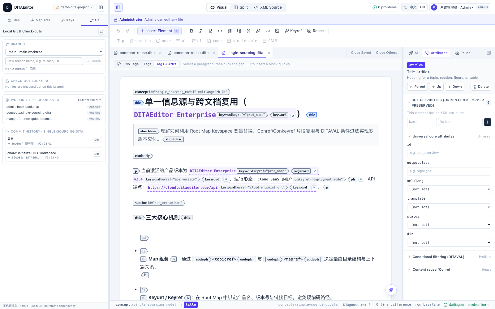

### Visual and XML source side-by-side mode

Switch live between "Visual", "Split", and "XML source". The visual pane offers a floating format toolbar on text selection, Notion-style block handles, and a `+` inserter between blocks. The source pane adds DITA 1.3 tag/attribute completion and well-formedness checking.

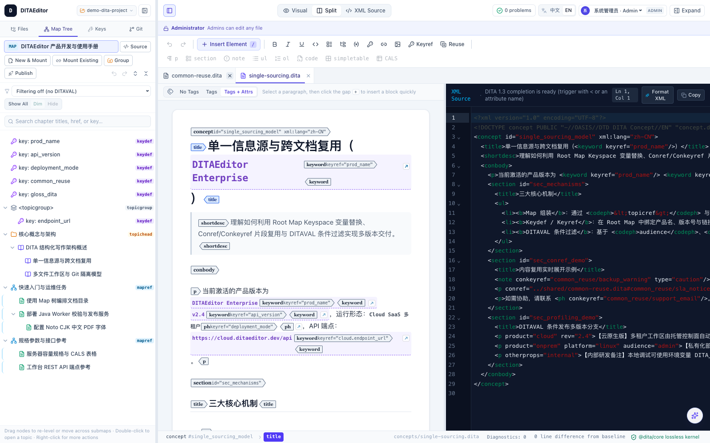

### Local Git versioning, check-out locks, and visual diffs

Files are read-only by default. Clicking "Check out" acquires an exclusive write lock scoped to `(project, branch, file)`. After saving, preview the working-tree diff, write a commit message, and check in to the local Git repository; the lock is released automatically after the commit. The Version panel shows per-file commit history and any two revisions, rendered as line-level differences with CodeMirror 6 MergeView. Each branch uses an isolated `git worktree`, so the same file can be checked out independently on different branches.

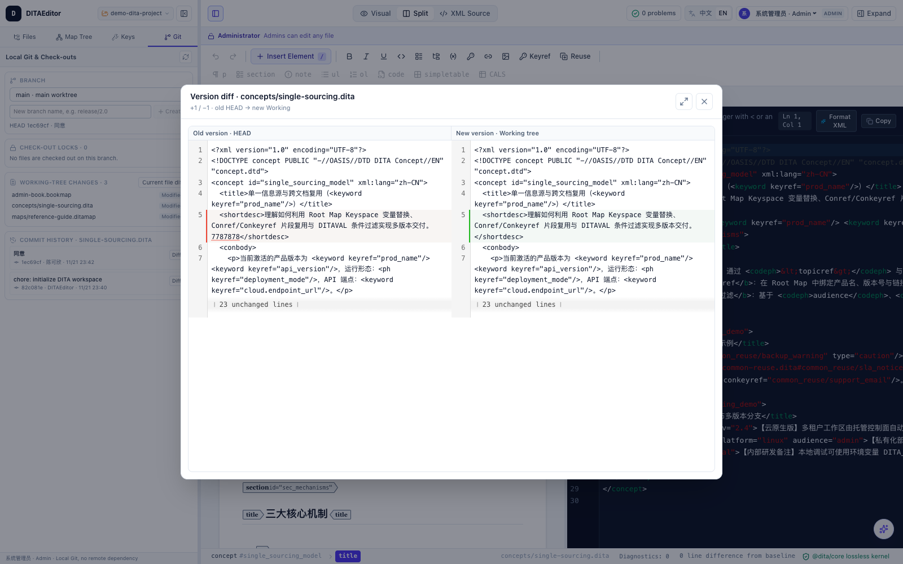

### Single-sourcing semantic engine (Keyref / Conref / DITAVAL)

Without touching the underlying XML, the visual editor renders read-only inline previews of block and inline `conref`/`conkeyref` (including nested `keyref` resolution and one-click jump to the source definition), while the Map tree applies `.ditaval` rules live ("show all / dim excluded / hide excluded", with flag highlighting).

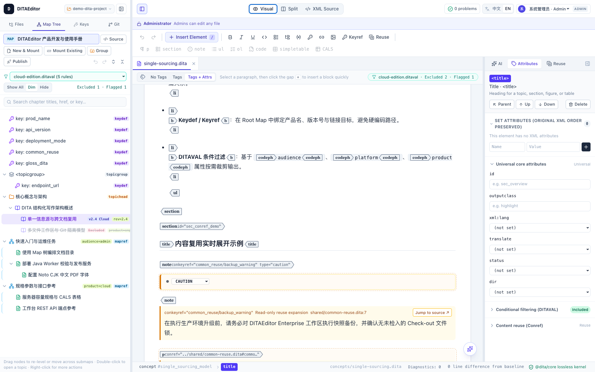

### Phase 5: DITA-OT strict validation and asynchronous HTML5 / Chinese PDF publishing

The publish dialog combines root-map, HTML5/PDF, DITAVAL, and title selection with live DITA-OT runtime status, the exact build command, `build.log`, publish history, and artifact downloads. HTML5 output can be previewed in place; PDF output embeds Noto CJK fonts. The strict-validation dialog shows the real DITA-OT exit code, duration, input files, and `DOTJ` / `DOTX` diagnostics, with one-click jumps back to the source line.

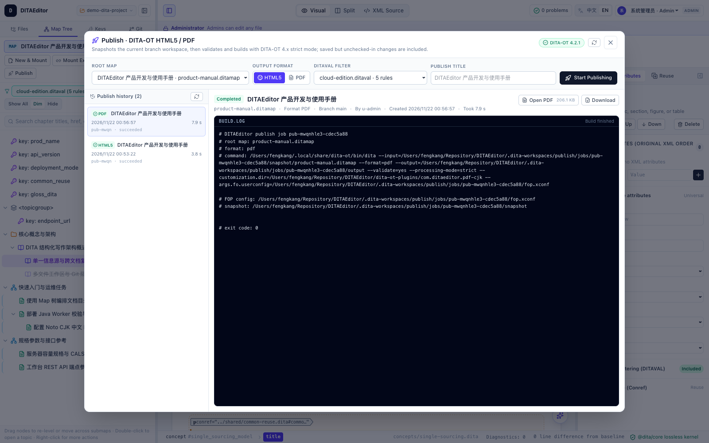

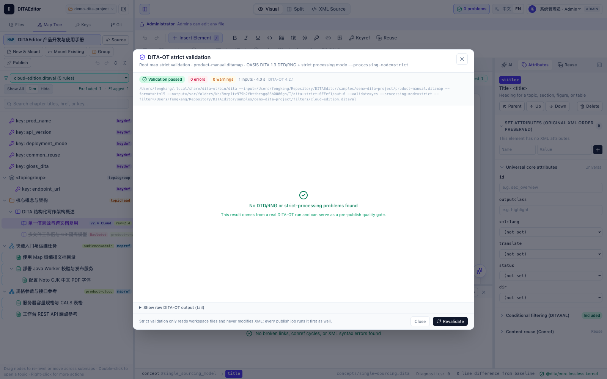

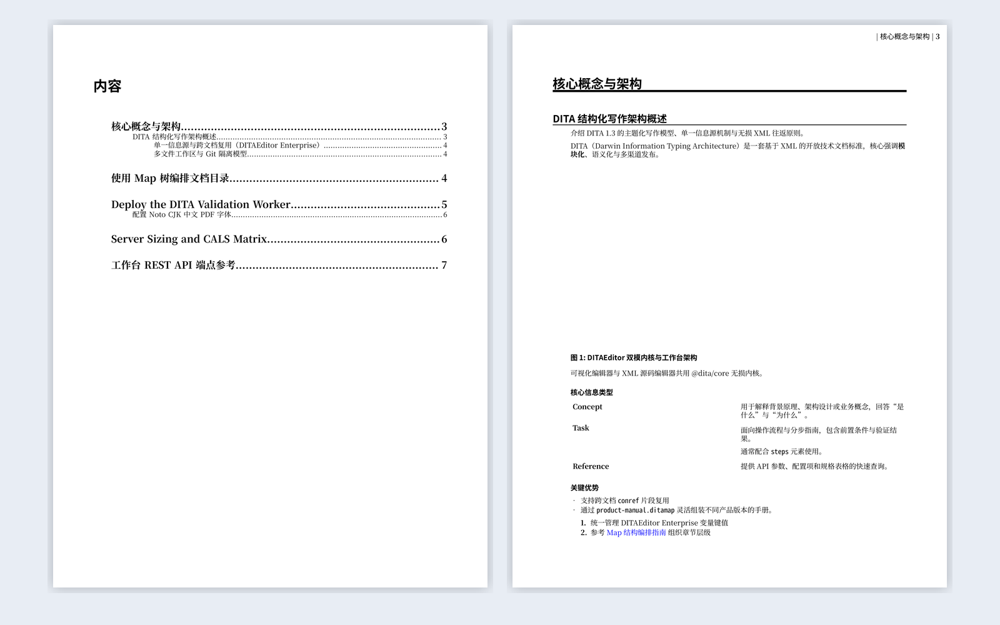

The PDF page is document content, so it stays in the topic's own `xml:lang` — only the workbench UI follows the language switch.

### Phase 6: AI-assisted authoring, semantic tag optimization, and error repair

The first inspector tab is "AI", and a floating entry point sits at the bottom-right of the document area. The default target scope is the **whole topic**, so one sentence can draft or rewrite a complete topic; switch to "Fragment" to touch only the selected element. The panel always shows the active model, keyspace / path-index / DITAVAL context badges, and streams the proposal as it is generated.

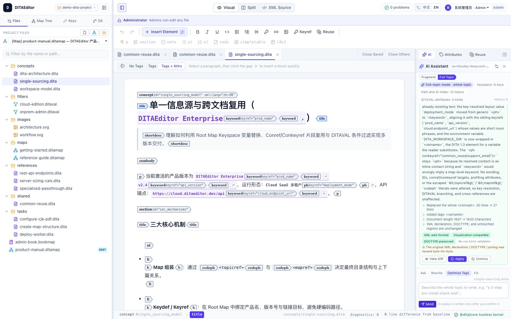

Every patch must pass a CodeMirror 6 `MergeView` review before it is written: the dialog shows the target mode plus well-formedness, visual compatibility, DOCTYPE preservation, and re-validatable-strictness verdicts, then renders only the changed lines and collapsed unchanged ranges.

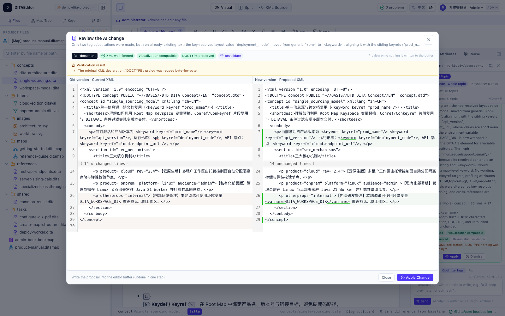

### Three-pane workbench and the Keys panel

The left pane switches between "Project files", "Map tree", "Keys", and "Version". The Map tree mirrors the root-map structure, and its action strip carries mount / group controls plus the publish entry point. The Keys panel groups keys by `keyscope` and shows values, target paths, and source line numbers with one-click `keyref` insertion.

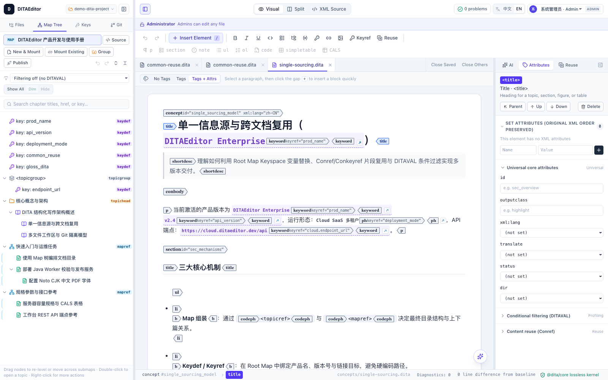

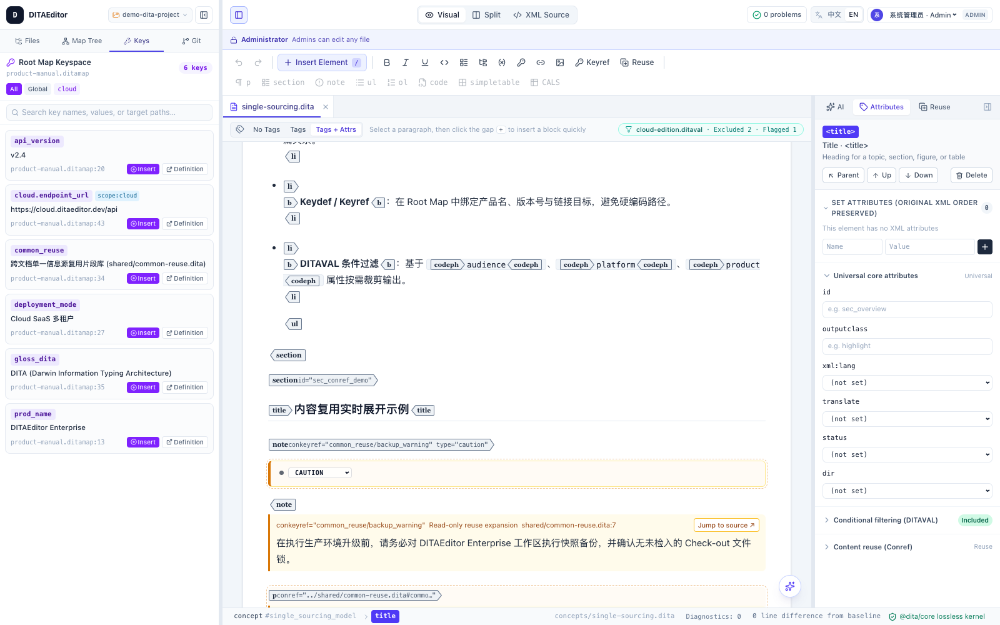

---

## Core features (Phase 0–8 implemented)

### 1. 100% lossless XML round-trip kernel (`@dita/core`)

- An isomorphic DITA XML kernel built on `slimdom` + `slimdom-sax-parser` + `fontoxpath`, recording each node's source start/end line and column while parsing.
- **Zero metadata loss**: XML declaration (`<?xml ...?>`), `<!DOCTYPE ...>`, comments (`<!-- ... -->`), processing instructions (`<?...?>`), CDATA, namespaces (`xml:*`, `xmlns:*`, `ditaarch:*`), and the original attribute order (`rawAttrs`) all survive `XML → slimdom → ProseMirror Doc → slimdom → XML`.
- **Deterministic serialization**: idempotent and minimal-diff — editing a text node does not reformat anything else. Verified against 10 complex DITA 1.3 golden round-trip fixtures (`packages/dita-core/test/fixtures/`).

### 2. Dual-mode topic editor (visual / split / XML source)

- **Fine-grained DITA 1.3 modeling with lossless passthrough**
  - Native ProseMirror Schema models `concept` / `task` / `reference` / `topic` structures (`title`, `shortdesc`, `prolog`, `section`, `steps/step/cmd`, `note`, `codeblock`, `dl`, `fig/image`, …).
  - Inline elements (`<b>`, `<i>`, `<u>`, `<codeph>`, `<keyword>`, `<ph>`, `<xref>`, …) are modeled as **ProseMirror inline nodes**, not marks, so empty elements, nesting order, and attributes are never merged or dropped.
  - Both `<simpletable>` and OASIS CALS `<table>` are supported (explicit `<colspec>` retention, `namest`/`nameend`/`morerows` ↔ `colspan`/`rowspan`, multi-`tgroup` protection).
  - Unknown or specialized tags pass through as `unknown_block` / `unknown_pre_block` / `unknown_inline` / `unknown_inline_block`, preserving `xml:space="preserve"` semantics.
- **Efficient structured authoring**
  - Three tag rendering modes: no tags, tags, tags with attributes.
  - Context-aware `/` insert menu (only shows elements legal at the caret), floating bubble toolbar on selection, Notion-style block handles, and a `+` inserter between blocks.
  - The right inspector covers generic core attributes, DITAVAL profiling attributes, conref attributes, and custom attributes while keeping the original XML attribute order; the breadcrumb selects ancestors quickly.
- **CodeMirror 6 XML source with switch protection**
  - DITA 1.3 tag/attribute and `keyref` / `conkeyref` / profiling-value completion driven by the `@dita/core` rule tables and the active Root Map semantics, plus live well-formedness lint and source formatting.
  - **Source → Visual guard**: `checkXmlWellFormed()` must pass before switching back; malformed XML blocks the switch and reports precise `{ line, column }` in the source editor.

### 3. Visual Map / Bookmap tree and multi-file workbench

- **Three-pane resizable workbench** (`react-resizable-panels`): the left pane switches between project files, the Map tree (`react-arborist`), and Keys; the file panel holds the **Root Map selector**; the Map tree panel holds the **DITAVAL configuration selector and three-state projection switch**, plus quick new topic / new map / new folder actions.
- **Lossless Map / Bookmap DOM engine**: drag to reorder and re-nest `topicref` / `mapref` / `topichead` / `chapter` / `keydef`, create-and-mount topics from templates, mount existing files, edit node attributes, and open the map source — while keeping `<reltable>`, `<topicmeta>`, comments, and PIs in place.
- **Multi-tab editing and a diagnostics panel**: multiple document tabs, dirty tracking, save-one/save-all, revert to baseline, and a project-level problems panel (XML well-formedness, broken `href`, recursive `<mapref>`, missing images, undefined `keyref`, invalid or cyclic `conref`, `.ditaval` syntax errors).

### 4. Single-sourcing semantic engine (Keys / Conref / DITAVAL)

- **Root Map BFS keyspace (`keydef` / `keyref` / `keyscope`)**
  - Breadth-first traversal with **First Definition Wins** conflict resolution per the DITA 1.3 spec, `keyscope` isolation, and no false reports when the same submap appears in several scopes.
  - The **Keys panel** lists every effective key definition for the current Root Map (with override counts), inserts `<keyword keyref="..."/>`, or jumps to the defining line. The visual editor resolves inline `keyref` text and image references live with one-click traceability, and the toolbar offers a key picker.
- **Cross-document content reuse (`conref` / `conkeyref` / `conrefend`) with DFS cycle detection**
  - Direct `conref`, indirect `conkeyref`, same-document `#./id`, `conrefend` ranges, nested `keyref` expansion, and DITA 1.3 specialization compatibility checks.
  - A DFS `visitStack` catches self-cycles, two-way and multi-hop cycles, and nested child-element cycles (while allowing legal diamond DAGs), showing the full cycle chain in the editor and the problems panel.
  - Reused fragments render as read-only inline cards (pure DOM construction — the underlying ProseMirror `Doc` and XML are never rewritten). The toolbar and the inspector's **Reuse** tab let you browse target elements, preview the expanded result live, and insert a new reused element or bind the reuse attribute to the current element.
- **DITAVAL filtering with live three-state projection**
  - Full `.ditaval` parsing (`<prop>`, `<revprop>`, `<startflag>` / `<endflag>`, `<style-conflict>`), following DITA 1.3 evaluation rules for multi-value exclusion within an attribute, cross-attribute AND semantics, and `props="group(val)"`.
  - One-click switching between `.ditaval` files and **show all / dim excluded / hide excluded**, synced live to the Map tree (dragging is locked in hide mode to avoid index drift) and the visual editor (flag colors and start/end badges) with zero XML modification.
  - The attribute inspector and Map node inspector embed a visual **profiling attribute editor** (`ProfilingAttrEditor`) backed by the project-wide value vocabulary, with live effect preview.

### 5. Local workspace, incremental semantic index, and asset backend (`@dita/api`)

- Fastify 5 + Zod provide local workspace scanning, file CRUD, directory switching, bulk project import, and a per-branch cached incremental semantic indexer (`WorkspaceSemanticIndexer`) that refreshes the keyspace, topic-id index, and diagnostics after every save, rename, or delete.
- Ships with a multi-variant demo project at `samples/demo-dita-project/` (`product-manual.ditamap`, `admin-book.bookmap`, the shared reuse library `shared/common-reuse.dita`, `filters/cloud-edition.ditaval` and `onprem-admin.ditaval`, nested submaps, concept/task/reference documents, and SVG diagrams) — with the same experience in offline in-memory mode.
- **Path safety**: `resolveSafeWorkspacePath` rejects traversal (`..`), absolute paths, NUL bytes, and symlink escapes.
- **Image asset pipeline**: multipart upload (`.png` / `.jpg` / `.jpeg` / `.gif` / `.svg` / `.webp` / `.avif`, 10 MB limit), automatic document-relative POSIX `href` computation, and a preview route.

### 6. Local Git version control and check-out exclusive locks (Phase 4)

- **Zero external dependencies**: initialize a local Git repository with `simple-git` directly in the project folder — no GitHub / GitLab / Gitee required. Branches are isolated with `git worktree`, and switching branches repoints the workspace root without copying the project.
- **Lightweight identities and roles**: SQLite + Drizzle ORM persist password-less author identities (Admin / Writer / Viewer) switchable from the toolbar. Write endpoints enforce roles and lock ownership server-side; viewers and files checked out by another author are automatically read-only in both visual and source editors.
- **Check-out exclusive locks**: files open read-only by default. Checking out grants editing rights on the same `(project, branch, file_path)` scope while other files and branches stay unblocked. Only the lock owner's dirty files can be committed, and check-in releases their locks; cancel-checkout rolls back to `HEAD`, release keeps the draft, and admin force-unlock stores the current content and patch in `lock_backups`.
- **Visual diff and history**: the left **Version** panel shows branches, locks, working-tree changes, and commit history. CodeMirror 6 `MergeView` compares working-tree changes or any two revisions, and check-in previews the diff with a local commit message before committing.

### 7. Authoritative DITA-OT 4.x validation and asynchronous publishing (Phase 5)

- **Two-layer strict validation**: day-to-day typing stays guarded by zero-latency frontend constraints and the TS semantic index. The toolbar, problems panel, and check-in dialog can call `POST /api/validate/strict`, which runs DITA-OT with `--validate=yes --processing-mode=strict`, parses `DOTJ` / `DOTX` codes, and jumps to the exact source line/column. Passing a Root Map validates the whole map in context so `keyref` / `conkeyref` / `conref` resolve; isolated topic validation downgrades context-free `DOTJ046E` to a warning.
- **Zero-middleware publish pipeline**: SQLite `publish_jobs` persists tasks and an in-process `PublishQueue` limits concurrency (default 1). Each publish copies a branch working-tree snapshot for an isolated build, supports timeout kills, cancellation while queued or running, `build.log` plus SSE streaming (`GET /api/publish/jobs/:id/events`), restart recovery, and retention-based artifact pruning.
- **HTML5 and Chinese PDF delivery**: successful HTML5 builds are zipped and served under `/preview/*` with working relative assets. PDF uses the pure-XML `dita-ot-plugins/com.ditaeditor.pdf-cjk/` plugin (`plugin.xml` + XML Catalog + DITA-OT 4 `font-mappings.xml` + `fop.xconf`) to map Noto Sans / Serif / Mono CJK; publishing adds `--customization.dir` and `--args.fo.userconfig` and always enables `--validate=yes` so CJK fonts are embedded and text never turns into tofu.
- **Single-container delivery**: the `Dockerfile` bundles Node 22, JRE 21, DITA-OT 4.2.1, Noto CJK fonts, and the font plugin. In production `@dita/api` serves the built `@dita/web` assets directly with zero Redis / PostgreSQL dependencies; the `/data` volume keeps workspaces, SQLite, branch worktrees, and publish artifacts.

### 8. AI-assisted writing, semantic tag optimization, and error repair (Phase 6)

- **Fragment-level lossless AI edits**: `@dita/core` gains an `ai/` kernel (`extractTargetFragment` / `spliceAndVerifyAiXml` / `normalizeCandidateXml` / `buildDitaConstraintSummary`) with **element**, **line-window**, and **full-document** targeting. The model only returns the replaced span; the server splices it back at exact source offsets and re-validates XML well-formedness, ProseMirror convertibility, and preservation of the `DOCTYPE` and XML declaration, retrying with the reported error (default 2 attempts) before anything reaches the editor.
- **Four task types**: `ask` (explain only), `authoring` (rewrite/expand/condense, `shortdesc` and step completion), `optimize_tags` (`uicontrol` / `menucascade` / `wintitle` / `filepath` / `codeph` / `parmname`, block structures), and `fix_error` (well-formedness, map links, asset paths, keyref, conref cycles, DITAVAL, and DITA-OT strict-validation failures).
- **Entry points across the workbench**: the **AI** tab is the first tab of the right inspector, and a floating AI button sits at the bottom-right of the document area; both open the assistant (which defaults to **whole-topic** targeting so one instruction can author a complete topic, with a one-click switch to **fragment** scope; target and context badges, streaming output, diff confirmation), AI rewrite/ask actions in the inline bubble toolbar, **AI fix** on the source XML error banner, and per-diagnostic repair in the problems panel and strict-validation dialog. Every request carries the current unsaved editor buffer.
- **Model access and audit**: `@dita/api` wraps an OpenAI-compatible `ChatOpenAI` from LangChain.js (`@langchain/core` + `@langchain/openai`), defaults to DeepSeek, and accepts a private/proxied `baseURL`, model, key, timeout, and retry count. SQLite `ai_settings` stores admin configuration (keys are returned masked only) and `ai_usage_logs` records author, task, file, status, retries, tokens, and duration, with `GET /api/ai/usage` aggregating by day, task, user, and model. Writes still honor check-out locks: admins and file owners apply directly, an unchecked-out writer is checked out first, and viewers or files locked by someone else stay preview-only.

### 9. Fully bilingual zh-CN / English UI (Phase 8)

- **Zero-dependency, strongly typed i18n**: `@dita/core` exposes `UiLocale` (`zh-CN` / `en`), `normalizeLocale`, and `formatMessage`; `@dita/web` keeps a single source of truth in `src/i18n/messages/zh-CN.ts` (which derives `MessageKey`) while `en.ts` is typed as `Record<MessageKey, string>`, so a missing or misspelled key fails `pnpm --filter @dita/web typecheck` instead of rendering `undefined`.
- **Lossless hot switch**: the header `中文 / EN` toggle only updates the Zustand locale store and `html[lang]`; the page never reloads and ProseMirror / CodeMirror instances are never recreated, so unsaved buffers, tabs, selection, and the `Cmd/Ctrl+Z` stack survive. ProseMirror decorations refresh through a single `DITA_DECORATIONS_KEY` locale-meta transaction, and `:root[lang="en"]` overrides in `index.css` swap the five DITA section pseudo-labels.
- **Bilingual DITA vocabulary**: `dita-rules.ts` now carries English labels, descriptions, and placeholders for 110+ elements and attributes (`getElementLabel(spec, locale)` and friends), used by the insert menu, attributes inspector, CodeMirror completion, and tag bubbles. `createTopicTemplate` / `createMapTemplate` accept `lang: 'en'` to scaffold OASIS 1.3 topics with `xml:lang="en"`.
- **The server answers in the same language**: `@dita/api` resolves `x-dita-locale` → `Accept-Language` → `zh-CN`, `HttpError` carries `{ key, params }` and routes render it per request, so lock conflicts, Git, validation, publish logs, DITA-OT failures, semantic diagnostics, and identity role wording all follow the request locale. AI prompts, context badges, SSE status, and explanations follow the UI language while the **XML body keeps the document's own `xml:lang`**. Every web API client sends `x-dita-locale` automatically.
- **Regression gates**: `apps/web/test/i18n-parity.test.ts` (key sets, `{param}` placeholders, no empty values), `apps/web/test/no-hardcoded-cjk.test.ts` (no hardcoded Chinese in `apps/web/src` after comment stripping, allow-listing only the catalogues and authored demo content), and `apps/api/test/phase8-i18n.test.ts` (roles, lock conflicts, validation messages, and the AI not-configured guard all English under `x-dita-locale: en`).

---

## Architecture and technology stack

A pure TypeScript full-stack monorepo organized with **pnpm workspaces + Turborepo**. XML parsing, lossless serialization, DITA 1.3 element rules, the CALS table model, and Map DOM operations live in the shared `@dita/core` package, reused by both `@dita/web` and `@dita/api`. Authoritative DITA 1.3 DTD/RNG validation and HTML5/PDF publishing are driven directly from `@dita/api` through the DITA-OT 4.x CLI (zero custom Java service code).

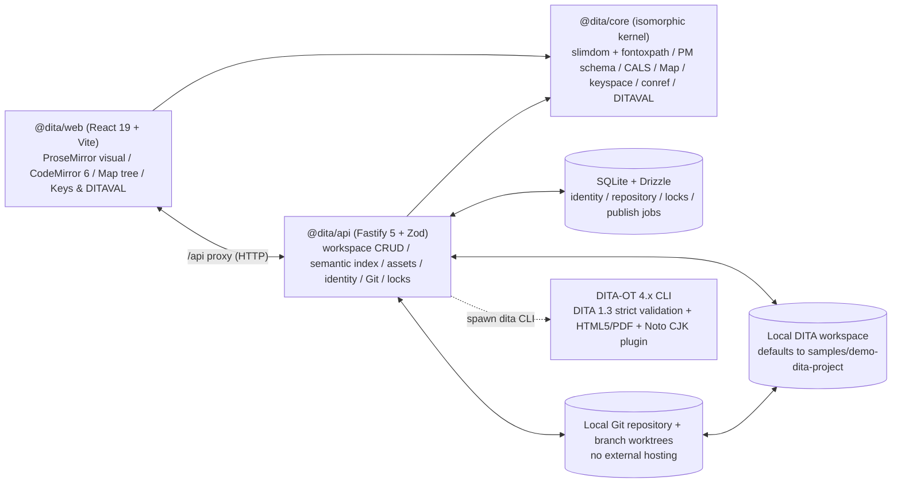

| Layer / module | Choice | Notes |
| :--- | :--- | :--- |
| **Monorepo** | pnpm 11 + Turborepo | One pipeline for building, type-checking, and testing `@dita/core`, `@dita/web`, `@dita/api` |
| **Frontend workbench** | React 19 + TypeScript 5.8 + Vite 6 + Tailwind CSS 4 | Responsive three-pane workbench with a high-precision editing surface |
| **Visual editing** | Native ProseMirror | Follows DITA DTD structure constraints; custom NodeViews and block/inline interactions |
| **XML source editing** | CodeMirror 6 | XML highlighting, DITA 1.3 completion, live well-formedness lint |
| **Map tree & state** | `react-arborist` + `react-resizable-panels` + Zustand | Virtualized tree, drag re-nesting, pane layout, multi-tab state |
| **Lossless XML kernel** | `slimdom` + `slimdom-sax-parser` + `fontoxpath` | Lossless DOM, source position tracking, XPath 3.1 queries |
| **Backend API** | Fastify 5 + `@fastify/multipart` + Zod | Local disk workspace management, asset upload/preview, project diagnostics |
| **Persistence & collaboration** | SQLite + Drizzle ORM + `better-sqlite3` | Password-less identities, check-out locks, admin unlock patch backups — no external database |
| **Version control** | `simple-git` + `git worktree` | Local repository init, branch-isolated worktrees, commit history, working-tree and revision diffs |
| **Validation & publishing** | DITA-OT 4.2.x CLI + JRE 21 | Authoritative DITA 1.3 DTD/RNG validation, HTML5 / PDF2 publishing, pure-XML Noto CJK plugin |
| **Desktop app** | Electron 35 + `electron-builder` + `esbuild` | Lightweight macOS Apple Silicon (`arm64`) & Windows (`x64`) desktop app embedding `@dita/api` with `userData` isolation |
| **Testing** | Vitest 3 | Golden round-trip fixtures, editor commands, workspace/Git/lock APIs, and desktop path/Windows runtime tests |

---

## Repository layout

```text
DITAEditor/
├── packages/
│   └── dita-core/              # @dita/core — shared DITA 1.3 and lossless XML kernel
│       ├── src/
│       │   ├── xml/            # slimdom parsing, position tracking, deterministic serialization, XPath, DOM diff
│       │   ├── model/          # DITA 1.3 element metadata, content models, attribute rules
│       │   ├── cals/           # OASIS CALS table <-> colspan/rowspan adapter
│       │   ├── map/            # Map/Bookmap DOM engine and POSIX path utilities
│       │   ├── ditaval/        # .ditaval parsing, multi-value/group evaluation, flag merging
│       │   ├── semantics/      # BFS keyspace, conref/conkeyref resolution, DFS cycles, incremental index
│       │   ├── templates/      # Topic (concept/task/reference/topic) and Map/Bookmap templates
│       │   ├── ai/             # AI target-fragment locator, candidate normalizer, lossless splice+verify
│       │   └── prosemirror/    # ProseMirror schema and lossless slimdom <-> PM Doc conversion
│       └── test/fixtures/      # 10 complex DITA 1.3 golden round-trip fixtures
├── apps/
│   ├── web/                    # @dita/web — React 19 + Vite authoring workbench
│   │   └── src/
│   │       ├── components/     # header, tab bar, file explorer, Keys panel, reuse panel, profiling editor, problems panel
│   │       ├── editor/         # visual/ (ProseMirror + semantic decorations + conref rendering), source/ (CodeMirror 6)
│   │       ├── map-tree/       # react-arborist map tree, DITAVAL projection, node inspector, context menu, overview
│   │       ├── components/publish/ # publish dialog, live build log, strict-validation results
│   │       ├── ai/             # AI panel/settings/usage/diff dialogs, SSE client, target builder, session store
│   │       ├── services/       # API client, offline demo fallback, persistence bridge
│   │       └── store/          # Zustand workbench, multi-tab, and semantic context state
│   ├── api/                    # @dita/api — Fastify 5 workspace, semantic index, and asset service
│       └── src/modules/
│           ├── files/          # safe path validation, workspace scan, file CRUD, multipart upload, diagnostics
│           ├── indexer/        # WorkspaceSemanticIndexer and /api/semantics/* routes
│           ├── validate/       # /api/validate/strict DITA-OT strict validation
│           ├── publish/        # SQLite publish jobs, snapshot builds, SSE logs, artifact downloads
│           ├── ai/             # AI settings/usage, prompt builder, LangChain model factory, SSE orchestration
│           └── dita-ot/        # dita CLI runtime detection, child-process runner, DOTJ/DOTX log parser
│   ├── site/                   # @dita/site — Astro 5 bilingual site, offline workbench, and docs
│   │   └── src/
│   │       ├── pages/          # bilingual home, /docs/*, 404, robots and sitemap
│   │       ├── content/docs/   # six mirrored zh/en docs (Content Collections)
│   │       ├── components/     # home sections, mini-demo island, search modal
│   │       ├── lib/            # line diff, site config, and path helpers
│   │       └── styles/         # Tailwind 4 CSS-first tokens and component styles
│   └── desktop/                # @dita/desktop — Electron lightweight desktop app (macOS arm64 & Windows x64)
│       ├── src/                # main.ts (embedded Fastify), preload.ts, paths.ts (userData isolation & demo seeding)
│       ├── scripts/            # build.mjs (esbuild) and stage.mjs (flat staging for native better-sqlite3 rebuild)
│       ├── build/              # macOS .icns / Windows .ico icons and entitlements.mac.plist
│       └── electron-builder.yml# macOS Apple Silicon (.dmg/.zip) and Windows x64 (NSIS .exe/.zip) packaging config
├── .github/workflows/          # deploy-site.yml / deploy-hf-space.yml / release-desktop.yml (dual-platform desktop release)
├── samples/
│   └── demo-dita-project/      # ready-to-run multi-variant DITA 1.3 demo (maps/bookmaps/reuse library/DITAVAL/SVG)
├── docs/
│   ├── architecture-and-plan.md # full architecture baseline and Phase 0–7 roadmap
│   ├── phase7-site-plan.md     # Phase 7 site / sandbox / docs blueprint
│   ├── phase6-ai-contract.md   # Phase 6 AI API/SSE/DB/frontend integration contract
│   └── pic/                    # workbench screenshots
├── dita-ot-plugins/            # Pure-XML DITA-OT 4.x Noto CJK PDF font-mappings plugin
├── Dockerfile                  # single-container build (Node + JRE 21 + DITA-OT + Noto CJK)
└── graphify-out/               # persistent codebase knowledge graph
```

---

## Getting started

### Requirements

| Dependency | Version | Purpose |
| :--- | :--- | :--- |
| Node.js | **22+** | Runs `@dita/web`, `@dita/api`, and build scripts |
| pnpm | **11.5+** | Monorepo dependency management and workspace scripts |
| Java | **21** | DITA-OT 4.x runtime (strict validation / publishing only) |
| DITA-OT | **4.2.x** | Official DITA 1.3 DTD/RNG validation and HTML5 / PDF builds |
| Noto CJK | Sans / Serif / Mono | Chinese PDF font embedding (bundled in the Docker image) |
| Docker | 24+ (optional) | Single-container deployment with every runtime included |

### Option 1: Single-container Docker (recommended, zero setup)

The image bundles Node 22, JRE 21, DITA-OT 4.2.1, Noto CJK fonts, and the font plugin; no host Java or DITA-OT installation is required. In production the API serves the built frontend directly:

```bash
docker build -t dita-editor .
docker run --rm -p 3001:3001 -v dita-editor-data:/data dita-editor
# Open http://localhost:3001
```

The `/data` volume contains the seeded demo workspace, the SQLite database, branch worktrees, and publish history; back up this volume to migrate all project data. Mount a host project with `-v /path/to/project:/data/workspace` if preferred.

### Option 2: Local source with host DITA-OT

```bash
# 1. Install dependencies
pnpm install

# 2. Build the shared kernel once (consumed by @dita/api and @dita/web)
pnpm --filter @dita/core build

# 3. Install DITA-OT 4.2.1 (macOS / Linux, into an auto-detected directory)
curl -L -o /tmp/dita-ot.zip \
  https://github.com/dita-ot/dita-ot/releases/download/4.2.1/dita-ot-4.2.1.zip
unzip -q /tmp/dita-ot.zip -d "$HOME/.local/share"
mv "$HOME/.local/share/dita-ot-4.2.1" "$HOME/.local/share/dita-ot"
"$HOME/.local/share/dita-ot/bin/dita" --version

# 4. Optional: Noto CJK fonts (or set DITAEDITOR_NOTO_CJK_DIR)
#    Place them in ~/.local/share/fonts/noto or ~/Library/Fonts/Noto for auto-discovery.

# 5. Start the API and the web dev server in parallel
pnpm dev
```

Then open:

- **Workbench**: `http://localhost:5173` (Vite proxies `/api` to `http://localhost:3001`)
- **API**: `http://localhost:3001` (health check: `GET /health`)

You can also start them in two terminals:

```bash
pnpm --filter @dita/api dev
pnpm --filter @dita/web dev
```

#### Host DITA-OT setup

Without Docker, install DITA-OT 4.x and make sure `dita` is on `PATH` (or set `DITA_OT_HOME`; the runtime also probes `~/dita-ot`, `~/.local/share/dita-ot`, `/opt/dita-ot`, and `/usr/local/dita-ot`). Chinese PDF also needs Noto CJK fonts: set `DITAEDITOR_NOTO_CJK_DIR`, or place them in `~/.local/share/fonts/noto` / `~/Library/Fonts/Noto` for automatic discovery. After `pnpm --filter @dita/api dev`, the publish dialog reports runtime detection. You do not need to install the plugin into DITA-OT: `@dita/api` always loads the repository plugin through `--customization.dir` to avoid DITA-OT 4 catalog ordering overrides. To reuse it with other DITA-OT commands: `cd dita-ot-plugins && zip -qr /tmp/plugin.zip com.ditaeditor.pdf-cjk && dita install /tmp/plugin.zip`.

### Option 3: Desktop app (macOS Apple Silicon & Windows x64, lightweight)

No Docker or Node.js required — download the installer for your platform from GitHub **Releases**:

- **macOS (Apple Silicon `arm64`)**: `DITAEditor-<version>-mac-arm64.dmg` / `.zip`
- **Windows (`x64`)**: `DITAEditor-<version>-win-x64.exe` (NSIS installer) / `.zip` (portable)

The desktop app embeds `@dita/api` inside the Electron main process (listening only on `127.0.0.1` with an ephemeral port), bundles the built web workbench, the Noto CJK PDF plugin, and the sample project, and keeps all writable state (`dita-editor.sqlite`, workspaces, branch worktrees, and publish output) under the OS `userData` directory (overridable via `DITA_DESKTOP_DATA_DIR`). This lightweight build auto-detects host Git and DITA-OT 4.x installations; authoring, Map editing, Keys/Conref/DITAVAL, and AI assistance work even without DITA-OT installed.

> For unsigned open-source builds without signing certificates: on macOS, if Gatekeeper blocks the first launch, run `xattr -cr /Applications/DITAEditor.app`; on Windows SmartScreen, choose **More info → Run anyway**.

Run or package the desktop app locally:

```bash
# 1. Build the core, web, and api packages
pnpm --filter @dita/core --filter @dita/web --filter @dita/api build

# 2. Launch the Electron app locally
pnpm --filter @dita/desktop dev

# 3. Build installers for the current OS (output in apps/desktop/release/)
CSC_IDENTITY_AUTO_DISCOVERY=false pnpm --filter @dita/desktop run dist:mac   # macOS Apple Silicon
CSC_IDENTITY_AUTO_DISCOVERY=false pnpm --filter @dita/desktop run dist:win   # Windows x64
```

**Automated releases**: publishing a GitHub Release triggers [`.github/workflows/release-desktop.yml`](.github/workflows/release-desktop.yml), which builds macOS `arm64` (on `macos-latest`) and Windows `x64` (on `windows-latest`) in parallel, syncs the installer version from the release tag, and attaches all artifacts directly to the GitHub Release (also runnable manually via `workflow_dispatch`).

### Option 4: Editing and semantic authoring only (no DITA-OT)

For editing, Map authoring, Keys / Conref / DITAVAL, Git, and check-out locks, Java and DITA-OT are optional. Publishing and "DITA-OT strict validation" report that the runtime is not ready without affecting any other feature.

### Backend environment variables (`@dita/api`)

| Variable | Default | Description |
| :--- | :--- | :--- |
| `PORT` | `3001` | Fastify listen port |
| `DITA_WORKSPACE_DIR` | `samples/demo-dita-project` | Local DITA project opened at startup |
| `DITA_IMPORTS_DIR` | `.dita-workspaces` | Root for UI-imported projects, the SQLite database (`dita-editor.sqlite`), and branch `git worktree`s |
| `DITA_LOCK_TTL_HOURS` | `72` | Lock age shown as stale in the UI (hours; locks are never auto-deleted) |
| `DITA_OT_HOME` / `DITA_HOME` | empty | DITA-OT 4.x installation; falls back to common install directories, then `dita` from `PATH` |
| `DITA_CMD` | empty | Explicit `dita` executable path (takes precedence over `DITA_OT_HOME`) |
| `DITA_PUBLISH_DIR` | `.dita-workspaces/publish` | Root for publish snapshots, `build.log`, and artifacts |
| `DITA_PUBLISH_CONCURRENCY` | `1` | In-process build concurrency; keep 1–2 for large queues |
| `DITAEDITOR_PDF_PLUGIN_DIR` | repo `dita-ot-plugins/com.ditaeditor.pdf-cjk` | Chinese PDF font plugin directory, also used as `--customization.dir` |
| `DITAEDITOR_FOP_XCONF` | plugin `fop.xconf` | FOP font configuration template |
| `DITAEDITOR_NOTO_CJK_DIR` | `/usr/share/fonts/opentype/noto` | Noto CJK font directory used to generate the per-job `fop.xconf` |
| `DITA_WEB_DIST` | `apps/web/dist` | Production web assets; served by the API when `index.html` exists |
| `DEEPSEEK_BASE_URL` | `https://api.deepseek.com/v1` | OpenAI-compatible AI endpoint; point at an internal proxy's `/v1` (overridable from **AI settings**) |
| `DEEPSEEK_MODEL` | `deepseek-flash` | Default model name; any model exposed by the proxy works |
| `DEEPSEEK_API_KEY` | empty | Environment fallback for the AI key; a key saved by an admin in SQLite wins |
| `AI_TIMEOUT_MS` | `45000` | Per-call model timeout (ms) |
| `AI_MAX_CONTEXT_CHARS` | `24000` | Character budget for project context (keyspace, path index, DITAVAL values) |

---

## Workspace, semantics, and asset REST API

| Method and path | Description |
| :--- | :--- |
| `GET /health` | Service status, `@dita/core` version, current workspace path |
| `GET /api/workspace` | Scans the workspace: file tree, maps, `.ditaval` files, topic title index, statistics |
| `POST /api/workspace/open` | Switches the local workspace directory (or resets to the demo project with `{ useDefault: true }`) |
| `POST /api/workspace/import` | Bulk-imports project files (UTF-8 text and Base64 binary images) |
| `GET /api/files/tree` | Workspace file tree, map summaries, topic title map |
| `GET /api/files/content?path=...` | Reads a file plus its well-formedness result |
| `PUT /api/files/content` | Saves content to disk and triggers an incremental semantic re-index |
| `POST /api/files/create` | Creates a topic / map / bookmap / DITAVAL file from a template |
| `POST /api/files/mkdir` | Creates a subdirectory inside the workspace |
| `POST /api/files/rename` | Renames or moves a file or directory |
| `DELETE /api/files?path=...` | Deletes a file or directory |
| `POST /api/assets/upload` | Uploads an image asset and returns a document-relative DITA `href` |
| `GET /api/assets/raw?path=...` | Serves a binary image asset by workspace path |
| `GET /api/assets/resolve?from=...&href=...` | Resolves an image asset relative to a source document |
| `GET /api/ai/config` | Reads public AI config (masked key, `db`/`env` source, model, timeout) |
| `PUT /api/ai/config` | Admin saves AI config (endpoint, model, key, temperature, retries, timeout) |
| `POST /api/ai/config/test` | Sends one real request with the current or overridden config and reports connectivity/latency |
| `POST /api/ai/stream` | Streaming AI task over SSE: `meta` / `delta` / `retry` / `proposal` / `error` / `done` |
| `GET /api/ai/usage?days=...&limit=...` | Admin usage ledger (totals plus by day/task/user/model and recent calls) |
| `GET /api/semantics/context?rootMap=...&ditaval=...` | Keyspace, topic-id index, profiling vocabulary, and parsed `.ditaval` for the given Root Map |
| `GET /api/semantics/keyspace?rootMap=...` | Builds and returns the effective BFS keyspace for a Root Map |
| `GET /api/semantics/ids?filePath=...` | Index of reusable `@id` elements in the workspace or one topic |
| `GET /api/semantics/ditaval?path=...` | Parses a `.ditaval` file into filtering and flag rules |
| `POST /api/semantics/resolve-document` | Computes the live `keyref` / `conref` overlay and diagnostics for one document (including unsaved drafts) |
| `POST /api/semantics/resolve-conref` | Expands a single `conref` / `conkeyref` preview on demand (with DFS cycle detection) |
| `GET /api/diagnostics?rootMap=...` | Well-formedness, broken `href`, recursive `<mapref>`, missing images, undefined `keyref`, conref cycles, `.ditaval` errors |
| `GET /api/identity` | Switchable authors, current identity, and the three role descriptions |
| `GET /api/locks` | Locks on the current branch, author directory, and Git workspace info |
| `POST /api/locks/checkout` | Check out and exclusively lock one file (409 for another author) |
| `POST /api/locks/release` / `cancel` | Release the lock keeping the draft / cancel and roll back to `HEAD` |
| `POST /api/locks/checkin` | Commit the author's dirty checked-out files, then release their locks |
| `POST /api/locks/force-unlock` | Admin force-unlock, archiving content and patch in `lock_backups` |
| `GET /api/git/status` | Repository init state, current branch, `git status` changes, and locks |
| `POST /api/git/init` | Initialize the local repository, `.gitignore`, and first commit (Admin/Writer) |
| `GET /api/git/branches` / `POST /api/git/branches` | Branch list with worktree paths / create a branch |
| `POST /api/git/switch-branch` | Switch to the primary workspace or a branch worktree and return the new snapshot |
| `GET /api/git/log` / `diff` / `file` | Commit history, diff between two revisions, file content at a revision |
| `POST /api/git/commit` / `discard` | Local commit (validates lock ownership) / discard one file's changes |
| `GET /api/validate/runtime` | DITA-OT version, Chinese PDF plugin, and Noto CJK font readiness |
| `POST /api/validate/strict` | Runs DITA-OT `--validate=yes --processing-mode=strict` for files or a Root Map and returns normalized DOTJ/DOTX diagnostics |
| `GET /api/publish/runtime` | Publish runtime state and publish root |
| `GET` / `POST /api/publish/jobs` | Branch publish history / create an HTML5 or PDF job (viewers get 403) |
| `GET /api/publish/jobs/:id` | Job status, diagnostics, artifact, and log/preview/download URLs |
| `POST /api/publish/jobs/:id/cancel` | Cancel a queued or running job (owner or admin) |
| `GET /api/publish/jobs/:id/log?offset=` | Incremental `build.log` reads |
| `GET /api/publish/jobs/:id/events` | SSE stream of build status and logs |
| `GET /api/publish/jobs/:id/preview/*` | HTML5 output preview (directories default to `index.html`) |
| `GET /api/publish/jobs/:id/artifact?inline=1` | Download the PDF or HTML5 ZIP; `inline=1` embeds it |

---

## Develop, build, and test

```bash
# Build, type-check, and test everything
pnpm -r build
pnpm -r typecheck
pnpm -r test

# Or use the Turborepo shortcuts at the repo root
pnpm build
pnpm typecheck
pnpm test
```

Current coverage (**411/411 Vitest tests passing**):

- `@dita/core` (158): 10 golden DITA 1.3 round-trip fixtures, unknown/specialized passthrough, OASIS CALS grid math, XML parsing/XPath 3.1, element rules and templates, Phase 9 ordered/cardinality content-model rules, lossless Map/Bookmap operations, DITAVAL evaluation (multi-value/group/flag/conflict styling), BFS keyspace with `keyscope`, `conref`/`conkeyref`/`conrefend` expansion, DFS cycle detection, and AI fragment targeting/normalization/lossless splice verification.
- `@dita/web` (174): ProseMirror ↔ XML bridge, table commands, inline bubble toolbar, block handles and transforms, sequence-guided insertion and structure decorations, CodeMirror DITA completion (including `keyref` / `conkeyref` / profiling-value semantics), map tree utilities and DITAVAL projection, visual semantic-decoration round-trip assertions, conref reuse value composition, Phase 4 identity/lock read-only projection, Phase 8 bilingual catalogue key/placeholder parity and hardcoded-CJK scan, and Phase 10 workbench hub router & unsaved-changes guards.
- `@dita/api` (45): zero-error validation of the demo project, a scale scan over 55 topics + 4 nested submaps with safe-path/upload/broken-link checks, `/api/semantics/*` Root Map switching and incremental cycle diagnostics, Phase 4 identities/Git/locks/branch isolation/admin force-unlock backups, Phase 5 runtime detection (including Windows `dita.bat` spawn wrapping via `resolveDitaSpawn`), DOTJ/DOTX log normalization, strict validation and HTML5/PDF publish pipeline, Phase 6 AI config/masking/usage/SSE regressions, Phase 8 `x-dita-locale` responses, and Phase 10 per-manual isolation & topic assignment workflows.
- `@dita/site` (30): bilingual dictionary key parity, doc-slug symmetry, `SITE_BASE` / offline workbench route helpers, and `@dita/core` preset round-trip tests.
- `@dita/desktop` (4): packaged vs dev resource/`userData` path resolution, idempotent first-launch demo workspace seeding (stripping `.git`, preserving user edits), and release-tag semver normalization.

---

## Roadmap

- [x] **Phase 0**: Monorepo foundation, `@dita/core` (`slimdom` + `slimdom-sax-parser` + `fontoxpath` + ProseMirror Schema + CALS adapter), and 10 golden round-trip fixtures.
- [x] **Phase 1**: Dual-mode topic editor MVP (ProseMirror visual editing + NodeViews + CALS/simpletable editing + `/` context insert menu + attribute panel + breadcrumb + CodeMirror 6 XML source with completion/lint and switch protection).
- [x] **Phase 2**: Visual Map / Bookmap tree (`react-arborist`), lossless Map DOM engine, three-pane multi-tab workbench, Fastify workspace/asset APIs, and the `samples/demo-dita-project/` demo project.
- [x] **Phase 3**: Root Map cross-file semantic engine (`keydef/keyref` BFS + `keyscope`, `conref/conkeyref`/`conrefend` with DFS cycle detection, DITAVAL three-state filtering and flags, incremental `/api/semantics/*` indexer, Keys panel, reuse/semantic insert UI, profiling attribute editor, CodeMirror 6 semantic completion).
- [x] **Phase 4**: SQLite + Drizzle identities and three roles, local `simple-git` repository with branch-isolated `git worktree`s, check-out exclusive locks / check-in / cancel / admin force-unlock backups, CodeMirror 6 MergeView working-tree and revision diffs, and the left **Version** panel.
- [x] **Phase 5**: DITA-OT 4.x CLI runner in `@dita/api` (zero custom Java code; built-in DITA 1.3 DTD/RNG strict validation + pure-XML Noto CJK PDF font-mappings plugin), zero-Redis SQLite + in-process concurrency-limited async publish queue with SSE log streaming, and single-container `Dockerfile` deployment.
- [x] **Phase 6**: LangChain.js AI assistance (DeepSeek / OpenAI-compatible endpoints), lossless fragment splice with automatic verification retries in `@dita/core`, streaming authoring / tag optimization / error repair, mandatory diff confirmation with check-out lock guards, SQLite config and token-usage auditing, AI settings/usage panels, and the real-endpoint acceptance script `apps/api/scripts/e2e-ai-live.mts`.
- [x] **Phase 7**: Standalone static marketing site `@dita/site` (Astro 5 + React 19 + Tailwind CSS 4, bilingual landing page + 6 mirrored doc pages + Pagefind search + an interactive browser-only DITA sandbox), with the offline three-pane workbench hosted on GitHub Pages at `/workbench/`.
- [x] **Phase 8**: Fully bilingual zh-CN/en stack — bilingual element vocabulary and semantic/AI diagnostics in `@dita/core`, a strongly typed i18n layer with lossless hot switching in `@dita/web`, request-locale resolution and bilingual messages in `@dita/api`, plus three i18n regression gates (see `docs/phase8-i18n-plan.md`).
- [x] **Phase 9**: DITA 1.3 ordered/cardinality content-model validation — pure sequence rules in `@dita/core`, guided slot insertion via `getInsertionSlot()`, and unified structure diagnostics across ProseMirror, CodeMirror, and the Problems panel.
- [x] **Phase 10**: Multi-manual Workbench Hub and lightweight topic editing task (`Assignment`) delegation with per-manual/per-branch request isolation and soft check-out/check-in/rename hooks (see `docs/phase10-workbench-assignments-plan.md`).
- [x] **Phase 11**: Lightweight desktop app `@dita/desktop` (Electron 35 + `electron-builder`, embedded `@dita/api` with `userData` isolation, Windows `dita.bat` runtime fixes) and automated GitHub Release builds for macOS Apple Silicon (`arm64` `.dmg`/`.zip`) and Windows (`x64` NSIS `.exe`/`.zip`).

---

## License

Released under the [MIT License](LICENSE). Free for commercial and non-commercial use as long as the copyright and license notice are retained.

Copyright © 2026 DITAEditor contributors
