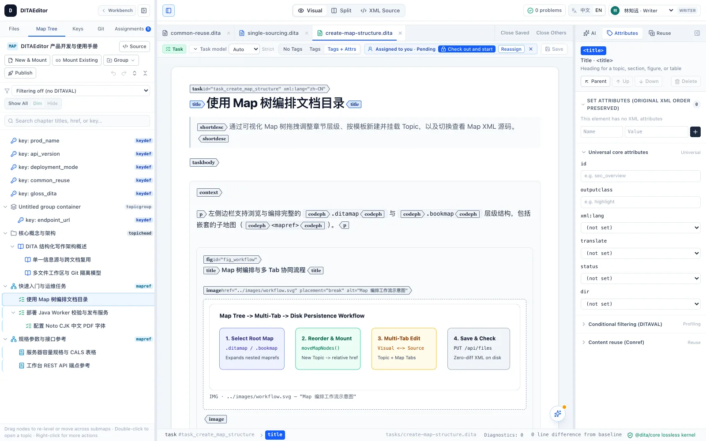
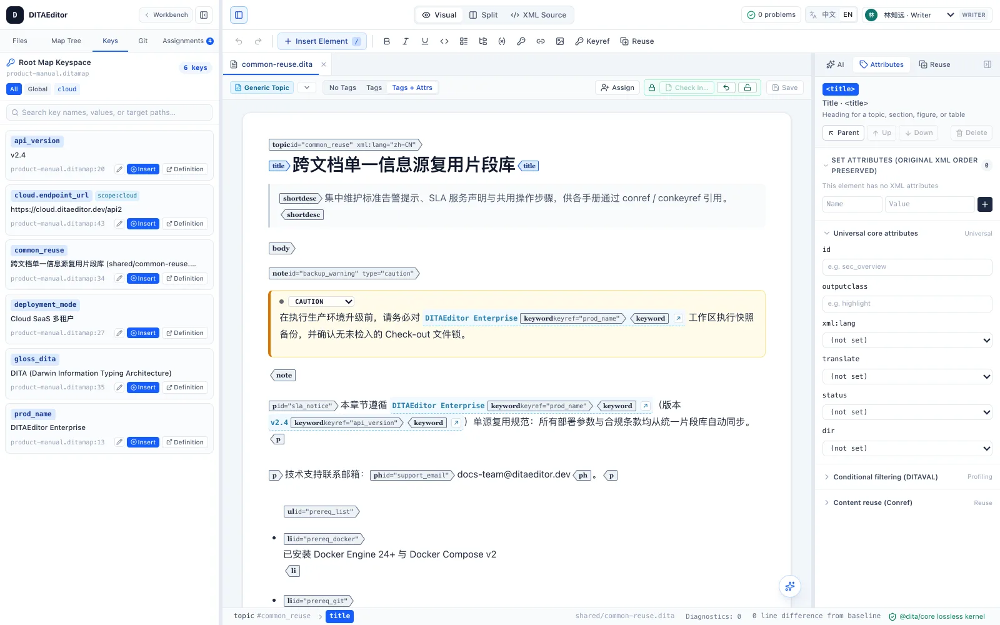
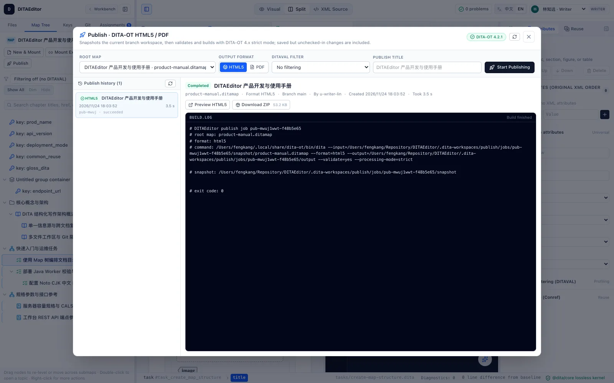
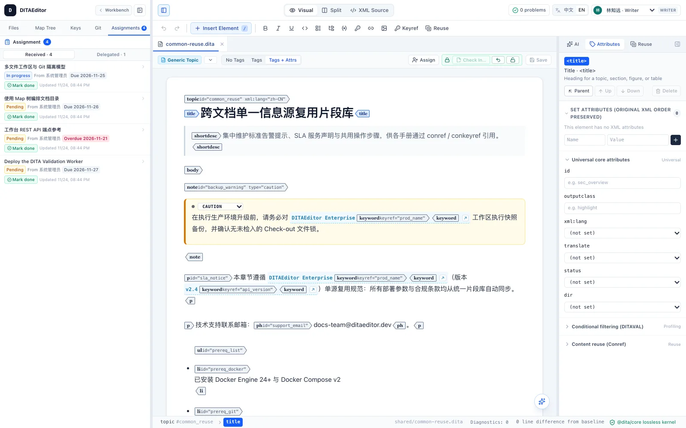
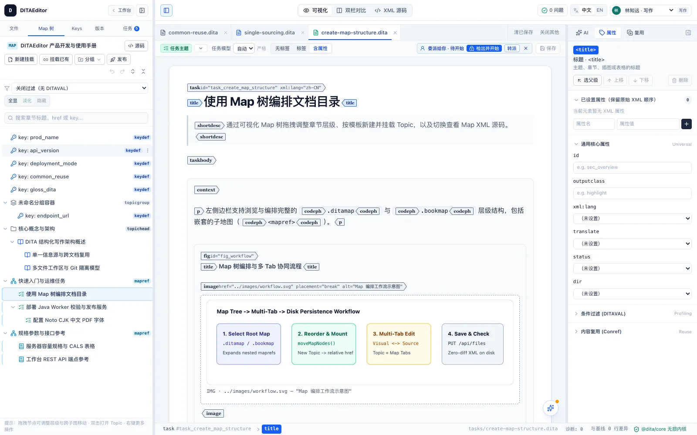
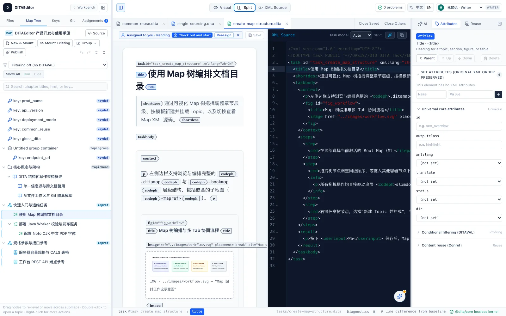
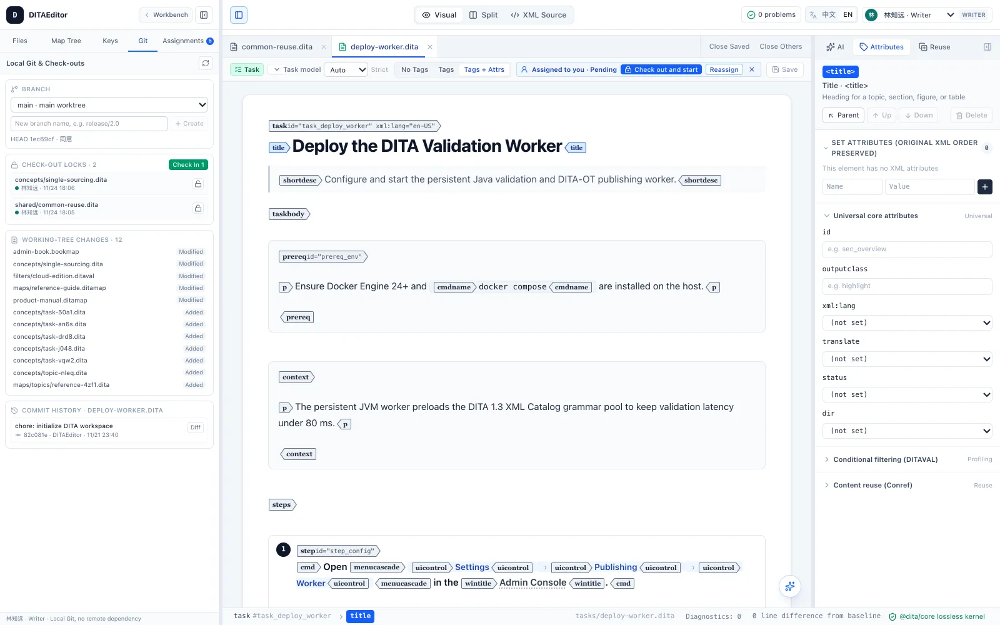
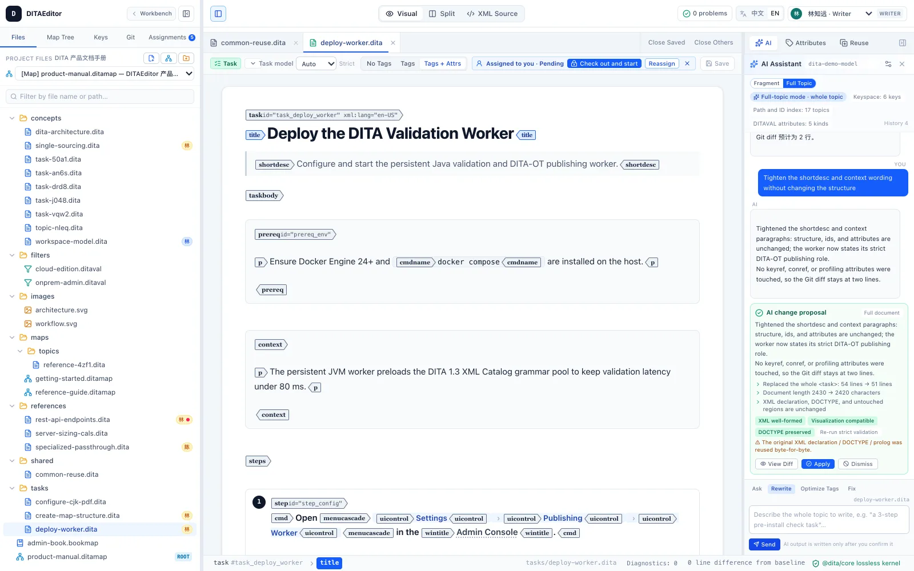
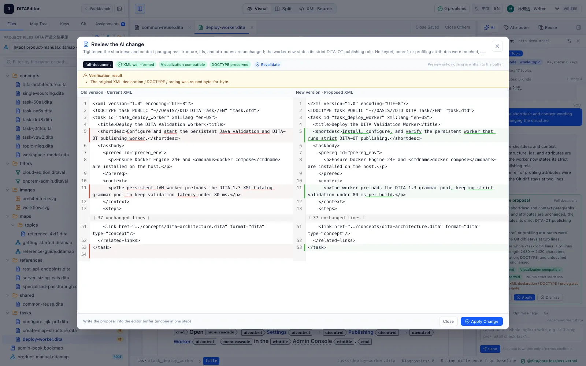
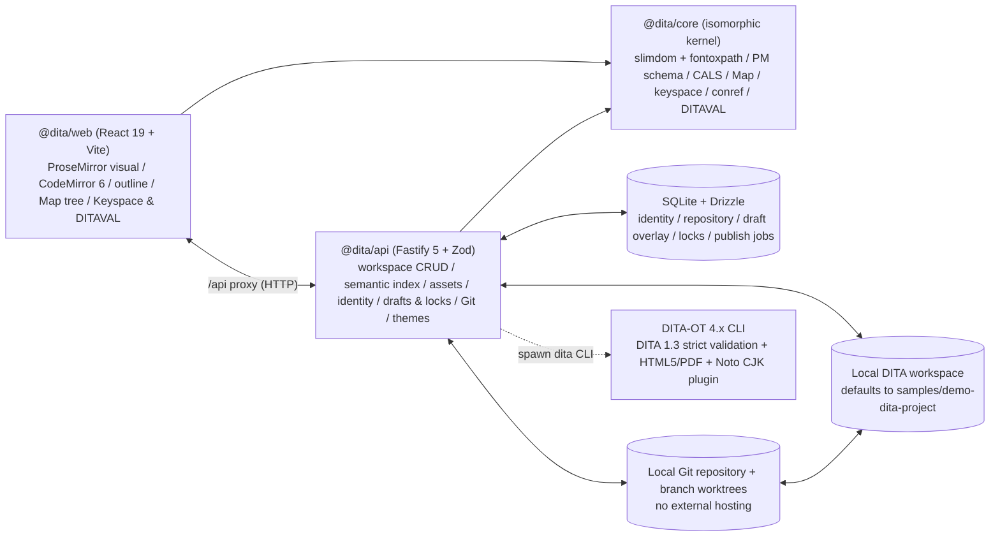

# DITAEditor

[](LICENSE)
[](CHANGELOG.md)
[](package.json)
[](https://github.com/Ericfeng84/DITAEditor/releases/latest/download/DITAEditor-1.5.0-mac-arm64.dmg)
[](https://github.com/Ericfeng84/DITAEditor/releases/latest/download/DITAEditor-1.5.0-win-x64.exe)

**English** · [简体中文](README.md)

A **web-based DITA 1.3 structured authoring workbench** for technical documentation teams: ProseMirror visual editing paired with CodeMirror 6 XML source, a collapsible **document outline** with drag-and-drop reordering constrained by DITA 1.3 content models, a visual Map / Bookmap workbench, a single-sourcing semantic engine (keyspace key management / Conref / DITAVAL), local Git with a **clean baseline plus per-user draft overlay**, check-out locks and visual diffs, authoritative DITA-OT 4.x validation with themed HTML5 / Chinese PDF publishing, fragment-scoped AI assistance, and manual-level topic assignment — all keeping standard DITA XML as the single source of truth with 100% lossless round-trips and minimal Git diffs.

> **v1.5.0** (Phase 0–13) · [Changelog](CHANGELOG.md) · [MIT license](LICENSE) · [Architecture baseline and roadmap](docs/architecture-and-plan.md) · [Engineering conventions](AGENTS.md)

| Try it online | URL | Notes |
| :--- | :--- | :--- |
| Website and bilingual docs | https://ericfeng84.github.io/DITAEditor/ | Astro static site with a DITA sandbox and full-text search (`/en/` for English) |
| Full workbench | https://www.cemplatformcvs.cloud/dita | GCP Cloud Run behind a subpath proxy: DITA-OT 4.2.1 strict validation, HTML5 themes with Noto CJK PDF, Git locks, AI ([deployment guide](docs/deploy-gcp-cloudrun.md)) |
| Browser-only offline build | https://ericfeng84.github.io/DITAEditor/workbench/ | Runs `demo-dita-project` in memory; no server-side Git, publishing, or AI |

## Table of contents

- [Screenshots](#screenshots)
- [Core capabilities](#core-capabilities)
- [Architecture and technology stack](#architecture-and-technology-stack)
- [Repository layout](#repository-layout)
- [Getting started](#getting-started)
- [Website, docs site and offline workbench](#website-docs-site-and-offline-workbench)
- [Develop, build, and test](#develop-build-and-test)
- [REST API overview](#rest-api-overview)
- [Roadmap](#roadmap)
- [License](#license)

---

## Screenshots

> All screenshots come from the real English UI at 1600×1000. Chinese UI screenshots live in [README.md](README.md#界面预览).

**Manual workbench: distribute first, write second (Phase 10)** — The workbench opens on the manual list. Each card shows topic and map counts, the active branch, the mounted directory and how many tasks are waiting for you; the "My assignments" rail splits work assigned to me from work I delegated, surfacing status, due dates and overdue badges.


**Three-pane workbench and dual-mode editing** — The left rail switches between files, the map tree, the keyspace, versions and assignments. The middle hosts multi-tab visual editing with a live check-out status bar, and the right holds an attribute inspector that preserves original XML attribute order; visual, split and XML source views switch live.



**Single-sourcing semantic engine (Keyref / Conref / DITAVAL)** — Without touching the underlying XML, the visual editor expands block and inline `conref`/`conkeyref` read-only (including nested `keyref` resolution and jump-to-definition), while the map tree applies `.ditaval` rules with show / dim / hide projection and flagged highlighting.



**DITA-OT 4.x strict validation and async HTML5 / CJK PDF publishing** — The publish dialog picks a root map, HTML5 or PDF, a DITAVAL and a title, then streams the runtime, command, `build.log`, history and artifacts. Strict validation reports the real exit code, duration and `DOTJ` / `DOTX` diagnostics with jump-to-line. PDF output relies on a pure-XML Noto CJK font-mappings plugin with zero custom Java code.



<details>
<summary>More screenshots (assignments, bilingual UI, split view, Git diffs, strict validation, PDF output, AI assistant and AI diff)</summary>

**Assignments panel: status, due dates, overdue badges and completion** — Tasks move between pending, in progress and done, overdue items turn red, "Open topic" jumps straight to the file, and completing a task clears it from the queue. Assignments only touch SQLite — never the XML.



**Fully bilingual stack (Phase 8)** — The workbench, dialogs, diagnostics and docs share one typed bilingual dictionary: switching between `zh-CN` and `en` applies instantly and persists, and the English UI covers manuals, assignments, check-in and publishing end to end.



**Visual and XML source side by side** — Source mode offers DITA 1.3 completion, well-formedness checks and formatting, while split view keeps both representations of the same document in sync.



**Local Git versioning, check-out locks, and visual diffs** — Topics are read-only until you check out an exclusive lock keyed by `(project, branch, file_path)`. Saving lets you preview the working-tree diff, write a message and commit, which releases the lock; branches use isolated `git worktree` checkouts, so the same file never blocks across branches.



**DITA-OT strict validation result and diagnostics**


**Chinese-content PDF output (contents and body, embedded Noto CJK fonts)**


**AI-assisted authoring with safe diffs** — AI only proposes fragments: the panel streams a proposal with transparent model, keyspace, path-index and DITAVAL context badges. Every patch must pass MergeView review (well-formed XML, visual compatibility, DOCTYPE preserved, revalidatable) before it is applied, and one `Cmd/Ctrl+Z` undoes it.





</details>

---

## Core capabilities

### 1. 100% lossless XML round-trip kernel (`@dita/core`)

An isomorphic DITA XML kernel: the XML declaration, `<!DOCTYPE>`, comments, PIs, CDATA, namespaces and the original attribute order (`rawAttrs`) all survive `XML → slimdom → ProseMirror Doc → slimdom → XML`. Serialization is idempotent — editing one word rewrites exactly one XML line — and verified by 10 complex golden fixtures.

<details>
<summary>Implementation details</summary>

- **Parsing and position tracking**: built on `slimdom` + `slimdom-sax-parser` + `fontoxpath`, recording each node's source start/end line and column while parsing for jump-to-line and diagnostics.
- **Zero metadata loss**: XML declaration (`<?xml ...?>`), `<!DOCTYPE ...>` (including the exact PUBLIC/SYSTEM identifiers and internal subset), comments (`<!-- ... -->`), processing instructions (`<?...?>`), CDATA and namespaces (`xml:*`, `xmlns:*`, `ditaarch:*`) are preserved, and attributes are always written back in `rawAttrs` document order rather than an unordered object.
- **Deterministic serialization**: strictly idempotent (`roundTrip(roundTrip(x)) === roundTrip(x)`) with a minimal change footprint, so editing text never disturbs neighbouring formatting — guarded by the 10 golden fixtures in `packages/dita-core/test/fixtures/`.

</details>

### 2. Dual-mode topic editor (visual / split / XML source)

A native ProseMirror schema models DITA 1.3 structures precisely; inline elements are inline nodes rather than marks so empty elements and nesting order stay intact, and unknown or specialized tags pass through untouched. CodeMirror 6 adds semantic completion, well-formedness lint and switch protection.

<details>
<summary>Implementation details</summary>

- **Fine-grained modeling with lossless passthrough**: the schema covers `concept` / `task` / `reference` / `topic` structures (`title`, `shortdesc`, `prolog`, `section`, `steps/step/cmd`, `note`, `codeblock`, `dl`, `fig/image`, …); inline elements (`<b>`, `<i>`, `<u>`, `<codeph>`, `<keyword>`, `<ph>`, `<xref>`, …) are ProseMirror inline nodes so empty elements, nesting order and attributes never degrade; both `<simpletable>` and OASIS CALS `<table>` are supported (explicit `<colspec>` retention, `namest`/`nameend`/`morerows` ↔ `colspan`/`rowspan`, multi-`tgroup` protection); unknown or specialized tags pass through as `unknown_block` / `unknown_pre_block` / `unknown_inline` / `unknown_inline_block`, preserving `xml:space="preserve"` whitespace.
- **Efficient structured authoring**: three tag rendering modes (no tags / tags / tags with attributes); a context-aware `/` menu that only lists elements legal at the caret, a floating bubble toolbar on selection, Notion-style block handles and a `+` inserter between blocks; the right inspector covers generic core attributes, DITAVAL profiling attributes, conref attributes and custom attributes while keeping original XML attribute order, and the breadcrumb selects ancestors quickly.
- **CodeMirror 6 source with switch protection**: DITA 1.3 tag/attribute plus `keyref` / `conkeyref` / profiling-value completion driven by the `@dita/core` rule tables and the active Root Map semantics, live well-formedness lint and formatting; `checkXmlWellFormed()` must pass before switching back to visual, otherwise the switch is blocked and precise `{ line, column }` is reported in the source editor.

</details>

### 3. Document outline view and structural reordering (v1.5.0)

A collapsible outline rail (`apps/web/src/editor/outline/`) renders the current document as a structure tree: the default **structure skeleton** shows structural containers only while **all blocks** expands every block; it filters instantly by text / `<tag>` / `#id`, shows `+N` hidden-child badges and structure warning dots, and toggles with `Cmd/Ctrl+Shift+O`. Opening, closing or switching the outline never remounts the editor, so undo history, selection and scroll position survive.

<details>
<summary>Implementation details</summary>

- **Bidirectional navigation**: the outline and the visual / split / source views stay in sync — clicking a node smooth-scrolls and pulses the matching block, and moving the caret highlights the matching outline row.
- **Drag and drop constrained by DITA 1.3**: legal drop targets come from `@dita/core`'s `DITA_SEQUENCE_MODEL` and `isChildAllowed()`, enabling same-container reordering and legal cross-container moves (a paragraph or note into another `<section>`, an `<li>` into another list) with the reason surfaced for illegal targets; every drop is one ProseMirror transaction, undone by a single `Cmd/Ctrl+Z` and 100% lossless.
- **Keyboard and read-only guards**: `Alt+↑/↓` reorders among siblings; viewers or files checked out by another author cannot drag or reorder.

</details>

### 4. Visual Map / Bookmap tree and multi-file workbench

A three-pane resizable workbench plus a lossless Map / Bookmap DOM engine: drag to reorder and re-nest `topicref` / `mapref` / `topichead` / `chapter` / `keydef` while keeping `<reltable>`, `<topicmeta>`, comments and PIs in place — with multi-tab editing and a project-level problems panel.

<details>
<summary>Implementation details</summary>

- **Three-pane resizable workbench** (`react-resizable-panels`): the left pane switches between project files, the Map tree (`react-arborist`) and Keys; the top bar holds the Root Map selector, the DITAVAL configuration selector with its three-state projection switch, and quick new / import / export actions.
- **Lossless Map / Bookmap DOM engine**: drag to reorder and re-nest, create-and-mount topics from templates, mount existing files, edit node attributes, and open the map source.
- **Multi-tab editing and diagnostics**: dirty tracking, save-one / save-all, revert to baseline, and a project-level problems panel covering XML well-formedness, broken `href`, recursive `<mapref>`, missing images, undefined `keyref`, invalid or cyclic `conref`, and `.ditaval` syntax errors.

</details>

### 5. Single-sourcing semantic engine (keyspace / Conref / DITAVAL)

The effective keyspace runs BFS with **First Definition Wins** resolution and `keyscope` isolation; the Keys panel closes the key lifecycle (create `<keydef>` / rename / edit in place / bind `keyref`); `conref` / `conkeyref` / `conrefend` reuse is guarded by DFS cycle detection; `.ditaval` filtering offers live three-state projection — all with zero XML modification.

<details>
<summary>Implementation details</summary>

- **BFS keyspace (`keydef` / `keyref` / `keyscope`)**: breadth-first traversal with specs-compliant conflict resolution, `keyscope` isolation, and no false reports when the same submap appears in several scopes; the Keys panel lists effective key definitions with override counts, inserts `<keyword keyref="..."/>` or jumps to the defining line, and the visual editor resolves inline `keyref` text and image references live with one-click traceability.
- **Key management workflow (v1.5.0)**: `KeyspacePanel` + `NewKeyDialog` + `KeyrefAttrField` + `InsertKeyrefDialog` cover the full loop — create a key, edit its value in place from the map tree or attribute inspector, then bind `keyref` in one click; the map tree filters `<keydef>` noise rows and trims node shortcuts, and every create or rename writes a standard DITA `<keydef>` rather than a private index.
- **Reuse and DFS cycle detection**: direct `conref`, indirect `conkeyref`, same-document `#./id`, `conrefend` ranges, nested `keyref` expansion and DITA 1.3 specialization compatibility; a DFS `visitStack` catches self-cycles, two-way and multi-hop cycles and nested child-element cycles (while allowing legal diamond DAGs) and shows the full cycle chain; reused fragments render as read-only inline cards (pure DOM construction — the `Doc` and XML are never rewritten), and the inspector's "Reuse" tab browses target elements by key or relative path, previews the expansion live, and inserts a new reused element or binds the attribute to the current element.
- **DITAVAL three-state projection**: full `.ditaval` parsing (`<prop>`, `<revprop>`, `<startflag>` / `<endflag>`, `<style-conflict>`) following DITA 1.3 rules for multi-value exclusion within an attribute, cross-attribute AND semantics and `props="group(val)"`; one-click switching between files and show / dim / hide, synced live to the map tree (dragging is locked in hide mode to avoid index drift) and the visual editor (flag colours and start/end badges), plus a `ProfilingAttrEditor` backed by the project-wide value vocabulary with live effect preview.

</details>

### 6. Local workspace, incremental semantic index, and asset backend (`@dita/api`)

Fastify 5 + Zod provide workspace scanning, file CRUD, bulk import and a per-branch cached incremental semantic indexer (`WorkspaceSemanticIndexer`) that refreshes the keyspace, topic-id index and diagnostics after every save, rename or delete — plus path safety and an image asset pipeline.

<details>
<summary>Implementation details</summary>

- **Bundled demo project**: `samples/demo-dita-project/` (`product-manual.ditamap`, `admin-book.bookmap`, the shared reuse library `shared/common-reuse.dita`, `filters/cloud-edition.ditaval` & `onprem-admin.ditaval`, nested submaps, concept/task/reference documents and SVG diagrams), with the same experience in offline in-memory mode.
- **Path safety**: `resolveSafeWorkspacePath` rejects traversal (`..`), absolute paths, NUL bytes and symlink escapes.
- **Asset pipeline**: multipart image upload (`.png` / `.jpg` / `.jpeg` / `.gif` / `.svg` / `.webp` / `.avif`, 10 MB limit) with automatic document-relative POSIX `href` computation and a preview route.

</details>

### 7. Clean baseline, personal draft overlay and local Git (Phase 4 / Phase 13)

Initialize a local Git repository with `simple-git` directly in the project folder — no external hosting. The shared branch `workDir` always equals Git `HEAD`; uncommitted edits, creates, deletes, renames and draft images live in each user's own SQLite draft overlay; files open read-only until an exclusive `(project, branch, file_path)` lock is checked out, and check-in runs an XML well-formedness and DITA structure pre-check before presenting MergeView diffs, conflict-free merges, tags, safe restore/revert and a version audit trail.

<details>
<summary>Implementation details</summary>

- **Zero external dependencies**: no GitHub / GitLab / Gitee; switching branches repoints the workspace root without copying the project.
- **Lightweight identities and roles**: SQLite + Drizzle ORM persist password-less author identities (Admin / Writer / Viewer) switchable from the toolbar; write endpoints enforce roles and lock ownership server-side, and viewers plus files checked out by another author are read-only in both visual and source editors.
- **Locks and recovery**: different files and branches never block each other, and only the lock owner's dirty files can be committed; cancel-checkout rolls back to `HEAD`, release keeps the draft, and admin force-unlock stores the current content and patch in `lock_backups`.
- **Visual diff and history**: the left "Version" panel shows branches, locks, working-tree changes and commit history, CodeMirror 6 `MergeView` compares working-tree changes or any two revisions, and check-in previews the diff with a local commit message before committing.
- **Clean baseline and per-user draft overlay (Phase 13)**: `apps/api/src/modules/locks/draft-service.ts` (SQLite `working_drafts` plus out-of-repo draft assets) and `apps/api/src/modules/files/overlay-workspace.ts` provide a disk-equivalent overlay view; cross-file diagnostics, strict validation and AI context read the `User Overlay` (`Baseline` + the caller's own drafts via `DitaSemanticIndex.cloneWithOverlay()`), while formal publishing defaults to the clean `Baseline` (`HEAD` / `Tag` / `Commit` through `git archive`) and the optional `my_drafts` preview contains only the requester's drafts.
- **Conflict-free merge and version audit**: `apps/api/src/modules/git/merge-service.ts` preflights conflicts with `git merge-tree` and synthesises an isolated merge commit, `MergeDialog` resolves XML conflicts file by file side by side, and tags, file restore, commit revert and the append-only `version_audit_logs` (`apps/api/src/modules/git/audit-service.ts`) trail check-out, handoff, check-in, merge, revert and publish.
- **Check-in validation gate and AI repair loop (v1.5.0)**: check-in runs XML well-formedness and DITA structure pre-checks on the draft, jumps straight to the offending line or launches AI repair from the check-in panel, and auto-checks-out and saves the repaired draft — a failing pre-check never lets the check-in through.

</details>

### 8. Authoritative DITA-OT 4.x validation and themed publishing (Phase 5 / Phase 12)

Two layers of validation: frontend constraints and the TS semantic index guard typing with zero latency, while `--validate=yes --processing-mode=strict` runs the official DTD/RNG checks on demand. Publishing uses a SQLite job table plus an in-process concurrency-limited queue to produce themed HTML5 ZIPs and Noto-CJK-embedded Chinese PDFs.

<details>
<summary>Implementation details</summary>

- **Two-layer strict validation**: parses `DOTJ` / `DOTX` codes and jumps to the exact source line/column; a Root Map validates the whole map in context so `keyref` / `conkeyref` / `conref` resolve, isolated topic validation downgrades context-free `DOTJ046E` to a warning, and the publish entry always targets the current Root Map from the map tree panel.
- **Zero-middleware publish pipeline**: an in-process `PublishQueue` limits concurrency (default 1) and every publish copies a branch working-tree snapshot for an isolated build, with timeout kills, cancellation while queued or running, `build.log` plus SSE streaming, restart recovery and retention-based artifact pruning.
- **HTML5 and Chinese PDF delivery**: successful HTML5 builds are zipped and served under `/preview/*` with working relative assets; PDF uses the pure-XML `dita-ot-plugins/com.ditaeditor.pdf-cjk/` plugin (`plugin.xml` + XML Catalog + DITA-OT 4 `font-mappings.xml` + `fop.xconf`) to map Noto Sans / Serif / Mono CJK, adding `--customization.dir` and `--args.fo.userconfig` and always enabling `--validate=yes`.
- **HTML5 style themes**: non-`vanilla` jobs append `--nav-toc=full`, then a deterministic Node post-processor injects one of the built-in themes (`dita-ot-plugins/html5-themes/`: Tech Docs, Editorial Paper, Enterprise Manual, Dev Dark, plus the untouched Vanilla fallback) with a collapsible sidebar tree, on-page outline, `Cmd/Ctrl+K` offline search, copy buttons, colour-mode toggle and a mobile drawer; branding is stored per manual in SQLite `manual_publish_profiles`, previewed live at multiple viewports in the publish dialog, and stays intact when the ZIP is opened over `file://`, with no XML or Git pollution.
- **Single-container delivery**: the `Dockerfile` bundles Node 22, JRE 21, DITA-OT 4.2.1, Noto CJK fonts and the font plugin; in production `@dita/api` serves the built `@dita/web` assets directly with zero Redis / PostgreSQL dependencies.

</details>

### 9. AI-assisted writing and error repair (Phase 6)

AI only returns the replaced span; `@dita/core` splices it back at exact source offsets and re-validates XML well-formedness, ProseMirror convertibility and preservation of the `DOCTYPE` and XML declaration, retrying with the reported error. Nothing is written without diff confirmation and lock authorization.

<details>
<summary>Implementation details</summary>

- **Fragment-level lossless edits**: the kernel (`extractTargetFragment` / `spliceAndVerifyAiXml` / `normalizeCandidateXml` / `buildDitaConstraintSummary`) supports **element**, **line-window** and **full-document** targeting, retrying twice by default.
- **Four task types**: `ask` (explain only), `authoring` (rewrite / expand / condense, `shortdesc` and step completion), `optimize_tags` (`uicontrol` / `menucascade` / `wintitle` / `filepath` / `codeph` / `parmname` semantic tags and block structures), and `fix_error` (well-formedness, map links, asset paths, keyref, conref cycles, DITAVAL and DITA-OT strict-validation failures).
- **Entry points across the workbench**: the first tab of the right inspector, a floating AI button at the bottom-right of the document area (whole-topic targeting by default with one-click fragment scope, target and context badges, streaming output, diff confirmation), AI rewrite/ask in the inline bubble toolbar, AI fix on the source XML error banner, and per-diagnostic repair in the problems panel and strict-validation dialog — every request carrying the current unsaved buffer.
- **Model access and audit**: `@dita/api` wraps an OpenAI-compatible `ChatOpenAI` from LangChain.js (`@langchain/core` + `@langchain/openai`), defaults to DeepSeek, and accepts a private/proxied `baseURL`, model, key, timeout and retry count; SQLite `ai_settings` stores admin configuration (keys returned masked only) and `ai_usage_logs` records author, task, file, status, retries, tokens and duration; admins and file owners apply directly, an unchecked-out writer is checked out first, and viewers or files locked by someone else stay preview-only.

</details>

### 10. Fully bilingual zh-CN / English UI (Phase 8)

`@dita/core` exposes a typed `UiLocale` and `formatMessage`, while `@dita/web` keeps a single message catalogue typed as `Record<MessageKey, string>` so a missing key fails typecheck. Switching language never reloads the page or recreates editors — unsaved buffers and undo history survive — and `@dita/api` answers lock conflicts, validation, publishing and AI messages in the request language.

<details>
<summary>Implementation details</summary>

- **Zero-dependency, strongly typed i18n**: `src/i18n/messages/zh-CN.ts` is the single source of truth (it derives `MessageKey`), `en.ts` is typed as `Record<MessageKey, string>`, and `pnpm --filter @dita/web typecheck` rejects a missing or misspelled key.
- **Lossless hot switch**: the header `中文 / EN` toggle only updates the Zustand locale store and `html[lang]`, ProseMirror decorations refresh through a single `DITA_DECORATIONS_KEY` locale-meta transaction, and `:root[lang="en"]` overrides in `index.css` swap the five DITA section pseudo-labels.
- **Bilingual DITA vocabulary**: `dita-rules.ts` carries English labels, descriptions and placeholders for 110+ elements and attributes (`getElementLabel(spec, locale)` and friends), and `createTopicTemplate` / `createMapTemplate` accept `lang: 'en'` to scaffold OASIS 1.3 topics with `xml:lang="en"`.
- **Server-side bilingual plus gates**: `resolveRequestLocale(req)` resolves `x-dita-locale` → `Accept-Language` → `zh-CN`, `HttpError` carries `{ key, params }` rendered per request, and the **XML body keeps the document's own `xml:lang`**; `apps/web/test/i18n-parity.test.ts` (key sets, placeholders, empty values), `apps/web/test/no-hardcoded-cjk.test.ts` (no hardcoded Chinese after comment stripping) and `apps/api/test/phase8-i18n.test.ts` (roles, lock conflicts, validation messages and the AI not-configured guard all English under `x-dita-locale: en`) prevent regressions.

</details>

### 11. Manual workbench and topic assignment (Phase 10)

The workbench opens on the manual list with attach / create / archive / restore actions; every assignment binds `(manual, branch, topic, assignee, due date, note)` with overdue highlighting and one-click open or complete — metadata lives only in SQLite and never pollutes XML or Git history.

<details>
<summary>Implementation details</summary>

- **Manuals as the entry point**: cards show topic and map counts, active branch, mounted directory, pending work and last-opened time; the built-in demo manual works out of the box.
- **Assignments**: "assigned to me" / "delegated by me" views with a pending / in-progress / done state machine.
- **Documents stay clean**: manual metadata and assignments live in SQLite (`manuals` / `assignments`), create no extra Git commits, and documents keep the standard check-out and commit flow.
- **Editor integration**: the Assignments tab and header task strip show the current topic's assignment with assign, reassign and check-out-and-start actions; admins can assign anywhere, authors see and complete their own work.

</details>

### 12. Document ingest and tool-using DITA-OT repair agent (Phase 14)

Import PDF, Word (`.docx`), PowerPoint, Excel, HTML, EPUB, CSV, Outlook (`.msg`), and Markdown files straight into OASIS DITA 1.3 manuals or topics: a pluggable **Docling + Microsoft MarkItDown** parser layer extracts Markdown and standalone images, then a multi-role AI agent (Planner → Writer → **Tool-Using DITA-OT Repair Agent**) authors, validates, and repairs the generated XML — producing either a clean-baseline new manual or Phase 13 personal drafts inside an existing manual.

<details>
<summary>Implementation details</summary>

- **Dual-parser smart routing**: PDFs, scans and AsciiDoc prefer **Docling** (`docling-serve` async HTTP API with local `docling` CLI fallback); Office, EPUB, CSV and HTML prefer lightweight sub-second **MarkItDown** (`--keep-data-uris` strips embedded images into `images/*` + `asset://` placeholders); `.md` and `.txt` pass through directly with zero dependencies; step 1 of the wizard allows per-upload engine overrides.
- **Two-stage 5-step wizard**: pauses after parsing and outline planning (`awaiting_plan_approval`) so authors can edit Markdown, inspect extracted images, tweak the map/topic split and re-plan, or toggle one-click auto-approve; accessible from the Workbench Hub, map-tree context menu, file explorer, New Topic dialog, and `Ctrl/Cmd+Shift+I`.
- **Tool-using DITA-OT repair agent with deterministic final gate**: deterministic Writer post-processing injects canonical `DOCTYPE`, `id`/`xml:lang`, exact relative image hrefs, and `scope="external" format="html"|"pdf"` on external `<xref>` links; Layer 1 checks well-formedness, ordered content models, illegal direct topic-root children, ProseMirror round-trip and assets; Layer 2 runs a `lax` pre-scan to surface all broken files at once, then gives the repair agent four sandboxed tools (`dita_ot_validate`, `list_staged_files`, `read_staged_file`, `write_staged_file`) inside a temporary `stagingDir` to batch-fix topics and maps under dynamic call/step budgets, a no-progress circuit breaker, a per-topic fallback loop for non-tool-calling models, and a mandatory outer **deterministic `strict` final gate** (degrading cleanly to `skipped` when DITA-OT is absent).
- **Lean base image + Compose stack**: `Dockerfile` keeps `ARG INSTALL_MARKITDOWN=false` by default (zero Python dependencies); the root `docker-compose.yml` launches `ditaeditor` (with MarkItDown) alongside the `docling-serve` sidecar.

</details>

---

## Architecture and technology stack

A pure TypeScript full-stack monorepo organized with **pnpm workspaces + Turborepo**. XML parsing, lossless serialization, DITA 1.3 element rules, the CALS table model and Map DOM operations live in the shared `@dita/core` package, reused by both `@dita/web` and `@dita/api`. Authoritative DITA 1.3 DTD/RNG validation and HTML5/PDF publishing are driven directly from `@dita/api` through the DITA-OT 4.x CLI (zero custom Java service code).



| Layer / module | Choice | Notes |
| :--- | :--- | :--- |
| **Monorepo** | pnpm 11 + Turborepo | One pipeline for building, type-checking and testing `@dita/core`, `@dita/web`, `@dita/api` |
| **Frontend workbench** | React 19 + TypeScript 5.8 + Vite 6 + Tailwind CSS 4 | Responsive three-pane workbench with a high-precision editing surface |
| **Visual editing** | Native ProseMirror | Follows DITA DTD structure constraints; custom NodeViews and block/inline interactions |
| **XML source editing** | CodeMirror 6 | XML highlighting, DITA 1.3 completion, live well-formedness lint |
| **Map tree & state** | `react-arborist` + `react-resizable-panels` + Zustand | Virtualized tree, drag re-nesting, pane layout, multi-tab state |
| **Document outline** | Native React structure tree + `DITA_SEQUENCE_MODEL` | Skeleton/all-blocks views, bidirectional locate, DITA-constrained drag and `Alt+↑/↓` reordering |
| **Lossless XML kernel** | `slimdom` + `slimdom-sax-parser` + `fontoxpath` | Lossless DOM, source position tracking, XPath 3.1 queries |
| **Backend API** | Fastify 5 + `@fastify/multipart` + Zod | Local disk workspace management, asset upload/preview, project diagnostics |
| **Persistence & collaboration** | SQLite + Drizzle ORM + `better-sqlite3` | Password-less identities, check-out locks, admin unlock patch backups — no external database |
| **Version control** | `simple-git` + `git worktree` + SQLite draft overlay | Local repository init, branch-isolated worktrees, clean baseline plus per-user drafts, merge/tag/audit, working-tree and revision diffs |
| **Validation & publishing** | DITA-OT 4.2.x CLI + JRE 21 | Authoritative DITA 1.3 DTD/RNG validation, HTML5 / PDF2 publishing, pure-XML Noto CJK plugin |
| **Desktop app** | Electron 35 + `electron-builder` + `esbuild` | Lightweight macOS Apple Silicon (`arm64`) & Windows (`x64`) desktop app embedding `@dita/api` with `userData` isolation |
| **Testing** | Vitest 3 | Golden round-trip fixtures, editor commands, workspace/Git/lock APIs, and desktop path/Windows runtime tests |

### Repository layout

```text
DITAEditor/
├── packages/
│   └── dita-core/              # @dita/core — shared DITA 1.3 and lossless XML kernel
│       ├── src/
│       │   ├── xml/            # slimdom parsing, position tracking, deterministic serialization, XPath, DOM diff
│       │   ├── model/          # DITA 1.3 element metadata, content models, attribute rules
│       │   ├── cals/           # OASIS CALS table <-> colspan/rowspan adapter
│       │   ├── map/            # Map/Bookmap DOM engine and POSIX path utilities
│       │   ├── ditaval/        # .ditaval parsing, multi-value/group evaluation, flag merging
│       │   ├── semantics/      # BFS keyspace, conref/conkeyref resolution, DFS cycles, incremental index
│       │   ├── templates/      # Topic (concept/task/reference/topic) and Map/Bookmap templates
│       │   ├── ai/             # AI target-fragment locator, candidate normalizer, lossless splice+verify
│       │   └── prosemirror/    # ProseMirror schema and lossless slimdom <-> PM Doc conversion
│       └── test/fixtures/      # 10 complex DITA 1.3 golden round-trip fixtures
├── apps/
│   ├── web/                    # @dita/web — React 19 + Vite authoring workbench
│   │   └── src/
│   │       ├── components/     # header, tab bar, file explorer, Keys panel, reuse panel, profiling editor, problems panel
│   │       ├── editor/         # visual/ (ProseMirror + semantic decorations + conref rendering), source/ (CodeMirror 6), outline/ (structure tree + DnD)
│   │       ├── map-tree/       # react-arborist map tree, DITAVAL projection, node inspector, context menu, overview
│   │       ├── components/publish/ # publish dialog, live build log, strict-validation results
│   │       ├── ai/             # AI panel/settings/usage/diff dialogs, SSE client, target builder, session store
│   │       ├── services/       # API client, offline demo fallback, persistence bridge
│   │       └── store/          # Zustand workbench, multi-tab, and semantic context state
│   ├── api/                    # @dita/api — Fastify 5 workspace, semantic index, and asset service
│       └── src/modules/
│           ├── files/          # safe path validation, workspace scan, file CRUD, draft overlay read view, multipart upload, diagnostics
│           ├── locks/          # check-out locks and the out-of-repo per-user draft overlay
│           ├── git/            # repository init, branches, tags, merge, restore/revert and version audit
│           ├── indexer/        # WorkspaceSemanticIndexer and /api/semantics/* routes
│           ├── validate/       # /api/validate/strict DITA-OT strict validation
│           ├── publish/        # SQLite publish jobs, snapshot builds, SSE logs, artifact downloads
│           ├── ai/             # AI settings/usage, prompt builder, LangChain model factory, SSE orchestration
│           └── dita-ot/        # dita CLI runtime detection, child-process runner, DOTJ/DOTX log parser
│   ├── site/                   # @dita/site — Astro 5 bilingual site, offline workbench, and docs
│   │   └── src/
│   │       ├── pages/          # bilingual home, /docs/*, 404, robots and sitemap
│   │       ├── content/docs/   # six mirrored zh/en docs (Content Collections)
│   │       ├── components/     # home sections, mini-demo island, search modal
│   │       ├── lib/            # line diff, site config, and path helpers
│   │       └── styles/         # Tailwind 4 CSS-first tokens and component styles
│   └── desktop/                # @dita/desktop — Electron lightweight desktop app (macOS arm64 & Windows x64)
│       ├── src/                # main.ts (embedded Fastify), preload.ts, paths.ts (userData isolation & demo seeding)
│       ├── scripts/            # build.mjs (esbuild) and stage.mjs (flat staging for native better-sqlite3 rebuild)
│       ├── build/              # macOS .icns / Windows .ico icons and entitlements.mac.plist
│       └── electron-builder.yml# macOS Apple Silicon (.dmg/.zip) and Windows x64 (NSIS .exe/.zip) packaging config
├── .github/workflows/          # deploy-site.yml / deploy-hf-space.yml / deploy-cloudrun.yml / release-desktop.yml
├── deploy/                     # cloud hosting configs (huggingface/ and gcp/: cloudbuild.yaml, deploy-cloudrun.sh)
├── samples/
│   └── demo-dita-project/      # ready-to-run multi-variant DITA 1.3 demo (maps/bookmaps/reuse library/DITAVAL/SVG)
├── docs/
│   ├── architecture-and-plan.md # full architecture baseline and phased roadmap
│   ├── deploy-gcp-cloudrun.md  # low-cost GCP Cloud Run trial, subpath reverse proxy, and WIF auto-deploy guide
│   ├── deploy-huggingface-spaces.md # Hugging Face Spaces single-container deployment guide
│   ├── deploy-github-pages.md  # GitHub Pages static site and offline workbench guide
│   ├── phase12-html-themes-plan.md # Phase 12 HTML5 publish themes blueprint
│   ├── phase13-versioning-overlay-plan.md # Phase 13 clean baseline + draft overlay blueprint
│   ├── key-management-integration-plan.md # v1.5.0 keyspace key management plan
│   ├── checkin-validation-ai-fix-plan.md # v1.5.0 check-in validation gate + AI repair plan
│   ├── adr/                    # architecture decision records (0001–0004)
│   ├── phase7-site-plan.md     # Phase 7 site / sandbox / docs blueprint
│   ├── phase6-ai-contract.md   # Phase 6 AI API/SSE/DB/frontend integration contract
│   └── pic/                    # workbench screenshots
├── dita-ot-plugins/            # DITA-OT 4.x plugins and static publish themes (pure XML/CSS/JS)
│   ├── com.ditaeditor.pdf-cjk/ # Noto CJK PDF font-mappings plugin
│   └── html5-themes/           # 4 HTML5 publish themes + shared layout base and offline runtime
├── Dockerfile                  # single-container build (Node + JRE 21 + DITA-OT + Noto CJK)
└── graphify-out/               # persistent codebase knowledge graph
```

---

## Getting started

### Requirements

| Dependency | Version | Purpose |
| :--- | :--- | :--- |
| Node.js | **22+** | Runs `@dita/web`, `@dita/api`, and build scripts |
| pnpm | **11.5+** | Monorepo dependency management and workspace scripts |
| Java | **21** | DITA-OT 4.x runtime (strict validation / publishing only) |
| DITA-OT | **4.2.x** | Official DITA 1.3 DTD/RNG validation and HTML5 / PDF builds |
| Noto CJK | Sans / Serif / Mono | Chinese PDF font embedding (bundled in the Docker image) |
| Docker | 24+ (optional) | Single-container deployment with every runtime included |

### Option 1: Single-container Docker (recommended, zero setup)

The image bundles Node 22, JRE 21, DITA-OT 4.2.1, Noto CJK fonts and the font plugin; no host Java or DITA-OT installation is required. In production the API serves the built frontend directly:

```bash
docker build -t dita-editor .
docker run --rm -p 3001:3001 -v dita-editor-data:/data dita-editor
# Open http://localhost:3001
```

The `/data` volume contains the seeded demo workspace, the SQLite database, branch worktrees and publish history; back up this volume to migrate all project data. Mount a host project with `-v /path/to/project:/data/workspace` if preferred.

### Option 2: Local source with host DITA-OT

```bash
# 1. Install dependencies
pnpm install

# 2. Build the shared kernel once (consumed by @dita/api and @dita/web)
pnpm --filter @dita/core build

# 3. Install DITA-OT 4.2.1 (macOS / Linux, into an auto-detected directory)
curl -L -o /tmp/dita-ot.zip \
  https://github.com/dita-ot/dita-ot/releases/download/4.2.1/dita-ot-4.2.1.zip
unzip -q /tmp/dita-ot.zip -d "$HOME/.local/share"
mv "$HOME/.local/share/dita-ot-4.2.1" "$HOME/.local/share/dita-ot"
"$HOME/.local/share/dita-ot/bin/dita" --version

# 4. Optional: Noto CJK fonts (or set DITAEDITOR_NOTO_CJK_DIR)
#    Place them in ~/.local/share/fonts/noto or ~/Library/Fonts/Noto for auto-discovery.

# 5. Start the API and the web dev server in parallel
pnpm dev
```

Then open the **workbench** at `http://localhost:5173` (Vite proxies `/api` to `http://localhost:3001`) and the **API** at `http://localhost:3001` (health check: `GET /health`). You can also run `pnpm --filter @dita/api dev` and `pnpm --filter @dita/web dev` in two terminals.

#### Host DITA-OT setup

Without Docker, install DITA-OT 4.x and make sure `dita` is on `PATH` (or set `DITA_OT_HOME`; the runtime also probes `~/dita-ot`, `~/.local/share/dita-ot`, `/opt/dita-ot` and `/usr/local/dita-ot`). Chinese PDF also needs Noto CJK fonts: set `DITAEDITOR_NOTO_CJK_DIR`, or place them in `~/.local/share/fonts/noto` / `~/Library/Fonts/Noto` for automatic discovery. After `pnpm --filter @dita/api dev`, the publish dialog reports runtime detection. You do not need to install the plugin into DITA-OT: `@dita/api` always loads the repository plugin through `--customization.dir` to avoid DITA-OT 4 catalog ordering overrides. To reuse it with other DITA-OT commands: `cd dita-ot-plugins && zip -qr /tmp/plugin.zip com.ditaeditor.pdf-cjk && dita install /tmp/plugin.zip`.

### Option 3: Desktop app (macOS Apple Silicon & Windows x64, lightweight)

No Docker or Node.js required — download the installer for your platform from GitHub **Releases**:

- **macOS (Apple Silicon `arm64`)**: `DITAEditor-<version>-mac-arm64.dmg` / `.zip`
- **Windows (`x64`)**: `DITAEditor-<version>-win-x64.exe` (NSIS installer) / `.zip` (portable)

The desktop app embeds `@dita/api` inside the Electron main process (listening only on `127.0.0.1` with an ephemeral port), bundles the built web workbench, the Noto CJK PDF plugin and the sample project, and keeps all writable state (`dita-editor.sqlite`, workspaces, branch worktrees, publish output) under the OS `userData` directory (overridable via `DITA_DESKTOP_DATA_DIR`). This lightweight build auto-detects host Git and DITA-OT 4.x installations; authoring, Map editing, Keys/Conref/DITAVAL and AI assistance work even without DITA-OT installed.

> For unsigned open-source builds without signing certificates: on macOS, if Gatekeeper blocks the first launch, run `xattr -cr /Applications/DITAEditor.app`; on Windows SmartScreen, choose **More info → Run anyway**.

Run or package the desktop app locally:

```bash
# 1. Build the core, web, and api packages
pnpm --filter @dita/core --filter @dita/web --filter @dita/api build

# 2. Launch the Electron app locally
pnpm --filter @dita/desktop dev

# 3. Build installers for the current OS (output in apps/desktop/release/)
CSC_IDENTITY_AUTO_DISCOVERY=false pnpm --filter @dita/desktop run dist:mac   # macOS Apple Silicon
CSC_IDENTITY_AUTO_DISCOVERY=false pnpm --filter @dita/desktop run dist:win   # Windows x64
```

**Automated releases**: publishing a GitHub Release triggers [`.github/workflows/release-desktop.yml`](.github/workflows/release-desktop.yml), which builds macOS `arm64` (on `macos-latest`) and Windows `x64` (on `windows-latest`) in parallel, syncs the installer version from the release tag and attaches all artifacts to the GitHub Release (also runnable manually via `workflow_dispatch`).

### Option 4: Low-cost cloud trial (GCP Cloud Run + subpath reverse proxy + auto-deploy on push)

For live evaluation or team demos, deploy the single container to GCP Cloud Run (`asia-northeast1`) with **`min-instances=0` / `max-instances=1` (2 vCPU / 2 GiB)** behind a custom-domain subpath reverse proxy (such as Vercel `vercel.json` rewrites or a Cloudflare Worker), paired with keyless GitHub Actions **Workload Identity Federation (OIDC)** and Artifact Registry cleanup policies so every push to `main` builds and rolls out automatically:

```bash
# Initial build and Cloud Run deployment (defaults to /dita subpath proxy)
GCP_PROJECT_ID="<your-gcp-project-id>" ./deploy/gcp/deploy-cloudrun.sh
```

See **[docs/deploy-gcp-cloudrun.md](docs/deploy-gcp-cloudrun.md)** for the full architecture, reverse-proxy setup, keyless WIF CI configuration, Artifact Registry cleanup policy and one-command teardown (see also [Hugging Face Spaces](docs/deploy-huggingface-spaces.md) and [GitHub Pages](docs/deploy-github-pages.md)).

### Option 5: Editing and semantic authoring only (no DITA-OT)

For editing, Map authoring, Keys / Conref / DITAVAL, Git and check-out locks, Java and DITA-OT are optional. Publishing and "DITA-OT strict validation" report that the runtime is not ready without affecting any other feature.

### Backend environment variables (`@dita/api`)

<details>
<summary>Expand the environment variable table (port, DITA-OT, publishing, AI)</summary>

| Variable | Default | Description |
| :--- | :--- | :--- |
| `PORT` | `3001` | Fastify listen port |
| `DITA_BASE_PATH` | empty | Optional reverse-proxy subpath prefix (e.g. `/dita`); stripped by `rewriteUrl`, paired with `VITE_BASE=/dita/` at build time |
| `DITA_WORKSPACE_DIR` | `samples/demo-dita-project` | Local DITA project opened at startup |
| `DITA_IMPORTS_DIR` | `.dita-workspaces` | Root for imported projects, the SQLite database (`dita-editor.sqlite`) and branch `git worktree`s |
| `DITA_LOCK_TTL_HOURS` | `72` | Lock age shown as stale (hours; locks are never auto-deleted) |
| `DITA_OT_HOME` / `DITA_HOME` | empty | DITA-OT 4.x installation; falls back to common directories, then `dita` from `PATH` |
| `DITA_CMD` | empty | Explicit `dita` executable path (takes precedence over `DITA_OT_HOME`) |
| `DITA_PUBLISH_DIR` | `.dita-workspaces/publish` | Root for publish snapshots, `build.log` and artifacts |
| `DITA_PUBLISH_CONCURRENCY` | `1` | In-process build concurrency; keep 1–2 for large queues |
| `DITAEDITOR_PDF_PLUGIN_DIR` | repo `dita-ot-plugins/com.ditaeditor.pdf-cjk` | Chinese PDF font plugin directory, also used as `--customization.dir` |
| `DITAEDITOR_HTML_THEMES_DIR` | repo `dita-ot-plugins/html5-themes` | HTML5 publish theme assets; packaged desktop passes it explicitly |
| `DITAEDITOR_FOP_XCONF` | plugin `fop.xconf` | FOP font configuration template |
| `DITAEDITOR_NOTO_CJK_DIR` | `/usr/share/fonts/opentype/noto` | Noto CJK directory used to generate the per-job `fop.xconf` |
| `DITA_WEB_DIST` | `apps/web/dist` | Production web assets; served by the API when `index.html` exists |
| `DEEPSEEK_BASE_URL` | `https://api.deepseek.com/v1` | OpenAI-compatible AI endpoint; point at an internal proxy's `/v1` (overridable in AI settings) |
| `DEEPSEEK_MODEL` | `deepseek-flash` | Default model name; any model exposed by the proxy works |
| `DEEPSEEK_API_KEY` | empty | Environment fallback for the AI key; a key saved by an admin in SQLite wins |
| `AI_TIMEOUT_MS` | `45000` | Per-call model timeout (ms) |
| `AI_MAX_CONTEXT_CHARS` | `24000` | Character budget for project context (keyspace, path index, DITAVAL values) |
| `DITA_INGEST_DIR` | `<importsRoot>/ingest` | Phase 14 staging directory for document ingest jobs (`/data/ingest` in Docker) |
| `INGEST_DEFAULT_ENGINE` | `auto` | Default document parser engine: `auto` / `docling` / `markitdown` |
| `DOCLING_MODE` | `auto` | Docling transport mode: `auto` / `serve` / `cli` / `off` |
| `DOCLING_SERVE_URL` | `http://localhost:5001` | `docling-serve` HTTP endpoint (`http://docling-serve:5001` in `docker-compose.yml`) |
| `MARKITDOWN_ENABLED` | `true` | Enable local/container `markitdown` CLI |

</details>

---

## Website, docs site and offline workbench

A separate static site, `apps/site` (`@dita/site`, Astro 5 + React 19 islands + Tailwind CSS 4), fully decoupled from the single-container workbench image and hostable on any CDN:

| Route | Contents |
| :--- | :--- |
| `/` · `/en/` | Bilingual home page: hero, real workbench tab showcase (manual hub, three-pane editor, dual mode, single sourcing, publishing, AI), CCMS / Markdown comparison, a "one changed word, one changed XML line" live round-trip widget, nine capability deep-dives (including the document outline), single-container architecture, Docker / pnpm / AI quick starts |
| `/workbench/` | **Browser-only three-pane offline workbench**: `@dita/web` built with `VITE_STATIC_DEMO=true` and bundled alongside the site, running the multi-file demo project, map tree, visual/source dual-mode editing and Keys/Conref/DITAVAL (no server-side Git, DITA-OT publishing or AI proxy) |
| `/docs/*` · `/en/docs/*` | Six mirrored docs (introduction, Docker quick start, local development and fonts, feature tour, AI setup, architecture) with in-page TOC, copy buttons and bilingual Pagefind search (`Cmd/Ctrl+K`) |

The home-page round-trip widget loads with `client:visible`, so ProseMirror and CodeMirror never enter the first paint.

```bash
pnpm --filter @dita/site dev      # http://localhost:4321
pnpm --filter @dita/site build    # static output + Pagefind index
pnpm --filter @dita/site test     # dictionary/doc-slug symmetry and preset round-trips
```

Deployment: `.github/workflows/deploy-site.yml` builds `@dita/site` and the offline `@dita/web` bundle (published under `/workbench/`) to GitHub Pages on every push to `main` (see [docs/deploy-github-pages.md](docs/deploy-github-pages.md)); `SITE_URL` / `SITE_BASE` repo variables cover the root path or a sub-path such as `/DITAEditor/`.

---

## Develop, build, and test

```bash
pnpm -r build && pnpm -r typecheck && pnpm -r test   # everything
pnpm build && pnpm typecheck && pnpm test            # or the Turborepo shortcuts
```

Current coverage (**807/807 Vitest tests passing**):

<details>
<summary>Expand per-package test coverage</summary>

- `@dita/core` (232): 10 golden DITA 1.3 round-trip fixtures, unknown/specialized passthrough, OASIS CALS grid math, XML parsing/XPath 3.1, element rules and templates, Phase 9 ordered/cardinality content models, lossless Map/Bookmap operations (including in-place `<keydef>` create/edit), DITAVAL evaluation (multi-value/group/flag/conflict styling), BFS keyspace with `keyscope`, `conref`/`conkeyref`/`conrefend` expansion, DFS cycle detection, AI fragment targeting/normalization/lossless splice verification, plus Phase 14 Markdown outline slicing, data-URI image extraction and lossless map mounting.
- `@dita/web` (356): ProseMirror ↔ XML bridge, table commands, inline bubble toolbar, block handles and transforms, sequence-guided insertion and structure decorations, CodeMirror DITA completion (including `keyref` / `conkeyref` / profiling-value semantics), map tree utilities and DITAVAL projection, visual semantic-decoration round-trip assertions, conref reuse value composition, Phase 4 identity/lock read-only projection, Phase 8 bilingual catalogue parity and hardcoded-CJK scan, Phase 10 workbench hub router & unsaved-changes guards, document outline model/DnD, keyspace key management, check-in validation gate UI, and Phase 14 ingest progress stage/error rendering.
- `@dita/api` (185): zero-error validation of the demo project, a scale scan over 55 topics + 4 nested submaps with safe-path/upload/broken-link checks, `/api/semantics/*` Root Map switching and incremental cycle diagnostics, Phase 4 identities/Git/locks/branch isolation/admin force-unlock backups, Phase 5 runtime detection (including Windows `dita.bat` spawn wrapping via `resolveDitaSpawn`), DOTJ/DOTX log normalization, strict validation and HTML5/PDF publish pipeline, Phase 6 AI config/masking/usage/SSE regressions, Phase 8 `x-dita-locale` responses, Phase 10 per-manual isolation & assignment workflows, Phase 13 draft overlay/conflict-free merge/tags/revert/audit and check-in pre-check, plus Phase 14 dual-parser routing, multi-role agent, tool-using DITA-OT repair agent (batch repair, map repair, circuit breaker, deterministic final gate, non-tool fallback) and end-to-end ingest routes.
- `@dita/site` (30): bilingual dictionary key parity, doc-slug symmetry, `SITE_BASE` / offline workbench route helpers, and `@dita/core` preset round-trip tests.
- `@dita/desktop` (4): packaged vs dev resource/`userData` path resolution, idempotent first-launch demo workspace seeding (stripping `.git`, preserving user edits), and release-tag semver normalization.

</details>

---

## REST API overview

<details>
<summary>Expand the workspace / semantics / assets / Git / validate / publish endpoint table</summary>

| Method and path | Description |
| :--- | :--- |
| `GET /health` | Service status, `@dita/core` version, current workspace path |
| `GET /api/workspace` | Scans the workspace: file tree, maps, `.ditaval` files, topic title index, statistics |
| `POST /api/workspace/open` | Switches the local workspace directory (or resets to the demo project with `{ useDefault: true }`) |
| `POST /api/workspace/import` | Bulk-imports project files (UTF-8 text and Base64 binary images) |
| `GET` / `POST /api/workspaces/create` | Manual (workspace) list / create and mount a directory |
| `POST /api/workspaces/forget` | Removes a manual from the list (never deletes the directory) |
| `GET` / `POST /api/manuals` · `PATCH` / `DELETE /api/manuals/:id` | Reads and writes manual metadata (branch, last opened) |
| `GET` / `POST /api/assignments` · `PATCH` / `DELETE /api/assignments/:id` | Topic editing assignments: list / create / update / remove (SQLite only) |
| `GET /api/assignments/summary` | "Received" / "Delegated" assignment summary with overdue counts |
| `GET /api/files/tree` | Workspace file tree, map summaries, topic title map |
| `GET /api/files/content?path=...` | Reads a file plus its well-formedness result |
| `PUT /api/files/content` | Saves content to disk and triggers an incremental semantic re-index |
| `POST /api/files/create` | Creates a topic / map / bookmap / DITAVAL file from a template |
| `POST /api/files/mkdir` / `rename` | Creates a subdirectory / renames or moves a file or directory |
| `DELETE /api/files?path=...` | Deletes a file or directory |
| `POST /api/assets/upload` | Uploads an image asset and returns a document-relative DITA `href` |
| `GET /api/assets/raw?path=...` | Serves a binary image asset by workspace path |
| `GET /api/assets/resolve?from=...&href=...` | Resolves an image asset relative to a source document |
| `GET /api/ai/config` | Reads public AI config (masked key, `db`/`env` source, model, timeout) |
| `PUT /api/ai/config` | Admin saves AI config (endpoint, model, key, temperature, retries, timeout) |
| `POST /api/ai/config/test` | Sends one real request with the current or overridden config and reports connectivity/latency |
| `POST /api/ai/stream` | Streaming AI task over SSE: `meta` / `delta` / `retry` / `proposal` / `error` / `done` |
| `GET /api/ai/usage?days=...&limit=...` | Admin usage ledger (totals plus by day/task/user/model and recent calls) |
| `GET /api/semantics/context?rootMap=...&ditaval=...` | Keyspace, topic-id index, profiling vocabulary and parsed `.ditaval` for the given Root Map |
| `GET /api/semantics/keyspace?rootMap=...` | Builds and returns the effective BFS keyspace for a Root Map |
| `GET /api/semantics/ids?filePath=...` | Index of reusable `@id` elements in the workspace or one topic |
| `GET /api/semantics/ditaval?path=...` | Parses a `.ditaval` file into filtering and flag rules |
| `POST /api/semantics/resolve-document` | Computes the live `keyref` / `conref` overlay and diagnostics for one document (including unsaved drafts) |
| `POST /api/semantics/resolve-conref` | Expands a single `conref` / `conkeyref` preview on demand (with DFS cycle detection) |
| `GET /api/diagnostics?rootMap=...` | Well-formedness, broken `href`, recursive `<mapref>`, missing images, undefined `keyref`, conref cycles, `.ditaval` errors |
| `GET /api/identity` | Switchable authors, current identity and the three role descriptions |
| `GET /api/locks` | Locks on the current branch, author directory and Git workspace info |
| `POST /api/locks/checkout` | Checks out and exclusively locks one file (409 when another author holds it) |
| `POST /api/locks/release` / `cancel` | Releases the lock keeping the draft / cancels and rolls back to `HEAD` |
| `POST /api/locks/checkin` | Commits the author's dirty checked-out files, then releases their locks |
| `POST /api/locks/force-unlock` | Admin force-unlock, archiving content and patch in `lock_backups` |
| `POST /api/locks/handoff` | Hands the caller's checked-out files and locks over to another author |
| `GET /api/git/status` | Repository init state, current branch, `git status` changes and locks |
| `POST /api/git/init` | Initializes the local repository, `.gitignore` and first commit (Admin/Writer) |
| `GET` / `POST /api/git/branches` | Branch list with worktree paths / create a branch |
| `POST /api/git/switch-branch` | Switches to the primary workspace or a branch worktree and returns the new snapshot |
| `GET /api/git/log` / `diff` / `file` | Commit history, diff between two revisions, file content at a revision |
| `POST /api/git/commit` / `discard` | Local commit (validates lock ownership) / discard one file's changes |
| `POST /api/git/external-commit` / `external-discard` | Handle baseline-external changes: adopt as a new commit / discard back to `HEAD` |
| `GET` / `POST /api/git/tags` · `DELETE /api/git/tags/:name` | Tag list / create / delete (publishing can build from a Tag snapshot) |
| `GET /api/git/merge-preview` / `merge-conflict` · `POST /api/git/merge` | `git merge-tree` preflight, conflict file contents and isolated synthetic merge |
| `POST /api/git/restore-file` / `revert-commit` | Single-file restore (`draft` / `commit`) and safe commit revert |
| `GET /api/git/audit` | Append-only version audit trail (check-out / handoff / check-in / merge / revert / publish) |
| `GET /api/validate/runtime` | DITA-OT version, Chinese PDF plugin and Noto CJK font readiness |
| `POST /api/validate/strict` | Runs `--validate=yes --processing-mode=strict` for files or a Root Map and returns normalized DOTJ/DOTX diagnostics |
| `GET /api/publish/runtime` | Publish runtime state and publish root |
| `GET /api/publish/themes` / `themes/:id/preview` | Built-in HTML5 publish themes and their preview pages |
| `GET` / `PUT /api/publish/profile` | Reads / saves per-manual theme and branding (`manual_publish_profiles`) |
| `GET` / `POST /api/publish/jobs` | Branch publish history / create an HTML5 or PDF job (viewers get 403) |
| `GET /api/publish/jobs/:id` | Job status, diagnostics, artifact and log/preview/download URLs |
| `POST /api/publish/jobs/:id/cancel` | Cancels a queued or running job (owner or admin) |
| `GET /api/publish/jobs/:id/log?offset=` | Incremental `build.log` reads |
| `GET /api/publish/jobs/:id/events` | SSE stream of build status and logs |
| `GET /api/publish/jobs/:id/preview/*` | HTML5 output preview (directories default to `index.html`) |
| `GET /api/publish/jobs/:id/artifact?inline=1` | Downloads the PDF or HTML5 ZIP; `inline=1` embeds it |
| `GET` / `PUT /api/ingest/config` · `POST /api/ingest/config/test` | Reads/saves parser config (Docling / MarkItDown, admin write) and probes engine runtimes |
| `POST /api/ingest/jobs` · `GET /api/ingest/jobs` / `:id` | Uploads a source document to create a manual or topics / lists and inspects ingest jobs |
| `GET` / `PUT /api/ingest/jobs/:id/markdown` · `GET .../assets/:assetId` | Reviews/edits extracted Markdown and previews extracted image assets |
| `POST /api/ingest/jobs/:id/{replan,approve,cancel}` · `GET .../stream` | Re-plans outline / approves AI authoring & validation / cancels job / streams SSE progress & logs |

</details>

---

## Roadmap

<details>
<summary>Expand the completed Phase 0–14 and v1.5.0 items</summary>

- [x] **Phase 0**: Monorepo foundation, `@dita/core` (`slimdom` + `slimdom-sax-parser` + `fontoxpath` + ProseMirror Schema + CALS adapter) and 10 golden round-trip fixtures.
- [x] **Phase 1**: Dual-mode topic editor MVP (ProseMirror visual editing + NodeViews + CALS/simpletable editing + `/` context insert menu + attribute panel + breadcrumb + CodeMirror 6 source with completion/lint and switch protection).
- [x] **Phase 2**: Visual Map / Bookmap tree (`react-arborist`), lossless Map DOM engine, three-pane multi-tab workbench, Fastify workspace/asset APIs and the `samples/demo-dita-project/` demo project.
- [x] **Phase 3**: Root Map cross-file semantic engine (`keydef/keyref` BFS + `keyscope`, `conref/conkeyref`/`conrefend` with DFS cycle detection, DITAVAL three-state filtering and flags, incremental `/api/semantics/*` indexer, Keys panel, reuse/semantic insert UI, profiling attribute editor, CodeMirror 6 semantic completion).
- [x] **Phase 4**: SQLite + Drizzle identities and three roles, local `simple-git` repository with branch-isolated `git worktree`s, check-out locks / check-in / cancel / admin force-unlock backups, CodeMirror 6 MergeView diffs and the left "Version" panel.
- [x] **Phase 5**: DITA-OT 4.x CLI runner in `@dita/api` (zero custom Java code; built-in DTD/RNG strict validation + pure-XML Noto CJK PDF plugin), zero-Redis SQLite + in-process concurrency-limited async publish queue with SSE logs, and single-container `Dockerfile` deployment.
- [x] **Phase 6**: LangChain.js AI assistance (DeepSeek / OpenAI-compatible endpoints), lossless fragment splice with verification retries in `@dita/core`, streaming authoring / tag optimization / error repair, mandatory diff confirmation with lock guards, SQLite config and token-usage auditing, and the real-endpoint script `apps/api/scripts/e2e-ai-live.mts`.
- [x] **Phase 7**: Standalone static site `@dita/site` (Astro 5 + React 19 + Tailwind CSS 4, bilingual landing page + 6 mirrored docs + Pagefind search + interactive sandbox), with the offline three-pane workbench hosted on GitHub Pages at `/workbench/`.
- [x] **Phase 8**: Fully bilingual zh-CN/en stack (bilingual element vocabulary and semantic/AI diagnostics in `@dita/core`, a strongly typed i18n layer with lossless hot switching in `@dita/web`, request-locale resolution and bilingual messages in `@dita/api`, plus three i18n regression gates; see `docs/phase8-i18n-plan.md`).
- [x] **Phase 9**: DITA 1.3 ordered/cardinality content-model validation — pure sequence rules in `@dita/core`, guided slot insertion via `getInsertionSlot()`, and unified structure diagnostics across ProseMirror, CodeMirror and the Problems panel.
- [x] **Phase 10**: Multi-manual Workbench Hub and lightweight topic editing task (`Assignment`) delegation with per-manual/per-branch request isolation and check-out/check-in/rename hooks (see `docs/phase10-workbench-assignments-plan.md`).
- [x] **Phase 11**: Lightweight desktop app `@dita/desktop` (Electron 35 + `electron-builder`, embedded `@dita/api` with `userData` isolation, Windows `dita.bat` runtime fixes) and automated GitHub Release builds for macOS Apple Silicon (`arm64` `.dmg`/`.zip`) and Windows (`x64` NSIS `.exe`/`.zip`).
- [x] **Phase 12**: HTML5 publish themes (four static themes in `dita-ot-plugins/html5-themes/` with a shared typography base and offline runtime, a deterministic Node post-processor, `/api/publish/themes` and multi-viewport previews, per-manual branding stored in `manual_publish_profiles`; `vanilla` stays untouched) and GCP Cloud Run sub-path deployment (see [docs/phase12-html-themes-plan.md](docs/phase12-html-themes-plan.md)).
- [x] **Phase 13**: Clean baseline plus a personal draft overlay (`working_drafts` with out-of-repo draft assets, the `User Overlay` read view, conflict-free merges, tags / safe revert, `version_audit_logs`, plus multi-tab identity isolation and `my_drafts` publish snapshots; see [ADR 0004](docs/adr/0004-baseline-and-draft-overlay.md) and [the Phase 13 plan](docs/phase13-versioning-overlay-plan.md)).
- [x] **v1.5.0 enhancements**: Document outline view (`apps/web/src/editor/outline/` — structure skeleton / all blocks, bidirectional locate and DITA 1.3-constrained drag plus `Alt+↑/↓` reordering), keyspace key management and the create-key workflow (`NewKeyDialog` / `KeyrefAttrField` / `InsertKeyrefDialog`), and the check-in validation gate with an AI repair loop (see [docs/key-management-integration-plan.md](docs/key-management-integration-plan.md) and [docs/checkin-validation-ai-fix-plan.md](docs/checkin-validation-ai-fix-plan.md)).
- [x] **Phase 14**: Document ingest and AI agent authoring/validation loop (Docling + Microsoft MarkItDown dual parsers with direct `.md`/`.txt` pass-through, data-URI image extraction, Planner → Writer → bounded tool-using DITA-OT repair agent with a deterministic `strict` final gate, clean-baseline new manuals or Phase 13 personal drafts, 5-step wizard with SSE progress, and root `docker-compose.yml`; see [docs/phase14-docling-agent-plan.md](docs/phase14-docling-agent-plan.md)).

</details>

---

## License

Released under the [MIT License](LICENSE). Free for commercial and non-commercial use as long as the copyright and license notice are retained.

Copyright © 2026 DITAEditor contributors
