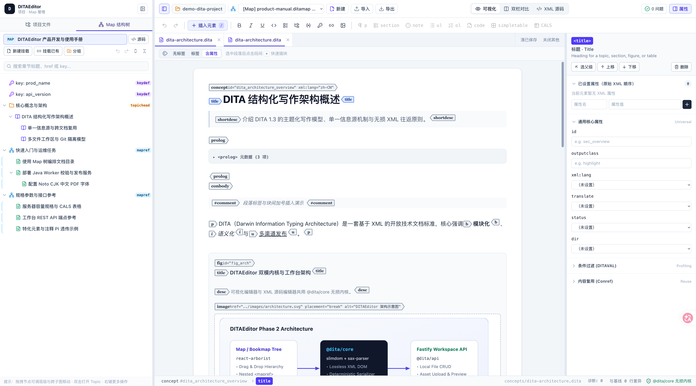
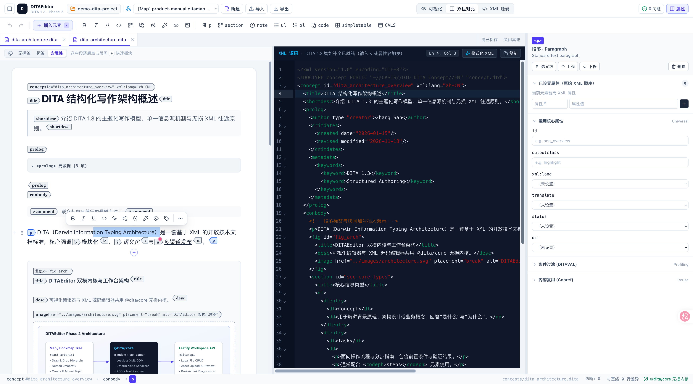
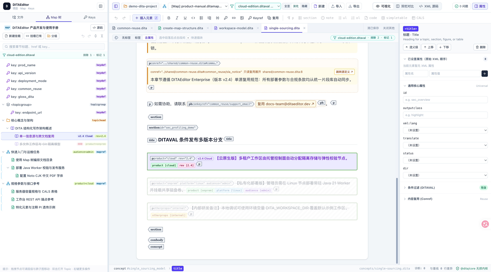
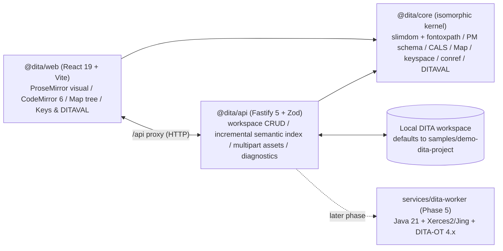

# DITAEditor

A lightweight **web-based DITA 1.3 structured authoring workbench** for technical documentation teams. It combines **ProseMirror structured WYSIWYG editing**, **CodeMirror 6 XML source editing**, a **visual Map / Bookmap workbench**, and a **single-sourcing semantic engine (Keys / Conref / DITAVAL)** — while keeping standard DITA XML as the single source of truth, with 100% lossless round-trips and minimal Git diffs.

> For the full architecture, technology rationale, and phased implementation baseline, see [docs/architecture-and-plan.md](docs/architecture-and-plan.md) and [AGENTS.md](AGENTS.md).

> Current release **v0.5.0** (covers Phase 0–3). See [CHANGELOG.md](CHANGELOG.md) for the changelog.

**English** · [简体中文](README.md)

---

## Screenshots

### Three-pane workbench with a visual Map tree

The left pane switches between "Project files", "Map tree", and "Keys". The middle is a multi-tab visual editing area (no tags / tags / with attributes, live `keyref` and `conref` expansion, DITAVAL profiling projection). The right pane is an attribute inspector that preserves the original XML attribute order, plus a conditional-attribute editor. The bottom bar shows a clickable element breadcrumb.



### Visual and XML source side-by-side mode

Switch live between "Visual", "Split", and "XML source". The visual pane offers a floating format toolbar on text selection, Notion-style block handles, and a `+` inserter between blocks. The source pane adds DITA 1.3 tag/attribute completion and well-formedness checking.



### Single-sourcing semantic engine (Keyref / Conref / DITAVAL)

Without touching the underlying XML, the visual editor renders read-only inline previews of block and inline `conref`/`conkeyref` (including nested `keyref` resolution and one-click jump to the source definition), while the Map tree applies `.ditaval` rules live ("show all / dim excluded / hide excluded", with flag highlighting).



---

## Core features (Phase 0–3 implemented)

### 1. 100% lossless XML round-trip kernel (`@dita/core`)

- An isomorphic DITA XML kernel built on `slimdom` + `slimdom-sax-parser` + `fontoxpath`, recording each node's source start/end line and column while parsing.
- **Zero metadata loss**: XML declaration (`<?xml ...?>`), `<!DOCTYPE ...>`, comments (`<!-- ... -->`), processing instructions (`<?...?>`), CDATA, namespaces (`xml:*`, `xmlns:*`, `ditaarch:*`), and the original attribute order (`rawAttrs`) all survive `XML → slimdom → ProseMirror Doc → slimdom → XML`.
- **Deterministic serialization**: idempotent and minimal-diff — editing a text node does not reformat anything else. Verified against 10 complex DITA 1.3 golden round-trip fixtures (`packages/dita-core/test/fixtures/`).

### 2. Dual-mode topic editor (visual / split / XML source)

- **Fine-grained DITA 1.3 modeling with lossless passthrough**
  - Native ProseMirror Schema models `concept` / `task` / `reference` / `topic` structures (`title`, `shortdesc`, `prolog`, `section`, `steps/step/cmd`, `note`, `codeblock`, `dl`, `fig/image`, …).
  - Inline elements (`<b>`, `<i>`, `<u>`, `<codeph>`, `<keyword>`, `<ph>`, `<xref>`, …) are modeled as **ProseMirror inline nodes**, not marks, so empty elements, nesting order, and attributes are never merged or dropped.
  - Both `<simpletable>` and OASIS CALS `<table>` are supported (explicit `<colspec>` retention, `namest`/`nameend`/`morerows` ↔ `colspan`/`rowspan`, multi-`tgroup` protection).
  - Unknown or specialized tags pass through as `unknown_block` / `unknown_pre_block` / `unknown_inline` / `unknown_inline_block`, preserving `xml:space="preserve"` semantics.
- **Efficient structured authoring**
  - Three tag rendering modes: no tags, tags, tags with attributes.
  - Context-aware `/` insert menu (only shows elements legal at the caret), floating bubble toolbar on selection, Notion-style block handles, and a `+` inserter between blocks.
  - The right inspector covers generic core attributes, DITAVAL profiling attributes, conref attributes, and custom attributes while keeping the original XML attribute order; the breadcrumb selects ancestors quickly.
- **CodeMirror 6 XML source with switch protection**
  - DITA 1.3 tag/attribute and `keyref` / `conkeyref` / profiling-value completion driven by the `@dita/core` rule tables and the active Root Map semantics, plus live well-formedness lint and source formatting.
  - **Source → Visual guard**: `checkXmlWellFormed()` must pass before switching back; malformed XML blocks the switch and reports precise `{ line, column }` in the source editor.

### 3. Visual Map / Bookmap tree and multi-file workbench

- **Three-pane resizable workbench** (`react-resizable-panels`): the left pane switches between project files, the Map tree (`react-arborist`), and Keys; the file panel holds the **Root Map selector**; the Map tree panel holds the **DITAVAL configuration selector and three-state projection switch**, plus quick new topic / new map / new folder actions.
- **Lossless Map / Bookmap DOM engine**: drag to reorder and re-nest `topicref` / `mapref` / `topichead` / `chapter` / `keydef`, create-and-mount topics from templates, mount existing files, edit node attributes, and open the map source — while keeping `<reltable>`, `<topicmeta>`, comments, and PIs in place.
- **Multi-tab editing and a diagnostics panel**: multiple document tabs, dirty tracking, save-one/save-all, revert to baseline, and a project-level problems panel (XML well-formedness, broken `href`, recursive `<mapref>`, missing images, undefined `keyref`, invalid or cyclic `conref`, `.ditaval` syntax errors).

### 4. Single-sourcing semantic engine (Keys / Conref / DITAVAL)

- **Root Map BFS keyspace (`keydef` / `keyref` / `keyscope`)**
  - Breadth-first traversal with **First Definition Wins** conflict resolution per the DITA 1.3 spec, `keyscope` isolation, and no false reports when the same submap appears in several scopes.
  - The **Keys panel** lists every effective key definition for the current Root Map (with override counts), inserts `<keyword keyref="..."/>`, or jumps to the defining line. The visual editor resolves inline `keyref` text and image references live with one-click traceability, and the toolbar offers a key picker.
- **Cross-document content reuse (`conref` / `conkeyref` / `conrefend`) with DFS cycle detection**
  - Direct `conref`, indirect `conkeyref`, same-document `#./id`, `conrefend` ranges, nested `keyref` expansion, and DITA 1.3 specialization compatibility checks.
  - A DFS `visitStack` catches self-cycles, two-way and multi-hop cycles, and nested child-element cycles (while allowing legal diamond DAGs), showing the full cycle chain in the editor and the problems panel.
  - Reused fragments render as read-only inline cards (pure DOM construction — the underlying ProseMirror `Doc` and XML are never rewritten). The toolbar and the inspector's **Reuse** tab let you browse target elements, preview the expanded result live, and insert a new reused element or bind the reuse attribute to the current element.
- **DITAVAL filtering with live three-state projection**
  - Full `.ditaval` parsing (`<prop>`, `<revprop>`, `<startflag>` / `<endflag>`, `<style-conflict>`), following DITA 1.3 evaluation rules for multi-value exclusion within an attribute, cross-attribute AND semantics, and `props="group(val)"`.
  - One-click switching between `.ditaval` files and **show all / dim excluded / hide excluded**, synced live to the Map tree (dragging is locked in hide mode to avoid index drift) and the visual editor (flag colors and start/end badges) with zero XML modification.
  - The attribute inspector and Map node inspector embed a visual **profiling attribute editor** (`ProfilingAttrEditor`) backed by the project-wide value vocabulary, with live effect preview.

### 5. Local workspace, incremental semantic index, and asset backend (`@dita/api`)

- Fastify 5 + Zod provide local workspace scanning, file CRUD, directory switching, bulk project import, and a per-branch cached incremental semantic indexer (`WorkspaceSemanticIndexer`) that refreshes the keyspace, topic-id index, and diagnostics after every save, rename, or delete.
- Ships with a multi-variant demo project at `samples/demo-dita-project/` (`product-manual.ditamap`, `admin-book.bookmap`, the shared reuse library `shared/common-reuse.dita`, `filters/cloud-edition.ditaval` and `onprem-admin.ditaval`, nested submaps, concept/task/reference documents, and SVG diagrams) — with the same experience in offline in-memory mode.
- **Path safety**: `resolveSafeWorkspacePath` rejects traversal (`..`), absolute paths, NUL bytes, and symlink escapes.
- **Image asset pipeline**: multipart upload (`.png` / `.jpg` / `.jpeg` / `.gif` / `.svg` / `.webp` / `.avif`, 10 MB limit), automatic document-relative POSIX `href` computation, and a preview route.

---

## Architecture and technology stack

A TypeScript full-stack monorepo organized with **pnpm workspaces + Turborepo**. XML parsing, lossless serialization, DITA 1.3 element rules, the CALS table model, and Map DOM operations live in the shared `@dita/core` package, reused by both `@dita/web` and `@dita/api`. Authoritative DTD/RNG validation and DITA-OT publishing will be delegated to a dedicated Java 21 worker in a later phase.



| Layer / module | Choice | Notes |
| :--- | :--- | :--- |
| **Monorepo** | pnpm 11 + Turborepo | One pipeline for building, type-checking, and testing `@dita/core`, `@dita/web`, `@dita/api` |
| **Frontend workbench** | React 19 + TypeScript 5.8 + Vite 6 + Tailwind CSS 4 | Responsive three-pane workbench with a high-precision editing surface |
| **Visual editing** | Native ProseMirror | Follows DITA DTD structure constraints; custom NodeViews and block/inline interactions |
| **XML source editing** | CodeMirror 6 | XML highlighting, DITA 1.3 completion, live well-formedness lint |
| **Map tree & state** | `react-arborist` + `react-resizable-panels` + Zustand | Virtualized tree, drag re-nesting, pane layout, multi-tab state |
| **Lossless XML kernel** | `slimdom` + `slimdom-sax-parser` + `fontoxpath` | Lossless DOM, source position tracking, XPath 3.1 queries |
| **Backend API** | Fastify 5 + `@fastify/multipart` + Zod | Local disk workspace management, asset upload/preview, project diagnostics |
| **Testing** | Vitest 3 | Golden round-trip fixtures, editor commands, workspace API |

---

## Repository layout

```text
DITAEditor/
├── packages/
│   └── dita-core/              # @dita/core — shared DITA 1.3 and lossless XML kernel
│       ├── src/
│       │   ├── xml/            # slimdom parsing, position tracking, deterministic serialization, XPath, DOM diff
│       │   ├── model/          # DITA 1.3 element metadata, content models, attribute rules
│       │   ├── cals/           # OASIS CALS table <-> colspan/rowspan adapter
│       │   ├── map/            # Map/Bookmap DOM engine and POSIX path utilities
│       │   ├── ditaval/        # .ditaval parsing, multi-value/group evaluation, flag merging
│       │   ├── semantics/      # BFS keyspace, conref/conkeyref resolution, DFS cycles, incremental index
│       │   ├── templates/      # Topic (concept/task/reference/topic) and Map/Bookmap templates
│       │   └── prosemirror/    # ProseMirror schema and lossless slimdom <-> PM Doc conversion
│       └── test/fixtures/      # 10 complex DITA 1.3 golden round-trip fixtures
├── apps/
│   ├── web/                    # @dita/web — React 19 + Vite authoring workbench
│   │   └── src/
│   │       ├── components/     # header, tab bar, file explorer, Keys panel, reuse panel, profiling editor, problems panel
│   │       ├── editor/         # visual/ (ProseMirror + semantic decorations + conref rendering), source/ (CodeMirror 6)
│   │       ├── map-tree/       # react-arborist map tree, DITAVAL projection, node inspector, context menu, overview
│   │       ├── services/       # API client, offline demo fallback, persistence bridge
│   │       └── store/          # Zustand workbench, multi-tab, and semantic context state
│   └── api/                    # @dita/api — Fastify 5 workspace, semantic index, and asset service
│       └── src/modules/
│           ├── files/          # safe path validation, workspace scan, file CRUD, multipart upload, diagnostics
│           └── indexer/        # WorkspaceSemanticIndexer and /api/semantics/* routes
├── samples/
│   └── demo-dita-project/      # ready-to-run multi-variant DITA 1.3 demo (maps/bookmaps/reuse library/DITAVAL/SVG)
├── docs/
│   ├── architecture-and-plan.md # full architecture baseline and Phase 0–5 roadmap
│   └── pic/                    # workbench screenshots
├── services/                   # (Phase 5) Java 21 authoritative validation and DITA-OT publishing worker
└── graphify-out/               # persistent codebase knowledge graph
```

---

## Getting started

### Requirements

- **Node.js** `>= 20.0.0`
- **pnpm** `11.5.2` (use `corepack enable` to match the `packageManager` field automatically)

### Install and run

```bash
# 1. Install dependencies
pnpm install

# 2. Build the shared kernel once (consumed by @dita/api and @dita/web)
pnpm --filter @dita/core build

# 3. Start the API and the web dev server in parallel
pnpm dev
```

Then open:

- **Workbench**: `http://localhost:5173` (Vite proxies `/api` to `http://localhost:3001`)
- **API**: `http://localhost:3001` (health check: `GET /health`)

You can also start them in two terminals:

```bash
pnpm --filter @dita/api dev
pnpm --filter @dita/web dev
```

### Backend environment variables (`@dita/api`)

| Variable | Default | Description |
| :--- | :--- | :--- |
| `PORT` | `3001` | Fastify listen port |
| `DITA_WORKSPACE_DIR` | `samples/demo-dita-project` | Local DITA project opened at startup |
| `DITA_IMPORTS_DIR` | `.dita-workspaces` | Root directory for projects imported through the UI |

---

## Workspace, semantics, and asset REST API

| Method and path | Description |
| :--- | :--- |
| `GET /health` | Service status, `@dita/core` version, current workspace path |
| `GET /api/workspace` | Scans the workspace: file tree, maps, `.ditaval` files, topic title index, statistics |
| `POST /api/workspace/open` | Switches the local workspace directory (or resets to the demo project with `{ useDefault: true }`) |
| `POST /api/workspace/import` | Bulk-imports project files (UTF-8 text and Base64 binary images) |
| `GET /api/files/tree` | Workspace file tree, map summaries, topic title map |
| `GET /api/files/content?path=...` | Reads a file plus its well-formedness result |
| `PUT /api/files/content` | Saves content to disk and triggers an incremental semantic re-index |
| `POST /api/files/create` | Creates a topic / map / bookmap / DITAVAL file from a template |
| `POST /api/files/mkdir` | Creates a subdirectory inside the workspace |
| `POST /api/files/rename` | Renames or moves a file or directory |
| `DELETE /api/files?path=...` | Deletes a file or directory |
| `POST /api/assets/upload` | Uploads an image asset and returns a document-relative DITA `href` |
| `GET /api/assets/raw?path=...` | Serves a binary image asset by workspace path |
| `GET /api/assets/resolve?from=...&href=...` | Resolves an image asset relative to a source document |
| `GET /api/semantics/context?rootMap=...&ditaval=...` | Keyspace, topic-id index, profiling vocabulary, and parsed `.ditaval` for the given Root Map |
| `GET /api/semantics/keyspace?rootMap=...` | Builds and returns the effective BFS keyspace for a Root Map |
| `GET /api/semantics/ids?filePath=...` | Index of reusable `@id` elements in the workspace or one topic |
| `GET /api/semantics/ditaval?path=...` | Parses a `.ditaval` file into filtering and flag rules |
| `POST /api/semantics/resolve-document` | Computes the live `keyref` / `conref` overlay and diagnostics for one document (including unsaved drafts) |
| `POST /api/semantics/resolve-conref` | Expands a single `conref` / `conkeyref` preview on demand (with DFS cycle detection) |
| `GET /api/diagnostics?rootMap=...` | Well-formedness, broken `href`, recursive `<mapref>`, missing images, undefined `keyref`, conref cycles, `.ditaval` errors |

---

## Develop, build, and test

```bash
# Build, type-check, and test everything
pnpm -r build
pnpm -r typecheck
pnpm -r test

# Or use the Turborepo shortcuts at the repo root
pnpm build
pnpm typecheck
pnpm test
```

Current coverage (**117/117 Vitest tests passing**):

- `@dita/core` (54): 10 golden DITA 1.3 round-trip fixtures, unknown/specialized passthrough, OASIS CALS grid math, XML parsing/XPath 3.1, element rules and templates, lossless Map/Bookmap operations, DITAVAL evaluation (multi-value/group/flag/conflict styling), BFS keyspace with `keyscope`, `conref`/`conkeyref`/`conrefend` expansion, and DFS cycle detection.
- `@dita/web` (59): ProseMirror ↔ XML bridge, table commands, inline bubble toolbar, block handles and transforms, decorations and insert menu, CodeMirror DITA completion (including `keyref` / `conkeyref` / profiling-value semantics), map tree utilities and DITAVAL projection, visual semantic-decoration round-trip assertions, and conref reuse value composition (conkeyref / relative-href / same-file fragment).
- `@dita/api` (4): zero-error validation of the demo project, a scale scan over 55 topics + 4 nested submaps with safe-path/upload/broken-link checks, and `/api/semantics/*` integration tests for Root Map switching, live `conkeyref` expansion, and incremental cycle diagnostics.

---

## Roadmap

- [x] **Phase 0**: Monorepo foundation, `@dita/core` (`slimdom` + `slimdom-sax-parser` + `fontoxpath` + ProseMirror Schema + CALS adapter), and 10 golden round-trip fixtures.
- [x] **Phase 1**: Dual-mode topic editor MVP (ProseMirror visual editing + NodeViews + CALS/simpletable editing + `/` context insert menu + attribute panel + breadcrumb + CodeMirror 6 XML source with completion/lint and switch protection).
- [x] **Phase 2**: Visual Map / Bookmap tree (`react-arborist`), lossless Map DOM engine, three-pane multi-tab workbench, Fastify workspace/asset APIs, and the `samples/demo-dita-project/` demo project.
- [x] **Phase 3**: Root Map cross-file semantic engine (`keydef/keyref` BFS + `keyscope`, `conref/conkeyref`/`conrefend` with DFS cycle detection, DITAVAL three-state filtering and flags, incremental `/api/semantics/*` indexer, Keys panel, reuse/semantic insert UI, profiling attribute editor, CodeMirror 6 semantic completion).
- [ ] **Phase 4**: PostgreSQL + Drizzle ORM, GitHub / GitLab / Gitee OAuth/PAT, branch-isolated `git worktree`, check-out exclusive locks, and PR/MR workflow.
- [ ] **Phase 5**: Persistent Java 21 worker (Xerces2 + Jing + DITA 1.3 Catalog + DITA-OT 4.x + Noto CJK fonts for Chinese PDF), BullMQ + SSE async publishing, and one-command Docker Compose deployment.
