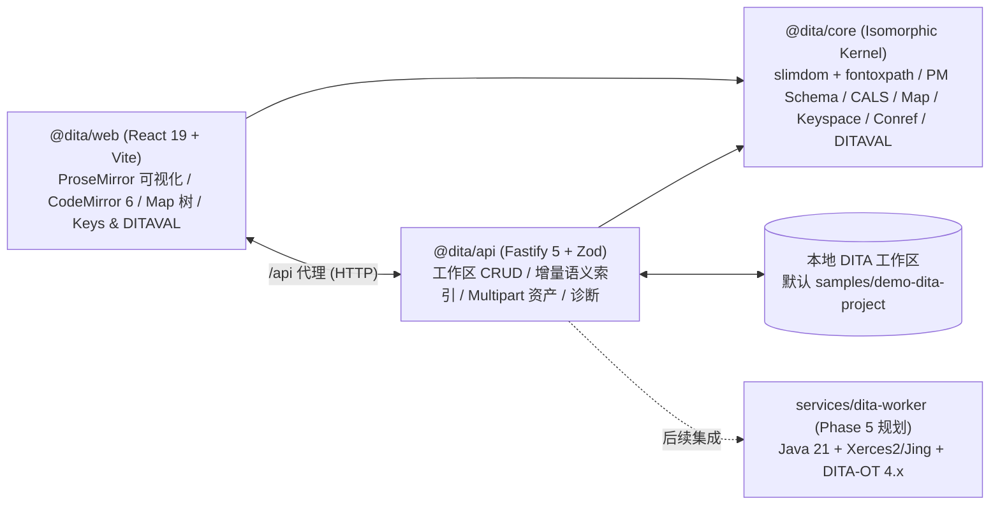

# DITAEditor

面向技术文档团队的轻量级 **Web DITA 1.3 结构化写作工作台**，支持 **ProseMirror 可视化结构化编辑**、**CodeMirror 6 XML 源码编辑**、**Map / Bookmap 可视化编排** 与 **单一信息源语义引擎（Keys / Conref / DITAVAL）**，并以标准 DITA XML 作为唯一真相源，实现 100% 无损往返（Round-trip）与最小化 Git Diff。

> 完整系统架构、技术选型论证与分阶段实施基线请参阅 [docs/architecture-and-plan.md](docs/architecture-and-plan.md) 与 [AGENTS.md](AGENTS.md)。

---

## 界面预览

### 三栏工作台与可视化 Map 结构树

左侧支持在「项目文件」「Map 结构树」与「Keys 键空间」间切换，中间为多 Tab 可视化编辑区（支持无标签 / 标签 / 含属性三种视图、实时 `keyref`/`conref` 展开与 DITAVAL 条件过滤），右侧提供按原始 XML 属性顺序排列的属性检查器与条件标签编辑器，底部显示可点击的元素面包屑路径。


### 可视化与 XML 源码双栏对比模式

支持「可视化」「双栏对比」「XML 源码」三种视图实时切换，可视化区提供选中文本悬浮格式工具栏、Notion 风格块级操作手柄与块间 `+` 插块；源码区接入 DITA 1.3 标签/属性智能补全与良构性检查。


---

## 核心特性（已实现：Phase 0–3）

### 1. 100% 无损 XML 往返内核（`@dita/core`）
- 基于 `slimdom` + `slimdom-sax-parser` + `fontoxpath` 构建前后端同构的 DITA XML 内核，解析时同步记录节点源码起止行列号。
- **元数据零丢失**：XML 声明（`<?xml ...?>`）、`<!DOCTYPE ...>`、注释（`<!-- ... -->`）、处理指令（`<?...?>`）、CDATA、命名空间（`xml:*`、`xmlns:*`、`ditaarch:*`）与元素原始属性顺序（`rawAttrs`）在 `XML → slimdom → ProseMirror Doc → slimdom → XML` 往返中完整保留。
- **确定性序列化**：严格保持幂等与最小化变更范围，仅修改文本时不扰动其他节点格式，已通过 10 份复杂 DITA 1.3 黄金往返测试样本（`packages/dita-core/test/fixtures/`）验证。

### 2. 双模式 Topic 编辑器（可视化 / 双栏对比 / XML 源码）
- **DITA 1.3 精细建模与兜底透传**：
  - 原生 ProseMirror Schema 建模 `concept` / `task` / `reference` / `topic` 核心结构（`title`、`shortdesc`、`prolog`、`section`、`steps/step/cmd`、`note`、`codeblock`、`dl`、`fig/image` 等）。
  - 行内元素（`<b>`、`<i>`、`<u>`、`<codeph>`、`<keyword>`、`<ph>`、`<xref>` 等）建模为 **ProseMirror inline nodes**（而非 Marks），确保空元素、嵌套顺序与属性完整保真。
  - 同时支持 `<simpletable>` 与 OASIS CALS `<table>`（保留 `<colspec>`，支持 `namest`/`nameend`/`morerows` 跨行列转换与多 `tgroup` 保护）。
  - 未知或特化标签通过 `unknown_block` / `unknown_pre_block` / `unknown_inline` / `unknown_inline_block` 节点原样透传，保留 `xml:space="preserve"` 空白语义。
- **高效结构化写作交互**：
  - 支持「无标签」「标签」「含属性」三种可视化标签渲染模式。
  - 上下文感知 `/` 斜杠插入菜单（仅显示当前光标处符合 DITA 规则的合法元素）、选中文本悬浮气泡工具栏、Notion 风格块级操作手柄与块间 `+` 快速插块。
  - 右侧属性检查器支持通用核心属性、条件过滤（DITAVAL）属性、复用（Conref）属性及自定义属性（保持原始 XML 属性顺序）；底部面包屑支持快速选中祖先节点。
- **CodeMirror 6 XML 源码与切换保护**：
  - 基于 `@dita/core` 规则表与活动 Root Map 语义上下文，提供 DITA 1.3 标签、属性以及 `keyref` / `conkeyref` / 条件过滤属性值的智能自动补全、实时 XML 良构性 Lint 与源码格式化。
  - **Source → Visual 切换保护**：切回可视化视图前强制执行 `checkXmlWellFormed()`，存在语法错误时拦截切换并在源码中精确定位 `{ line, column }`。

### 3. 可视化 Map / Bookmap 树与多文件工作台
- **三栏可拖拽工作台**（`react-resizable-panels`）：左侧在「项目文件」「Map 结构树（`react-arborist`）」与「Keys 键空间」之间切换，顶部提供 **Root Map 选择器**、**DITAVAL 条件配置选择器与三态投影开关**以及快捷新建/导入/导出入口。
- **无损 Map / Bookmap DOM 引擎**：支持拖拽调整 `topicref` / `mapref` / `topichead` / `chapter` / `keydef` 层级与顺序、右键按模板新建并挂载 Topic、挂载已有文件、编辑节点属性及一键查看 Map 源码，同时原位保留 `<reltable>`、`<topicmeta>`、注释与 PI。
- **多 Tab 编辑与问题诊断面板**：支持多文档标签页、未保存状态追踪、单文件/全部保存、还原基线，以及底部项目级问题诊断面板（XML 良构错误、断链 `href`、循环 `<mapref>`、缺失图片引用、未定义 `keyref`、非法/循环 `conref` 与 `.ditaval` 语法错误）。

### 4. 单一信息源语义引擎（Keys / Conref / DITAVAL）
- **Root Map BFS 键空间（`keydef` / `keyref` / `keyscope`）**：
  - 按 DITA 1.3 规范执行广度优先遍历与 **First Definition Wins** 冲突裁决，支持 `keyscope` 作用域隔离及同一子 Map 在多作用域下无误报复用。
  - 左侧 **Keys 面板**集中展示当前 Root Map 生效的键定义与被覆盖计数，支持一键插入 `<keyword keyref="..."/>` 或跳转至定义行；可视化编辑区实时解析行内 `keyref` 文本与图片引用并提供一键溯源跳转，工具栏支持通过 **插入 Keyref 弹窗** 快速选用键定义。
- **跨文档内容复用（`conref` / `conkeyref` / `conrefend`）与 DFS 环路检测**：
  - 支持直接 `conref`、间接 `conkeyref`、同文档 `#./id`、`conrefend` 范围切片、嵌套 `keyref` 展开及 DITA 1.3 元素特化兼容校验。
  - 基于 DFS `visitStack` 精准拦截自循环、双向/多跳循环与嵌套子节点循环（同时放行合法菱形 DAG），并在可视化编辑区与问题面板展示完整环路链。
  - 可视化编辑区以只读内联卡片渲染被复用片段（纯 DOM 构造，不改写底层 ProseMirror `Doc` 与 XML），工具栏与属性检查器提供 **插入 / 绑定 Conref 弹窗** 浏览目标文档元素并实时预览展开结果。
- **DITAVAL 条件过滤与实时三态投影**：
  - 完整解析 `.ditaval`（`<prop>`、`<revprop>`、`<startflag>` / `<endflag>`、`<style-conflict>`），遵循 DITA 1.3 同属性多值全排斥、跨属性逻辑与及 `props="group(val)"` 分组求值规则。
  - 顶部工作台一键切换 `.ditaval` 与「**全部显示 / 置灰排除 / 隐藏排除**」三种投影模式，实时同步至 Map 结构树（隐藏模式下自动锁定拖拽以防索引错位）与可视化编辑区（支持 Flag 配色与起止徽章），严格保持底层 XML 零修改。
  - 属性检查器与 Map 节点检查器内置可视化 **条件属性编辑器（`ProfilingAttrEditor`）**，支持基于项目全量条件值词表的快速增删与生效状态实时预览。

### 5. 本地工作区、增量语义索引与资产后端（`@dita/api`）
- 基于 Fastify 5 + Zod 提供本地工作区扫描、文件 CRUD、目录切换、项目批量导入与按分支缓存的增量语义索引器（`WorkspaceSemanticIndexer`），文件保存/重命名/删除后自动增量刷新 Keyspace、Topic ID 索引与项目诊断。
- 默认加载内置多变体示例项目 `samples/demo-dita-project/`（含 `product-manual.ditamap`、`admin-book.bookmap`、公共复用库 `shared/common-reuse.dita`、`filters/cloud-edition.ditaval` & `onprem-admin.ditaval`、嵌套子 Map、Concept/Task/Reference 文档与 SVG 架构图），并在离线内存模式下保持一致体验。
- **路径安全防护**：`resolveSafeWorkspacePath` 严格校验并拦截路径穿越（`..`）、绝对路径、空字节及符号链接逃逸。
- **图片资产管线**：支持 Multipart 图片上传（`.png` / `.jpg` / `.jpeg` / `.gif` / `.svg` / `.webp` / `.avif`，单文件上限 10 MB），自动计算相对文档的 POSIX `href` 并提供预览路由。

---

## 系统架构与技术栈

系统采用 **pnpm Workspace + Turborepo** 组织的 TypeScript 全栈 Monorepo，核心设计是将 XML 解析、无损序列化、DITA 1.3 元素规则、CALS 表格模型与 Map DOM 操作沉淀在共享包 `@dita/core` 中，由前端 `@dita/web` 与后端 `@dita/api` 共同复用（权威 DTD/RNG 校验与 DITA-OT 异步发布将在后续阶段接入独立 Java 21 Worker）。



| 层级 / 模块 | 技术选型 | 说明 |
| :--- | :--- | :--- |
| **Monorepo 工程** | pnpm 11 + Turborepo | 统一管理 `@dita/core`、`@dita/web`、`@dita/api` 构建、类型检查与测试 |
| **前端工作台** | React 19 + TypeScript 5.8 + Vite 6 + Tailwind CSS 4 | 响应式三栏工作台与高精度编辑界面 |
| **可视化编辑** | 原生 ProseMirror | 贴合 DITA DTD 结构约束，自定义 NodeView 与块/行内操作体验 |
| **XML 源码编辑** | CodeMirror 6 | XML 语法高亮、DITA 1.3 智能补全与实时良构 Lint |
| **Map 树与状态** | `react-arborist` + `react-resizable-panels` + Zustand | 虚拟化结构树、拖拽调层级、分栏布局与多 Tab 状态管理 |
| **XML 无损内核** | `slimdom` + `slimdom-sax-parser` + `fontoxpath` | 无损 DOM 表示、节点位置追踪与 XPath 3.1 查询 |
| **后端 API** | Fastify 5 + `@fastify/multipart` + Zod | 本地磁盘工作区管理、资产上传预览与项目诊断接口 |
| **测试框架** | Vitest 3 | 覆盖核心 round-trip 黄金样本、编辑器交互命令与工作区 API |

---

## 仓库目录结构

```text
DITAEditor/
├── packages/
│   └── dita-core/              # @dita/core — 前后端共享的 DITA 1.3 与 XML 无损内核
│       ├── src/
│       │   ├── xml/            # slimdom 解析、位置追踪、确定性序列化、XPath、DOM 对比
│       │   ├── model/          # DITA 1.3 元素元数据、内容约束与属性规则表
│       │   ├── cals/           # OASIS CALS 表格 <-> colspan/rowspan 双向转换
│       │   ├── map/            # Map/Bookmap DOM 树引擎与 POSIX 路径工具
│       │   ├── ditaval/        # .ditaval 解析、多值/分组条件求值与 Flag 合并
│       │   ├── semantics/      # BFS Keyspace、Conref/Conkeyref 解析、DFS 环路检测与增量索引
│       │   ├── templates/      # Topic (concept/task/reference/topic) 与 Map/Bookmap 模板
│       │   └── prosemirror/    # ProseMirror Schema 与 slimdom <-> PM Doc 无损双向转换
│       └── test/fixtures/      # 10 份复杂 DITA 1.3 黄金往返测试样本
├── apps/
│   ├── web/                    # @dita/web — React 19 + Vite 双模结构化写作工作台
│   │   └── src/
│   │       ├── components/     # 顶栏、Tab 栏、文件浏览、Keys 面板、条件编辑器、语义引用弹窗、问题面板
│   │       ├── editor/         # visual/ (ProseMirror + 语义装饰/Conref 渲染)、source/ (CodeMirror 6)
│   │       ├── map-tree/       # react-arborist Map 树、DITAVAL 投影、节点检查器、右键菜单、概览面板
│   │       ├── services/       # API 客户端、离线示例回退与持久化桥接
│   │       └── store/          # Zustand 工作台、多 Tab 与语义上下文状态管理
│   └── api/                    # @dita/api — Fastify 5 本地工作区、增量语义索引与资产服务
│       └── src/modules/
│           ├── files/          # 安全路径校验、工作区扫描、文件 CRUD、Multipart 上传、诊断
│           └── indexer/        # WorkspaceSemanticIndexer 与 /api/semantics/* 语义路由
├── samples/
│   └── demo-dita-project/      # 开箱即用的多变体 DITA 1.3 演示项目（Map/Bookmap/复用库/DITAVAL/SVG）
├── docs/
│   ├── architecture-and-plan.md # 完整架构设计基线与 Phase 0–5 实施路线
│   └── pic/                    # 工作台界面截图
├── services/                   # （Phase 5 规划）Java 21 权威校验与 DITA-OT 4.x 发布 Worker
└── graphify-out/               # 项目代码库知识图谱
```

---

## 快速开始

### 环境要求
- **Node.js** `>= 20.0.0`
- **pnpm** `11.5.2`（推荐使用 `corepack enable` 自动匹配 `packageManager` 版本）

### 安装与启动

```bash
# 1. 安装依赖
pnpm install

# 2. 首次编译共享内核 @dita/core（供 @dita/api 与 @dita/web 引用）
pnpm --filter @dita/core build

# 3. 并行启动后端 API 与前端开发服务器
pnpm dev
```

启动完成后访问：
- **前端工作台**：`http://localhost:5173`（Vite 已配置将 `/api` 请求自动代理至 `http://localhost:3001`）
- **后端 API**：`http://localhost:3001`（健康检查：`GET /health`）

也可在两个终端分别启动：

```bash
pnpm --filter @dita/api dev
pnpm --filter @dita/web dev
```

### 后端环境变量（`@dita/api`）

| 变量名 | 默认值 | 说明 |
| :--- | :--- | :--- |
| `PORT` | `3001` | Fastify 服务监听端口 |
| `DITA_WORKSPACE_DIR` | `samples/demo-dita-project` | 启动时默认打开的本地 DITA 项目目录 |
| `DITA_IMPORTS_DIR` | `.dita-workspaces` | 通过前端「导入目录」批量上传的项目存放根目录 |

---

## Workspace、Semantics & Asset REST API 速览

| 方法与路径 | 说明 |
| :--- | :--- |
| `GET /health` | 返回服务状态、`@dita/core` 版本与当前工作区路径 |
| `GET /api/workspace` | 扫描当前工作区，返回文件树、Map 与 `.ditaval` 列表、Topic 标题索引与统计数据 |
| `POST /api/workspace/open` | 切换本地工作区目录（或重置回内置示例项目 `{ useDefault: true }`） |
| `POST /api/workspace/import` | 批量导入项目文件（支持 UTF-8 文本与 Base64 二进制图片） |
| `GET /api/files/tree` | 获取工作区文件树、Map 摘要与 Topic 标题映射 |
| `GET /api/files/content?path=...` | 读取指定文件内容并附带 XML 良构性检查结果 |
| `PUT /api/files/content` | 保存修改后的文件内容至工作区磁盘，并触发增量语义索引更新 |
| `POST /api/files/create` | 基于标准模板新建 Topic / Map / Bookmap / DITAVAL 文件 |
| `POST /api/files/mkdir` | 在工作区内创建子目录 |
| `POST /api/files/rename` | 重命名或移动工作区内的文件/目录 |
| `DELETE /api/files?path=...` | 删除工作区内指定文件或目录 |
| `POST /api/assets/upload` | 上传图片资产并返回相对于当前文档的 DITA `href` |
| `GET /api/assets/raw?path=...` | 按工作区路径读取二进制图片资产 |
| `GET /api/assets/resolve?from=...&href=...` | 按源文档相对路径解析并返回图片资产 |
| `GET /api/semantics/context?rootMap=...&ditaval=...` | 获取当前 Root Map Keyspace、Topic ID 索引、条件值词表与已解析 `.ditaval` |
| `GET /api/semantics/keyspace?rootMap=...` | 按 BFS 规则构建并返回指定 Root Map 的生效键空间 |
| `GET /api/semantics/ids?filePath=...` | 查询工作区或指定 Topic 中所有可复用的 `@id` 元素索引 |
| `GET /api/semantics/ditaval?path=...` | 解析并返回指定 `.ditaval` 文件的条件过滤与 Flag 规则 |
| `POST /api/semantics/resolve-document` | 计算单篇文档（含未保存草稿 XML）的实时 `keyref` / `conref` 覆盖层与诊断 |
| `POST /api/semantics/resolve-conref` | 按需展开单条 `conref` / `conkeyref` 预览（含 DFS 循环检测） |
| `GET /api/diagnostics?rootMap=...` | 扫描工作区 XML 良构、断链 `href`、循环 `<mapref>`、缺失图片、未定义 `keyref`、`conref` 环路与 `.ditaval` 错误 |

---

## 开发、构建与测试

```bash
# 全量构建、类型检查与测试
pnpm -r build
pnpm -r typecheck
pnpm -r test

# 或使用根目录 Turborepo 脚本
pnpm build
pnpm typecheck
pnpm test
```

当前测试覆盖（**107/107 Vitest 测试通过**）：
- `@dita/core`（54 项）：10 份复杂 DITA 1.3 黄金往返测试、未知/特化元素透传、OASIS CALS 表格网格计算、XML 解析/XPath 3.1、规则与模板、Map/Bookmap 无损操作、DITAVAL 条件求值（多值/分组/Flag/冲突配色）、BFS Keyspace + `keyscope`、Conref/Conkeyref/`conrefend` 展开与 DFS 环路检测。
- `@dita/web`（49 项）：ProseMirror ↔ XML 桥接、表格命令、行内气泡栏、块级手柄与变换、装饰与插入菜单、CodeMirror DITA 补全（含 `keyref` / `conkeyref` / 条件属性语义补全）、Map 树工具与 DITAVAL 投影、可视化语义装饰无损往返断言。
- `@dita/api`（4 项）：内置示例项目零错误校验、55 个 Topic + 4 个嵌套子 Map 的规模化扫描与安全/上传/断链测试，以及 `/api/semantics/*` Root Map 切换、实时 `conkeyref` 展开与增量更新环路诊断集成测试。

---

## 实施路线图（Roadmap）

- [x] **Phase 0**：Monorepo 底座、`@dita/core`（`slimdom` + `slimdom-sax-parser` + `fontoxpath` + ProseMirror Schema + CALS 适配器）与 10 份黄金往返测试。
- [x] **Phase 1**：双模式 Topic 编辑器 MVP（ProseMirror 可视化编辑 + NodeView + CALS/simpletable 编辑 + `/` 上下文插入 + 属性面板 + 面包屑 + CodeMirror 6 XML 源码补全/Lint 与切换保护）。
- [x] **Phase 2**：可视化 Map / Bookmap 树（`react-arborist`）、无损 Map DOM 引擎、三栏多 Tab 工作台、Fastify 本地工作区/资产 API 与示例项目 `samples/demo-dita-project/`。
- [x] **Phase 3**：Root Map 跨文件语义引擎（`keydef/keyref` BFS + `keyscope`、`conref/conkeyref`/`conrefend` 与 DFS 循环引用检测、`DITAVAL` 三态条件过滤与 Flag 标记、增量 `/api/semantics/*` 索引服务、`Keys` 面板、语义插入弹窗、条件属性编辑器与 CodeMirror 6 语义补全）。
- [ ] **Phase 4**：PostgreSQL + Drizzle ORM、GitHub / GitLab / Gitee OAuth/PAT、按分支隔离 `git worktree`、Check-out 独占锁与 PR/MR 工作流。
- [ ] **Phase 5**：常驻 Java 21 Worker（Xerces2 + Jing + DITA 1.3 Catalog + DITA-OT 4.x + Noto CJK 中文 PDF 字体）、BullMQ + SSE 异步发布与 Docker Compose 一键部署。
