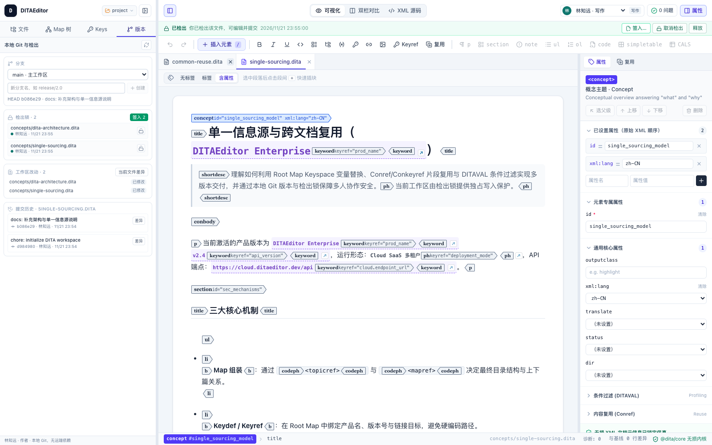
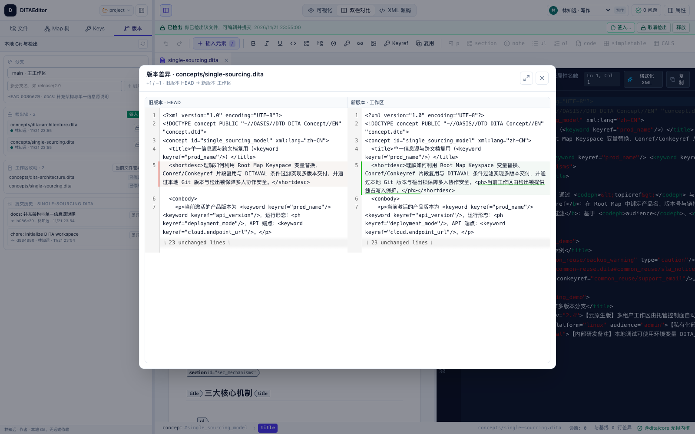
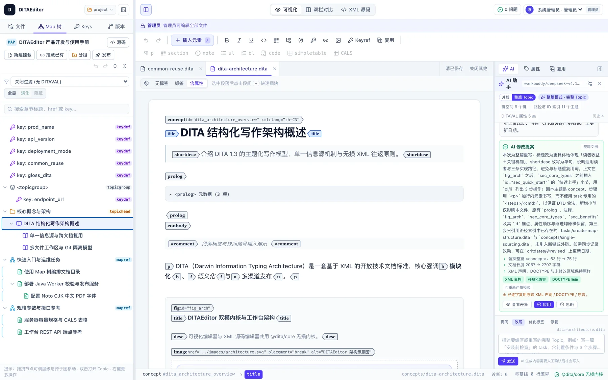
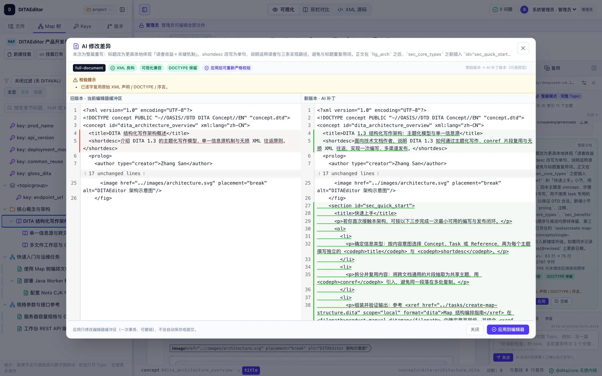
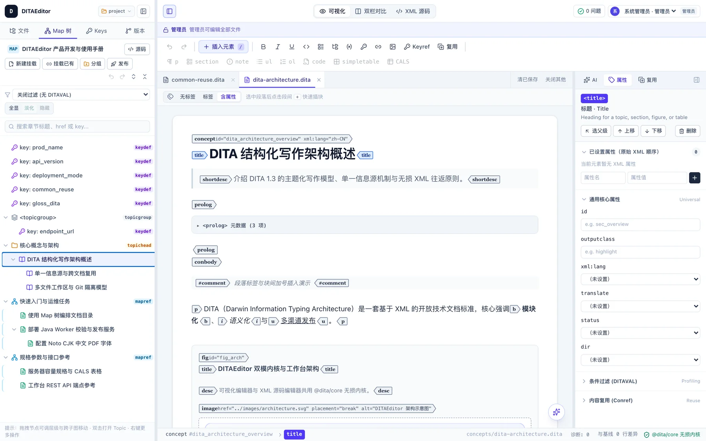
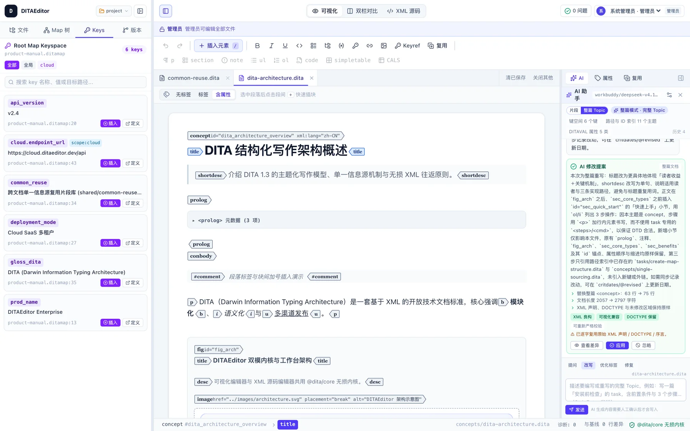
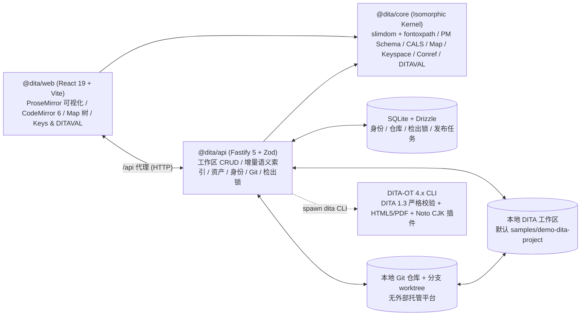

# DITAEditor

[](LICENSE)
[](CHANGELOG.md)
[](package.json)

**简体中文** · [English](README.en.md)

面向技术文档团队的轻量级 **Web DITA 1.3 结构化写作工作台**，支持 **ProseMirror 可视化结构化编辑**、**CodeMirror 6 XML 源码编辑**、**Map / Bookmap 可视化编排**、**单一信息源语义引擎（Keys / Conref / DITAVAL）**、**本地 Git 版本管理 / Check-out 独占锁 / 可视化 Diff**，以及 **DITA-OT 4.x 权威严格校验与 HTML5 / 中文 PDF 异步发布**，并以标准 DITA XML 作为唯一真相源，实现 100% 无损往返（Round-trip）与最小化 Git Diff。

> 完整系统架构、技术选型论证与分阶段实施基线请参阅 [docs/architecture-and-plan.md](docs/architecture-and-plan.md) 与 [AGENTS.md](AGENTS.md)。

> 当前版本 **v1.3.0**（覆盖 Phase 0–11：工作台 + 官网/离线三栏工作台/双语文档站 + 全栈中英双语 + DITA 1.3 顺序/基数校验 + 手册编辑工作台与 Topic 委派 + macOS/Windows 轻量桌面端），版本变更记录见 [CHANGELOG.md](CHANGELOG.md)，许可证见 [LICENSE](LICENSE)（MIT）。

- **项目官网与双语文档（GitHub Pages）**：https://ericfeng84.github.io/DITAEditor/ （英文版：`/en/`）
- **在线工作台（纯前端离线版）**：https://ericfeng84.github.io/DITAEditor/workbench/ （内置 `demo-dita-project` 内存工作区，免部署体验三栏工作台、Map 树、双模编辑与 Keys/Conref/DITAVAL）

---

## 官网与 GitHub Pages 在线体验（Phase 7）

独立静态站 `apps/site`（`@dita/site`，Astro 5 + React 19 Islands + Tailwind CSS 4），与单容器工作台镜像完全解耦、可托管在任意 CDN：

| 入口 | 内容 |
| :--- | :--- |
| `/` · `/en/` | 中英双语官网首页：Hero、真实工作台多 Tab 展台、CCMS / Markdown 对照表、首页「改一字仅变一行 XML」微演示、六大能力深度展台、单容器架构全景、Docker / pnpm / AI 三条快速启动路径 |
| `/workbench/` | **非完整版三栏离线工作台**：由 `@dita/web` 以 `VITE_STATIC_DEMO=true` 构建并合包发布，纯浏览器运行多文件示例项目、Map 树、可视化/源码双模编辑与 Keys/Conref/DITAVAL（不含服务端 Git、DITA-OT 发布与 AI 代理） |
| `/docs/*` · `/en/docs/*` | 六篇对称文档（简介、Docker 快速开始、本地开发与字体配置、功能导览、AI 配置、架构参考），带页内 TOC、代码一键复制与中英静态全文检索（`Cmd/Ctrl+K`，Pagefind） |

首页「改一个字，只变一行 XML」微演示以 `client:visible` 懒加载，首屏不加载 ProseMirror / CodeMirror chunk。

```bash
pnpm --filter @dita/site dev      # http://localhost:4321
pnpm --filter @dita/site build    # 静态产物 + Pagefind 索引
pnpm --filter @dita/site test     # 双语字典/文档 slug 对称性与预设往返无损
```

部署：`.github/workflows/deploy-site.yml` 在 `main` 推送时构建 `@dita/site` 与离线版 `@dita/web`（输出至 `/workbench/`）并发布到 GitHub Pages（详见 [docs/deploy-github-pages.md](docs/deploy-github-pages.md)）；`SITE_URL` / `SITE_BASE` 通过仓库变量覆盖根路径或子路径（如 `/DITAEditor/`）。

---

## 界面预览

### 三栏工作台与 Phase 4 版本协作面板

左侧在「项目文件」「Map 结构树」「Keys 键空间」与「版本」之间切换：「版本」面板集中展示当前分支、身份、Check-out 检出锁、工作区改动与提交历史。中间为多 Tab 可视化编辑区，顶部状态条实时提示当前文件的检出 / 编辑 / 签入权限；右侧为按原始 XML 属性顺序排列的属性检查器。



### 可视化与 XML 源码双栏对比模式

支持「可视化」「双栏对比」「XML 源码」三种视图实时切换，可视化区提供选中文本悬浮格式工具栏、Notion 风格块级操作手柄与块间 `+` 插块；源码区接入 DITA 1.3 标签/属性智能补全与良构性检查。


### 本地 Git 版本、Check-out 独占锁与可视化 Diff

阅读默认只读，点击「检出」后获得 `(项目, 分支, 文件)` 维度的独占写锁；保存后可预览工作区 Diff、填写提交说明并签入到本地 Git 仓库，提交后自动释放锁。版本面板可查看单文件提交历史、切换任意两个版本，并通过 CodeMirror 6 MergeView 展示行级差异。不同分支使用独立 `git worktree`，同一文件在不同分支上的检出互不阻塞。



### 单一信息源语义引擎（Keyref / Conref / DITAVAL 条件过滤）

在保持底层 XML 100% 无损的前提下，可视化区实时展开块级与行内 `conref`/`conkeyref` 只读预览（含嵌套 `keyref` 解析与一键跳转源定义），并联动左侧 Map 树实时应用 `.ditaval` 规则（支持「全部 / 淡化 / 隐藏」三态投影与 Flag 标记高亮）。


### Phase 5：DITA-OT 严格校验与异步 HTML5 / 中文 PDF 发布

发布对话框集中选择 Root Map、HTML5 / PDF、DITAVAL 与标题，实时展示 DITA-OT 运行时、构建命令、`build.log`、发布历史与产物下载；HTML5 可直接在线预览，PDF 确认嵌入 Noto CJK 字体。严格校验弹窗展示真实 DITA-OT 退出码、耗时、输入文件与 `DOTJ` / `DOTX` 诊断，并可一键跳回源码行列。


### Phase 6：AI 辅助写作、语义标签优化与错误修复

右侧检查器首位是「AI」页签，文档区右下角另有浮动入口；默认「整篇 Topic」靶向，一句话即可起草或重写完整主题，也可一键切到「片段」只改选中元素。面板会透明展示模型、键空间 / 路径索引 / DITAVAL 上下文徽标，并流式输出 AI 提案。



每个补丁都必须经过 CodeMirror 6 `MergeView` 差异确认才能写入：弹窗展示定位模式、XML 良构 / 可视化兼容 / DOCTYPE 保留 / 可重新严格校验等校验结论，并呈现提取出的变更行与未变区间。



### 三栏工作台与 Keys 键空间

左侧在「项目文件」「Map 结构树」「Keys 键空间」与「版本」之间切换；Map 树贴着 Root Map 结构，操作条含新建 / 挂载 / 分组与发布入口。Keys 面板按 keyscope 分组展示键值、目标路径与来源行号，可一键插入 `keyref`。





---

## 核心特性（已实现：Phase 0–8）

### 1. 100% 无损 XML 往返内核（`@dita/core`）
- 基于 `slimdom` + `slimdom-sax-parser` + `fontoxpath` 构建前后端同构的 DITA XML 内核，解析时同步记录节点源码起止行列号。
- **元数据零丢失**：XML 声明（`<?xml ...?>`）、`<!DOCTYPE ...>`、注释（`<!-- ... -->`）、处理指令（`<?...?>`）、CDATA、命名空间（`xml:*`、`xmlns:*`、`ditaarch:*`）与元素原始属性顺序（`rawAttrs`）在 `XML → slimdom → ProseMirror Doc → slimdom → XML` 往返中完整保留。
- **确定性序列化**：严格保持幂等与最小化变更范围，仅修改文本时不扰动其他节点格式，已通过 10 份复杂 DITA 1.3 黄金往返测试样本（`packages/dita-core/test/fixtures/`）验证。

### 2. 双模式 Topic 编辑器（可视化 / 双栏对比 / XML 源码）
- **DITA 1.3 精细建模与兜底透传**：
  - 原生 ProseMirror Schema 建模 `concept` / `task` / `reference` / `topic` 核心结构（`title`、`shortdesc`、`prolog`、`section`、`steps/step/cmd`、`note`、`codeblock`、`dl`、`fig/image` 等）。
  - 行内元素（`<b>`、`<i>`、`<u>`、`<codeph>`、`<keyword>`、`<ph>`、`<xref>` 等）建模为 **ProseMirror inline nodes**（而非 Marks），确保空元素、嵌套顺序与属性完整保真。
  - 同时支持 `<simpletable>` 与 OASIS CALS `<table>`（保留 `<colspec>`，支持 `namest`/`nameend`/`morerows` 跨行列转换与多 `tgroup` 保护）。
  - 未知或特化标签通过 `unknown_block` / `unknown_pre_block` / `unknown_inline` / `unknown_inline_block` 节点原样透传，保留 `xml:space="preserve"` 空白语义。
- **高效结构化写作交互**：
  - 支持「无标签」「标签」「含属性」三种可视化标签渲染模式。
  - 上下文感知 `/` 斜杠插入菜单（仅显示当前光标处符合 DITA 规则的合法元素）、选中文本悬浮气泡工具栏、Notion 风格块级操作手柄与块间 `+` 快速插块。
  - 右侧属性检查器支持通用核心属性、条件过滤（DITAVAL）属性、复用（Conref）属性及自定义属性（保持原始 XML 属性顺序）；底部面包屑支持快速选中祖先节点。
- **CodeMirror 6 XML 源码与切换保护**：
  - 基于 `@dita/core` 规则表与活动 Root Map 语义上下文，提供 DITA 1.3 标签、属性以及 `keyref` / `conkeyref` / 条件过滤属性值的智能自动补全、实时 XML 良构性 Lint 与源码格式化。
  - **Source → Visual 切换保护**：切回可视化视图前强制执行 `checkXmlWellFormed()`，存在语法错误时拦截切换并在源码中精确定位 `{ line, column }`。

### 3. 可视化 Map / Bookmap 树与多文件工作台
- **三栏可拖拽工作台**（`react-resizable-panels`）：左侧在「项目文件」「Map 结构树（`react-arborist`）」与「Keys 键空间」之间切换，顶部提供 **Root Map 选择器**、**DITAVAL 条件配置选择器与三态投影开关**以及快捷新建/导入/导出入口。
- **无损 Map / Bookmap DOM 引擎**：支持拖拽调整 `topicref` / `mapref` / `topichead` / `chapter` / `keydef` 层级与顺序、右键按模板新建并挂载 Topic、挂载已有文件、编辑节点属性及一键查看 Map 源码，同时原位保留 `<reltable>`、`<topicmeta>`、注释与 PI。
- **多 Tab 编辑与问题诊断面板**：支持多文档标签页、未保存状态追踪、单文件/全部保存、还原基线，以及底部项目级问题诊断面板（XML 良构错误、断链 `href`、循环 `<mapref>`、缺失图片引用、未定义 `keyref`、非法/循环 `conref` 与 `.ditaval` 语法错误）。

### 4. 单一信息源语义引擎（Keys / Conref / DITAVAL）
- **Root Map BFS 键空间（`keydef` / `keyref` / `keyscope`）**：
  - 按 DITA 1.3 规范执行广度优先遍历与 **First Definition Wins** 冲突裁决，支持 `keyscope` 作用域隔离及同一子 Map 在多作用域下无误报复用。
  - 左侧 **Keys 面板**集中展示当前 Root Map 生效的键定义与被覆盖计数，支持一键插入 `<keyword keyref="..."/>` 或跳转至定义行；可视化编辑区实时解析行内 `keyref` 文本与图片引用并提供一键溯源跳转，工具栏支持通过 **插入 Keyref 弹窗** 快速选用键定义。
- **跨文档内容复用（`conref` / `conkeyref` / `conrefend`）与 DFS 环路检测**：
  - 支持直接 `conref`、间接 `conkeyref`、同文档 `#./id`、`conrefend` 范围切片、嵌套 `keyref` 展开及 DITA 1.3 元素特化兼容校验。
  - 基于 DFS `visitStack` 精准拦截自循环、双向/多跳循环与嵌套子节点循环（同时放行合法菱形 DAG），并在可视化编辑区与问题面板展示完整环路链。
  - 可视化编辑区以只读内联卡片渲染被复用片段（纯 DOM 构造，不改写底层 ProseMirror `Doc` 与 XML），工具栏与右侧检视区的 **「复用」tab** 可按 Key 或相对路径浏览目标文档元素、实时预览展开结果，并选择「新建复用元素」或「绑定到当前元素」。
- **DITAVAL 条件过滤与实时三态投影**：
  - 完整解析 `.ditaval`（`<prop>`、`<revprop>`、`<startflag>` / `<endflag>`、`<style-conflict>`），遵循 DITA 1.3 同属性多值全排斥、跨属性逻辑与及 `props="group(val)"` 分组求值规则。
  - 顶部工作台一键切换 `.ditaval` 与「**全部显示 / 置灰排除 / 隐藏排除**」三种投影模式，实时同步至 Map 结构树（隐藏模式下自动锁定拖拽以防索引错位）与可视化编辑区（支持 Flag 配色与起止徽章），严格保持底层 XML 零修改。
  - 属性检查器与 Map 节点检查器内置可视化 **条件属性编辑器（`ProfilingAttrEditor`）**，支持基于项目全量条件值词表的快速增删与生效状态实时预览。

### 5. 本地工作区、增量语义索引与资产后端（`@dita/api`）
- 基于 Fastify 5 + Zod 提供本地工作区扫描、文件 CRUD、目录切换、项目批量导入与按分支缓存的增量语义索引器（`WorkspaceSemanticIndexer`），文件保存/重命名/删除后自动增量刷新 Keyspace、Topic ID 索引与项目诊断。
- 默认加载内置多变体示例项目 `samples/demo-dita-project/`（含 `product-manual.ditamap`、`admin-book.bookmap`、公共复用库 `shared/common-reuse.dita`、`filters/cloud-edition.ditaval` & `onprem-admin.ditaval`、嵌套子 Map、Concept/Task/Reference 文档与 SVG 架构图），并在离线内存模式下保持一致体验。
- **路径安全防护**：`resolveSafeWorkspacePath` 严格校验并拦截路径穿越（`..`）、绝对路径、空字节及符号链接逃逸。
- **图片资产管线**：支持 Multipart 图片上传（`.png` / `.jpg` / `.jpeg` / `.gif` / `.svg` / `.webp` / `.avif`，单文件上限 10 MB），自动计算相对文档的 POSIX `href` 并提供预览路由。

### 6. 本地 Git 版本管理与 Check-out 独占锁（Phase 4）
- **零外部依赖的版本管理**：基于 `simple-git` 直接在项目目录初始化本地 Git 仓库，无需 GitHub / GitLab / Gitee；按分支隔离 `git worktree`，切换分支时自动重定向工作区根目录而不复制项目。
- **轻量身份与角色**：SQLite + Drizzle ORM 持久化作者身份（管理员 / 编辑者 / 只读），工具栏免密码一键切换；写接口在服务端强制校验角色与检出锁，前端只读身份与未检出文件自动禁用可视化/源码编辑。
- **Check-out 独占锁**：默认只读打开，检出后本人可编辑，同一 `(project, branch, file_path)` 互斥；不同文件、不同分支互不阻塞。仅能提交本人已检出且有改动的文件，提交成功后自动释放锁；支持撤销检出（回滚到 `HEAD`）、释放锁保留草稿，以及管理员强制解锁并把当前内容与补丁写入 `lock_backups` 备份表。
- **可视化 Diff 与历史**：左侧「版本」面板展示分支、检出锁、工作区改动与提交历史；基于 CodeMirror 6 `MergeView` 对比工作区改动或任意两个历史版本，签入前先预览 Diff 并填写本地提交说明。

### 7. DITA-OT 4.x 权威校验与异步发布（Phase 5）
- **双层严格校验**：日常编辑继续由前端约束 + TS 语义索引零延迟把关；工具栏、问题面板与签入对话框可按需调用 `POST /api/validate/strict`，由 `@dita/api` 以 `--validate=yes --processing-mode=strict` 调度 DITA-OT 官方 DITA 1.3 DTD/RNG 校验，解析 `DOTJ` / `DOTX` 错误码并统一跳转到源码行列。提供 Root Map 上下文时按整图校验，保证 `keyref` / `conkeyref` / `conref` 正常解析；独立主题校验会把缺少键上下文的 `DOTJ046E` 降级为警告。
- **发布入口在 Map 树**：左侧「Map 树」面板操作区提供「发布」按钮，发布对象始终是当前 Root Map，切换 Root Map 即可切换交付范围。**零外部中间件发布流水线**：SQLite `publish_jobs` 表持久化任务，Node 进程内 `PublishQueue` 并发限流（默认 1）；每次发布复制当前分支工作区快照隔离构建，支持超时强杀、排队/运行中取消、`build.log` 落盘与 SSE 实时日志、`GET /api/publish/jobs/:id/events` 事件流、服务重启自动回收中断任务与按保留天数清理历史产物。
- **HTML5 与中文 PDF 交付**：HTML5 构建完成后自动打包 ZIP，并提供 `/preview/*` 在线预览（相对图片/CSS 路径可直接访问）；PDF 通过纯 XML 插件 `dita-ot-plugins/com.ditaeditor.pdf-cjk/`（`plugin.xml` + XML Catalog + DITA-OT 4 新版 `font-mappings.xml` + `fop.xconf`）映射 Noto Sans / Serif / Mono CJK，发布时追加 `--customization.dir` 与 `--args.fo.userconfig`，并强制 `--validate=yes`，确保中文嵌入字体、无乱码。
- **单容器交付**：`Dockerfile` 内置 Node 22、JRE 21、DITA-OT 4.2.1、Noto CJK 字体与字体插件；生产模式由 `@dita/api` 直接托管 `@dita/web` 构建产物，零 Redis / PostgreSQL 依赖，`/data` 数据卷持久化工作区、SQLite、分支 worktree 与发布产物。

### 8. AI 辅助写作、语义标签优化与错误修复（Phase 6）
- **片段级无损 AI 修改**：`@dita/core` 新增 `ai/` 内核（`extractTargetFragment` / `spliceAndVerifyAiXml` / `normalizeCandidateXml` / `buildDitaConstraintSummary`），支持 **元素 / 行窗口 / 整篇** 三种定位模式。模型只输出被替换区间的 XML，系统按源码偏移拼回原文件，再强制校验 XML 良构、ProseMirror 可转换、`DOCTYPE` 与 XML 声明保留；失败自动携带错误原因重试（默认 2 次），最终写入前必须经过 Diff 确认。
- **四类任务**：`ask`（只答不改）、`authoring`（重写/扩写/精简/补写 shortdesc 与步骤）、`optimize_tags`（`uicontrol` / `menucascade` / `wintitle` / `filepath` / `codeph` / `parmname` 等语义标签）、`fix_error`（XML 结构、Map 链接、资源路径、Keyref、Conref 环路、DITAVAL 与 DITA-OT 严格校验错误）。
- **入口遍布工作台**：属性检视区「AI」页签（排在第一位）与文档区右下角 AI 浮动按钮（默认「整篇 Topic」靶向，一句话即可起草或重写完整主题，可一键切到「片段」；目标徽标 + 上下文徽标 + 流式输出 + Diff 确认）、行内气泡栏「AI 改写 / 询问」、源码 XML 错误横幅「AI 修复」、问题面板与严格校验逐条修复；请求始终携带当前未保存的编辑器缓冲区。
- **模型与审计**：`@dita/api` 用 LangChain.js（`@langchain/core` + `@langchain/openai`）封装 OpenAI 兼容 `ChatOpenAI`，默认 DeepSeek，可配置私有化/内网代理 `baseURL`、模型名、API Key、超时与重试；SQLite `ai_settings` 保存管理员配置（Key 仅返回掩码），`ai_usage_logs` 记录调用人、任务、文件、状态、重试次数、token 与耗时，`GET /api/ai/usage` 汇总按天/任务/用户/模型分组。写操作继续强守 Check-out 独占锁：管理员与文件所有者直接应用，未检出的编辑者先签出，只读或他人锁定仅可预览。

### 9. 全栈中英双语界面（Phase 8）
- **零依赖强类型 i18n**：`@dita/core` 提供 `UiLocale`（`zh-CN` / `en`）、`normalizeLocale` 与 `formatMessage`；`@dita/web` 的
  `src/i18n/messages/zh-CN.ts` 是**唯一文案源**（`MessageKey` 由它派生），`en.ts` 用 `Record<MessageKey, string>` 强制键集合一致，
  `pnpm --filter @dita/web typecheck` 即校验缺失/拼错的键，运行期再无 `undefined` 文案。
- **无损热切换**：顶栏 `中文 / EN` 切换只更新 Zustand locale store + `html[lang]`，不刷新页面、不重建 ProseMirror /
  CodeMirror 实例；未保存的缓冲区、多 Tab、选区与 `Cmd/Ctrl+Z` 撤销栈全部保留，ProseMirror 装饰通过
  `DITA_DECORATIONS_KEY` 的 locale 元数据单事务刷新，`index.css` 的 `:root[lang="en"]` 同步替换 5 个 DITA 区块伪标签。
- **DITA 元素词典双语**：`dita-rules.ts` 为 110+ 元素与属性补充英文标签/说明/占位符（`getElementLabel(spec, locale)` 等），
  元素插入菜单、属性面板、CodeMirror 补全与标签气泡按当前语言渲染；`createTopicTemplate` / `createMapTemplate` 支持
  `lang: 'en'` 生成 `xml:lang="en"` 的英文 OASIS 1.3 模板。
- **服务端也双语**：`@dita/api` 的 `resolveRequestLocale(req)` 依次读取 `x-dita-locale` → `Accept-Language` → `zh-CN`，
  `HttpError` 携带 `{ key, params }` 由路由按请求语言渲染；锁冲突、Git、校验、发布任务日志与 DITA-OT 缺失提示、
  语义诊断、身份角色均返回对应语言；AI 提示词、上下文徽标、SSE 状态与解释按界面语言输出，**XML 正文仍遵循文档自身
  的 `xml:lang`**（解释用界面语言、结构不翻译）。前端所有 API 客户端自动携带 `x-dita-locale`。
- **防回归门禁**：`apps/web/test/i18n-parity.test.ts`（键集合 / `{param}` 占位符 / 空值）、
  `apps/web/test/no-hardcoded-cjk.test.ts`（`apps/web/src` 注释剥离后零硬编码中文，白名单只留文案表与示例 DITA 内容）、
  `apps/api/test/phase8-i18n.test.ts`（角色文案、锁冲突、校验提示、AI 未配置守卫在 `x-dita-locale: en` 下均为英文）。

---

## 系统架构与技术栈

系统采用 **pnpm Workspace + Turborepo** 组织的纯 TypeScript 全栈 Monorepo，核心设计是将 XML 解析、无损序列化、DITA 1.3 元素规则、CALS 表格模型与 Map DOM 操作沉淀在共享包 `@dita/core` 中，由前端 `@dita/web` 与后端 `@dita/api` 共同复用；官方 DITA 1.3 DTD/RNG 严格校验与 HTML5/PDF 异步发布由 `@dita/api` 直接调用 DITA-OT 4.x CLI 完成，零 Java 业务代码。



| 层级 / 模块 | 技术选型 | 说明 |
| :--- | :--- | :--- |
| **Monorepo 工程** | pnpm 11 + Turborepo | 统一管理 `@dita/core`、`@dita/web`、`@dita/api` 构建、类型检查与测试 |
| **前端工作台** | React 19 + TypeScript 5.8 + Vite 6 + Tailwind CSS 4 | 响应式三栏工作台与高精度编辑界面 |
| **可视化编辑** | 原生 ProseMirror | 贴合 DITA DTD 结构约束，自定义 NodeView 与块/行内操作体验 |
| **XML 源码编辑** | CodeMirror 6 | XML 语法高亮、DITA 1.3 智能补全与实时良构 Lint |
| **Map 树与状态** | `react-arborist` + `react-resizable-panels` + Zustand | 虚拟化结构树、拖拽调层级、分栏布局与多 Tab 状态管理 |
| **XML 无损内核** | `slimdom` + `slimdom-sax-parser` + `fontoxpath` | 无损 DOM 表示、节点位置追踪与 XPath 3.1 查询 |
| **后端 API** | Fastify 5 + `@fastify/multipart` + Zod | 本地磁盘工作区管理、资产上传预览与项目诊断接口 |
| **持久化与协作** | SQLite + Drizzle ORM + `better-sqlite3` | 轻量身份/角色、检出锁与管理员解锁补丁备份，零外部数据库依赖 |
| **版本管理** | `simple-git` + `git worktree` | 本地仓库初始化、分支隔离工作区、提交历史与工作区/历史 Diff |
| **校验与发布** | DITA-OT 4.2.x CLI + JRE 21 | 官方 DITA 1.3 DTD/RNG 严格校验、HTML5 / PDF2 发布、纯 XML Noto CJK 字体插件 |
| **桌面客户端** | Electron 35 + `electron-builder` + `esbuild` | 轻量桌面版（macOS Apple Silicon `arm64` & Windows `x64`），主进程内嵌 `@dita/api`，数据隔离至 `userData` |
| **测试框架** | Vitest 3 | 覆盖核心 round-trip 黄金样本、编辑器交互命令、工作区 API、Git/锁全链路与桌面路径/Windows 启动单测 |

---

## 仓库目录结构

```text
DITAEditor/
├── packages/
│   └── dita-core/              # @dita/core — 前后端共享的 DITA 1.3 与 XML 无损内核
│       ├── src/
│       │   ├── xml/            # slimdom 解析、位置追踪、确定性序列化、XPath、DOM 对比
│       │   ├── model/          # DITA 1.3 元素元数据、内容约束与属性规则表
│       │   ├── cals/           # OASIS CALS 表格 <-> colspan/rowspan 双向转换
│       │   ├── map/            # Map/Bookmap DOM 树引擎与 POSIX 路径工具
│       │   ├── ditaval/        # .ditaval 解析、多值/分组条件求值与 Flag 合并
│       │   ├── semantics/      # BFS Keyspace、Conref/Conkeyref 解析、DFS 环路检测与增量索引
│       │   ├── templates/      # Topic (concept/task/reference/topic) 与 Map/Bookmap 模板
│       │   ├── ai/             # AI 目标片段定位、候选 XML 规整、无损拼接校验与 DITA 约束摘要
│       │   └── prosemirror/    # ProseMirror Schema 与 slimdom <-> PM Doc 无损双向转换
│       └── test/fixtures/      # 10 份复杂 DITA 1.3 黄金往返测试样本
├── apps/
│   ├── web/                    # @dita/web — React 19 + Vite 双模结构化写作工作台
│   │   └── src/
│   │       ├── components/     # 顶栏、Tab 栏、文件浏览、Keys 面板、属性/复用检视区、条件编辑器、问题面板
│   │       ├── editor/         # visual/ (ProseMirror + 语义装饰/Conref 渲染)、source/ (CodeMirror 6)
│   │       ├── map-tree/       # react-arborist Map 树、DITAVAL 投影、节点检查器、右键菜单、概览面板
│   │       ├── components/publish/ # 发布对话框、构建日志流与严格校验结果
│   │       ├── ai/             # AI 面板/设置/用量/Diff 对话框、SSE 客户端、目标构建与会话状态
│   │       ├── services/       # API 客户端、离线示例回退与持久化桥接
│   │       └── store/          # Zustand 工作台、多 Tab 与语义上下文状态管理
│   ├── api/                    # @dita/api — Fastify 5 本地工作区、增量语义索引与资产服务
│       └── src/modules/
│           ├── files/          # 安全路径校验、工作区扫描、文件 CRUD、Multipart 上传、诊断
│           ├── indexer/        # WorkspaceSemanticIndexer 与 /api/semantics/* 语义路由
│           ├── validate/       # /api/validate/strict DITA-OT 严格校验
│           ├── publish/        # SQLite 发布任务、快照构建、SSE 日志与产物下载
│           ├── ai/             # AI 配置/用量、Prompt 构建、LangChain 模型工厂、SSE 编排与重试
│           └── dita-ot/        # dita CLI 运行时探测、子进程调度与 DOTJ/DOTX 日志解析
│   ├── site/                   # @dita/site — Astro 5 双语官网与文档站（GitHub Pages 同步打包 /workbench/ 离线工作台）
│   │   └── src/
│   │       ├── pages/          # 双语首页、/docs/*、404 与 robots/sitemap
│   │       ├── content/docs/   # 中英对称的 6 篇文档（Content Collections）
│   │       ├── components/     # 首屏/首页区块、mini-demo 岛屿与 Pagefind 搜索弹窗
│   │       ├── lib/            # 行级 Diff、站点配置与页面路径辅助
│   │       └── styles/         # Tailwind 4 CSS-first 设计令牌与组件样式
│   └── desktop/                # @dita/desktop — Electron 轻量桌面端（macOS arm64 & Windows x64）
│       ├── src/                # main.ts（内嵌 Fastify）、preload.ts、paths.ts（userData 隔离与首次样本拷贝）
│       ├── scripts/            # build.mjs（esbuild）与 stage.mjs（扁平依赖打包）
│       ├── build/              # macOS .icns / Windows .ico 图标与 entitlements.mac.plist
│       └── electron-builder.yml# macOS Apple Silicon (.dmg/.zip) 与 Windows x64 (NSIS .exe/.zip) 打包配置
├── .github/workflows/          # deploy-site.yml / deploy-hf-space.yml / release-desktop.yml（Release 自动打双端桌面包）
├── samples/
│   └── demo-dita-project/      # 开箱即用的多变体 DITA 1.3 演示项目（Map/Bookmap/复用库/DITAVAL/SVG）
├── docs/
│   ├── architecture-and-plan.md # 完整架构设计基线与 Phase 0–7 实施路线
│   ├── phase7-site-plan.md     # Phase 7 官网/沙箱/文档站蓝图
│   ├── phase6-ai-contract.md   # Phase 6 AI 接口/SSE/DB/前端集成契约
│   └── pic/                    # 工作台界面截图
├── dita-ot-plugins/            # 纯 XML DITA-OT 4.x 中文 PDF 字体映射插件（Noto CJK）
├── Dockerfile                  # 单容器构建（Node + JRE 21 + DITA-OT + Noto CJK）
└── graphify-out/               # 项目代码库知识图谱
```

---

## 快速开始

### 环境要求

| 依赖 | 版本 | 用途 |
| :--- | :--- | :--- |
| Node.js | **22+** | 运行 `@dita/web`、`@dita/api` 与构建脚本 |
| pnpm | **11.5+** | Monorepo 依赖管理与 workspace 脚本 |
| Java | **21** | DITA-OT 4.x 运行时（仅严格校验 / 发布需要） |
| DITA-OT | **4.2.x** | 官方 DITA 1.3 DTD/RNG 校验与 HTML5 / PDF 构建 |
| Noto CJK | Sans / Serif / Mono | 中文 PDF 字体嵌入（Docker 镜像已内置） |
| Docker | 24+（可选） | 单容器一键部署，内置全部运行时 |

### 方式一：Docker 单容器（推荐，开箱即用）

镜像已内置 Node 22、JRE 21、DITA-OT 4.2.1、Noto CJK 与字体插件，无需在宿主机安装 Java / DITA-OT；生产模式由 API 直接托管前端构建产物：

```bash
docker build -t dita-editor .
docker run --rm -p 3001:3001 -v dita-editor-data:/data dita-editor
# 浏览器打开 http://localhost:3001
```

`/data` 卷包含默认示例工作区（首次启动自动播种）、SQLite 数据库、分支 worktree 与发布历史；备份该卷即可迁移全部项目数据。也可通过 `-v /path/to/project:/data/workspace` 挂载宿主 DITA 项目。

### 方式二：本地源码 + 本机 DITA-OT

```bash
# 1. 安装依赖
pnpm install

# 2. 首次编译共享内核 @dita/core（供 @dita/api 与 @dita/web 引用）
pnpm --filter @dita/core build

# 3. 准备 DITA-OT 4.2.1（macOS / Linux，安装到自动探测目录）
curl -L -o /tmp/dita-ot.zip \
  https://github.com/dita-ot/dita-ot/releases/download/4.2.1/dita-ot-4.2.1.zip
unzip -q /tmp/dita-ot.zip -d "$HOME/.local/share"
mv "$HOME/.local/share/dita-ot-4.2.1" "$HOME/.local/share/dita-ot"
"$HOME/.local/share/dita-ot/bin/dita" --version

# 4. 可选：准备 Noto CJK 字体（也可设置 DITAEDITOR_NOTO_CJK_DIR）
#    放到 ~/.local/share/fonts/noto 或 ~/Library/Fonts/Noto 即可被自动探测

# 5. 并行启动后端 API 与前端开发服务器
pnpm dev
```

启动完成后访问：
- **前端工作台**：`http://localhost:5173`（Vite 已配置将 `/api` 请求自动代理至 `http://localhost:3001`）
- **后端 API**：`http://localhost:3001`（健康检查：`GET /health`）

也可在两个终端分别启动：

```bash
pnpm --filter @dita/api dev
pnpm --filter @dita/web dev
```

#### 本机 DITA-OT 配置

不使用 Docker 时，安装 DITA-OT 4.x 并确保 `dita` 在 `PATH` 中（或设置 `DITA_OT_HOME`；也会自动探测 `~/dita-ot`、`~/.local/share/dita-ot`、`/opt/dita-ot`、`/usr/local/dita-ot`）；中文 PDF 需额外准备 Noto CJK 字体，可设置 `DITAEDITOR_NOTO_CJK_DIR`，或放入 `~/.local/share/fonts/noto`、`~/Library/Fonts/Noto` 由运行时自动探测。`pnpm --filter @dita/api dev` 启动后，发布对话框会显示运行时检测结果。无需把插件安装进 DITA-OT：`@dita/api` 始终通过 `--customization.dir` 加载仓库内插件，避免 DITA-OT 4 的 Catalog 顺序覆盖；如需让其他 DITA-OT 命令复用，可 `cd dita-ot-plugins && zip -qr /tmp/plugin.zip com.ditaeditor.pdf-cjk && dita install /tmp/plugin.zip`。

### 方式三：桌面客户端（macOS Apple Silicon & Windows x64，轻量版）

无需安装 Docker 或 Node.js，直接从 GitHub **Releases** 下载对应平台安装包运行：

- **macOS (Apple Silicon `arm64`)**：`DITAEditor-<version>-mac-arm64.dmg` / `.zip`
- **Windows (`x64`)**：`DITAEditor-<version>-win-x64.exe`（NSIS 安装程序）/ `.zip`（便携版）

桌面端在主进程内嵌 `@dita/api`（仅监听 `127.0.0.1` 随机端口），内置中文 PDF 字体插件与示例项目；所有工作区、SQLite 数据库（`dita-editor.sqlite`）、分支 `git worktree` 与发布产物均保存在系统用户数据目录（`app.getPath('userData')`，可通过环境变量 `DITA_DESKTOP_DATA_DIR` 覆盖）。轻量版会自动探测本机已安装的 Git 与 DITA-OT 4.x（若未安装，编辑、Map 编排、Keys/Conref/DITAVAL 与 AI 辅助仍可正常使用）。

> 未配置商业代码签名证书的开源构建首次启动时：macOS 如遇 Gatekeeper 提示可执行 `xattr -cr /Applications/DITAEditor.app`；Windows SmartScreen 点击「更多信息 → 仍要运行」。

本地开发与手动打包桌面端：

```bash
# 1. 先构建工作台三包
pnpm --filter @dita/core --filter @dita/web --filter @dita/api build

# 2. 本地启动 Electron 桌面端开发预览
pnpm --filter @dita/desktop dev

# 3. 本机打包（按当前操作系统执行对应命令，产物输出在 apps/desktop/release/）
CSC_IDENTITY_AUTO_DISCOVERY=false pnpm --filter @dita/desktop run dist:mac   # macOS Apple Silicon
CSC_IDENTITY_AUTO_DISCOVERY=false pnpm --filter @dita/desktop run dist:win   # Windows x64
```

**自动发布**：在 GitHub 发布正式 Release 时，[`.github/workflows/release-desktop.yml`](.github/workflows/release-desktop.yml) 会自动在 `macos-latest`（`arm64`）与 `windows-latest`（`x64`）并行打包，将 Tag 同步为应用版本号并把双端安装包自动挂载到该 Release 下（也支持在 GitHub Actions 中通过 `workflow_dispatch` 手动试跑验证）。

### 方式四：仅编辑 / 语义写作（不安装 DITA-OT）

只运行编辑、Map 编排、Keys / Conref / DITAVAL、Git 与检出锁时，可跳过 Java 与 DITA-OT；发布与「DITA-OT 严格校验」会显示运行时未就绪，不影响其它功能。

### 后端环境变量（`@dita/api`）

| 变量名 | 默认值 | 说明 |
| :--- | :--- | :--- |
| `PORT` | `3001` | Fastify 服务监听端口 |
| `DITA_WORKSPACE_DIR` | `samples/demo-dita-project` | 启动时默认打开的本地 DITA 项目目录 |
| `DITA_IMPORTS_DIR` | `.dita-workspaces` | 导入项目、SQLite 数据库（`dita-editor.sqlite`）与分支 `git worktree` 的存放根目录 |
| `DITA_LOCK_TTL_HOURS` | `72` | 检出锁过期提示阈值（小时，仅用于界面提醒，不自动删除锁） |
| `DITA_OT_HOME` / `DITA_HOME` | 空 | DITA-OT 4.x 安装目录；未设置时自动探测常见目录，最后回退到 `PATH` 中的 `dita` |
| `DITA_CMD` | 空 | 显式指定 `dita` 可执行文件路径（优先级高于 `DITA_OT_HOME`） |
| `DITA_PUBLISH_DIR` | `.dita-workspaces/publish` | 发布任务快照、`build.log` 与产物的存储根目录 |
| `DITA_PUBLISH_CONCURRENCY` | `1` | 进程内并发构建数；大队列建议保持 1–2 |
| `DITAEDITOR_PDF_PLUGIN_DIR` | 仓库 `dita-ot-plugins/com.ditaeditor.pdf-cjk` | 中文 PDF 字体插件目录，同时作为 `--customization.dir` |
| `DITAEDITOR_FOP_XCONF` | 插件内 `fop.xconf` | FOP 字体配置模板 |
| `DITAEDITOR_NOTO_CJK_DIR` | `/usr/share/fonts/opentype/noto` | Noto CJK 字体目录，用于生成本次构建的 `fop.xconf` |
| `DITA_WEB_DIST` | `apps/web/dist` | 生产模式静态前端目录；存在 `index.html` 时由 API 托管 |
| `DEEPSEEK_BASE_URL` | `https://api.deepseek.com/v1` | OpenAI 兼容 AI 端点；内网代理填其 `/v1` 地址（后台「AI 设置」可覆盖） |
| `DEEPSEEK_MODEL` | `deepseek-flash` | 默认模型名，可换成代理暴露的任意模型 |
| `DEEPSEEK_API_KEY` | 空 | AI Key 的环境变量兜底；数据库中管理员保存的 Key 优先 |
| `AI_TIMEOUT_MS` | `45000` | 单次模型调用超时（毫秒） |
| `AI_MAX_CONTEXT_CHARS` | `24000` | 项目上下文（键空间/路径索引/DITAVAL 词表）字符预算 |

---

## Workspace、Semantics & Asset REST API 速览

| 方法与路径 | 说明 |
| :--- | :--- |
| `GET /health` | 返回服务状态、`@dita/core` 版本与当前工作区路径 |
| `GET /api/workspace` | 扫描当前工作区，返回文件树、Map 与 `.ditaval` 列表、Topic 标题索引与统计数据 |
| `POST /api/workspace/open` | 切换本地工作区目录（或重置回内置示例项目 `{ useDefault: true }`） |
| `POST /api/workspace/import` | 批量导入项目文件（支持 UTF-8 文本与 Base64 二进制图片） |
| `GET /api/files/tree` | 获取工作区文件树、Map 摘要与 Topic 标题映射 |
| `GET /api/files/content?path=...` | 读取指定文件内容并附带 XML 良构性检查结果 |
| `PUT /api/files/content` | 保存修改后的文件内容至工作区磁盘，并触发增量语义索引更新 |
| `POST /api/files/create` | 基于标准模板新建 Topic / Map / Bookmap / DITAVAL 文件 |
| `POST /api/files/mkdir` | 在工作区内创建子目录 |
| `POST /api/files/rename` | 重命名或移动工作区内的文件/目录 |
| `DELETE /api/files?path=...` | 删除工作区内指定文件或目录 |
| `POST /api/assets/upload` | 上传图片资产并返回相对于当前文档的 DITA `href` |
| `GET /api/assets/raw?path=...` | 按工作区路径读取二进制图片资产 |
| `GET /api/assets/resolve?from=...&href=...` | 按源文档相对路径解析并返回图片资产 |
| `GET /api/ai/config` | 读取 AI 公共配置（Key 掩码、来源 `db`/`env`、模型、超时） |
| `PUT /api/ai/config` | 管理员保存 AI 配置（端点、模型、Key、温度、重试、超时） |
| `POST /api/ai/config/test` | 用当前或覆盖配置发起一次真实小请求，返回连通性与延迟 |
| `POST /api/ai/stream` | SSE 流式 AI 任务：`meta` / `delta` / `retry` / `proposal` / `error` / `done` 事件 |
| `GET /api/ai/usage?days=...&limit=...` | 管理员查询 AI 用量账本（总量、按天/任务/用户/模型、最近调用） |
| `GET /api/semantics/context?rootMap=...&ditaval=...` | 获取当前 Root Map Keyspace、Topic ID 索引、条件值词表与已解析 `.ditaval` |
| `GET /api/semantics/keyspace?rootMap=...` | 按 BFS 规则构建并返回指定 Root Map 的生效键空间 |
| `GET /api/semantics/ids?filePath=...` | 查询工作区或指定 Topic 中所有可复用的 `@id` 元素索引 |
| `GET /api/semantics/ditaval?path=...` | 解析并返回指定 `.ditaval` 文件的条件过滤与 Flag 规则 |
| `POST /api/semantics/resolve-document` | 计算单篇文档（含未保存草稿 XML）的实时 `keyref` / `conref` 覆盖层与诊断 |
| `POST /api/semantics/resolve-conref` | 按需展开单条 `conref` / `conkeyref` 预览（含 DFS 循环检测） |
| `GET /api/diagnostics?rootMap=...` | 扫描工作区 XML 良构、断链 `href`、循环 `<mapref>`、缺失图片、未定义 `keyref`、`conref` 环路与 `.ditaval` 错误 |
| `GET /api/identity` | 返回可切换作者、当前身份与三档角色说明 |
| `GET /api/locks` | 当前分支检出锁、作者目录与 Git 工作区信息 |
| `POST /api/locks/checkout` | 检出并独占锁定单个文件（同一文件其他作者返回 409） |
| `POST /api/locks/release` / `cancel` | 释放锁保留草稿 / 撤销检出并回滚到 `HEAD` |
| `POST /api/locks/checkin` | 提交本人已检出且有改动的文件，创建本地 Commit 后释放锁 |
| `POST /api/locks/force-unlock` | 管理员强制解锁，并把内容与补丁写入 `lock_backups` |
| `GET /api/git/status` | 仓库初始化状态、当前分支、`git status` 改动与锁列表 |
| `POST /api/git/init` | 初始化本地仓库、`.gitignore` 与首个提交（管理员/编辑者） |
| `GET /api/git/branches` / `POST /api/git/branches` | 分支列表（含 worktree 路径）/ 新建分支 |
| `POST /api/git/switch-branch` | 切换到主工作区或分支隔离 worktree 并返回新快照 |
| `GET /api/git/log` / `diff` / `file` | 提交历史、任意两版本差异与指定版本文件内容 |
| `POST /api/git/commit` / `discard` | 本地提交（校验锁归属）/ 丢弃单文件改动 |
| `GET /api/validate/runtime` | 检测 DITA-OT 版本、中文 PDF 插件与 Noto CJK 字体是否就绪 |
| `POST /api/validate/strict` | 按文件或 Root Map 调用 DITA-OT `--validate=yes --processing-mode=strict`，返回归一化 DOTJ/DOTX 诊断 |
| `GET /api/publish/runtime` | 发布运行时状态与发布根目录 |
| `GET` / `POST /api/publish/jobs` | 当前分支发布历史 / 创建 HTML5 或 PDF 发布任务（只读角色 403） |
| `GET /api/publish/jobs/:id` | 任务状态、诊断、产物与日志/预览/下载 URL |
| `POST /api/publish/jobs/:id/cancel` | 取消排队或运行中的任务（作者或管理员） |
| `GET /api/publish/jobs/:id/log?offset=` | 按偏移增量读取 `build.log` |
| `GET /api/publish/jobs/:id/events` | SSE 实时推送构建状态与日志 |
| `GET /api/publish/jobs/:id/preview/*` | HTML5 产物在线预览（目录默认 `index.html`） |
| `GET /api/publish/jobs/:id/artifact?inline=1` | 下载 PDF 或 HTML5 ZIP，`inline=1` 用于内嵌预览 |

---

## 开发、构建与测试

```bash
# 全量构建、类型检查与测试
pnpm -r build
pnpm -r typecheck
pnpm -r test

# 或使用根目录 Turborepo 脚本
pnpm build
pnpm typecheck
pnpm test
```

当前测试覆盖（**411/411 Vitest 测试通过**）：
- `@dita/core`（158 项）：10 份复杂 DITA 1.3 黄金往返测试、未知/特化元素透传、OASIS CALS 表格网格计算、XML 解析/XPath 3.1、规则与模板、DITA 1.3 顺序/基数内容模型校验（Phase 9）、Map/Bookmap 无损操作、DITAVAL 条件求值（多值/分组/Flag/冲突配色）、BFS Keyspace + `keyscope`、Conref/Conkeyref/`conrefend` 展开与 DFS 环路检测，以及 AI 片段定位（元素/行窗口/整篇）、候选 XML 规整、无损拼接与校验失败原因。
- `@dita/web`（174 项）：ProseMirror ↔ XML 桥接、表格命令、行内气泡栏、块级手柄与变换、顺序引导与结构装饰、CodeMirror DITA 补全（含 `keyref` / `conkeyref` / 条件属性语义补全）、Map 树工具与 DITAVAL 投影、可视化语义装饰无损往返断言、复用属性值组装、Phase 4 身份/锁只读投影、Phase 8 双语目录键集合/占位符对称与源码硬编码中文扫描，以及 Phase 10 手册工作台路由与防丢逻辑。
- `@dita/api`（45 项）：内置示例项目零错误校验、55 个 Topic + 4 个嵌套子 Map 规模化扫描与安全/上传/断链测试、`/api/semantics/*` Root Map 切换与增量环路诊断、Phase 4 身份/Git/锁/跨分支隔离/强解备份、Phase 5 运行时探测（含 Windows `dita.bat` 调度封装 `resolveDitaSpawn`）、DOTJ/DOTX 日志归一化、严格校验与 HTML5/PDF 发布流水线、Phase 6 AI 配置/掩码/用量/SSE 回归、Phase 8 `x-dita-locale` 双语响应，以及 Phase 10 多手册隔离与 Topic 编辑任务委派全链路。
- `@dita/site`（30 项）：中英双语字典键对称校验、双语文档 slug 对称校验、子路径（`SITE_BASE`）与离线工作台路由辅助单测，以及核心 `@dita/core` 预设无损往返验证。
- `@dita/desktop`（4 项）：打包态/开发态资源与 `userData` 路径隔离、首次样本拷贝幂等性（跳过 `.git`、不覆盖用户修改）以及 Release Tag 版本号规范化。

---

## 实施路线图（Roadmap）

- [x] **Phase 0**：Monorepo 底座、`@dita/core`（`slimdom` + `slimdom-sax-parser` + `fontoxpath` + ProseMirror Schema + CALS 适配器）与 10 份黄金往返测试。
- [x] **Phase 1**：双模式 Topic 编辑器 MVP（ProseMirror 可视化编辑 + NodeView + CALS/simpletable 编辑 + `/` 上下文插入 + 属性面板 + 面包屑 + CodeMirror 6 XML 源码补全/Lint 与切换保护）。
- [x] **Phase 2**：可视化 Map / Bookmap 树（`react-arborist`）、无损 Map DOM 引擎、三栏多 Tab 工作台、Fastify 本地工作区/资产 API 与示例项目 `samples/demo-dita-project/`。
- [x] **Phase 3**：Root Map 跨文件语义引擎（`keydef/keyref` BFS + `keyscope`、`conref/conkeyref`/`conrefend` 与 DFS 循环引用检测、`DITAVAL` 三态条件过滤与 Flag 标记、增量 `/api/semantics/*` 索引服务、`Keys` 面板、语义插入弹窗、条件属性编辑器与 CodeMirror 6 语义补全）。
- [x] **Phase 4**：SQLite + Drizzle ORM 轻量身份与三档角色、本地 `simple-git` 仓库与按分支隔离 `git worktree`、Check-out 独占锁/签入/撤销/管理员强制解锁备份、CodeMirror 6 MergeView 工作区与历史版本 Diff、左侧「版本」面板。
- [x] **Phase 5**：基于 `@dita/api` 直接调度 DITA-OT 4.x CLI（零 Java 业务代码，内置 DITA 1.3 DTD/RNG 严格校验 + 纯 XML Noto CJK 中文 PDF 字体插件）、零 Redis 的 SQLite + 进程内并发限流异步发布与 SSE 实时日志，以及单容器 `Dockerfile` 一键部署。
- [x] **Phase 6**：LangChain.js AI 辅助（DeepSeek / OpenAI 兼容端点）、`@dita/core` 片段级无损替换与自动校验重试、SSE 流式写作/标签优化/错误修复、强制 Diff 确认与 Check-out 锁守卫、SQLite 配置与 token 用量审计、AI 配置/用量面板；含真实端点端到端脚本 `apps/api/scripts/e2e-ai-live.mts`。
- [x] **Phase 7**：独立静态官网 `@dita/site`（Astro 5 + React 19 + Tailwind CSS 4，中英双语 + 6 篇对称文档 + Pagefind 搜索 + 首页微演示），并通过 GitHub Pages 同步托管纯前端离线版三栏工作台（`/workbench/`）。
- [x] **Phase 8**：全栈中英双语界面（`@dita/core` 双语元素词典与语义/AI 诊断、`@dita/web` 强类型 i18n 与无损热切换、`@dita/api` 请求语言解析与双语提示、三套 i18n 防回归测试；规划见 [docs/phase8-i18n-plan.md](docs/phase8-i18n-plan.md)）。
- [x] **Phase 9**：DITA 1.3 顺序/基数内容模型校验（`@dita/core` 纯规则内核、`getInsertionSlot()` 引导式插入，以及可视化装饰 / 源码 Lint / 问题面板三处同源结构诊断）。
- [x] **Phase 10**：手册编辑工作台（Workbench Hub）与轻量 Topic 编辑任务（`Assignment`）委派闭环，支持多手册/多分支并发隔离与 Check-out/Check-in/Rename 联动（规划见 [docs/phase10-workbench-assignments-plan.md](docs/phase10-workbench-assignments-plan.md)）。
- [x] **Phase 11**：轻量桌面端 `@dita/desktop`（Electron 35 + `electron-builder`，主进程内嵌 `@dita/api` 与 `userData` 隔离、Windows `dita.bat` 兼容修复）与 GitHub Release 自动构建流水线（macOS Apple Silicon `arm64` `.dmg`/`.zip` + Windows `x64` NSIS `.exe`/`.zip`）。

---

## 许可证

本项目采用 [MIT License](LICENSE) 发布，可自由用于商业与非商业场景，保留版权与许可声明即可。

Copyright © 2026 DITAEditor contributors
