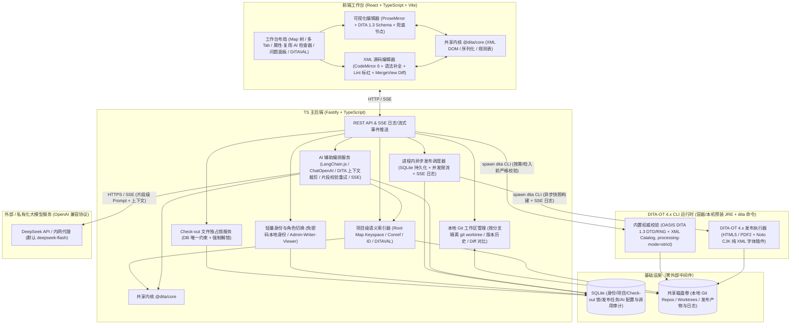
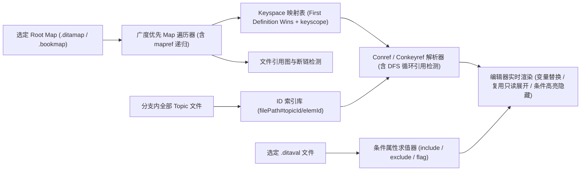

# Web 版 DITA 编辑器：架构设计、技术选型与实施计划

> 本文档为本项目的架构设计基线与分阶段实施计划，面向**单人 / AI 辅助独立推进**模式，围绕**团队级轻量 Web DITA 工作台**定义系统架构、核心难点攻关方案、技术选型矩阵与垂直切片落地路线。

---

## 一、需求共识总览（Design Tree 决策清单）

| 维度 | 已确认决策 | 对架构的关键约束 |
| :--- | :--- | :--- |
| **产品定位** | 团队级轻量 Web DITA 工作台（面向技术文档工程师） | 聚焦专业结构化写作效率，不做重型 CCMS 审批流 |
| **编辑模式** | 双模式切换（可视化结构化 WYSIWYG + XML 源码视图） | **标准 DITA XML 为唯一真相源**，必须保证无损往返（Round-trip） |
| **DITA 规范** | DITA 1.3 核心精渲染 + 未知/特化元素通用结构块兜底 | 核心类型精细建模，未知标签用通用容器节点保真透传，源码全量编辑 |
| **Map 编辑形态** | 双栏工作台（左侧可视化 Map 树 + 右侧多 Tab 单 Topic 编辑） | Map 树支持拖拽调层级、新建/挂载 Topic、属性编辑与源码切换 |
| **核心 DITA 语义 (V1)** | `keydef/keyref`、`conref/conkeyref`、`DITAVAL` 条件过滤 | 必须构建围绕 **Root Map** 的项目级语义解析引擎与循环引用检测 |
| **存储与版本控制** | 服务端托管本地 Git 工作区（不依赖外部 Git 平台） | 保留原生目录结构，支持本地仓库初始化、分支管理、Commit 历史与版本 Diff 对比，与本地工具互通 |
| **多人并发机制** | **仅支持 Check-out 独占锁**（单文件同时仅 1 人编辑） | 不做 CRDT 实时协同；按分支维度隔离 worktree，文件级悲观锁 + 管理员强解 |
| **校验策略** | 双层校验（前端实时约束 + 语义索引 + DITA-OT CLI 权威校验） | 日常编辑 0 延迟由 `@dita/core` 与语义索引器校验；按需/检入前/发布前调用 `dita` CLI 跑官方 DITA 1.3 DTD/RNG 严格校验 |
| **发布与预览** | 服务端 DITA-OT CLI 异步发布（Root Map + DITAVAL → HTML5 / PDF） | 异步构建队列、实时日志流、产物在线预览与打包下载，预置 Noto CJK 字体与纯 XML 字体插件 |
| **AI 辅助写作（Phase 6）** | 后端 **LangChain.js**（`@langchain/core` + `@langchain/openai`，默认 DeepSeek `deepseek-flash`，支持私有化代理） | 覆盖单 Topic 写作、语义/结构/Keyref 标签优化与三类错误修复，并为后续「手册发布后 RAG 问答」统一模型、Prompt 与 `BaseRetriever` 底座；片段级无损替换 + `@dita/core` 自动校验重试 + 强制 MergeView Diff 确认，写操作强守 Check-out 锁 |
| **前后端技术栈** | React + TS + Vite / TS 主后端 + DITA-OT 4.x CLI | 纯 TypeScript Monorepo（零 Java 业务代码），Node 后端直接调度系统/容器内预装的 `dita` CLI |
| **部署与权限** | 私有化/团队内网单容器部署（单 `Dockerfile` / 本机直跑） | 轻量身份切换（免密码工具栏切换作者与管理员 / 编辑者 / 只读角色），零外部认证与中间件依赖 |
| **推进方式** | 个人 / AI 辅助垂直切片迭代 | Phase 0 先攻克最高风险的 XML 无损双模内核，再逐层叠加能力 |

---

## 二、系统总体架构

系统采用 **纯 TypeScript 全栈 Monorepo + DITA-OT 4.x CLI 外部工具** 的分层架构。核心设计原则是：**把 DITA 词法/AST 模型与基础语义规则沉淀在共享包 `@dita/core` 中，不自建 Java 微服务，由 TS 后端通过子进程直接调度预装的 `dita` CLI 完成官方 DITA 1.3 DTD/RNG 权威校验与 HTML5/PDF 发布。**



### 关键架构决策解读

1. **为什么按分支建 `git worktree`，而不是整个仓库共用一个工作目录？**
   - 协作模型采用单文件 Check-out 独占锁，但团队里完全可能出现“A 在 `main` 分支检出 `install.dita`，B 切到 `release/2.0` 分支查看文档或触发发布”。
   - 后端使用一个 bare/主克隆目录，为每个活跃分支按需维护独立的 `git worktree` 目录。Check-out 锁的粒度精确到 `(repo_id, branch, file_path)`，分支之间互不干扰，且 DITA-OT 发布前会对目标分支工作区做只读快照，避免发布途中文件变更导致构建失败。
2. **为什么直接由 Node 后端调度 `dita` CLI，而不单独开发维护常驻 Java Worker？**
   - 编辑器日常输入与保存时的实时反馈，已由前端 ProseMirror/CodeMirror 约束、`@dita/core` 规则表与 TS 跨文件语义索引器（断链、`keyref`、`conref` 环路）以 0 延迟覆盖。
   - DITA-OT 4.x 本身已内置官方 OASIS DITA 1.3 DTD/RNG 校验器与发布引擎，且中文 PDF 字体映射插件仅为纯 XML 配置（`plugin.xml` + `font-mappings.xml` + `fop.xconf`）。通过 `spawn('dita', ...)` 按需在检入前/发布前做严格校验和异步构建，可实现**零 Java 业务代码**、免去独立 JVM 微服务的开发与运维；若未来确需 50ms 级保存期 DTD 校验，再平滑外挂常驻校验服务即可。
3. **为什么 AI 辅助采用「后端 LangChain.js（`@langchain/core` + `@langchain/openai`）+ 片段级 `@dita/core` 校验重试 + 强制 MergeView Diff 确认」，而不是前端直连或整篇重写？**
   - **私有化、密钥安全与后续手册 RAG 演进**：项目面向团队内网/单容器部署，API Key 仅由服务端持有（环境变量兜底 + SQLite 仅 `Admin` 可改、前端掩码展示）；通过 LangChain 的 `ChatOpenAI`（自定义 `configuration.baseURL`）既开箱对接 DeepSeek 官方 API（默认 `deepseek-flash`）与内网兼容代理，又在后端统一沉淀了 `ChatPromptTemplate`、`BaseChatModel` 工厂与可选 `BaseRetriever` 扩展口，后续接入「基于发布后手册产物的 RAG AI 问答」（文档切分、Embedding、向量检索与引用溯源）可平滑复用同一套编排与流式底座，而无需推翻重来（同时 `@dita/core` 保持零 LangChain 依赖的纯同构内核）。
   - **守住无损 XML 与最小 Git Diff 底线**：直接让大模型重写整篇 `.dita` 极易丢弃 `<!DOCTYPE>`、XML 注释、处理指令（PI）或打乱属性顺序。后端将目标缩小到选区节点/报错片段，生成后先由 `@dita/core` 校验良构性与合法性（不合法时自动带错反馈重试 1–2 次）再拼回原文，并强制经现有 CodeMirror 6 MergeView 展示精确 Diff；用户确认应用时同样严格受 Check-out 独占锁约束，避免破坏团队协作秩序。

---

## 三、六大核心技术难点攻关设计

Web DITA 编辑器 80% 的工程风险集中在下面 6 个模块，必须在编码前明确边界与实现策略：

### 1. XML 无损往返（Lossless Round-trip）与双模同步内核

这是整个项目**风险最高、决定成败的内核**。普通富文本编辑器（如 Tiptap/Quill）面向 HTML，直接用于 DITA 会丢失 `DOCTYPE`、XML 注释、`<?processing-instruction?>`、未识别属性以及原始标签结构，导致 Git Diff 满屏噪音。

- **底层 XML 表示层**：选用 `slimdom` + `slimdom-sax-parser` + `fontoxpath`（正是商业级 Web DITA 编辑器 Fonto 开源的基础 XML 栈）：
  - `slimdom` 完整保留 `DocumentType`、`Comment`、`ProcessingInstruction`、`CDATASection`、属性顺序和命名空间。
  - `slimdom-sax-parser` 在解析时为每个节点记录源码起止行列号（`line/col/offset`），用于可视化视图与源码视图光标互跳、校验报错精准定位。
  - `fontoxpath` 提供标准 XPath 3.1 查询，直接支撑 `#topicId/elemId` 解析、`keydef` 提取和 `conref` 目标定位。
- **ProseMirror Schema 与 XML 映射规则**：
  - **精细映射的核心类型**：
    - 文档级：`topic`、`concept`、`task`、`reference`（含 `title`、`shortdesc`、`prolog`、`body`/`conbody`/`taskbody`/`refbody`、`section`、`example`、`steps`/`step`/`cmd`/`info`/`stepresult` 等）。
    - 块级与行内：`p`、`ul`/`ol`/`li`、`dl`/`dlentry`/`dt`/`dd`、`note`（含 `type` 属性）、`codeblock`/`pre`、`fig`/`image`、`simpletable`、`table`（CALS）、`b`/`i`/`u`/`codeph`/`uicontrol`/`filepath`/`varname`/`ph`/`keyword`/`xref`/`fn`。
  - **未知/特化元素兜底机制（Passthrough Nodes）**：
    - 定义 `unknown_block` 和 `unknown_inline` 两种通用 ProseMirror 节点，保存原始 `tagName` 与 `rawAttrs`（JSON Map）。
    - 遇到未精细建模的 DITA 1.3 冷门标签（如 `hazardstatement`、`syntaxdiagram`）或自定义特化标签时，在可视化视图中以带标签徽章的边框容器/胶囊渲染，允许编辑内部文本或属性，序列化回 XML 时**原样输出原始标签名与全部属性**。
  - **特殊元信息保留**：XML 声明、`<!DOCTYPE ...>`、文档级注释与处理指令（PI）存储在 ProseMirror Document 的顶层元数据（或不可见锚点节点 `xml_comment` / `xml_pi`）中，切回源码或保存时无损还原。
- **CALS 表格专项处理**：
  - DITA `<simpletable>` 可直接映射为常规表格；而标准 `<table>` 采用 OASIS CALS 模型（`<tgroup cols="3"><colspec colname="c1"/>...<entry namest="c1" nameend="c2" morerows="1">`）。
  - **策略**：Phase 1 先将 `<simpletable>` 做到原生完整编辑体验，将 CALS `<table>` 通过专用适配器把 `namest/nameend/morerows` 转换为 `colspan/rowspan` 映射到 ProseMirror 表格节点（并保留 `colspec` 元数据），确保读写往返不破坏复杂合并单元格。
- **双模切换状态机**：
  - **Visual → Source**：ProseMirror `Doc` → `slimdom` → 格式化序列化为 XML 字符串（保持确定性缩进，最小化 Git Diff），刷新 CodeMirror 6。
  - **Source → Visual**：先检查 XML 良构性（Well-formed）。若存在未闭合标签等语法错误，**禁止切回 Visual 模式**并在源码视图高亮报错位置，待修复后再解析回 ProseMirror `Doc`，从根源避免非法 XML 破坏可视化树。

### 2. Map 可视化树与双栏工作台

- 左侧 Map 编辑器同样基于 `slimdom` 解析 `.ditamap` / `.bookmap`：
  - 将 `topicref`、`chapter`、`part`、`appendix`、`mapref`、`topichead`、`topicgroup`、`keydef` 映射为树节点模型，保留未建模节点（如 `topicmeta`、`reltable`、`bookmeta`）在 DOM 中原位不动。
  - 拖拽重排/调层级直接操作底层 `slimdom` 节点移动并即时写回 Map 缓冲区，支持一键切换查看/编辑该 Map 的 XML 源码。
  - 支持右键“新建 Topic 并挂载”（按 `concept`/`task`/`reference`/`topic` 模板创建标准 `.dita` 文件并自动生成相对路径 `href`）。
  - 顶部提供**当前激活 Root Map 选择器**与 **DITAVAL 预览选择器**，全局驱动右侧所有已打开 Topic 的语义解析。

### 3. Root Map 驱动的跨文件语义引擎（Keys / Conref / DITAVAL）

这是决定产品是否是“真 DITA 编辑器”的分水岭。后端维护按 `(repoId, branch)` 缓存的增量语义索引器（修改单个文件仅增量重算受影响节点）：



- **Keyspace 解析（`keydef` / `keyref`）**：
  - 严格遵循 DITA 1.3 规范的 **广度优先 + 先定义生效（First Definition Wins）** 原则，同时支持基础 `keyscope` 作用域前缀。
  - 索引每个 key 的 `href` 目标及内联文本（`topicmeta/keywords/keyword` 或 `linktext`）。
  - 在可视化编辑器中，`<keyword keyref="prod_name"/>` 或 `<ph keyref="ver"/>` 实时显示解析后的变量文本（带虚线下划线徽章提示，悬停显示定义来源 Map，若未定义则标红告警）。
- **内容复用（`conref` / `conkeyref`）**：
  - 插入向导支持先选目标文件/Key，再从该 Topic 的 ID 列表中挑选目标元素（自动校验目标元素与当前元素类型兼容性）。
  - 解析时执行 **DFS 访问栈检测**，一旦发现 `A → B → A` 循环引用立即中断并返回语义错误。
  - 在可视化编辑器中以 **只读嵌套块/行内装饰（Read-only NodeView）** 展开真实复用内容，并提供“跳转到源定义”快捷按钮；底层 XML 仅保存引用属性，不污染源标签。
- **条件过滤（Profiling & `DITAVAL`）**：
  - 所有支持过滤的元素在右侧属性面板均提供 `audience`、`platform`、`product`、`otherprops`、`props`、`rev` 的结构化多值编辑（支持从项目内已有值自动提示，减少拼写错误）。
  - 工具栏可选择项目中的 `.ditaval` 文件（或关闭过滤），实时在左侧 Map 树和右侧 Topic 编辑器中切换三种视觉模式：**全部显示（带属性彩色标签） / 淡化被排除内容 / 完全隐藏被排除内容**（外加 `flag` 规则的颜色/标记高亮）。整个过滤仅为视图层投影，不改动底层 XML。

### 4. Check-out 独占锁与本地 Git 版本管理状态机

- **锁模型**：在 SQLite（Drizzle ORM）`file_locks` 表建立唯一索引 `UNIQUE(project_id, branch, file_path)`，彻底杜绝并发抢锁竞态，零外部数据库依赖。
- **轻量身份切换**：免密码登录门槛，工具栏直接切换当前作者身份与角色（管理员 / 编辑者 / 只读），Check-out 锁归属与本地 Git Commit 作者信息均自动关联当前身份。
- **单文件生命周期**：
  1. **打开文件**：默认以**只读模式**打开（可直接浏览、复制、预览 `conref`/DITAVAL），顶部状态栏显示当前锁定人（若已被他人检出）。
  2. **Check out（检出）**：点击检出 → 后端检查当前分支工作区与锁状态 → 写入锁记录 → 编辑器切换为可编辑态。编辑过程中的自动保存写入工作区文件并标记为未提交（Dirty）。
  3. **Check in（检入）**：点击检入 → 可选先跑一次权威校验（有 Error 时拦截或二次确认）→ 展示单文件/批量 Git Diff → 填写 Commit Message → 仅 `git add` 当前身份检出的文件并执行本地 `git commit` → 释放数据库锁。
  4. **Cancel Check-out（撤销检出）**：执行 `git checkout -- <file>` 回滚本地改动并释放锁。
  5. **管理员强制解锁**：管理员在锁管理面板可强制释放他人占用的锁（默认先备份未提交内容为补丁/草稿，防止误删他人工作）。
- **版本管理与对比（无外部平台依赖）**：提供本地仓库自动初始化、分支切换/新建、项目级与单文件 Commit 历史浏览、工作区未提交改动与任意两个历史版本之间的可视化并排/行内 Diff 对比（基于 CodeMirror 6 MergeView），以及查看历史只读快照或按版本回滚。

### 5. 双层校验与 DITA-OT 异步发布（含中文 PDF 关键处理）

- **双层校验闭环**：
  - **第一层（日常实时，0 延迟）**：ProseMirror Schema 限制合法子节点与属性；CodeMirror 6 基于 `@dita/core` 规则表做标签与属性自动补全及 XML 良构检查；TS 语义索引器实时报出断链 `href`、未定义 `keyref`、无效/循环 `conref`。
  - **第二层（官方权威，手动触发 / 检入前 / 发布前）**：TS 后端通过子进程调用 `dita` CLI（启用 `--validate=yes --processing-mode=strict`，使用 DITA-OT 内置 OASIS DITA 1.3 DTD/RNG 与 XML Catalog），解析 DOTJ/DOTX 诊断日志并合并 TS 语义诊断，统一归一为 `{ filePath, line, column, severity, source, message }` 结构，在底部“问题面板”、源码红线和可视化节点旁同步高亮。
- **DITA-OT CLI 异步发布流水线**：
  - 用户选择 `Root Map` + `Output Format (HTML5 / PDF)` + 可选 `DITAVAL` → TS 后端写入 SQLite `publish_jobs` 记录并将当前分支工作区文件快照到独立构建目录 → 进程内并发限流调度器（默认并发 1–2）调用 `dita` CLI 执行构建，将 stdout/stderr 一边落盘到 `build.log`、一边通过 `EventEmitter` + SSE 实时回传前端构建日志抽屉（支持断线续看与手动取消）。
  - HTML5 产物通过受鉴权的静态预览路由直接在浏览器新标签页/抽屉内在线预览，同时提供 `.zip` 打包下载；PDF 支持在线预览与下载。
  - **中文 PDF 避坑方案（必做）**：DITA-OT 默认 `pdf2`（Apache FOP）不含中文字体，中文会全部渲染成 `###`。在 `api` 容器镜像内预装 **Noto Sans CJK SC / Noto Serif CJK SC**，并在仓库内置纯 XML 的 DITA-OT PDF 字体映射插件（`dita-ot-plugins/com.ditaeditor.pdf-cjk/`，含 `plugin.xml`、`catalog.xml`、`cfg/fo/font-mappings.xml` 与 `fop.xconf`），通过 `dita install` 注册（运行时同时通过 `--customization.dir` 优先加载仓库 XML Catalog，并以 `--args.fo.userconfig` 传入按字体目录生成的 FOP 配置），确保零 Java 代码即可开箱导出中文 PDF。

### 6. DeepSeek AI 辅助文档编写、标签优化与错误处理（无损约束与锁联动）

将大模型引入结构化 DITA 工作台，最难的不是“调通 Chat API”，而是如何在**不破坏无损 XML 往返、最小 Git Diff 与 Check-out 锁边界**的前提下，让 AI 真正理解 DITA 1.3 语义与项目上下文：

- **接入层、LangChain 底座与配置权限（`@langchain/core` + `@langchain/openai` + 默认 `deepseek-flash`）**：
  - 后端 `apps/api/src/modules/ai/` 基于 **LangChain.js**（仅引入核心包 `@langchain/core` 与 `@langchain/openai`，严格隔离在服务端，`@dita/core` 保持零依赖）封装 `ChatOpenAI` 工厂与 `ChatPromptTemplate`，默认对接 DeepSeek API 并采用 **`deepseek-flash`** 作为默认模型，同时支持配置兼容协议的私有化/内网代理 `baseURL` 与自定义模型名，并预留 `BaseRetriever` / `Embeddings` 扩展口以无缝衔接后续「手册发布后 RAG 问答」。
  - 配置采用 **环境变量兜底（`DEEPSEEK_API_KEY` / `DEEPSEEK_BASE_URL` / `DEEPSEEK_MODEL`）+ SQLite `ai_settings` 全局覆盖**：工作台设置弹窗仅 `Admin` 角色可编辑保存，API Key 仅服务端持有并向前端返回掩码状态（如 `sk-****1234`）。
- **按任务裁剪的 DITA 上下文组装与隐私边界**：
  - 服务端按任务类型自动组装精简上下文：目标节点周边 XML、当前信息类型与 `@dita/core` 合法子元素约束、当前 Root Map 的 `Keyspace` 摘要（用于 `keyref` 推荐与未定义 key 修复）、报错关联的工作区文件路径/Topic ID 清单，并设置硬性 Token 上限截断。
  - AI 面板提供透明可控的 **「附带项目上下文」开关**，并在发送区以胶囊标签展示本次实际附带的上下文范围，兼顾语义准确率与敏感信息外发控制。
- **三大核心场景设计**：
  1. **辅助文档编写（单 Topic 全生命周期）**：支持选区润色、扩写、精简、术语统一、中英互译、自动补全 `shortdesc` / 操作步骤，以及按自然语言需求或草稿生成结构规范的 `concept` / `task` / `reference` Topic（暂不做跨文件批量建 Map）。
  2. **优化标签（语义精细化 + 块级重构 + Keyref 推荐）**：将粗粒度 `<b>`/`<i>`/`<ph>` 或纯文本精准升级为 `<uicontrol>`、`<menucascade>`、`<codeph>`、`<filepath>`、`<varname>`、`<cmdname>` 等语义标签并补齐 `id`/`alt`；将平铺段落重构为 `<steps>/<step>/<cmd>/<stepresult>`、`<dl>`、`<note>`、`<codeblock>`；同时结合当前 Root Map `Keyspace`，识别硬编码产品名/版本号并建议替换为 `<keyword keyref="..."/>`。
  3. **错误处理（全覆盖三类错误 + 自动校验重试闭环）**：覆盖 **XML 良构错误**（`checkXmlWellFormed()`）、**项目语义诊断**（断链 `href`/未定义 `keyref`/无效或循环 `conref`/`ditaval`）与 **DITA-OT 严格校验/发布报错**（DOTJ/DOTX）。AI 生成修复方案后，后端先经 `@dita/core` 校验良构性与结构合法性；若仍不合法，将报错信息回喂模型自动纠错重试最多 **1–2 次**，验证通过后再向用户展示解释与 Diff，并支持对 DITA-OT 报错一键复跑严格校验复验。
- **无损落地安全、UI 融合与 Check-out 锁联动**：
  - **片段级靶向替换 + 强制 Diff 审阅**：默认只替换选中节点或报错片段并经 `@dita/core` 拼回原文档，完整保留 `<?xml ...?>`、`<!DOCTYPE ...>`、XML 注释、PI、属性顺序与未改动行（当原文档 XML 已损坏无法解析时，降级为报错行附近行段补丁并经 `checkXmlWellFormed()` 验证）。所有改写结果均通过现有 CodeMirror 6 MergeView（`DiffViewer`）展示精确 Diff，用户点击「应用」后才写入编辑器且支持单步 Undo。
  - **工作台入口融合**：右侧 `TopicInspector` 扩展为三 Tab（`属性` / `复用` / `AI 助手`），同时在选区浮动栏（`InlineBubbleToolbar`）、底部 `ProblemsPanel` 每条诊断、源码 XML 报错条与 `StrictValidationDialog` 报错项挂接「AI 优化 / AI 修复」快捷按钮，点击自动携带上下文切换至右侧 AI 面板。
  - **读写分离与锁保护**：未 Check-out 或 `Viewer` 只读状态下允许向 AI 提问、解释报错与预览优化方案，但「应用修改」强校验 Check-out 锁与写角色；`Writer`/`Admin` 在未检出文件上点击应用时提供一键 **「检出并应用」**。
- **流式交互与轻量审计**：
  - 响应通过 SSE 实时流式推送并支持随时中止（`AbortController`）；对话记录保存在前端当前会话态不落库；后端 SQLite `ai_usage_logs` 表仅记录调用元数据（作者、任务类型、模型、输入/输出 Token 数、耗时、状态，**不落盘文档正文**），供 `Admin` 查看团队用量统计。

---

## 四、技术选型矩阵

| 层级 / 模块 | 推荐选型 | 核心理由 | 备选方案（何时切换） |
| :--- | :--- | :--- | :--- |
| **工程组织** | **pnpm Workspace + Turborepo** | 原生支持 TS Monorepo，让前后端直接共享 `@dita/core` | Nx（团队规模扩大后再考虑） |
| **前端框架** | **React 19 + TypeScript + Vite** | 复杂工作台与自定义 NodeView 生态最成熟 | 已确认选型 |
| **UI 与工作台布局** | **Tailwind CSS + shadcn/ui (Radix) + `react-resizable-panels`** | 零运行时侵入、极适合高密度专业工具/IDE 风格 | Ant Design（偏后台表单风，工作台定制略重） |
| **可视化编辑引擎** | **原生 ProseMirror**（薄封装 React NodeView） | Content Expression 语法天然贴合 DTD 结构约束，无 Tiptap 的 HTML 抽象包袱 | Lexical / Slate（缺少原生声明式结构约束） |
| **XML 源码引擎** | **CodeMirror 6** (`@codemirror/lang-xml`, `lint`, `merge`) | 体积轻、切 Tab 极快、内置 Schema 补全/Lint/Diff | Monaco Editor（体积大，仅当强依赖 VS Code 体验时选） |
| **Map 树组件** | **`react-arborist`**（或 `@dnd-kit` 自定义虚拟树） | 专为 IDE 目录/大纲树设计，自带拖拽层级调整、快捷键与大树虚拟滚动 | `@dnd-kit/core`（完全手控定制） |
| **前端状态管理** | **Zustand + TanStack Query** | 区分本地工作台状态（Tab/锁/DITAVAL）与服务端异步缓存 | Redux Toolkit（样板代码偏多） |
| **XML 无损内核 (`@dita/core`)** | **`slimdom` + `slimdom-sax-parser` + `fontoxpath`** | Fonto 开源技术栈，完整保留 DOCTYPE/注释/PI/位置信息，支持 XPath 3.1 | `@xml-tools/parser`（纯 CST，缺少 DOM 与 XPath 生态） |
| **TS 主后端** | **Fastify + TypeScript + Zod** | 轻量高性能、开发心智负担低，非常适合个人/AI 快速迭代 | NestJS（多人强约束规范团队可选） |
| **Git 引擎** | **`simple-git`**（封装系统 git） | 原生支持本地仓库初始化、`git worktree`、分支、历史日志与 Diff，零外部平台依赖 | `isomorphic-git`（大仓库和 worktree 支持较弱） |
| **数据库 & ORM** | **SQLite + Drizzle ORM** | 零外部服务依赖、单文件开箱即用，强事务唯一索引支撑 Check-out 独占锁，Drizzle 类型安全轻量 | PostgreSQL（若后期多实例横向扩展可平滑迁移） |
| **异步发布队列与实时日志** | **SQLite (`publish_jobs`) + Node 进程内并发队列 + SSE** | 零外部中间件依赖，支持并发限流、超时强杀、手动取消与日志落盘断线续看 | Redis + BullMQ（仅后期多 API 副本横向扩展时按需引入） |
| **DITA-OT 发布与校验运行时** | **DITA-OT 4.x CLI + JRE 21 + 纯 XML 中文 PDF 插件** | 零 Java 业务代码，直接复用官方 DITA 1.3 DTD/RNG 校验与 HTML5/PDF2 发布引擎 | 独立常驻 Java Worker（仅在强需求 50ms 级保存期 DTD 校验时按需扩展） |
| **AI 辅助与模型接入 (Phase 6)** | **LangChain.js（`@langchain/core` + `@langchain/openai`，默认 DeepSeek `deepseek-flash`）+ SSE 流式 + SQLite 配置与轻量审计** | 仅引入轻量核心包即可统一 `ChatOpenAI`（兼容 DeepSeek 与内网代理）、Prompt 模板与消息历史，并天然预留 `BaseRetriever`/`Embeddings`/LangGraph 扩展位，平滑承接后续「基于手册发布后的 RAG AI 问答」 | 原生 `fetch` / `openai` SDK（若明确永远不做 RAG 知识库问答时可降级简化） |
| **部署交付** | **单容器 `Dockerfile`**（`@dita/api` 托管打包后的 `@dita/web` 静态资源，内置 JRE 21 + DITA-OT 4.x + Noto CJK） | 零外部数据库/队列中间件，一条 `docker run` 一键启动，SQLite 与本地 Git 仓库持久化在挂载卷 | 单机裸部署（本机安装 `dita` CLI 与 Noto CJK 字体亦可直接运行） |

---

## 五、推荐 Monorepo 目录结构

```text
DITAEditor/
├── apps/
│   ├── web/                    # React + Vite 前端工作台
│   │   ├── src/
│   │   │   ├── components/     # 通用 UI、工作台分栏、弹窗
│   │   │   ├── editor/
│   │   │   │   ├── visual/     # ProseMirror Schema、NodeViews、Toolbar、属性面板
│   │   │   │   ├── source/     # CodeMirror 6 XML 编辑器、补全、Lint 桥接
│   │   │   │   └── bridge/     # Visual <-> Source 双模无损同步与光标映射
│   │   │   ├── map-tree/       # 可视化 Map/Bookmap 树形编辑器
│   │   │   ├── git-panel/      # 分支管理、Check-out 状态、版本历史、Diff 对比、Commit
│   │   │   ├── publish/        # DITA-OT 发布配置、实时日志抽屉、产物预览
│   │   │   └── ai/             # AI 助手面板（TopicInspector 第三 Tab）、Diff 审阅、Admin 设置与用量统计
│   └── api/                    # Fastify + TypeScript 主后端
│       ├── src/
│       │   ├── modules/
│       │   │   ├── identity/   # 轻量身份与角色切换 (Admin / Writer / Viewer)
│       │   │   ├── projects/   # 项目配置、本地 Git 仓库与分支 worktree 管理
│       │   │   ├── locks/      # Check-out 独占锁与管理员强制解锁
│       │   │   ├── files/      # 文件读写、图片资产、重命名与引用影响检查
│       │   │   ├── indexer/    # Root Map Keyspace / Conref / ID / DITAVAL 语义引擎
│       │   │   ├── validate/   # 校验编排（调用 dita CLI 严格校验 + 解析日志 + 合并语义诊断）
│       │   │   ├── publish/    # SQLite 发布任务、进程内并发队列、工作区快照、spawn dita CLI、SSE 日志与静态预览路由
│       │   │   └── ai/         # LangChain.js (@langchain/core + @langchain/openai) 模型工厂、DITA 上下文裁剪、片段校验重试、SSE 流式与轻量审计（预留手册 RAG Retriever 扩展口）
│       │   └── db/             # Drizzle Schema & Migrations（含 ai_settings / ai_usage_logs）
├── packages/
│   └── dita-core/              # @dita/core 前后端共享核心库
│       ├── xml/                # slimdom 解析、位置追踪、确定性无损序列化
│       ├── model/              # DITA 1.3 核心元素定义、内容约束规则、属性元数据
│       ├── cals/               # CALS 表格 <-> 矩阵模型双向转换
│       ├── ditaval/            # .ditaval 解析与元素条件求值器
│       └── templates/          # concept / task / reference / topic / map 新建模板
├── dita-ot-plugins/            # 纯 XML DITA-OT 定制插件（零 Java 代码）
│   └── com.ditaeditor.pdf-cjk/ # 内置中文 PDF 字体映射插件 (plugin.xml + fop.xconf + font-mappings.xml)
├── Dockerfile                  # 单容器部署镜像（Node + JRE 21 + DITA-OT 4.x + Noto CJK + 前后端静态托管）
└── docs/                       # 架构文档、ADR 与接口契约
```

---

## 六、分阶段垂直切片实施计划

面向**个人 / AI 辅助独立推进**，遵循 **“高风险内核先行（Spike）→ 单机闭环 → 语义深化 → 团队协作 → 发布闭环 → AI 赋能”** 的原则，每个阶段产出可运行、可验收的垂直切片。Phase 0–5 基线总计约 **10–14 周**（已完成），Phase 6 增补约 **2–3 周**（按全职或高强度 AI 辅助推进估算；兼职可按比例顺延）。

### Phase 0：技术尖刺与工程底座（第 1 周）
> **目标**：在写任何业务页面之前，用自动化测试证明最难的“DITA XML 无损往返 + 双模互转”可行。
- 初始化 pnpm Monorepo（`apps/web`、`apps/api`、`packages/dita-core`）与基础测试框架（Vitest）。
- 在 `@dita/core` 跑通 `slimdom` + `slimdom-sax-parser` + `fontoxpath`。
- **核心验证（Spike）**：编写 10 份真实复杂的 DITA 1.3 样本文档（包含 `DOCTYPE`、XML 注释、PI、`task/steps`、CALS 合并单元格、未知特化标签、`conkeyref`），跑通 `XML → slimdom → ProseMirror Doc → slimdom → XML` 的双向转换黄金快照测试（Golden Tests），确保结构与属性 **100% 无损且 Diff 干净**。
- **验收标准**：10 份复杂 DITA 样本往返序列化测试全绿；`unknown_block` / `unknown_inline` 保真机制验证通过。

### Phase 1：双模式 Topic 编辑器核心 MVP（第 2–4 周）
> **目标**：单文件层面的专业 DITA Topic 编辑体验成型（暂用本地目录/内存样本驱动，快速打磨编辑器手感）。
- 实现 DITA 1.3 核心 Schema（`topic` / `concept` / `task` / `reference`）及高频元素渲染与编辑命令（标题、段落、列表、步骤 `steps/step/cmd`、`note`、`codeblock`、`fig/image`、`simpletable`、CALS `table`、行内格式化与 `xref`）。
- 实现上下文感知元素插入菜单（斜杠命令 `/` 或插入面板，仅展示当前光标处 DITA 规范允许插入的合法元素）、底部元素面包屑路径栏与右侧属性面板。
- 集成 CodeMirror 6 XML 源码视图，接入基于 `@dita/core` 规则表的标签/属性自动补全、XML 良构检查与 Visual ↔ Source 双向无损切换（带源码非法拦截保护）。
- **验收标准**：可流畅新建并编辑标准 Concept / Task / Reference 文档，在可视化与源码间反复切换无数据丢失，可编辑复杂表格和元素属性。

### Phase 2：Map 可视化树与多文件工作台（第 5–6 周）
> **目标**：从“单文件编辑器”升级为“多文件 DITA 项目工作台”。
- 搭建三栏可拖拽工作台（左侧 Map 树 / 文件浏览切换，中间多 Tab 编辑器，右侧属性面板，底部问题诊断面板）。
- 实现 Map / Bookmap 解析与 `react-arborist` 树形编辑器：支持拖拽调整 `topicref`/`mapref`/`topichead`/`chapter` 层级、右键按模板新建并挂载 Topic、编辑 `topicref` 属性、一键切换 Map 源码视图。
- 搭建 Fastify 后端与本地项目文件读写 API、图片上传与相对路径引用预览。
- **验收标准**：导入一份包含 50+ Topic 和嵌套子 Map 的真实 DITA 项目，可完整浏览、拖拽重构目录结构、多 Tab 编辑并保存落盘。

### Phase 3：单一信息源语义引擎（Keys + Conref + DITAVAL）（第 7–9 周）
> **目标**：交付团队最看重的三大 DITA 高级语义能力。
- 在后端构建按分支缓存的增量语义索引器（启动扫描 + 文件变更增量更新），并在工作台顶部接入 **Root Map 上下文选择器**。
- **Keyspace 能力**：实现广度优先 + `keyscope` 的 `keydef` 解析；编辑器支持插入 `keyref`、实时内联预览变量值、跳转到 Key 定义、未定义 Key 标红。
- **Conref / Conkeyref 能力**：实现复用插入选择器、跨文件片段解析、DFS 循环引用检测，以及可视化编辑器内只读内联展开渲染与一键跳转源文件。
- **DITAVAL 条件过滤能力**：实现 `.ditaval` 解析与求值器；右侧面板支持编辑条件属性；工作台顶部支持切换激活 `.ditaval` 文件并在 Map 树与 Topic 编辑器内实时高亮/淡化/隐藏条件内容。
- **验收标准**：在真实单源多版本测试项目中，切换不同 Root Map 或 DITAVAL 时，变量值、复用片段和条件显示均能毫秒级准确更新，循环引用能被精准拦截告警。

### Phase 4：本地 Git 版本管理、Check-out 独占锁与版本对比（第 10–11 周）
> **目标**：不依赖 GitHub / GitLab / Gitee 等外部平台，落地开箱即用的本地 Git 版本管理、Check-out 独占锁与可视化版本对比闭环。
- 接入 SQLite + Drizzle ORM，实现轻量身份切换（免密码在工具栏切换当前作者与三档角色：管理员 / 编辑者 / 只读），零外部服务依赖。
- 实现后端本地 Git 工作区管理器（基于 `simple-git` + 按分支隔离 `git worktree`）：支持为项目自动初始化或绑定本地 Git 仓库、分支切换/新建、项目与单文件 Commit 历史浏览，以及工作区未提交改动或任意两版本之间的可视化 Diff 对比（CodeMirror 6 MergeView）。
- 实现 **Check-out 独占锁服务**：打开默认只读、点击检出加锁、编辑草稿自动保存、检入前预览 Diff 并仅提交本人检出文件后释放锁、撤销检出回滚、管理员强制解锁（带补丁备份）。
- **验收标准**：在工具栏切换两个不同作者身份打开同一仓库同一分支，验证同一文件互斥检出、不同文件互不干扰、跨分支互不阻塞，以及完整 Check-out → 编辑 → Diff 对比 → Check-in（本地 Commit）→ 历史版本对比链路。

### Phase 5：DITA-OT CLI 权威校验、异步发布与容器部署（第 12–14 周）
> **状态**：✅ 已实现（v0.7.0）。运行时使用 DITA-OT 4.2.1 + JRE 21；严格校验命令为 `--validate=yes --processing-mode=strict`；中文 PDF 插件通过 XML Catalog `org.dita.pdf2.catalog.relative` 与 `--customization.dir` 加载；发布队列为 SQLite `publish_jobs` + 进程内并发限流。
>
> **目标**：零 Java 业务代码打通 DITA-OT 4.x 官方严格校验与 HTML5 / 中文 PDF 一键发布交付，达到团队生产可用状态。
- 构建纯 XML 的中文 PDF 字体插件 `dita-ot-plugins/com.ditaeditor.pdf-cjk/`（`plugin.xml` + `fop.xconf` + `font-mappings.xml`），并在后端运行镜像中预装 JRE 21 + DITA-OT 4.x + Noto CJK 字体（插件可通过 `dita install` 注册，但运行时始终以 `--customization.dir` 优先加载仓库插件，避免 DITA-OT 4 默认 Catalog 覆盖字体映射）。
- 打通**双层校验**：在现有实时前端约束与 TS 语义索引之上，新增 `/api/validate/strict`（手动触发 / Check-in 前 / 发布前调用 `dita` CLI `--validate=yes --processing-mode=strict`），解析 DOTJ/DOTX 报错并统一汇总到底部问题面板，点击精准定位到可视化节点或源码对应行/列。
- 实现零外部中间件的异步发布流水线（`apps/api/src/modules/publish/`，基于 SQLite `publish_jobs` 表 + Node 进程内并发限流队列）：工作区快照隔离构建、子进程调度 `dita` CLI（支持超时强杀与取消）、`build.log` 落盘 + SSE 实时构建日志流、HTML5 在线预览与 ZIP 导出、中文 PDF 正确渲染与下载、历史发布记录管理。
- 编写单容器 `Dockerfile`（生产模式由 `@dita/api` 直接托管打包后的 `@dita/web` 静态资源，镜像内置 Node + JRE 21 + DITA-OT 4.x + Noto CJK 字体与中文 PDF 插件，无 Redis/PG 外部依赖），补齐单容器部署、本机 `dita` CLI 配置说明与数据卷备份方案。
- **验收标准**：通过单容器 `docker run`（或本机安装 DITA-OT CLI）一键运行；故意写入违反 DITA 1.3 DTD 的标签可在严格校验中准确标红定位；选定 Root Map + DITAVAL 一键产出排版正常、中文无乱码的 HTML5 与 PDF。

### Phase 6：DeepSeek AI 辅助文档编写、标签优化与错误处理（第 15–17 周）
> **状态**：📋 规划中（设计共识已确认；详细实施方案见 [phase6-ai-implementation-plan.md](./phase6-ai-implementation-plan.md)）。后端采用 **LangChain.js**（`@langchain/core` + `@langchain/openai`），默认模型为 `deepseek-flash`，支持私有化/内网兼容代理，并为后续手册发布后 RAG 问答预留 `BaseRetriever` 扩展底座。
>
> **目标**：在不破坏 DITA 无损 XML 往返、最小 Git Diff 与 Check-out 独占锁边界的前提下，引入 DeepSeek 全面提升单 Topic 编写、标签规范化与错误排障效率。
- **后端 AI 模块与配置审计（`apps/api/src/modules/ai/` + LangChain.js + Drizzle）**：
  - 引入 `@langchain/core` + `@langchain/openai`，构建 `ChatOpenAI` 模型工厂与 `ChatPromptTemplate` 编排层，默认接入 DeepSeek API（`deepseek-flash`），支持自定义私有化/内网代理 `baseURL` 与模型名，并预留 `BaseRetriever` / `Embeddings` 接口承接后续发布手册 RAG 问答。
  - 在 SQLite 新增 `ai_settings`（环境变量兜底、仅 `Admin` 可写、API Key 服务端持有并掩码返回）与 `ai_usage_logs`（仅记录作者、任务类型、模型、Token 用量、耗时与状态，不存储文档正文）。
  - 实现按任务裁剪的 DITA 上下文构建器（周边 XML、`@dita/core` 合法子元素约束、Root Map `Keyspace` 摘要、报错关联清单 + Token 上限截断）以及 SSE 流式响应与 `AbortController` 中止取消。
- **内核无损片段拼装与自动校验重试（`@dita/core` + `apps/api`）**：
  - 在 `@dita/core` 补齐面向 AI 的节点/片段级提取与无损回拼能力，以及针对损坏 XML 的局部行段补丁兜底，确保 `<?xml?>`、`<!DOCTYPE>`、注释、PI 与未改动区域零污染。
  - 落地 AI 修复结果自动预验闭环：生成 XML 片段后先经 `@dita/core` 检验良构性与结构合法性，若失败则附带错误详情自动向模型发起最多 1–2 次纠错重试，通过后再返回前端。
- **三大核心能力与前端工作台深度融合（`apps/web/src/ai/`）**：
  - **辅助文档编写**：支持选区润色/扩写/精简/术语统一/中英互译、`shortdesc` 与步骤补全，以及按自然语言需求/草稿生成标准 `concept`/`task`/`reference` Topic。
  - **优化标签**：实现行内语义标签精细化（`uicontrol`/`menucascade`/`codeph`/`filepath`/`varname` 等）、块级结构规范化（`steps`/`dl`/`note`/`codeblock`）与结合当前 Root Map `Keyspace` 的 `keyref` 变量替换建议。
  - **错误处理**：打通 XML 良构错误、项目语义诊断（`ProblemsPanel`）与 DITA-OT 严格校验/发布报错（`StrictValidationDialog`）三类报错源，提供中文根因解释、预验修复 Diff 与一键复跑 DITA-OT 严格校验。
  - **UI 入口与安全落地**：在右侧 `TopicInspector` 新增 `AI 助手` Tab（含「附带项目上下文」透明开关与上下文标签），并在选区浮动栏、问题面板、源码报错条与严格校验弹窗挂接快捷按钮；所有改动强制经现有 CodeMirror MergeView（`DiffViewer`）审阅后写入并支持单步 Undo；遵循读写分离与 Check-out 锁边界（只读/Viewer 仅问答预览，`Writer`/`Admin` 未检出时支持一键「检出并应用」）；新增 `Admin` 专属 AI 配置与调用统计弹窗。
- **验收标准**：通过单测（Mock OpenAI 兼容 SSE 流 + `@dita/core` 片段无损回拼与自动重试用例）与端到端手测验证：在含 `DOCTYPE`/注释/PI 的复杂 Topic 上执行选区改写、标签优化与三类错误修复，MergeView Diff 仅改动目标片段且无损往返；未检出文件可提问预览但写操作触发 Check-out 拦截或一键检出并应用；切换为内网兼容代理 URL 与自定义模型可正常工作。

---

## 七、主要工程风险与应对策略

| 风险点 | 触发场景 | 应对策略 |
| :--- | :--- | :--- |
| **Git Diff 污染** | 可视化编辑改了一个字，保存后整篇 XML 缩进、属性顺序全变 | Phase 0 即引入确定性序列化器，严格保留属性顺序、注释与未改动节点格式，并建立 Round-trip 回归测试集 |
| **CALS 复杂表格损坏** | 带多行跨列（`namest`/`nameend`/`morerows`）与多 `tgroup` 的技术规格表 | 编写独立 `@dita/core/cals` 单元测试；对含多个 `tgroup` 等极端结构自动降级为源码编辑提示，绝不静默丢数据 |
| **DITA-OT 构建阻塞与磁盘膨胀** | 多人同时发布大手册，临时构建目录和历史产物占满磁盘 | 进程内发布调度器限制并发度（如 1–2 个构建并发），构建超时强制 kill，服务重启自动回收中断任务并定时清理超过 N 天的历史构建产物 |
| **DITA-OT 中文 PDF 乱码** | 默认 FOP 找不到 CJK 字形导致方块/`###` | 后端镜像内置 Noto CJK 字体 + 纯 XML 定制 `font-mappings` 插件，并通过 `--customization.dir` 优先加载 XML Catalog（避免 DITA-OT 4 默认 Catalog 覆盖），纳入 Phase 5 必检验收项 |
| **Check-out 死锁** | 成员检出文件后长期休假或忘记检入 | 提供清晰的锁定人/锁定时间展示、锁到期提醒，以及管理员带补丁备份的一键强制解锁 |
| **AI 改写破坏 XML 结构或污染无关行** | 模型幻觉遗漏 `DOCTYPE`/注释、输出未闭合或违背 DTD 的标签、或改写选区外内容 | 采用片段级靶向替换 + `@dita/core` 校验拼回与 1–2 次自动纠错重试；强制通过 MergeView 审阅 Diff 后应用，且受 Check-out 锁与单步 Undo 双重兜底 |
