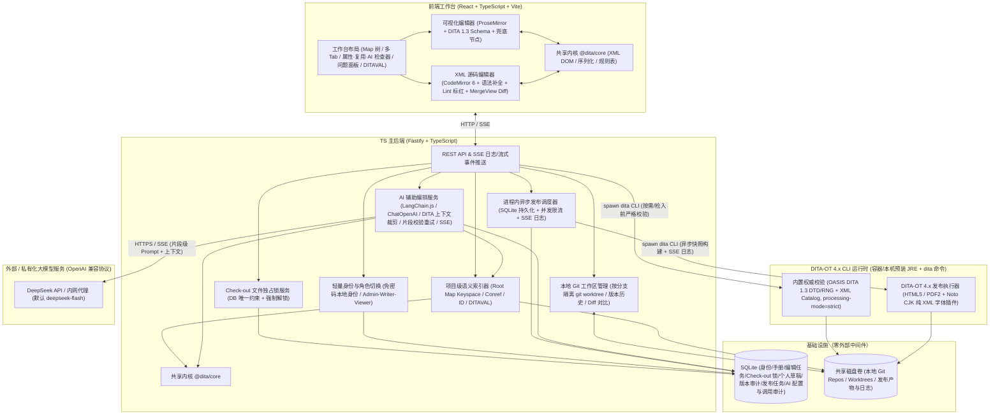
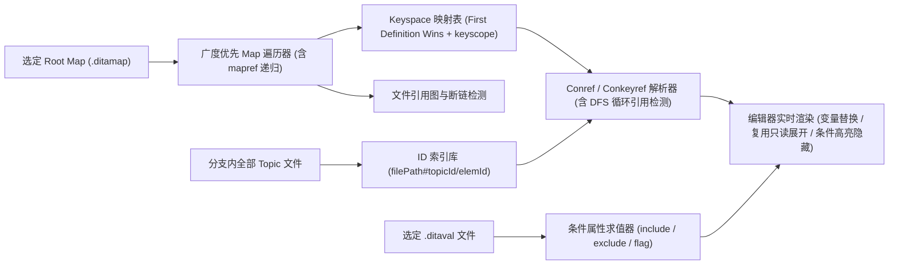

# Web 版 DITA 编辑器：架构设计、技术选型与实施计划

> 本文档为本项目的架构设计基线与分阶段实施计划，面向**单人 / AI 辅助独立推进**模式，围绕**团队级轻量 Web DITA 工作台**定义系统架构、核心难点攻关方案、技术选型矩阵与垂直切片落地路线。
>
> 版本管理与个人草稿叠加层重构方案（Phase 13），另见 [phase13-versioning-overlay-plan.md](phase13-versioning-overlay-plan.md) 与 [ADR 0004](adr/0004-baseline-and-draft-overlay.md)。
> 文档智能导入与多角色 AI Agent 撰写校验闭环方案（Phase 14），另见 [phase14-docling-agent-plan.md](phase14-docling-agent-plan.md)。

---

## 一、需求共识总览（Design Tree 决策清单）

| 维度 | 已确认决策 | 对架构的关键约束 |
| :--- | :--- | :--- |
| **产品定位** | 团队级轻量 Web DITA 工作台（面向技术文档工程师） | 聚焦专业结构化写作效率，不做重型 CCMS 审批流 |
| **编辑模式** | 双模式切换（可视化结构化 WYSIWYG + XML 源码视图） | **标准 DITA XML 为唯一真相源**，必须保证无损往返（Round-trip） |
| **DITA 规范** | DITA 1.3 核心精渲染 + 未知/特化元素通用结构块兜底 | 核心类型精细建模，未知标签用通用容器节点保真透传，源码全量编辑 |
| **Map 编辑形态** | 双栏工作台（左侧可视化 Map 树 + 右侧多 Tab 单 Topic 编辑） | Map 树支持拖拽调层级、新建/挂载 Topic、属性编辑与源码切换 |
| **核心 DITA 语义 (V1)** | `keydef/keyref`、`conref/conkeyref`、`DITAVAL` 条件过滤 | 必须构建围绕 **Root Map** 的项目级语义解析引擎与循环引用检测 |
| **存储与版本控制** | 服务端托管本地 Git 工作区（不依赖外部 Git 平台） | 保留原生目录结构，支持本地仓库初始化、分支管理、Commit 历史与版本 Diff 对比，与本地工具互通 |
| **多人并发机制** | **仅支持 Check-out 独占锁**（单文件同时仅 1 人编辑） | 不做 CRDT 实时协同；按分支维度隔离 worktree，文件级悲观锁 + 管理员强解 |
| **校验策略** | 双层校验（前端实时约束 + 语义索引 + DITA-OT CLI 权威校验） | 日常编辑 0 延迟由 `@dita/core` 与语义索引器校验；按需/检入前/发布前调用 `dita` CLI 跑官方 DITA 1.3 DTD/RNG 严格校验 |
| **发布与预览** | 服务端 DITA-OT CLI 异步发布（Root Map + DITAVAL → HTML5 / PDF） | 异步构建队列、实时日志流、产物在线预览与打包下载，预置 Noto CJK 字体与纯 XML 字体插件 |
| **AI 辅助写作（Phase 6）** | 后端 **LangChain.js**（`@langchain/core` + `@langchain/openai`，默认 DeepSeek `deepseek-flash`，支持私有化代理） | 覆盖单 Topic 写作、语义/结构/Keyref 标签优化与三类错误修复，并为后续「手册发布后 RAG 问答」统一模型、Prompt 与 `BaseRetriever` 底座；片段级无损替换 + `@dita/core` 自动校验重试 + 强制 MergeView Diff 确认，写操作强守 Check-out 锁 |
| **项目官网与在线离线版（Phase 7）** | 独立静态站 `apps/site`（**Astro 5 + React 19 Islands + Tailwind CSS 4**），中英双语（`zh-CN` / `en`），现代技术出版编辑风；GitHub Pages 合包发布 `/workbench/`（`@dita/web` `VITE_STATIC_DEMO=true` 离线模式） | 营销页与文档页零 JS 静态输出，首页内嵌 `@dita/core` 懒加载微演示，在线体验直接跳转 `/workbench/` 纯前端离线三栏工作台；与单容器工作台镜像完全解耦 |
| **英文版界面与国际化（Phase 8）** | 零外部依赖的强类型全栈 i18n（`zh-CN` / `en`），浏览器语言自动探测 + 顶栏实时无刷新切换（`localStorage` 持久化） | 覆盖前端工作台 UI / CSS 伪元素 / ProseMirror 热刷新、`@dita/core` 规则与模板/语义诊断、`@dita/api` 报错与 AI 回复语言（`x-dita-locale` 请求头）；严格对齐 OASIS DITA 1.3 官方英文术语且不改动已有文档正文 |
| **手册编辑工作台与 Topic 委派（Phase 10）** | 独立「手册编辑工作台（Workbench Hub）」首页（`/`）+ 三栏编辑器路由（`/manuals/:id`）；1 手册 = 1 独立工作区与 Git 仓库；轻量 Topic 编辑任务（`Assignment`）委派与软引导协作 | 后端按 `x-dita-manual-id` + `x-dita-branch` 请求级隔离多手册与多分支 worktree；任务仅落库 SQLite（零 XML/Git 污染），与 Check-out 锁解耦（不自动加锁、不做审批流），并支持 Check-out 自动推进与 Check-in 可选同步结单 |
| **HTML5 发布样式主题与多套模板（Phase 12）** | 内置 **4 套专业 HTML5 文档主题（现代技术文档 / 出版极简纸白 / 企业标准手册 / 开发者暗夜风）+ 原生默认兜底**；DITA-OT 原生 `--nav-toc=full` 搭配确定性静态后处理增强（侧栏树、页内 TOC、`Cmd+K` 离线搜索、代码复制、明暗切换、移动端适配）；轻量品牌定制（主色 / Logo / 标题 / 页脚 / 自定义 CSS）按手册持久化 | 零 DITA-OT XSLT/Java 插件安装门槛（Docker / 本机 / 桌面端一致可用），零 CDN 外部依赖，ZIP 解压 `file://` 双击离线搜索同样可用；配置仅落库 SQLite，零 XML/Git 污染 |
| **干净基线 + 个人草稿叠加层与合并闭环（Phase 13，已实施）** | 分支 `workDir` 永远保持 clean（严格等于 `HEAD` 基线），未检入编辑/新建/删除/重命名与草稿图片资产全部隔离在 SQLite `working_drafts`（仅持锁人可见）；签入原子落盘推进基线，语法校验/AI 上下文读 `User Overlay`，正式发布默认走 `Baseline/Tag/Commit`（可选 `my_drafts` 预览），补齐 Tag、安全回滚、无污染 Merge、乐观锁与路径解耦（见 [phase13-versioning-overlay-plan.md](./phase13-versioning-overlay-plan.md) 与 [ADR 0004](./adr/0004-baseline-and-draft-overlay.md)） | 同分支多人共编同一 Map 仍只用 1 个 worktree 且零互相污染；只读 GET 永不隐式建分支；零 XML/Git 元数据污染；兼容桌面端外部改盘探测 |
| **文档智能导入与 AI Agent 撰写校验闭环（Phase 14，已实施）** | 新增可插拔双解析层：**Docling**（`docling-serve` sidecar HTTP 优先 + `docling` CLI 回退，主打扫描件 OCR / 复杂 PDF 版面 / 插图与表格）+ **Microsoft MarkItDown**（轻量 Python CLI，主打 `.docx`/`.pptx`/`.xlsx`/`.xls`/`.epub`/`.csv`/`.msg`/HTML 与文本型 PDF 回退），`.md`/`.txt` 直通；解析产物统一为 Markdown + 提取图片资产（`asset://img_NNN.<ext>`），再由复用 LangChain.js 底座的**多角色 Agent（Planner → Writer → 有界工具化 DITA-OT Repair Agent + 确定性终检门禁）** 生成 DITA 1.3 项目与 Topic，完成 `@dita/core` 良构/结构/根直系子节点校验 + 跨文件语义 + DITA-OT `lax` 预扫/`strict` 终检（不可用时显式 `skipped`，非 Tool-Calling 模型自动按 Topic 独立计数降级）的自修复闭环；支持「新建项目（干净基线 Git init）」与「现有手册新建 Topic（严格写 Phase 13 个人草稿叠加层）」双目标，5 步向导 + SSE 实时进度（见 [phase14-docling-agent-plan.md](./phase14-docling-agent-plan.md)） | 主镜像默认**零 Python 依赖**保持精简，仅 `--build-arg INSTALL_MARKITDOWN=true` 时在 `/opt/markitdown-venv` 安装 `markitdown[all]`；新增根级 `docker-compose.yml` 一键编排 `ditaeditor` + `docling-serve`（CPU 默认 / CUDA GPU 镜像可切换），Docling 仅经 HTTP 调用（`DOCLING_MODE=serve`）；导入作业全部落 SQLite `ingest_jobs` 与 `/data/ingest` 暂存目录，修复 Agent 仅能改写暂存区生成文件并受确定性 `strict` 终检约束，落盘保留 Draft Overlay 隔离与锁语义 |
| **前后端技术栈** | React + TS + Vite / TS 主后端 + DITA-OT 4.x CLI | 纯 TypeScript Monorepo（零 Java 业务代码），Node 后端直接调度系统/容器内预装的 `dita` CLI |
| **部署与权限** | 私有化/团队内网单容器部署（单 `Dockerfile` / 本机直跑）+ **GCP Cloud Run 低成本试用部署**（`min=0`/`max=1`、子路径反向代理 `VITE_BASE` / `DITA_BASE_PATH` + GitHub Actions 无密钥 WIF `push` 自动发布）+ 轻量桌面端（`apps/desktop`，macOS Apple Silicon & Windows x64） | 轻量身份切换（免密码工具栏切换作者与管理员 / 编辑者 / 只读角色），零外部认证与中间件依赖；单容器支持根路径 `/` 与反代子路径（如 `/dita`）双形态运行；桌面端主进程内嵌 `@dita/api`（`127.0.0.1:0`），数据目录隔离至 `app.getPath('userData')`，与 `Dockerfile` 完全解耦 |
| **推进方式** | 个人 / AI 辅助垂直切片迭代 | Phase 0 先攻克最高风险的 XML 无损双模内核，再逐层叠加能力 |

---

## 二、系统总体架构

系统采用 **纯 TypeScript 全栈 Monorepo + DITA-OT 4.x CLI 外部工具** 的分层架构。核心设计原则是：**把 DITA 词法/AST 模型与基础语义规则沉淀在共享包 `@dita/core` 中，不自建 Java 微服务，由 TS 后端通过子进程直接调度预装的 `dita` CLI 完成官方 DITA 1.3 DTD/RNG 权威校验与 HTML5/PDF 发布。**



### 关键架构决策解读

1. **为什么按分支建 `git worktree`，而不是整个仓库共用一个工作目录？**
   - 协作模型采用单文件 Check-out 独占锁，但团队里完全可能出现“A 在 `main` 分支检出 `install.dita`，B 切到 `release/2.0` 分支查看文档或触发发布”。
   - 后端使用一个 bare/主克隆目录，为每个活跃分支按需维护独立的 `git worktree` 目录。Check-out 锁的粒度精确到 `(repo_id, branch, file_path)`，分支之间互不干扰，且 DITA-OT 发布前会对目标分支工作区做只读快照，避免发布途中文件变更导致构建失败。
2. **为什么直接由 Node 后端调度 `dita` CLI，而不单独开发维护常驻 Java Worker？**
   - 编辑器日常输入与保存时的实时反馈，已由前端 ProseMirror/CodeMirror 约束、`@dita/core` 规则表与 TS 跨文件语义索引器（断链、`keyref`、`conref` 环路）以 0 延迟覆盖。
   - DITA-OT 4.x 本身已内置官方 OASIS DITA 1.3 DTD/RNG 校验器与发布引擎，且中文 PDF 字体映射插件仅为纯 XML 配置（`plugin.xml` + `font-mappings.xml` + `fop.xconf`）。通过 `spawn('dita', ...)` 按需在检入前/发布前做严格校验和异步构建，可实现**零 Java 业务代码**、免去独立 JVM 微服务的开发与运维；若未来确需 50ms 级保存期 DTD 校验，再平滑外挂常驻校验服务即可。
3. **为什么 AI 辅助采用「后端 LangChain.js（`@langchain/core` + `@langchain/openai`）+ 片段级 `@dita/core` 校验重试 + 强制 MergeView Diff 确认」，而不是前端直连或整篇重写？**
   - **私有化、密钥安全与后续手册 RAG 演进**：项目面向团队内网/单容器部署，API Key 仅由服务端持有（环境变量兜底 + SQLite 仅 `Admin` 可改、前端掩码展示）；通过 LangChain 的 `ChatOpenAI`（自定义 `configuration.baseURL`）既开箱对接 DeepSeek 官方 API（默认 `deepseek-flash`）与内网兼容代理，又在后端统一沉淀了 `ChatPromptTemplate`、`BaseChatModel` 工厂与可选 `BaseRetriever` 扩展口，后续接入「基于发布后手册产物的 RAG AI 问答」（文档切分、Embedding、向量检索与引用溯源）可平滑复用同一套编排与流式底座，而无需推翻重来（同时 `@dita/core` 保持零 LangChain 依赖的纯同构内核）。
   - **守住无损 XML 与最小 Git Diff 底线**：直接让大模型重写整篇 `.dita` 极易丢弃 `<!DOCTYPE>`、XML 注释、处理指令（PI）或打乱属性顺序。后端将目标缩小到选区节点/报错片段，生成后先由 `@dita/core` 校验良构性与合法性（不合法时自动带错反馈重试 1–2 次）再拼回原文，并强制经现有 CodeMirror 6 MergeView 展示精确 Diff；用户确认应用时同样严格受 Check-out 独占锁约束，避免破坏团队协作秩序。

---

## 三、六大核心技术难点攻关设计

Web DITA 编辑器 80% 的工程风险集中在下面 6 个模块，必须在编码前明确边界与实现策略：

### 1. XML 无损往返（Lossless Round-trip）与双模同步内核

这是整个项目**风险最高、决定成败的内核**。普通富文本编辑器（如 Tiptap/Quill）面向 HTML，直接用于 DITA 会丢失 `DOCTYPE`、XML 注释、`<?processing-instruction?>`、未识别属性以及原始标签结构，导致 Git Diff 满屏噪音。

- **底层 XML 表示层**：选用 `slimdom` + `slimdom-sax-parser` + `fontoxpath`（正是商业级 Web DITA 编辑器 Fonto 开源的基础 XML 栈）：
  - `slimdom` 完整保留 `DocumentType`、`Comment`、`ProcessingInstruction`、`CDATASection`、属性顺序和命名空间。
  - `slimdom-sax-parser` 在解析时为每个节点记录源码起止行列号（`line/col/offset`），用于可视化视图与源码视图光标互跳、校验报错精准定位。
  - `fontoxpath` 提供标准 XPath 3.1 查询，直接支撑 `#topicId/elemId` 解析、`keydef` 提取和 `conref` 目标定位。
- **ProseMirror Schema 与 XML 映射规则**：
  - **精细映射的核心类型**：
    - 文档级：`topic`、`concept`、`task`、`reference`（含 `title`、`shortdesc`、`prolog`、`body`/`conbody`/`taskbody`/`refbody`、`section`、`example`、`steps`/`step`/`cmd`/`info`/`stepresult` 等）。
    - 块级与行内：`p`、`ul`/`ol`/`li`、`dl`/`dlentry`/`dt`/`dd`、`note`（含 `type` 属性）、`codeblock`/`pre`、`fig`/`image`、`simpletable`、`table`（CALS）、`b`/`i`/`u`/`codeph`/`uicontrol`/`filepath`/`varname`/`ph`/`keyword`/`xref`/`fn`。
  - **未知/特化元素兜底机制（Passthrough Nodes）**：
    - 定义 `unknown_block` 和 `unknown_inline` 两种通用 ProseMirror 节点，保存原始 `tagName` 与 `rawAttrs`（JSON Map）。
    - 遇到未精细建模的 DITA 1.3 冷门标签（如 `hazardstatement`、`syntaxdiagram`）或自定义特化标签时，在可视化视图中以带标签徽章的边框容器/胶囊渲染，允许编辑内部文本或属性，序列化回 XML 时**原样输出原始标签名与全部属性**。
  - **特殊元信息保留**：XML 声明、`<!DOCTYPE ...>`、文档级注释与处理指令（PI）存储在 ProseMirror Document 的顶层元数据（或不可见锚点节点 `xml_comment` / `xml_pi`）中，切回源码或保存时无损还原。
- **CALS 表格专项处理**：
  - DITA `<simpletable>` 可直接映射为常规表格；而标准 `<table>` 采用 OASIS CALS 模型（`<tgroup cols="3"><colspec colname="c1"/>...<entry namest="c1" nameend="c2" morerows="1">`）。
  - **策略**：Phase 1 先将 `<simpletable>` 做到原生完整编辑体验，将 CALS `<table>` 通过专用适配器把 `namest/nameend/morerows` 转换为 `colspan/rowspan` 映射到 ProseMirror 表格节点（并保留 `colspec` 元数据），确保读写往返不破坏复杂合并单元格。
- **双模切换状态机**：
  - **Visual → Source**：ProseMirror `Doc` → `slimdom` → 格式化序列化为 XML 字符串（保持确定性缩进，最小化 Git Diff），刷新 CodeMirror 6。
  - **Source → Visual**：先检查 XML 良构性（Well-formed）。若存在未闭合标签等语法错误，**禁止切回 Visual 模式**并在源码视图高亮报错位置，待修复后再解析回 ProseMirror `Doc`，从根源避免非法 XML 破坏可视化树。

### 2. Map 可视化树与双栏工作台

- 左侧 Map 编辑器同样基于 `slimdom` 解析 `.ditamap`：
  - 将 `topicref`、`mapref`、`topichead`、`topicgroup`、`keydef` 映射为树节点模型，保留未建模节点（如 `topicmeta`、`reltable`）在 DOM 中原位不动。
  - 拖拽重排/调层级直接操作底层 `slimdom` 节点移动并即时写回 Map 缓冲区，支持一键切换查看/编辑该 Map 的 XML 源码。
  - 支持右键“新建 Topic 并挂载”（按 `concept`/`task`/`reference`/`topic` 模板创建标准 `.dita` 文件并自动生成相对路径 `href`）。
  - 顶部提供**当前激活 Root Map 选择器**与 **DITAVAL 预览选择器**，全局驱动右侧所有已打开 Topic 的语义解析。

### 3. Root Map 驱动的跨文件语义引擎（Keys / Conref / DITAVAL）

这是决定产品是否是“真 DITA 编辑器”的分水岭。后端维护按 `(repoId, branch)` 缓存的增量语义索引器（修改单个文件仅增量重算受影响节点；Phase 13 起进一步拆分为共享只读 `Baseline` 基线索引 + 按用户浅拷贝增量叠加的 `User Overlay` 索引，杜绝同分支未检入草稿互相污染）：



- **Keyspace 解析（`keydef` / `keyref`）**：
  - 严格遵循 DITA 1.3 规范的 **广度优先 + 先定义生效（First Definition Wins）** 原则，同时支持基础 `keyscope` 作用域前缀。
  - 索引每个 key 的 `href` 目标及内联文本（`topicmeta/keywords/keyword` 或 `linktext`）。
  - 在可视化编辑器中，`<keyword keyref="prod_name"/>` 或 `<ph keyref="ver"/>` 实时显示解析后的变量文本（带虚线下划线徽章提示，悬停显示定义来源 Map，若未定义则标红告警）。
- **内容复用（`conref` / `conkeyref`）**：
  - 插入向导支持先选目标文件/Key，再从该 Topic 的 ID 列表中挑选目标元素（自动校验目标元素与当前元素类型兼容性）。
  - 解析时执行 **DFS 访问栈检测**，一旦发现 `A → B → A` 循环引用立即中断并返回语义错误。
  - 在可视化编辑器中以 **只读嵌套块/行内装饰（Read-only NodeView）** 展开真实复用内容，并提供“跳转到源定义”快捷按钮；底层 XML 仅保存引用属性，不污染源标签。
- **条件过滤（Profiling & `DITAVAL`）**：
  - 所有支持过滤的元素在右侧属性面板均提供 `audience`、`platform`、`product`、`otherprops`、`props`、`rev` 的结构化多值编辑（支持从项目内已有值自动提示，减少拼写错误）。
  - 工具栏可选择项目中的 `.ditaval` 文件（或关闭过滤），实时在左侧 Map 树和右侧 Topic 编辑器中切换三种视觉模式：**全部显示（带属性彩色标签） / 淡化被排除内容 / 完全隐藏被排除内容**（外加 `flag` 规则的颜色/标记高亮）。整个过滤仅为视图层投影，不改动底层 XML。

### 4. Check-out 独占锁与本地 Git 版本管理状态机

- **锁模型**：在 SQLite（Drizzle ORM）`file_locks` 表建立唯一索引 `UNIQUE(project_id, branch, file_path)`，彻底杜绝并发抢锁竞态，零外部数据库依赖。
- **轻量身份切换**：免密码登录门槛，工具栏直接切换当前作者身份与角色（管理员 / 编辑者 / 只读），Check-out 锁归属与本地 Git Commit 作者信息均自动关联当前身份。
- **单文件生命周期（Phase 4 现状 → Phase 13 演进目标）**：
  1. **打开文件**：默认以**只读模式**打开（可直接浏览、复制、预览 `conref`/DITAVAL），顶部状态栏显示当前锁定人（若已被他人检出）。
  2. **Check out（检出）**：点击检出 → 后端检查当前分支工作区与锁状态 → 写入锁记录 → 编辑器切换为可编辑态。Phase 4 现状下自动保存直接写入共享 `workDir`；**Phase 13 起演进为写入 SQLite `working_drafts` 个人草稿层（共享 `workDir` 永远保持 clean = `HEAD`）**，同分支他人的校验、AI 上下文与正式发布完全不受未检入半成品污染。
  3. **Check in（检入）**：点击检入 → 可选先跑一次权威校验（Phase 13 按 `HEAD + 本人草稿 Overlay` 校验）→ 展示单文件/批量 Git Diff（个人草稿 vs `HEAD`）→ 填写 Commit Message → 在单分支互斥锁内原子落盘并执行本地 `git commit` → 释放数据库锁与草稿（并同步重命名的 `topic_assignments`）。
  4. **Cancel Check-out（撤销检出）**：Phase 4 现状执行 `git checkout -- <file>` 回滚磁盘改动；**Phase 13 起直接事务性删除个人 `working_drafts` 与锁记录**，无需操作 Git 工作区，彻底消除删除/重命名检入死锁与无主脏文件。
  5. **管理员强制解锁**：管理员在锁管理面板可强制释放他人占用的锁（默认先备份未提交内容/草稿与补丁至 `lock_backups`，防止误删他人工作；Phase 13 同时收口 `admin` 写规则，覆盖他人锁须先走显式强解）。
- **版本管理与对比（无外部平台依赖）**：提供本地仓库自动初始化、分支切换/新建、项目级与单文件 Commit 历史浏览、可视化并排/行内 Diff 对比（基于 CodeMirror 6 MergeView），以及在 Phase 13 补齐的发布标签（Tag）、单文件/提交安全回滚、无污染分支合并（`merge-tree` + MergeView XML 冲突求解）、保护分支与 worktree 回收。

### 5. 双层校验与 DITA-OT 异步发布（含中文 PDF 关键处理）

- **双层校验闭环**：
  - **第一层（日常实时，0 延迟）**：ProseMirror Schema 限制合法子节点与属性；`@dita/core` 新增的**顺序/基数内容模型引擎**（`model/dita-structure.ts`）按 OASIS DITA 1.3 DTD 的 `,` / `|` / `?` / `+` 语义校验「有序容器」（topic/`taskbody`/`step`/`dlentry`/`prolog`/`table`/`section` 的 `title` 首位置等），并以 **引导 + 实时诊断**（不阻断事务）落地：插入命令与 `/` 菜单、块间 `+` 插入器与源码自动补全只提供当期合法且未超基数的元素并自动落到正确槽位（重复列表/步骤项保留原地插入），违规子元素在可视化编辑器内以红色波浪线/左边框 + 悬浮说明标出，源码模式由 CodeMirror linter 输出同一套诊断，全部汇总进底部“问题面板”（`source: 'structure'`）；同时 CodeMirror 6 基于 `@dita/core` 规则表做标签与属性自动补全及 XML 良构检查；TS 语义索引器实时报出断链 `href`、未定义 `keyref`、无效/循环 `conref`。
  - **为什么不硬拦截**：未建模/客户特殊化元素必须无损透传，全新骨架的中间态也常常“暂时不合法”，因此顺序违规只诊断不抛错；真正的硬性闸口仍是源码↔可视化切换时的 XML 良构检查与第二层 DITA-OT strict 校验。
  - **第二层（官方权威，手动触发 / 检入前 / 发布前）**：TS 后端通过子进程调用 `dita` CLI（启用 `--validate=yes --processing-mode=strict`，使用 DITA-OT 内置 OASIS DITA 1.3 DTD/RNG 与 XML Catalog），解析 DOTJ/DOTX 诊断日志并合并 TS 语义诊断，统一归一为 `{ filePath, line, column, severity, source, message }` 结构，在底部“问题面板”、源码红线和可视化节点旁同步高亮。
- **DITA-OT CLI 异步发布流水线**：
  - 用户选择 `Root Map` + `Output Format (HTML5 / PDF)` + 可选 `DITAVAL` → TS 后端写入 SQLite `publish_jobs` 记录并生成只读快照目录（Phase 5 现状拷贝工作区；**Phase 13 起默认基于干净基线 `Baseline / Tag / Commit`（`git archive`）并落库 `commit_hash` / `is_dirty`，同时支持可选 `my_drafts` 个人草稿预览**）→ 进程内并发限流调度器（默认并发 1–2）调用 `dita` CLI 执行构建，将 stdout/stderr 一边落盘到 `build.log`、一边通过 `EventEmitter` + SSE 实时回传前端构建日志抽屉（支持断线续看与手动取消）。
  - HTML5 产物通过受鉴权的静态预览路由直接在浏览器新标签页/抽屉内在线预览，同时提供 `.zip` 打包下载；PDF 支持在线预览与下载。
  - **中文 PDF 避坑方案（必做）**：DITA-OT 默认 `pdf2`（Apache FOP）不含中文字体，中文会全部渲染成 `###`。在 `api` 容器镜像内预装 **Noto Sans CJK SC / Noto Serif CJK SC**，并在仓库内置纯 XML 的 DITA-OT PDF 字体映射插件（`dita-ot-plugins/com.ditaeditor.pdf-cjk/`，含 `plugin.xml`、`catalog.xml`、`cfg/fo/font-mappings.xml` 与 `fop.xconf`），通过 `dita install` 注册（运行时同时通过 `--customization.dir` 优先加载仓库 XML Catalog，并以 `--args.fo.userconfig` 传入按字体目录生成的 FOP 配置），确保零 Java 代码即可开箱导出中文 PDF。

### 6. DeepSeek AI 辅助文档编写、标签优化与错误处理（无损约束与锁联动）

将大模型引入结构化 DITA 工作台，最难的不是“调通 Chat API”，而是如何在**不破坏无损 XML 往返、最小 Git Diff 与 Check-out 锁边界**的前提下，让 AI 真正理解 DITA 1.3 语义与项目上下文：

- **接入层、LangChain 底座与配置权限（`@langchain/core` + `@langchain/openai` + 默认 `deepseek-flash`）**：
  - 后端 `apps/api/src/modules/ai/` 基于 **LangChain.js**（仅引入核心包 `@langchain/core` 与 `@langchain/openai`，严格隔离在服务端，`@dita/core` 保持零依赖）封装 `ChatOpenAI` 工厂与 `ChatPromptTemplate`，默认对接 DeepSeek API 并采用 **`deepseek-flash`** 作为默认模型，同时支持配置兼容协议的私有化/内网代理 `baseURL` 与自定义模型名，并预留 `BaseRetriever` / `Embeddings` 扩展口以无缝衔接后续「手册发布后 RAG 问答」。
  - 配置采用 **环境变量兜底（`DEEPSEEK_API_KEY` / `DEEPSEEK_BASE_URL` / `DEEPSEEK_MODEL`）+ SQLite `ai_settings` 全局覆盖**：工作台设置弹窗仅 `Admin` 角色可编辑保存，API Key 仅服务端持有并向前端返回掩码状态（如 `sk-****1234`）。
- **按任务裁剪的 DITA 上下文组装与隐私边界**：
  - 服务端按任务类型自动组装精简上下文：目标节点周边 XML、当前信息类型与 `@dita/core` 合法子元素约束、当前 Root Map 的 `Keyspace` 摘要（用于 `keyref` 推荐与未定义 key 修复）、报错关联的工作区文件路径/Topic ID 清单，并设置硬性 Token 上限截断。
  - AI 面板提供透明可控的 **「附带项目上下文」开关**，并在发送区以胶囊标签展示本次实际附带的上下文范围，兼顾语义准确率与敏感信息外发控制。
- **三大核心场景设计**：
  1. **辅助文档编写（单 Topic 全生命周期）**：支持选区润色、扩写、精简、术语统一、中英互译、自动补全 `shortdesc` / 操作步骤，以及按自然语言需求或草稿生成结构规范的 `concept` / `task` / `reference` Topic（暂不做跨文件批量建 Map）。
  2. **优化标签（语义精细化 + 块级重构 + Keyref 推荐）**：将粗粒度 `<b>`/`<i>`/`<ph>` 或纯文本精准升级为 `<uicontrol>`、`<menucascade>`、`<codeph>`、`<filepath>`、`<varname>`、`<cmdname>` 等语义标签并补齐 `id`/`alt`；将平铺段落重构为 `<steps>/<step>/<cmd>/<stepresult>`、`<dl>`、`<note>`、`<codeblock>`；同时结合当前 Root Map `Keyspace`，识别硬编码产品名/版本号并建议替换为 `<keyword keyref="..."/>`。
  3. **错误处理（全覆盖三类错误 + 自动校验重试闭环）**：覆盖 **XML 良构错误**（`checkXmlWellFormed()`）、**项目语义诊断**（断链 `href`/未定义 `keyref`/无效或循环 `conref`/`ditaval`）与 **DITA-OT 严格校验/发布报错**（DOTJ/DOTX）。AI 生成修复方案后，后端先经 `@dita/core` 校验良构性与结构合法性；若仍不合法，将报错信息回喂模型自动纠错重试最多 **1–2 次**，验证通过后再向用户展示解释与 Diff，并支持对 DITA-OT 报错一键复跑严格校验复验。
- **无损落地安全、UI 融合与 Check-out 锁联动**：
  - **片段级靶向替换 + 强制 Diff 审阅**：默认只替换选中节点或报错片段并经 `@dita/core` 拼回原文档，完整保留 `<?xml ...?>`、`<!DOCTYPE ...>`、XML 注释、PI、属性顺序与未改动行（当原文档 XML 已损坏无法解析时，降级为报错行附近行段补丁并经 `checkXmlWellFormed()` 验证）。所有改写结果均通过现有 CodeMirror 6 MergeView（`DiffViewer`）展示精确 Diff，用户点击「应用」后才写入编辑器且支持单步 Undo。
  - **工作台入口融合**：右侧 `TopicInspector` 扩展为三 Tab（`属性` / `复用` / `AI 助手`），同时在选区浮动栏（`InlineBubbleToolbar`）、底部 `ProblemsPanel` 每条诊断、源码 XML 报错条与 `StrictValidationDialog` 报错项挂接「AI 优化 / AI 修复」快捷按钮，点击自动携带上下文切换至右侧 AI 面板。
  - **读写分离与锁保护**：未 Check-out 或 `Viewer` 只读状态下允许向 AI 提问、解释报错与预览优化方案，但「应用修改」强校验 Check-out 锁与写角色；`Writer`/`Admin` 在未检出文件上点击应用时提供一键 **「检出并应用」**。
- **流式交互与轻量审计**：
  - 响应通过 SSE 实时流式推送并支持随时中止（`AbortController`）；对话记录保存在前端当前会话态不落库；后端 SQLite `ai_usage_logs` 表仅记录调用元数据（作者、任务类型、模型、输入/输出 Token 数、耗时、状态，**不落盘文档正文**），供 `Admin` 查看团队用量统计。

---

## 四、技术选型矩阵

| 层级 / 模块 | 推荐选型 | 核心理由 | 备选方案（何时切换） |
| :--- | :--- | :--- | :--- |
| **工程组织** | **pnpm Workspace + Turborepo** | 原生支持 TS Monorepo，让前后端直接共享 `@dita/core` | Nx（团队规模扩大后再考虑） |
| **前端框架** | **React 19 + TypeScript + Vite** | 复杂工作台与自定义 NodeView 生态最成熟 | 已确认选型 |
| **UI 与工作台布局** | **Tailwind CSS + shadcn/ui (Radix) + `react-resizable-panels`** | 零运行时侵入、极适合高密度专业工具/IDE 风格 | Ant Design（偏后台表单风，工作台定制略重） |
| **可视化编辑引擎** | **原生 ProseMirror**（薄封装 React NodeView） | Content Expression 语法天然贴合 DTD 结构约束，无 Tiptap 的 HTML 抽象包袱 | Lexical / Slate（缺少原生声明式结构约束） |
| **XML 源码引擎** | **CodeMirror 6** (`@codemirror/lang-xml`, `lint`, `merge`) | 体积轻、切 Tab 极快、内置 Schema 补全/Lint/Diff | Monaco Editor（体积大，仅当强依赖 VS Code 体验时选） |
| **Map 树组件** | **`react-arborist`**（或 `@dnd-kit` 自定义虚拟树） | 专为 IDE 目录/大纲树设计，自带拖拽层级调整、快捷键与大树虚拟滚动 | `@dnd-kit/core`（完全手控定制） |
| **前端状态管理** | **Zustand + TanStack Query** | 区分本地工作台状态（Tab/锁/DITAVAL）与服务端异步缓存 | Redux Toolkit（样板代码偏多） |
| **XML 无损内核 (`@dita/core`)** | **`slimdom` + `slimdom-sax-parser` + `fontoxpath`** | Fonto 开源技术栈，完整保留 DOCTYPE/注释/PI/位置信息，支持 XPath 3.1 | `@xml-tools/parser`（纯 CST，缺少 DOM 与 XPath 生态） |
| **TS 主后端** | **Fastify + TypeScript + Zod** | 轻量高性能、开发心智负担低，非常适合个人/AI 快速迭代 | NestJS（多人强约束规范团队可选） |
| **Git 引擎** | **`simple-git`**（封装系统 git） | 原生支持本地仓库初始化、`git worktree`、分支、历史日志与 Diff，零外部平台依赖 | `isomorphic-git`（大仓库和 worktree 支持较弱） |
| **数据库 & ORM** | **SQLite + Drizzle ORM** | 零外部服务依赖、单文件开箱即用，强事务唯一索引支撑 Check-out 独占锁，Drizzle 类型安全轻量 | PostgreSQL（若后期多实例横向扩展可平滑迁移） |
| **异步发布队列与实时日志** | **SQLite (`publish_jobs`) + Node 进程内并发队列 + SSE** | 零外部中间件依赖，支持并发限流、超时强杀、手动取消与日志落盘断线续看 | Redis + BullMQ（仅后期多 API 副本横向扩展时按需引入） |
| **DITA-OT 发布与校验运行时** | **DITA-OT 4.x CLI + JRE 21 + 纯 XML 中文 PDF 插件** | 零 Java 业务代码，直接复用官方 DITA 1.3 DTD/RNG 校验与 HTML5/PDF2 发布引擎 | 独立常驻 Java Worker（仅在强需求 50ms 级保存期 DTD 校验时按需扩展） |
| **AI 辅助与模型接入 (Phase 6)** | **LangChain.js（`@langchain/core` + `@langchain/openai`，默认 DeepSeek `deepseek-flash`）+ SSE 流式 + SQLite 配置与轻量审计** | 仅引入轻量核心包即可统一 `ChatOpenAI`（兼容 DeepSeek 与内网代理）、Prompt 模板与消息历史，并天然预留 `BaseRetriever`/`Embeddings`/LangGraph 扩展位，平滑承接后续「基于手册发布后的 RAG AI 问答」 | 原生 `fetch` / `openai` SDK（若明确永远不做 RAG 知识库问答时可降级简化） |
| **项目官网与文档站 (Phase 7)** | **Astro 5（Static）+ React 19 Islands + Tailwind CSS 4 + Content Collections / Shiki + Pagefind** | 首页与文档零 JS 静态生成、SEO/性能极佳；React Islands 按需水合首页 `@dita/core` 微演示，GitHub Pages CI 同步合包构建离线版 `@dita/web` 至 `/workbench/`；支持中英双语与纯静态托管 | VitePress（若不需要高度定制的出版风官网首页时可选） |
| **全栈国际化 (Phase 8)** | **自研零依赖强类型 TS i18n 模块（`@dita/core/i18n` + `apps/web/src/i18n` + `apps/api/src/i18n`）+ `x-dita-locale` 请求头** | 零第三方运行包体积开销，TS 编译期校验键名与 `{param}` 占位符，配合 Vitest 双语对称与硬编码中文扫描门禁防止回退，支持 ProseMirror 元数据无损热切换 | `i18next` + `react-i18next`（若未来需扩展 3+ 语种与复杂复数/ICU 规则时可平滑迁移） |
| **HTML5 发布主题引擎 (Phase 12)** | **DITA-OT 原生 `--nav-toc=full` + Node 确定性静态后处理增强器 + 纯静态主题包（`dita-ot-plugins/html5-themes/`）** | 零外部 CDN 与零 `dita install` 插件门槛，离线 ZIP 双击 `file://` 与静态托管体验一致；按目录深度自适应相对路径；与 Docker / 桌面端 / HF Space 天然兼容 | 独立 DITA-OT XSLT 自定义 `transtype` 插件（仅当需深度改写 DITA HTML DOM 结构时按需演进） |
| **文档智能导入与多角色 Agent（Phase 14）** | **Docling（`docling-serve` sidecar HTTP API / `docling` CLI）+ Microsoft MarkItDown CLI 双解析器 + LangChain.js 多角色编排（Planner → Writer → 有界工具化 DITA-OT Repair Agent + 确定性终检门禁）** | 解析层按类型智能路由并可按次覆盖：扫描 PDF/多栏版面/复杂表格/插图交给 Docling（OCR + 版面模型），Office/EPUB/CSV/HTML 交给亚秒级零 GPU 的 MarkItDown（`--keep-data-uris` 保留 Base64 图片），`.md`/`.txt` 直通；Markdown 作为唯一中间态天然适配 DITA 结构化拆分；Agent 复用现有 `@langchain/core` + `@langchain/openai`、`AiSettingsService` / `AiModelFactory`（扩展 `bindTools`）/ `AiUsageService`，Layer 2 将 `dita_ot_validate`（`lax`/`strict`）与沙箱文件读写封装为工具并配动态预算、无进展熔断、按 Topic 计数降级与确定性 `strict` 终检门禁，零新增重型 Agent 框架依赖 | 纯 LLM 直读原文档（不可控、无法校验、图片与表格丢失）或无护栏放飞循环（JVM 耗时失控、幻觉“假通过”或死循环） |
| **部署交付** | **单容器 `Dockerfile`**（`@dita/api` 托管 `@dita/web` 静态资源，内置 JRE 21 + DITA-OT 4.x + Noto CJK，支持 `VITE_BASE` / `DITA_BASE_PATH` 子路径反代）+ **GCP Cloud Run 试用部署**（`min=0/max=1`、2 vCPU / 2 GiB + GitHub Actions 无密钥 WIF 自动构建部署，见 [deploy-gcp-cloudrun.md](./deploy-gcp-cloudrun.md)）+ **轻量桌面端（Electron 35 + `electron-builder` + `esbuild`）** | 零外部数据库/队列中间件，一条 `docker run` 一键启动；云端试用借助 Cloud Run 缩容至 0 + 主域名子路径反代（如 Vercel + Cloudflare）兼顾近零成本与中国大陆直连，GitHub Actions 免费 Runner + GHA 层缓存 + AR 保留 2 版清理策略压低 CI/存储成本；桌面端复用同一 `@dita/api` + `@dita/web`，通过扁平 staging 目录按 Electron ABI 重编 `better-sqlite3` | 常驻 GCE 单机 VM（挂载本地 `/data` 持久化卷并按需开关机，适合需要长期保留在线数据的试用场景）或全量离线桌面版（内置 `jlink` JRE 21 + DITA-OT） |

---

## 五、推荐 Monorepo 目录结构

```text
DITAEditor/
├── apps/
│   ├── web/                    # React + Vite 前端工作台
│   │   ├── src/
│   │   │   ├── components/     # 通用 UI、工作台分栏、弹窗
│   │   │   ├── editor/
│   │   │   │   ├── visual/     # ProseMirror Schema、NodeViews、Toolbar、属性面板
│   │   │   │   ├── source/     # CodeMirror 6 XML 编辑器、补全、Lint 桥接
│   │   │   │   └── bridge/     # Visual <-> Source 双模无损同步与光标映射
│   │   │   ├── map-tree/       # 可视化 DITA Map 树形编辑器
│   │   │   ├── git-panel/      # 分支管理、Check-out 状态、版本历史、Diff 对比、Commit
│   │   │   ├── publish/        # DITA-OT 发布配置、实时日志抽屉、产物预览
│   │   │   ├── ai/             # AI 助手面板（TopicInspector 第一 Tab）、Diff 审阅、Admin 设置与用量统计
│   │   │   ├── router/         # 零依赖 History API 路由（/ 工作台首页 ↔ /manuals/:id 编辑器，Phase 10）
│   │   │   ├── workbench/      # 手册编辑工作台首页、手册卡片/新建编辑弹窗与「我的任务」面板（Phase 10）
│   │   │   ├── i18n/           # 零依赖强类型双语词典 (zh-CN / en)、useLocaleStore 与格式化器（Phase 8）
│   │   │   └── ingest/         # 文档智能导入：5 步向导（上传/解析/规划审阅/进度/结果）、SSE 进度与服务端解析引擎设置 Tab（Phase 14）
│   ├── api/                    # Fastify + TypeScript 主后端
│   │   ├── src/
│   │   │   ├── modules/
│   │   │   │   ├── identity/   # 轻量身份与角色切换 (Admin / Writer / Viewer)
│   │   │   │   ├── manuals/    # 手册注册管理、workspaces.json 迁移与按请求多手册/多分支上下文隔离（Phase 10）
│   │   │   │   ├── assignments/# Topic 编辑任务委派、转派、状态流转与锁/重命名联动（Phase 10）
│   │   │   │   ├── projects/   # 项目配置、本地 Git 仓库与分支 worktree 管理
│   │   │   │   ├── locks/      # Check-out 独占锁、个人草稿叠加层 (working_drafts, Phase 13) 与管理员强制解锁
│   │   │   │   ├── git/        # 本地 Git worktree、单飞/互斥锁、Tag、无污染 Merge、安全回滚与审计日志（Phase 4/13）
│   │   │   │   ├── files/      # 文件读写、图片资产、重命名与引用影响检查
│   │   │   │   ├── indexer/    # Root Map Keyspace / Conref / ID / DITAVAL 语义引擎
│   │   │   │   ├── validate/   # 校验编排（调用 dita CLI 严格校验 + 解析日志 + 合并语义诊断）
│   │   │   │   ├── publish/    # SQLite 发布任务、进程内并发队列、工作区快照、spawn dita CLI、SSE 日志与静态预览路由
│   │   │   │   ├── ai/         # LangChain.js (@langchain/core + @langchain/openai) 模型工厂、DITA 上下文裁剪、片段校验重试、SSE 流式与轻量审计（预留手册 RAG Retriever 扩展口）
│   │   │   │   └── ingest/     # 文档导入：解析引擎路由 (Docling serve/CLI + MarkItDown)、Planner/Writer/Validator-Repairer Agent、Materializer（新建项目 / Draft Overlay）、作业队列与 REST+SSE 路由（Phase 14）
│   │   │   └── db/             # Drizzle Schema & Migrations（含 ai_settings / ai_usage_logs）
│   ├── site/                   # @dita/site — Astro 5 + React 19 项目官网与中英双语文档站（GitHub Pages 同步合包发布 /workbench/ 离线工作台）
│   │   ├── src/
│   │   │   ├── pages/          # 中文 (/) 与英文 (/en/) 官网首页、/docs 文档路由与 404
│   │   │   ├── content/docs/   # 中英双语快速上手、Docker 部署、DITA-OT 与 AI 配置指南 (Markdown/MDX)
│   │   │   ├── components/     # 现代技术出版编辑风静态组件 + MiniRoundTripDemo 懒加载 Island
│   │   │   └── i18n/           # 中英双语词典与对称路由切换工具
│   │   └── test/               # 双语对称性校验与内置预设 @dita/core 往返无损回归测试
│   └── desktop/                # @dita/desktop — Electron 轻量桌面端（macOS arm64 & Windows x64，独立于 Dockerfile）
│       ├── src/                # main.ts（内嵌 Fastify 127.0.0.1:0、菜单、优雅退出）、preload.ts、paths.ts（userData 隔离）
│       ├── scripts/            # build.mjs（esbuild 打包）、stage.mjs（扁平依赖供 better-sqlite3 按 Electron ABI 重编）
│       ├── build/              # icon.icns / icon.ico / icon.png 与 entitlements.mac.plist
│       ├── electron-builder.yml# macOS arm64 (.dmg/.zip) 与 Windows x64 (NSIS .exe/.zip) 打包配置
│       └── test/               # 路径解析、首次样本拷贝幂等性与 Release 版本号规范化单测
├── .github/workflows/          # deploy-site.yml / deploy-hf-space.yml / deploy-cloudrun.yml (WIF 自动部署) / release-desktop.yml
├── deploy/                     # 云端托管配置（huggingface/ 与 gcp/：cloudbuild.yaml、deploy-cloudrun.sh）
├── packages/
│   └── dita-core/              # @dita/core 前后端共享核心库
│       ├── xml/                # slimdom 解析、位置追踪、确定性无损序列化
│       ├── model/              # DITA 1.3 核心元素定义、内容约束规则、属性元数据
│       ├── cals/               # CALS 表格 <-> 矩阵模型双向转换
│       ├── ditaval/            # .ditaval 解析与元素条件求值器
│       ├── templates/          # concept / task / reference / topic / map 双语新建模板 (zh-CN / en)
│       ├── i18n/               # 同构 UiLocale / normalizeLocale / formatMessage 与核心诊断双语消息（Phase 8）
│       └── ingest/             # 同构 Markdown 大纲切片与 Base64 图片剥离、导入规划校验与 DITA Map XML 生成/无损挂载（Phase 14）
├── dita-ot-plugins/            # 纯 XML DITA-OT 定制插件与静态发布主题（零 Java 代码）
│   ├── com.ditaeditor.pdf-cjk/ # 内置中文 PDF 字体映射插件 (plugin.xml + fop.xconf + font-mappings.xml)
│   └── html5-themes/           # 内置 HTML5 样式主题资产 (shared/ + 4 套专业主题 CSS，Phase 12)
├── Dockerfile                  # 单容器部署镜像（Node + JRE 21 + DITA-OT 4.x + Noto CJK + 前后端静态托管）
└── docs/                       # 架构文档、ADR 与接口契约
```

---

## 六、分阶段垂直切片实施计划

面向**个人 / AI 辅助独立推进**，遵循 **“高风险内核先行（Spike）→ 单机闭环 → 语义深化 → 团队协作 → 发布闭环 → AI 赋能 → 官网与离线工作台 → 全栈英文版国际化”** 的原则，每个阶段产出可运行、可验收的垂直切片。Phase 0–5 基线总计约 **10–14 周**（已完成），Phase 6 增补约 **2–3 周**（已完成），Phase 7（已完成）与 Phase 8 各增补约 **1.5–2 周**（按全职或高强度 AI 辅助推进估算；兼职可按比例顺延）。

### Phase 0：技术尖刺与工程底座（第 1 周）
> **目标**：在写任何业务页面之前，用自动化测试证明最难的“DITA XML 无损往返 + 双模互转”可行。
- 初始化 pnpm Monorepo（`apps/web`、`apps/api`、`packages/dita-core`）与基础测试框架（Vitest）。
- 在 `@dita/core` 跑通 `slimdom` + `slimdom-sax-parser` + `fontoxpath`。
- **核心验证（Spike）**：编写 10 份真实复杂的 DITA 1.3 样本文档（包含 `DOCTYPE`、XML 注释、PI、`task/steps`、CALS 合并单元格、未知特化标签、`conkeyref`），跑通 `XML → slimdom → ProseMirror Doc → slimdom → XML` 的双向转换黄金快照测试（Golden Tests），确保结构与属性 **100% 无损且 Diff 干净**。
- **验收标准**：10 份复杂 DITA 样本往返序列化测试全绿；`unknown_block` / `unknown_inline` 保真机制验证通过。

### Phase 1：双模式 Topic 编辑器核心 MVP（第 2–4 周）
> **目标**：单文件层面的专业 DITA Topic 编辑体验成型（暂用本地目录/内存样本驱动，快速打磨编辑器手感）。
- 实现 DITA 1.3 核心 Schema（`topic` / `concept` / `task` / `reference`）及高频元素渲染与编辑命令（标题、段落、列表、步骤 `steps/step/cmd`、`note`、`codeblock`、`fig/image`、`simpletable`、CALS `table`、行内格式化与 `xref`）。
- 实现上下文感知元素插入菜单（斜杠命令 `/` 或插入面板，仅展示当前光标处 DITA 规范允许插入的合法元素）、底部元素面包屑路径栏与右侧属性面板。
- 集成 CodeMirror 6 XML 源码视图，接入基于 `@dita/core` 规则表的标签/属性自动补全、XML 良构检查与 Visual ↔ Source 双向无损切换（带源码非法拦截保护）。
- **验收标准**：可流畅新建并编辑标准 Concept / Task / Reference 文档，在可视化与源码间反复切换无数据丢失，可编辑复杂表格和元素属性。

### Phase 2：Map 可视化树与多文件工作台（第 5–6 周）
> **目标**：从“单文件编辑器”升级为“多文件 DITA 项目工作台”。
- 搭建三栏可拖拽工作台（左侧 Map 树 / 文件浏览切换，中间多 Tab 编辑器，右侧属性面板，底部问题诊断面板）。
- 实现 DITA Map 解析与 `react-arborist` 树形编辑器：支持拖拽调整 `topicref`/`mapref`/`topichead`/`topicgroup` 层级、右键按模板新建并挂载 Topic、编辑 `topicref` 属性、一键切换 Map 源码视图。
- 搭建 Fastify 后端与本地项目文件读写 API、图片上传与相对路径引用预览。
- **验收标准**：导入一份包含 50+ Topic 和嵌套子 Map 的真实 DITA 项目，可完整浏览、拖拽重构目录结构、多 Tab 编辑并保存落盘。

### Phase 3：单一信息源语义引擎（Keys + Conref + DITAVAL）（第 7–9 周）
> **目标**：交付团队最看重的三大 DITA 高级语义能力。
- 在后端构建按分支缓存的增量语义索引器（启动扫描 + 文件变更增量更新），并在工作台顶部接入 **Root Map 上下文选择器**。
- **Keyspace 能力**：实现广度优先 + `keyscope` 的 `keydef` 解析；编辑器支持插入 `keyref`、实时内联预览变量值、跳转到 Key 定义、未定义 Key 标红。
- **Conref / Conkeyref 能力**：实现复用插入选择器、跨文件片段解析、DFS 循环引用检测，以及可视化编辑器内只读内联展开渲染与一键跳转源文件。
- **DITAVAL 条件过滤能力**：实现 `.ditaval` 解析与求值器；右侧面板支持编辑条件属性；工作台顶部支持切换激活 `.ditaval` 文件并在 Map 树与 Topic 编辑器内实时高亮/淡化/隐藏条件内容。
- **验收标准**：在真实单源多版本测试项目中，切换不同 Root Map 或 DITAVAL 时，变量值、复用片段和条件显示均能毫秒级准确更新，循环引用能被精准拦截告警。

### Phase 4：本地 Git 版本管理、Check-out 独占锁与版本对比（第 10–11 周）
> **目标**：不依赖 GitHub / GitLab / Gitee 等外部平台，落地开箱即用的本地 Git 版本管理、Check-out 独占锁与可视化版本对比闭环。
- 接入 SQLite + Drizzle ORM，实现轻量身份切换（免密码在工具栏切换当前作者与三档角色：管理员 / 编辑者 / 只读），零外部服务依赖。
- 实现后端本地 Git 工作区管理器（基于 `simple-git` + 按分支隔离 `git worktree`）：支持为项目自动初始化或绑定本地 Git 仓库、分支切换/新建、项目与单文件 Commit 历史浏览，以及工作区未提交改动或任意两版本之间的可视化 Diff 对比（CodeMirror 6 MergeView）。
- 实现 **Check-out 独占锁服务**：打开默认只读、点击检出加锁、编辑草稿自动保存、检入前预览 Diff 并仅提交本人检出文件后释放锁、撤销检出回滚、管理员强制解锁（带补丁备份）。
- **验收标准**：在工具栏切换两个不同作者身份打开同一仓库同一分支，验证同一文件互斥检出、不同文件互不干扰、跨分支互不阻塞，以及完整 Check-out → 编辑 → Diff 对比 → Check-in（本地 Commit）→ 历史版本对比链路。

### Phase 5：DITA-OT CLI 权威校验、异步发布与容器部署（第 12–14 周）
> **状态**：✅ 已实现（v0.7.0）。运行时使用 DITA-OT 4.2.1 + JRE 21；严格校验命令为 `--validate=yes --processing-mode=strict`；中文 PDF 插件通过 XML Catalog `org.dita.pdf2.catalog.relative` 与 `--customization.dir` 加载；发布队列为 SQLite `publish_jobs` + 进程内并发限流。
>
> **目标**：零 Java 业务代码打通 DITA-OT 4.x 官方严格校验与 HTML5 / 中文 PDF 一键发布交付，达到团队生产可用状态。
- 构建纯 XML 的中文 PDF 字体插件 `dita-ot-plugins/com.ditaeditor.pdf-cjk/`（`plugin.xml` + `fop.xconf` + `font-mappings.xml`），并在后端运行镜像中预装 JRE 21 + DITA-OT 4.x + Noto CJK 字体（插件可通过 `dita install` 注册，但运行时始终以 `--customization.dir` 优先加载仓库插件，避免 DITA-OT 4 默认 Catalog 覆盖字体映射）。
- 打通**双层校验**：在现有实时前端约束与 TS 语义索引之上，新增 `/api/validate/strict`（手动触发 / Check-in 前 / 发布前调用 `dita` CLI `--validate=yes --processing-mode=strict`），解析 DOTJ/DOTX 报错并统一汇总到底部问题面板，点击精准定位到可视化节点或源码对应行/列。
- 实现零外部中间件的异步发布流水线（`apps/api/src/modules/publish/`，基于 SQLite `publish_jobs` 表 + Node 进程内并发限流队列）：工作区快照隔离构建、子进程调度 `dita` CLI（支持超时强杀与取消）、`build.log` 落盘 + SSE 实时构建日志流、HTML5 在线预览与 ZIP 导出、中文 PDF 正确渲染与下载、历史发布记录管理。
- 编写单容器 `Dockerfile`（生产模式由 `@dita/api` 直接托管打包后的 `@dita/web` 静态资源，镜像内置 Node + JRE 21 + DITA-OT 4.x + Noto CJK 字体与中文 PDF 插件，无 Redis/PG 外部依赖），补齐单容器部署、本机 `dita` CLI 配置说明与数据卷备份方案。
- **验收标准**：通过单容器 `docker run`（或本机安装 DITA-OT CLI）一键运行；故意写入违反 DITA 1.3 DTD 的标签可在严格校验中准确标红定位；选定 Root Map + DITAVAL 一键产出排版正常、中文无乱码的 HTML5 与 PDF。

### Phase 6：DeepSeek AI 辅助文档编写、标签优化与错误处理（第 15–17 周）
> **状态**：✅ 已完成（v1.0.0；接口契约见 [phase6-ai-contract.md](./phase6-ai-contract.md)，详细方案见 [phase6-ai-implementation-plan.md](./phase6-ai-implementation-plan.md)，真实端点端到端验收脚本 `apps/api/scripts/e2e-ai-live.mts`）。后端采用 **LangChain.js**（`@langchain/core` + `@langchain/openai`），默认模型为 `deepseek-flash`，支持私有化/内网兼容代理，并为后续手册发布后 RAG 问答预留 `BaseRetriever` 扩展底座。
>
> **目标**：在不破坏 DITA 无损 XML 往返、最小 Git Diff 与 Check-out 独占锁边界的前提下，引入 DeepSeek 全面提升单 Topic 编写、标签规范化与错误排障效率。
- **后端 AI 模块与配置审计（`apps/api/src/modules/ai/` + LangChain.js + Drizzle）**：
  - 引入 `@langchain/core` + `@langchain/openai`，构建 `ChatOpenAI` 模型工厂与 `ChatPromptTemplate` 编排层，默认接入 DeepSeek API（`deepseek-flash`），支持自定义私有化/内网代理 `baseURL` 与模型名，并预留 `BaseRetriever` / `Embeddings` 接口承接后续发布手册 RAG 问答。
  - 在 SQLite 新增 `ai_settings`（环境变量兜底、仅 `Admin` 可写、API Key 服务端持有并掩码返回）与 `ai_usage_logs`（仅记录作者、任务类型、模型、Token 用量、耗时与状态，不存储文档正文）。
  - 实现按任务裁剪的 DITA 上下文构建器（周边 XML、`@dita/core` 合法子元素约束、Root Map `Keyspace` 摘要、报错关联清单 + Token 上限截断）以及 SSE 流式响应与 `AbortController` 中止取消。
- **内核无损片段拼装与自动校验重试（`@dita/core` + `apps/api`）**：
  - 在 `@dita/core` 补齐面向 AI 的节点/片段级提取与无损回拼能力，以及针对损坏 XML 的局部行段补丁兜底，确保 `<?xml?>`、`<!DOCTYPE>`、注释、PI 与未改动区域零污染。
  - 落地 AI 修复结果自动预验闭环：生成 XML 片段后先经 `@dita/core` 检验良构性与结构合法性，若失败则附带错误详情自动向模型发起最多 1–2 次纠错重试，通过后再返回前端。
- **三大核心能力与前端工作台深度融合（`apps/web/src/ai/`）**：
  - **辅助文档编写**：支持选区润色/扩写/精简/术语统一/中英互译、`shortdesc` 与步骤补全，以及按自然语言需求/草稿生成标准 `concept`/`task`/`reference` Topic。
  - **优化标签**：实现行内语义标签精细化（`uicontrol`/`menucascade`/`codeph`/`filepath`/`varname` 等）、块级结构规范化（`steps`/`dl`/`note`/`codeblock`）与结合当前 Root Map `Keyspace` 的 `keyref` 变量替换建议。
  - **错误处理**：打通 XML 良构错误、项目语义诊断（`ProblemsPanel`）与 DITA-OT 严格校验/发布报错（`StrictValidationDialog`）三类报错源，提供中文根因解释、预验修复 Diff 与一键复跑 DITA-OT 严格校验。
  - **UI 入口与安全落地**：在右侧 `TopicInspector` 新增 `AI 助手` Tab（含「附带项目上下文」透明开关与上下文标签），并在选区浮动栏、问题面板、源码报错条与严格校验弹窗挂接快捷按钮；所有改动强制经现有 CodeMirror MergeView（`DiffViewer`）审阅后写入并支持单步 Undo；遵循读写分离与 Check-out 锁边界（只读/Viewer 仅问答预览，`Writer`/`Admin` 未检出时支持一键「检出并应用」）；新增 `Admin` 专属 AI 配置与调用统计弹窗。
- **验收标准**：通过单测（Mock OpenAI 兼容 SSE 流 + `@dita/core` 片段无损回拼与自动重试用例）与端到端手测验证：在含 `DOCTYPE`/注释/PI 的复杂 Topic 上执行选区改写、标签优化与三类错误修复，MergeView Diff 仅改动目标片段且无损往返；未检出文件可提问预览但写操作触发 Check-out 拦截或一键检出并应用；切换为内网兼容代理 URL 与自定义模型可正常工作。

### Phase 7：项目官网、GitHub Pages 离线工作台与快速上手文档（第 18–19 周）
> **状态**：✅ 已完成（`@dita/site`；详细蓝图见 [phase7-site-plan.md](./phase7-site-plan.md)，GitHub Pages 部署指南见 [deploy-github-pages.md](./deploy-github-pages.md)，部署工作流 `.github/workflows/deploy-site.yml`）。采用独立静态站 `apps/site`（**Astro 5 + React 19 Islands + Tailwind CSS 4**），中英双语（`zh-CN` / `en`），现代技术出版编辑风，与单容器工作台镜像完全解耦；同时在 GitHub Pages 合包托管纯前端离线版三栏工作台（`/workbench/`）。
>
> **目标**：为 DITAEditor 打造高信噪比的产品展示官网、免后端部署的浏览器内离线三栏工作台与中英双语快速上手/部署文档，实现“访问即体验多文件 DITA 工作台、5 分钟完成 Docker 部署”。
- **工程底座与静态部署解耦（`apps/site` + CI）**：
  - 新增独立 workspace 包 `@dita/site`（Astro 5 静态输出 + React 19 Islands + Tailwind CSS 4 + Shiki + Pagefind 静态搜索），在 Vite 配置中复用 `browserStreamStubPlugin()` 以支撑 `@dita/core` 浏览器运行，并确保 `Dockerfile` 仅构建 `@dita/core` / `@dita/web` / `@dita/api`，单容器镜像零膨胀。
  - 建立中英双语对称路由（默认简体中文 `/`、英文 `/en/`）与 `SITE_BASE` 子路径适配，提供 GitHub Pages 自动部署工作流（`.github/workflows/deploy-site.yml`）及完整 SEO（`sitemap.xml`、`hreflang`、中英 OG 封面）。
- **现代技术出版编辑风官网首页（`/` & `/en/`）**：
  - 采用暖纸白精密排版 + 深色炭墨 XML/Diff 代码对比块设计系统，涵盖：Hero 价值主张与多 Tab 真实工作台展台、与传统 CCMS/Markdown 工具的痛点对比、六大核心能力深度展台、零图片依赖的 HTML/CSS 单容器架构全景，以及一键复制的 Docker / pnpm / AI 配置快速启动条。
  - 首页内嵌懒加载（`client:visible`）紧凑型「改一字仅变一行 XML」微演示（`MiniRoundTripDemo`），访客无需离开首页即可亲眼验证 `<!DOCTYPE>`、注释、PI 与属性顺序 100% 保真。
- **浏览器内非完整版三栏离线工作台（`/workbench/`）**：
  - 取消独立 `/playground` 重复页面，改由 `.github/workflows/deploy-site.yml` 以 `VITE_BASE=${SITE_BASE}workbench/`、`VITE_STATIC_DEMO=true` 构建 `@dita/web` 并合包输出至 `apps/site/dist/workbench/`。
  - 静态部署下自动跳过 `/api/workspace`、`/api/identity` 与 `/api/ai/config` 请求（零 404 报错），直接加载内置 `demo-dita-project` 内存工作区，完整体验 Map 树、多 Tab 可视化/源码双模编辑与 Keys/Conref/DITAVAL 三态过滤（服务端 Git、DITA-OT 发布与 AI 需自托管单容器）。
- **中英双语快速上手与部署文档（`/docs/*` & `/en/docs/*`）**：
  - 基于 Astro Content Collections 交付 6 篇精炼对称文档（项目简介、Docker 快速开始、本地开发与 DITA-OT 字体配置、核心功能导览、DeepSeek/私有代理 AI 配置、架构与更新日志），内置代码一键复制、页内 TOC 与 Pagefind 中英文静态检索（`Cmd/Ctrl+K`）。
- **验收标准**：`pnpm -r build && pnpm -r typecheck && pnpm -r test` 全绿（含 `@dita/site` 双语字典/文档 slug 对称性、子路径与 `workbenchPath` 路由单测及预设 `@dita/core` 往返无损单测）；纯静态构建产物在根路径 `/` 与子路径（如 `/DITAEditor/`）下均正常访问；首页首屏不加载 ProseMirror/CodeMirror chunk；GitHub Pages 上的 `/`、`/en/`、`/workbench/` 均返回 `200` 且离线工作台零 `/api/*` 404 报错。

### Phase 8：全栈英文版界面与双语国际化（第 20–21 周）
> **状态**：📋 规划已确认（详细蓝图、代码库盘点、术语规范与分步切片见 [phase8-i18n-plan.md](./phase8-i18n-plan.md)）。采用零外部依赖的强类型 TS i18n 模块，支持浏览器语言自动探测与顶栏实时无刷新中/英切换，全链路对齐 OASIS DITA 1.3 官方英文术语。
>
> **目标**：让 DITAEditor 工作台达到中英双语（`zh-CN` / `en`）全栈一致，消除界面、新建模板、语义诊断、接口报错与 AI 助手中的中英混杂，同时严格守住编辑态零丢失与零意外 Git Diff 底线。
- **同构 i18n 底座与 `@dita/core` 双语化**：
  - 在 `packages/dita-core/src/i18n/` 提供 `UiLocale`（`'zh-CN' | 'en'`）、`normalizeLocale` 与 `formatMessage`；补齐 `model/dita-rules.ts` 全部元素/属性英文说明，让 `templates/{topic,map}-templates.ts` 在 `lang="en"` 时生成地道英文 OASIS DITA 1.3 模板，并让语义诊断与 AI 校验错误支持可选 `locale` 参数（默认 `'zh-CN'` 保持向后兼容）。
- **前端强类型词典、无损热切换与 CSS 伪元素适配（`apps/web/src/i18n/`）**：
  - 首次访问按 `localStorage` → `navigator.language` 自动选定语言，顶栏新增 `LocaleSwitcher`（`中文 / EN`）支持不刷新页面即时切换并同步 `html[lang]`、`document.title` 与时间/数字格式。
  - 通过 TypeScript 编译期校验消息键与 `{param}` 占位符，全量抽取 59 个前端源码文件的 UI 文案；为 `DITA_DECORATIONS_KEY` 增补 `locale` 元数据热刷新（保留光标与 ProseMirror 撤销栈），并在 `index.css` 为 `prereq`/`context`/`result`/`postreq`/`related-links` 5 处伪元素补齐 `:root[lang="en"]` 规则。
  - 新建 Topic/Map 弹窗默认 `xml:lang` 跟随当前界面语言并支持手动改选，切换界面语言绝不改写已打开文档内容。
- **后端 `x-dita-locale` 透传与 AI 双语响应（`apps/api/src/i18n/`）**：
  - 前端全部 API 客户端统一发送 `x-dita-locale` 请求头，后端 `resolveRequestLocale(req)` 驱动角色信息、工作区/语义诊断、锁/Git/发布/校验 `HttpError` 报错以及 Phase 6 AI 助手的英文 Prompt、`<explanation>` 回复语言与 `contextBadges`（同时明确约束 AI 修改 XML 正文时尊重原文档语言，不擅自翻译正文）。
- **自动化防退化门禁与验收标准**：
  - 新增双语键/占位符 100% 对称单测、前端硬编码中文扫描门禁单测与后端 `x-dita-locale: en` 接口/AI 单测；在 `1280×800` 笔记本视口走查英文较长按钮与三栏排版无溢出；英文模式下完整主链路 100% 无中文残留，切语言时未保存编辑与 `Cmd/Ctrl+Z` 撤销历史完好无损。

### Phase 9：DITA 1.3 顺序/基数内容模型校验（第一层校验补齐）
> **状态**：✅ 已实现（`packages/dita-core/src/model/dita-structure.ts`、`xml/structure-check.ts`、`prosemirror/structure.ts`；web 侧 `editor/visual/structure-decorations.ts`、`editor/structure-messages.ts`、`editor/source/xml-linter.ts`）。
>
> **目标**：`isChildAllowed()` 只回答了「能不能放」，「放在第几个、能放几次」长期没人管——“缺省（relaxed）的 DITA-OT 不会报错，只有 strict 模式或换工具才爆”，所以必须在编辑期就以引导 + 诊断的方式拦住顺序与基数违规，同时绝不牺牲未知元素无损透传。
- **纯规则内核（同构、无 ProseMirror 依赖）**：`DITA_SEQUENCE_MODEL` 只收录真正有 sequence 的容器（topic/concept/task/reference、`taskbody`、`section`/`example`/`refsyn`、`fig`、`table`/`tgroup`/`simpletable`、`steps`/`step`/`substeps`/`choices`、`dl`/`dlentry`、`ul`/`ol`、`prolog`/`critdates`、`related-links`/`link`），每槽位声明 `required / optional / zeroOrMore / oneOrMore`，并区分单次互斥 choice `(a | b)?` 与可混合重复 choice `(a | b)*`；`body`/`conbody`/`refbody`/`li`/`entry` 等无序容器不建模型（`isChildAllowed` 已足够）。
- **四种违规码**：`child-out-of-order`（元素踩到了更大序号的槽位）、`child-cardinality`（单次槽位重复）、`slot-exclusive`（如 `steps | steps-unordered | steps-informal` 同时出现）、`missing-required-child`（`cmd`、`title`、`tbody`、`dt`/`dd` 等必填缺失，`oneOrMore` 降为 warning）。含 `conref`/`conkeyref` 的元素（内容被复用，本地子元素不可信）跳过 missing 检查，严格顺序容器内的未知特化元素透明跳过，避免误报。
- **引导而非拦截**：`getInsertionSlot()` 以 `[minIndex, maxIndex]` 合法区间 + clamp 让插入命令、`/` 插入菜单与块间 `+` 插入器在乱序位置自动落位、在重复列表中段原地插入，`getInsertableTagsBySequence()` 把已满槽位与互斥备选从菜单和源码补全中滤掉；`filterTransaction` 一律不用，保证未建模/客户特殊化元素与骨架中间态不被阻断。
- **诊断三处同源**：视觉编辑器用 ProseMirror `Decoration.node` 标出违规节点 + `title` 悬浮说明（按 locale 热切换、不重建 View）；源码模式单次解析输出良构或结构诊断并随语言切换即时刷新；语义索引器统一调用 `@dita/core` 的 `formatStructureIssue` 汇总进问题面板（`source: 'structure'`）。

### Phase 10：手册编辑工作台与 Topic 编辑任务委派
> **状态**：✅ 已实现（后端 `apps/api/src/modules/{manuals,assignments}/`（`manual-registry-service.ts`、`manual-context-resolver.ts`、`assignment-service.ts` 及路由）、SQLite `manuals` / `topic_assignments` 表与部分唯一索引；前端 `apps/web/src/router/app-router.ts`、`workbench/`（工作台首页、手册表单、我的任务、委派/防丢弹窗）、`store/workbench-store.ts`、`store/assignment-store.ts` 与 `components/{TopicAssignmentBanner,DelegateTopicButton,ManualAssignmentsPanel}`；详细蓝图、Schema、API 契约与切片计划见 [phase10-workbench-assignments-plan.md](./phase10-workbench-assignments-plan.md)；领域词典见 [GLOSSARY.md](../GLOSSARY.md)；关键架构决策见 [ADR-0001](./adr/0001-manual-as-independent-workspace.md)、[ADR-0002](./adr/0002-per-request-manual-isolation.md)、[ADR-0003](./adr/0003-soft-assignments-in-sqlite.md)）。
>
> **目标**：用户进入系统即展示「手册编辑工作台（Workbench Hub）」，一站式新增、管理与进入多本手册，并提供「我的任务」与轻量 Topic 编辑任务（`Assignment`）委派闭环，同时将后端升级为按手册与分支隔离的并发上下文。
- **手册领域统一与后端多手册/分支隔离（`apps/api/src/modules/manuals/`）**：
  - 将 1 本手册（`Manual`）明确建模为 1 个独立工作区目录与独立 Git 仓库（SQLite `manuals` 表持久化名称、简介、默认 Root Map、归档状态与最近打开时间，ID 与现有 `repositories.id` 对齐），启动时幂等迁移内置示例、`workspaces.json` 与 `.dita-workspaces/` 已有目录；移除仅取消登记，绝不误删磁盘目录。
  - 引入 `ManualContextResolver`，基于请求头 `x-dita-manual-id` 与可选 `x-dita-branch`（及图片资源 query 参数）定位对应手册目录或分支 `git worktree` 并通过有界 LRU 缓存池隔离 `WorkspaceSemanticIndexer`（无头请求向后兼容默认手册与主分支），彻底解决多人/多标签页并发打开不同手册或分支的串台问题。
- **Topic 编辑任务（`Assignment`）与轻量协作联动（`apps/api/src/modules/assignments/`）**：
  - 在领域术语、数据库表与英文界面统一称委派项为 **`Assignment`**（严格避开 DITA `<task>` 主题类型）；数据仅存 SQLite `topic_assignments` 表，绝不写入 `.dita` XML，零 Git Diff 污染。
  - 限定目标为 `.dita` Topic，绑定 `(manualId, branch, topicPath)`，数据库部分唯一索引强制同一 Topic 同分支最多 **1 条活跃任务**（`pending` / `in_progress`），重复委派走转派（Reassign）；状态为无审批四态（`pending` → `in_progress` → `done` / `cancelled`，支持重新打开与自委派）；`admin` / `writer` 均可委派与被委派（禁止 `viewer`）。
  - **软引导 + 锁/文件钩子**：委派不自动加锁也不硬拦截他人编辑，他人查看或检出已委派给别人的 Topic 时给出提示与二次确认；受托人 Check-out 自动推进 `pending → in_progress`，Check-in 弹窗默认勾选「同时标记关联任务完成」；文件重命名自动同步 `topic_path`，文件删除保留任务并标出「目标文件已移除」。
- **工作台双视图路由与前端融入（`apps/web/src/{router,workbench}/`）**：
  - 采用零新增依赖的 History API 路由（`/` 手册编辑工作台首页 ↔ `/manuals/:id?branch=...&topic=...` 三栏编辑器，兼容 `VITE_BASE` 与单容器 SPA 回退，离开未保存编辑器触发防丢确认弹窗；`VITE_STATIC_DEMO=true` 维持离线编辑器直达）。
  - 工作台首页采用左 2/3「手册库」卡片网格（搜索、活跃/归档筛选、新建模板/导入文件夹/关联目录、编辑信息、归档/移除）+ 右 1/3 常驻「我的任务」面板（`指派给我` / `我委派的` / `团队全部`、状态筛选、逾期标红、新建委派与一键直达目标手册+分支+Topic）。
  - 编辑器内在 **Map 树**与**文件树**节点显示受托人头像徽章与右键委派菜单，在 **Topic 顶部**增加委派提示与快捷操作条，在**左侧栏**新增「任务」Tab 展示本手册当前分支分工；采用动作即时拉取 + 窗口聚焦（`focus`/`visibilitychange`）节流自动刷新，并完整纳入 Phase 8 强类型中英双语词典与防退化门禁。
- **验收标准**：`pnpm -r build && pnpm -r typecheck && pnpm -r test` 全绿（含多手册/多分支并发隔离、委派唯一性与角色权限、Check-out/Check-in/Rename 联动单测及双语门禁）；进入 `/` 展示工作台与我的任务，完成「新增/编辑手册 → Map 树委派 Topic → 切换受托人从我的任务一键跳转 → 检出自动进入编辑中 → 检入同步标记完成」端到端闭环。

### Phase 11：轻量桌面端（macOS Apple Silicon & Windows x64）与 Release 自动构建
> **状态**：✅ 已实现（`apps/desktop/`、`.github/workflows/release-desktop.yml`、Windows DITA-OT 兼容修复 `apps/api/src/modules/dita-ot/dita-runtime.ts`）。采用 **Electron 35 + `electron-builder` + `esbuild`** 轻量版形态（自动探测本机 Git / DITA-OT，内置 `com.ditaeditor.pdf-cjk` 插件与示例项目），与单容器 `Dockerfile`、Hugging Face Space 及静态官网彻底解耦。
>
> **目标**：让用户无需部署 Docker 或 Node 环境即可在 macOS（Apple Silicon）与 Windows（x64）双击运行完整 DITAEditor 工作台，并在 GitHub Release 发布时自动产出并挂载双端安装包。
- **内嵌后端与数据目录隔离（`apps/desktop/src/{main,paths,preload}.ts`）**：
  - 主进程直接调用 `@dita/api` 的 `createServer()` 并仅监听 `127.0.0.1:0`（随机可用回环端口），`BrowserWindow` 以 `contextIsolation: true`、`nodeIntegration: false`、`sandbox: true` 加载同源工作台，内置单实例锁、标准应用菜单（保障 macOS 剪贴板/撤销快捷键）、同源 HTML5 预览弹窗与外部链接系统浏览器跳转，并通过 `preload.ts` 预留原生目录选择器 IPC（`dita:pick-directory`）。
  - 将 SQLite 数据库、工作区目录、分支 `git worktree` 与发布产物全部写入 `app.getPath('userData')`（支持 `DITA_DESKTOP_DATA_DIR` 覆盖）；首次启动将只读资源 `samples/demo-dita-project` 无 `.git` 拷贝到用户可写目录，避免改写只读 `.app` / `Program Files`。
  - 优雅退出时先销毁所有 `BrowserWindow` 释放 Chromium HTTP/1.1 keep-alive 连接，再在 3 秒兜底超时内完成 `fastify.close()`，确保 SQLite WAL 正常刷盘且退出绝不挂死。
- **pnpm Monorepo 原生模块打包与 Windows 兼容**：
  - 通过 `scripts/build.mjs`（`esbuild`）将主进程与 `@dita/api` / `@dita/core` 打包为单文件 ESM（仅 `electron`、`better-sqlite3` 外置），再由 `scripts/stage.mjs` 生成扁平无 symlink 的 `stage/` 目录并交由 `electron-builder`（`asarUnpack` + `npmRebuild: true`）按目标平台 Electron Node ABI 重编 `better-sqlite3`。
  - 修复 `apps/api/src/modules/dita-ot/dita-runtime.ts` 在 Windows + Node 22 下直接 `spawn('dita.bat')` 触发 `EINVAL` 的问题（改为 `cmd.exe /d /s /c` + 参数转义 `resolveDitaSpawn()`），补充 Windows 常见 DITA-OT 与字体目录探测，并将 `apps/api/src/index.ts` 入口判断改为 `pathToFileURL()` 兼容 Windows 盘符路径。
  - 在 `Dockerfile`、`scripts/sync-hf-space.sh` 与 `.github/workflows/deploy-site.yml` 中跳过 Electron 二进制下载并按包过滤安装，确保容器镜像与官网 CI 零膨胀。
- **GitHub Release 双平台自动化流水线（`.github/workflows/release-desktop.yml`）**：
  - 监听 `release: [published]`（与 HF Space 同步工作流一致）及 `workflow_dispatch` 手动试跑，在原生 `macos-latest`（`arm64` `.dmg` / `.zip`）与 `windows-latest`（`x64` NSIS `.exe` / 便携 `.zip`）并行构建，自动将 Release Tag 同步为安装包版本号并挂载到对应 GitHub Release；无证书时自动跳过签名发现，配置 `CSC_LINK` / `WIN_CSC_LINK` 等 Secrets 后即自动启用签名。
- **验收标准**：`pnpm -r build && pnpm -r typecheck && pnpm -r test` 全绿（含 `apps/api/test/dita-runtime.test.ts` 与 `apps/desktop/test/paths.test.ts`）；本机 `pnpm --filter @dita/desktop run dist:mac` 产出可运行的 Apple Silicon `.dmg`/`.zip`，实包启动能正常初始化 `better-sqlite3` 数据库、拷贝示例项目并快速优雅退出；`./scripts/sync-hf-space.sh --dry-run` 保持精简无桌面产物混入。

### Phase 12：HTML5 发布样式主题与多套专业文档模板
> **状态**：✅ 已实现（`dita-ot-plugins/html5-themes/`、`apps/api/src/modules/publish/{html-themes,theme-enhancer,theme-preview,publish-profiles}.ts`、`apps/web/src/components/publish/`、`apps/desktop/src/paths.ts`；蓝图与设计矩阵见 [phase12-html-themes-plan.md](./phase12-html-themes-plan.md)）。采用 **DITA-OT 原生 `--nav-toc=full` + Node 确定性静态后处理增强 + 纯静态主题资产（`dita-ot-plugins/html5-themes/`）** 方案，无需 `dita install`、零外部 CDN 依赖，在 Docker、本机与桌面端一致开箱可用；示例项目实测 `dev-dark` 发布 9 页 / 5 资源 / 9 条离线搜索索引，ZIP 解压 `file://` 双击搜索与在线预览均正常。
>
> **目标**：将默认的裸版 DITA-OT HTML5 产物升级为多风格可选的现代离线文档站，内置 **4 套定位鲜明的专业样式模板 + 原生默认兜底**，并支持轻量品牌微调、实时样本预览与按手册持久化默认配置。
- **内置 4 套专业 HTML5 模板 + 原生兜底（`dita-ot-plugins/html5-themes/`）**：
  - 沉淀统一排版与零依赖交互底座（`shared/theme-base.css` + `shared/theme-runtime.js`），提供可折叠左侧目录树与当前页定位、右侧页内大纲（Scroll-Spy）、上下篇跳转、`Cmd/Ctrl+K` 离线全文搜索、代码块一键复制、明暗模式切换、移动端抽屉导航及 `index.html` 门户封面增强。
  - 交付 4 套风格鲜明的内置主题：**现代技术文档（`tech-docs`，默认）**、**出版极简纸白（`editorial-paper`）**、**企业标准手册（`enterprise-manual`）**、**开发者暗夜风（`dev-dark`）**，并保留 **原生纯净默认（`vanilla`）** 跳过一切后处理以兼容客户二次加工。
- **确定性后处理增强、离线搜索与安全隔离（`apps/api/src/modules/publish/`）**：
  - 非 `vanilla` HTML5 任务由 `PublishService` 自动向 `dita` CLI 追加 `--nav-toc=full` 与 `--args.gen.task.lbl=YES`，构建完成后由 `Html5ThemeEnhancer` 扫描全部 `.html` 按目录层级计算 `relRoot` 相对路径注入样式/页眉/页脚/脚本，并将离线搜索索引输出为 `_ditaeditor/search-index.js`（`window.__DITA_SEARCH_INDEX__`），确保 ZIP 解压双击 `file://` 与 HTTP 托管均零 CORS 报错。
  - 严格消毒与路径校验：页眉标题/页脚版权转义防 XSS，主色强校验 `#RRGGBB` 并自动推导色阶变量，工作区 Logo 与自定义 CSS 覆盖文件须通过 `resolveSafeWorkspacePath()` 与后缀/体积白名单校验。
- **轻量品牌定制、手册级默认配置与实时预览（SQLite + `@dita/web`）**：
  - 新增 SQLite `manual_publish_profiles` 表按 `manual_id` 保存默认 HTML5 主题与品牌参数（主色、页眉标题、工作区 Logo、页脚版权、自定义 CSS 与 4 项功能开关），并在 `publish_jobs.options_json` 留存单次发布主题快照（零 XML / Git 污染）。
  - 新增 `GET /api/publish/themes`、`GET /api/publish/themes/:id/preview`（免 DITA-OT 编译实时渲染含完整 DITA 语义元素的样本页）与 `GET/PUT /api/publish/profile`。
  - 升级 `PublishDialog`：HTML5 模式下展示带迷你布局缩略图的主题卡片网格、可折叠品牌定制区、`ThemePreviewModal`（桌面/平板/手机多视口实时预览）及历史任务主题徽章，并纳入 Phase 8 中英双语词典与防退化门禁；同步接通 `apps/desktop` 打包资源路径。
- **验收标准**：`pnpm -r build && pnpm -r typecheck && pnpm -r test` 全绿（含主题后处理、多级目录相对路径、离线搜索索引、XSS/路径穿越拦截、多手册 Profile 隔离与双语门禁测试）；使用示例项目分别发布 4 套主题与 `vanilla`，工作台在线预览与解压 ZIP 双击 `index.html`（`file://`）均样式完整、离线搜索与交互零报错。

### Phase 13：Git 干净基线 + 个人草稿叠加层（版本管理重构与合并闭环）
> **状态**：✅ 已实现（详细蓝图、四类操作对象边界、SQLite 迁移与分阶段测试矩阵见 [phase13-versioning-overlay-plan.md](./phase13-versioning-overlay-plan.md)；架构决策见 [ADR-0004](./adr/0004-baseline-and-draft-overlay.md)）。
>
> **目标**：在不改变“标准 DITA XML & Git 为唯一真相源、单容器零外部中间件、1 分支 = 1 worktree”轻量定位的前提下，彻底消除同分支半成品互相污染、删除/重命名检入死锁、只读请求隐式建分支与并发竞态等版本管理根因缺陷，并补齐发布基线（Tag）、安全回滚与无污染分支合并闭环。
- **三层视图解耦与个人草稿层（Stage 1 / P0）**：
  - 确立 **公共基线（`workDir = HEAD`，永远 clean）**、**个人叠加视图（`User Overlay = Baseline + 仅当前用户 working_drafts`）** 与 **编辑器瞬时内容（`Editor Live XML`）** 三层边界：同分支多人共编同一 Map 下的不同 Topic 仍共用 1 个 worktree 且完全零互相污染。
  - 新增 SQLite `working_drafts` 表与仓库外草稿二进制资产目录（图片 URL 扩展 `userId` query 参数以兼容 `` 预览）；普通保存、新建、删除、重命名均写草稿层，签入在 `withWorkDirLock` 内原子落盘并 `git commit`（失败即还原 `workDir`，草稿零丢失；重命名的 `topic_assignments.topic_path` 仅在签入推进基线时同步），取消检出直接事务删草稿与锁。
  - 收口锁与并发边界：修复 `isExpired(updatedAt)` 续期、`release` 禁止留脏并新增 `POST /api/locks/handoff`、统一 `admin` 写入/强解/提交规则；`ensureWorktree` 默认 `createIfMissing = false` 禁止 GET 隐式建分支、放开 `viewer` 切换已有分支、`createBranch` 默认基于当前分支、补充 `inflightWorktrees`/`inflightSessions` 单飞锁与 `${slug}-${sha1(branch).slice(0,8)}` 目录防碰撞、消除全局 `defaultBranchByManual` 跨用户串台。
  - 在 `@dita/core` 新增同构 `DitaSemanticIndex.cloneWithOverlay()`（浅拷贝基线 Map + 仅增量解析本人草稿，零重解析），让跨文件语义诊断、DITA-OT 严格校验（默认 `scope='my_drafts'` 临时物化目录，可选 `'baseline'`）与 AI 上下文（`buildAiContext`）全部准确读取 `User Overlay`。
- **可信基线发布、乐观锁与路径解耦（Stage 2 / P1）**：
  - `publish_jobs` 增补 `source_mode / source_ref / commit_hash / is_dirty / dirty_files_json` 溯源列，正式发布默认基于干净 `Baseline`（或 `git archive <Tag|Commit>`），同时支持 `my_drafts` 个人草稿预览（不含他人草稿），HTML5 主题 Logo/CSS 统一基于构建快照目录 `snapshotDir` 解析；新增 `GET/POST/DELETE /api/git/tags`。
  - `GET/PUT /api/files/content` 接入 `contentHash` / `expectedHash` 乐观并发防静默覆写；新建手册改用独立 UUID 并持久化至 `.git/ditaeditor-id`，目录迁移后 `attach` 自动认回原 `manualId`；落地 `version_audit_logs` 统一操作审计流。
- **安全回滚、无污染合并与生命周期回收（Stage 3 / P2）**：
  - 落地 `POST /api/git/restore-file`（恢复历史版本进草稿或直提）与 `POST /api/git/revert-commit`（冲突自动 `--abort`）。
  - 落地 `GET /api/git/merge-preview`（`git merge-tree --write-tree` 纯内存预检 `ahead/behind`、冲突与受影响锁）、`GET /api/git/merge-conflict` 与 `POST /api/git/merge`（前端 MergeView 求解 + `@dita/core` 良构校验 + 隔离合成 merge commit，共享 `workDir` 永不残留 `MERGING` 态）。
  - 落地保护分支配置、`DELETE /api/git/branches/:branch` 与 worktree 回收、24h 孤儿目录与过期草稿资产巡检，以及桌面端/本机外部编辑器直接改盘的脏状态探测与保护策略。
- **验收标准**：`pnpm -r build && pnpm -r typecheck && pnpm -r test` 全绿；同分支 A 写入畸形 XML 草稿时 `workDir` 始终 clean 且 B 的读取/诊断/严格校验/AI 编写/默认发布 100% 不受影响；删除与重命名已跟踪文件可正常签入或撤销；`viewer` 携带不存在分支头调用 GET 返回 404 且零分支创建；无冲突与 XML 冲突合并均不污染共享 `workDir`。

### Phase 14：文档智能导入与 AI Agent 撰写校验闭环（Docling + MarkItDown → Markdown → DITA）
> **状态**：✅ 已实现（`packages/dita-core/src/ingest/`、`apps/api/src/modules/ingest/`、`apps/web/src/ingest/`、`docker-compose.yml`；完整蓝图、路由矩阵、数据模型与分阶段测试矩阵见 [phase14-docling-agent-plan.md](./phase14-docling-agent-plan.md)）。
>
> **目标**：把外部 PDF / Word / PowerPoint / Excel / HTML / EPUB / CSV / Outlook / Markdown 文档一键转换为规范 OASIS DITA 1.3 内容，既可直接创建全新手册（干净基线 Git 仓库），也可在当前手册中以个人草稿方式增量新建 Topic，并用多角色 AI Agent + 双层校验自修复闭环保证产物可直接通过 DITA-OT 严格校验与发布。
- **可插拔双解析层与智能路由（`apps/api/src/modules/ingest/parsers/`）**：
  - **Docling**：优先调用 `docling-serve` HTTP 异步接口 `/v1/convert/file/async`（`DOCLING_MODE=serve`），无 sidecar 时可切 `cli` 调用本机 `docling`，负责扫描件 OCR、多栏 PDF 版面还原、复杂表格与 PDF 插图提取；`off` 时完全禁用。
  - **MarkItDown**：`markitdown` CLI（默认 `--keep-data-uris`），零 PyTorch / 零 GPU、亚秒级，负责 `.docx` / `.pptx` / `.xlsx` / `.xls` / `.epub` / `.csv` / `.msg` / HTML，并作为未部署 Docling 时文本型 PDF 的回退引擎。
  - **直通**：`.md` / `.markdown` / `.txt` 零依赖直通；`auto` 模式按扩展名路由且上传向导第 1 步可手动覆盖，`INGEST_DEFAULT_ENGINE` / `DOCLING_MODE` / `MARKITDOWN_ENABLED` 等环境变量提供兜底默认值，Admin 保存的 `ingest_parser_settings` 单例行覆盖之。
- **同构规划与无损 Map 生成（`packages/dita-core/src/ingest/`）**：
  - `markdown-outline.ts` 完成 ATX / Setext 标题大纲切片（跳过围栏代码块）、Planner 摘要与按 Topic 切片，并通过 `extractDataUriImages()` 将 `data:image/*;base64,...` 统一剥离落盘为独立图片 + `asset://img_NNN.<ext>` 占位符。
  - `dita-plan-builder.ts` 负责 ID 清洗、路径规范化、Root Map / `keys.ditamap` 生成与 `mountTopicsIntoExistingMap()` 基于 `slimdom` 的无损 `<topicref>` 挂载（严格保留 `<?xml?>` / `<!DOCTYPE>` / 注释 / PI / 属性顺序），并提供确定性规则兜底计划。
- **多角色 Agent 与工具化 DITA-OT 自修复闭环（`apps/api/src/modules/ingest/agent/`）**：Planner 生成 Zod 校验的 `IngestOutlinePlan`（失败重试 + 规则兜底）；Writer 按节点受控并发（默认 2）撰写 DITA XML 并做确定性后处理（标准 `<?xml?>`/`<!DOCTYPE>`、`asset://` → 精确相对 `href`、`id`/`xml:lang` 同步、`http(s)://`/`mailto:` 外链自动补齐 `scope="external"` 与 `format`、`serializeXml()`）；Validator/Repairer 先跑 Layer 1（良构 + `checkXmlStructure` + Topic 根直系子节点守卫 + ProseMirror 往返 + 资产存在性，单 Topic 最多 2 轮自动修复），再跑 Layer 2（`DitaSemanticIndex` 跨文件语义 + `lax` 全量预扫 + **有界工具化 DITA-OT 修复 Agent** `dita-ot-repair-agent.ts`，向模型暴露沙箱内的 `dita_ot_validate` / `list_staged_files` / `read_staged_file` / `write_staged_file` 工具，支持批量修 Topic 与跨文件修 Map，带动态调用/步数上限、无进展熔断、非 Tool-Calling 模型按 Topic 独立计数降级，以及外层**确定性 `strict` 终检门禁**；无 DITA-OT 时显式 `skipped` 降级）。用量统一记入 `ai_usage_logs` 的 `ingest_plan` / `ingest_write` / `ingest_repair`。
- **双目标落盘与作业编排（`materializer.ts` / `ingest-service.ts` / `routes.ts`）**：`materializeNewManual()` 建目录、写文件（复用 Agent 修复后的 Map `fileOverrides`）、`git init` 干净初始提交并注册手册；`materializeIntoExistingManual()` 严格写 Phase 13 `working_drafts` + 仓库外草稿资产 + `file_locks`（遇他人锁不越权），可选无损挂载 `<topicref>` 到当前 Map 草稿。作业落 SQLite `ingest_jobs`（含 `options_json` / `markdown_path` / `assets_json` / `plan_json` / `progress_json` / `validation_json` / `result_json`），进程内队列并发 `DITA_INGEST_CONCURRENCY`（默认 1）、支持 `AbortController` 取消与重启回收，校验失败提示优先展示 `severity === 'error'` 诊断并同步推送各 Topic 最终状态；上传独立 Multipart 作用域上限 100MB（运行时默认 `max_file_mb = 80`），暂存目录由 `DITA_INGEST_DIR` 指定（容器内 `/data/ingest`）。
- **REST + SSE 契约**：`GET/PUT /api/ingest/config`、`POST /api/ingest/config/test`、`POST /api/ingest/jobs`、`GET /api/ingest/jobs`、`GET /api/ingest/jobs/:id`、`GET/PUT /api/ingest/jobs/:id/markdown`、`GET /api/ingest/jobs/:id/assets/:assetId`、`POST /api/ingest/jobs/:id/{replan,approve,cancel}`、`GET /api/ingest/jobs/:id/stream`（SSE 快照重放 + 增量事件 + 15s 心跳）。两段式向导默认在 `awaiting_plan_approval` 暂停供人工审阅，也支持「一键全自动」直通。
- **交付形态（`Dockerfile` + `docker-compose.yml`）**：主镜像默认 `ARG INSTALL_MARKITDOWN=false` 保持精简；`true` 时在 `/opt/markitdown-venv` 安装 `markitdown[all]`（`--no-cache-dir`）并加入 `PATH`。根级 `docker-compose.yml` 一键启动 `ditaeditor`（`ports 3001`、`dita_data:/data`、`INSTALL_MARKITDOWN=true`、`DOCLING_MODE=serve`、`DOCLING_SERVE_URL=http://docling-serve:5001`、`INGEST_DEFAULT_ENGINE=auto`、DeepSeek 环境变量透传）与 `docling-serve` sidecar（`5001`、`DOCLING_SERVE_ENABLE_UI=true`、`DOCLING_SERVE_MAX_SYNC_WAIT=600`、`docling_cache:/root/.cache`，可切 `docling-serve-cu128` + GPU 预留给 CUDA 主机）。
- **验收标准**：`pnpm -r build && pnpm -r typecheck && pnpm -r test` 全绿（含 `packages/dita-core/test/ingest.test.ts`、`apps/api/test/ingest-parsers.test.ts`、`apps/api/test/ingest-agent.test.ts`、`apps/api/test/ingest-routes.test.ts` 及 `i18n-parity` / `no-hardcoded-cjk` 双语门禁）；`docker compose config` 校验通过；`INSTALL_MARKITDOWN=false` 镜像体积与依赖与 Phase 13 基线一致，`true` 时 `markitdown` CLI 可用。

---

## 七、主要工程风险与应对策略

| 风险点 | 触发场景 | 应对策略 |
| :--- | :--- | :--- |
| **Git Diff 污染** | 可视化编辑改了一个字，保存后整篇 XML 缩进、属性顺序全变 | Phase 0 即引入确定性序列化器，严格保留属性顺序、注释与未改动节点格式，并建立 Round-trip 回归测试集 |
| **CALS 复杂表格损坏** | 带多行跨列（`namest`/`nameend`/`morerows`）与多 `tgroup` 的技术规格表 | 编写独立 `@dita/core/cals` 单元测试；对含多个 `tgroup` 等极端结构自动降级为源码编辑提示，绝不静默丢数据 |
| **DITA-OT 构建阻塞与磁盘膨胀** | 多人同时发布大手册，临时构建目录和历史产物占满磁盘 | 进程内发布调度器限制并发度（如 1–2 个构建并发），构建超时强制 kill，服务重启自动回收中断任务并定时清理超过 N 天的历史构建产物 |
| **DITA-OT 中文 PDF 乱码** | 默认 FOP 找不到 CJK 字形导致方块/`###` | 后端镜像内置 Noto CJK 字体 + 纯 XML 定制 `font-mappings` 插件，并通过 `--customization.dir` 优先加载 XML Catalog（避免 DITA-OT 4 默认 Catalog 覆盖），纳入 Phase 5 必检验收项 |
| **Check-out 死锁** | 成员检出文件后长期休假或忘记检入 | 提供清晰的锁定人/锁定时间展示、锁到期提醒，以及管理员带补丁备份的一键强制解锁 |
| **AI 改写破坏 XML 结构或污染无关行** | 模型幻觉遗漏 `DOCTYPE`/注释、输出未闭合或违背 DTD 的标签、或改写选区外内容 | 采用片段级靶向替换 + `@dita/core` 校验拼回与 1–2 次自动纠错重试；强制通过 MergeView 审阅 Diff 后应用，且受 Check-out 锁与单步 Undo 双重兜底 |
| **官网/离线工作台拖累首屏或破坏容器构建** | 在官网引入 ProseMirror/CodeMirror/`@dita/core` 导致首页 JS 体积暴涨，或新增 `apps/site` 触发 `Dockerfile` 编译失败与双语文档漂移 | 采用 Astro 静态输出 + `client:visible` 隔离首页微演示，将完整离线工作台合包部署至 `/workbench/`（`VITE_STATIC_DEMO=true`）；在 `Dockerfile` 限定仅构建工作台三包；以 Vitest 强制校验中英字典键与文档 slug 100% 对称 |
| **英文界面文案漏翻、布局溢出或切语言丢撤销栈** | 散落在 ProseMirror 装饰、CSS 伪元素、后端报错与 AI Prompt 的中文残留；英文词长导致窄屏顶栏/工具栏换行挤压；切换语言重挂载编辑器丢失光标与 Undo | 以 `DITA_DECORATIONS_KEY` 元数据事务实现编辑器无损热刷新；用 `:root[lang="en"]` 覆盖 CSS 伪元素；通过 `x-dita-locale` 打通后端报错与 AI 解释语言；以 Vitest 双语对称与硬编码中文扫描门禁持续防退化 |
| **多手册/分支并发串台与任务目标漂移** | 多人或双标签页同时打开不同手册/分支时覆盖全局工作区，或已委派 Topic 被重命名/删除导致死链、未保存返回工作台丢失草稿 | 后端全部路由与图片端点通过 `ManualContextResolver` 按 `x-dita-manual-id` + `x-dita-branch` 隔离并用 LRU 缓存语义索引；文件重命名同步更新 `topic_assignments.topic_path`、删除标出缺失告警；路由切出前检测 `dirtyCount` 触发防丢确认 |
| **桌面端原生模块 ABI、Windows 批处理与退出挂死** | pnpm symlink 导致 `electron-builder` 漏包、`better-sqlite3` ABI 不匹配、Windows Node 22 直接 `spawn('dita.bat')` 报 `EINVAL`，或 Chromium keep-alive 阻塞 Fastify 退出 | 用 `esbuild` 打包后端并经扁平 `stage/` 目录 + `asarUnpack` 由 `electron-builder` 在原生 macOS/Windows Runner 上重编 `better-sqlite3`；Windows `.bat` 通过 `cmd.exe /d /s /c` + 显式引号转义执行；退出前先关闭窗口再设 3 秒 drain 兜底；`Dockerfile`/官网 CI 设 `ELECTRON_SKIP_BINARY_DOWNLOAD=1` 严格隔离 |
| **HTML5 主题多级子目录断链、离线 `file://` CORS 与品牌注入风险** | 嵌套目录 Topic 样式/Logo 路径错误、本地双击解压 ZIP 时 `fetch` 搜索索引报 CORS、或自定义标题/CSS 路径引入 XSS 与路径穿越 | 后处理增强器按每个 `.html` 相对深度自动计算 `relRoot`；搜索索引改以 `_ditaeditor/search-index.js` 脚本加载兼容 `file://`；标题/页脚严格 HTML 转义、主色强校验 `#RRGGBB`、Logo/CSS 强制走 `resolveSafeWorkspacePath()` 与后缀白名单；主题资产统一放在三端已覆盖的 `dita-ot-plugins/html5-themes/` |
| **云端试用部署子路径断链、国内不可达与镜像存储膨胀** | Cloud Run 默认 `*.run.app` 域名国内不可达；反向代理挂载 `/dita` 子路径时 `/api/*` 请求打到主站；本地 `.tsbuildinfo` 混入容器导致 `tsc` 跳过产物输出；多次 push 导致 Artifact Registry 镜像堆积产生额外费用 | 前端统一经 `apiUrl()` 拼接 `VITE_BASE`、后端以 `DITA_BASE_PATH` + Fastify `rewriteUrl` 透明剥离前缀；复用主域名反代网关（Vercel + Cloudflare）免去 GCP LB 费用；`.dockerignore`/`.gcloudignore` 忽略 `**/*.tsbuildinfo`；GitHub Actions 用无密钥 WIF（锁死 `main`）+ 免费 Runner GHA 缓存构建，并在 AR 配置清理策略仅留最新 2 版（详见 [deploy-gcp-cloudrun.md](./deploy-gcp-cloudrun.md)） |
| **草稿叠加层与基线/外部改盘一致性风险（Phase 13）** | 桌面端外部编辑器直接修改 `workDir` 破坏 clean 假设；草稿图片 `` 无法带自定义请求头；草稿期重命名过早修改全员共享的 `topic_assignments`；或合并冲突把共享 `workDir` 卡死在 `MERGING` 态 | 签入与状态查询探测外部 `git status` 并提供显式提交/丢弃入口，冲突路径拦截不盲覆；图片端点通过 `userId` query 参数隔离草稿资产；`topic_assignments` 仅在签入推进基线时同步；合并采用 `git merge-tree` 预检 + 隔离合成 merge commit，确保共享 `workDir` 永不残留半截状态 |
| **文档导入解析质量、容器膨胀与 Docling/MarkItDown 可用性风险（Phase 14）** | 扫描版 PDF 或复杂多栏表格被解析成乱序 Markdown；Office 文档图片丢失（Base64 内联未剥离）；开启 `INSTALL_MARKITDOWN=true` 后镜像体积与构建时长显著上升；`docling-serve` 未启动 / 超时 / 无 GPU 导致导入直接失败；DITA-OT `strict` 遇错即停导致多文件漏修或 Agent 修复循环失控；或 AI 生成 Topic 污染共享 `workDir` | 解析结果先落 Markdown 并在向导第 2 步允许人工审阅修正，图片统一经 `extractDataUriImages()` 落盘为独立资产再改写为相对 `href`；MarkItDown 保持默认 `false` 且仅在单个条件层安装，Docling 走可选 `docker-compose.yml` sidecar 而非主镜像内置；`auto` 路由逐级回退（serve → cli → markitdown），`DOCLING_SERVE_MAX_SYNC_WAIT=600` 容忍大文件，运行时不可用时显式 `skipped` 降级并在 UI 提示；Layer 2 采用 `lax` 全量预扫 + 有界工具化 DITA-OT 修复 Agent（动态步数/调用预算、无进展熔断、按 Topic 独立计数降级、确定性 `strict` 终检门禁）兜底跨文件与多 Topic 错误，落盘严格走 `materializeNewManual()` 干净基线或 Phase 13 `working_drafts`（他人锁不越权） |
