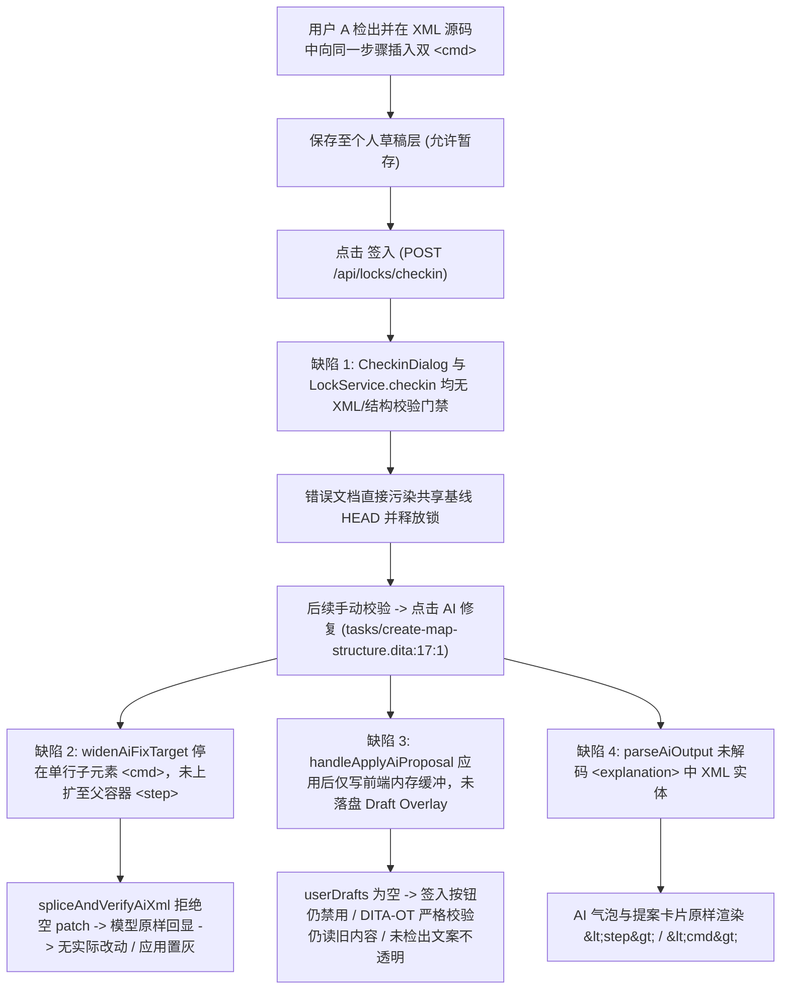

# 签入前置校验门禁与 AI 修复「检出—草稿—提交」闭环方案与测试案例

- **状态**：已完成实施与自动化验证（待手工端到端抽查验收）
- **关联基线**：
  - [`docs/phase6-ai-contract.md`](./phase6-ai-contract.md)
  - [`docs/phase13-versioning-overlay-plan.md`](./phase13-versioning-overlay-plan.md)
  - [`docs/dita-authoring-compliance.md`](./dita-authoring-compliance.md)
- **问题现象**：
  1. 用户 A 检出 `tasks/create-map-structure.dita`，在 XML 源码编辑器中向同一个 `<step>` 内插入两条 `<cmd>`，保存后点击「签入...」，**系统未做校验即放行签入**，导致结构错误污染团队共享基线 `HEAD` 且锁被释放；
  2. 后续用户手动触发校验并在诊断列表点击「AI 修复」：
     - AI 定位范围卡死在单个 `<cmd>` 所在行（`行窗口 · 第 17 行`），无法删重或修改外层 `<step>`，导致生成 **「无实际改动」** 且「应用」按钮置灰；
     - 即使 AI 给出有效修改建议，在文件未检出/已释放锁的场景下，应用流程未清晰完成「**自动检出 → 写入编辑器 → 自动保存为个人草稿 → 引导用户复核并签入**」的端到端闭环，用户仍需手工检出/保存才能重新校验或签入。

---

## 1. 根因分析

结合运行截图与源码链路追踪，该问题由 **4 个叠加缺陷** 共同导致：



### 1.1 签入链路完全缺少 XML 与 DITA 结构门禁
- **后端**：`apps/api/src/modules/locks/lock-service.ts` 中的 `LockService.checkin()`（同时服务 `POST /api/locks/checkin` 与 `POST /api/git/commit`）在将个人草稿物化写入共享 `workDir` 并提交到 Git `HEAD` 之前，只校验了锁归属、草稿存在性与外部文件冲突，**未执行 `checkXmlWellFormed()` 或 `checkXmlStructure()`**。
- **前端**：`apps/web/src/components/CheckinDialog.tsx` 仅提供了可选手动按钮「DITA-OT 严格校验」，既不展示候选文件已有的 XML / DITA 结构错误，也不阻断提交，更未在弹窗内提供直达修复的入口。

### 1.2 AI 修复后缺少「自动检出 + 自动保存草稿 + 提交引导」完整闭环
- `apps/web/src/ai/use-ai-panel-actions.ts` 中的 `handleApplyAiProposal()`：
  1. 虽然在 `aiApplyMode === 'checkout-and-apply'` 时会调用 `checkoutFile(filePath)`，但 `AiAssistantPanel.tsx` 与 `AiDiffDialog.tsx` 的主按钮始终只展示「应用」，未明确区分 **「检出并应用到草稿」** 与 **「应用到草稿」**；
  2. **仅调用 `applyAiPatchedXml()` 修改了前端内存中的 `openTabs[].xml`，未调用 `saveFile(filePath)` 写入服务端草稿层（`working_drafts`）**。后果包括：
     - 服务端 `userDrafts` 为空，`gitStatus.dirtyFiles` 不包含该文件，顶部 `LockStatusBar` 的「签入...」按钮保持禁用（`canCheckin={activeLockDirty}`）；
     - 若用户此时点击「DITA-OT 严格校验」，服务端 `/api/validate/strict` 默认物化 `my_drafts`（基于 SQLite `working_drafts`），**看不到未保存的内存修改**，会继续报原错误；
     - 诊断面板（由服务端语义索引驱动）在用户手动点「保存」前不会清零。
  3. 从 `ProblemsPanel` 或 `StrictValidationDialog` 跨文件点击「AI 修复」时，先异步 `openFileTab()` 打开或切换文件，若用户紧接着应用提案，必须按**目标文件当前最新锁状态**实时计算 `resolveAiApplyMode()`，而非依赖旧渲染闭包中的 `activeTab` / `aiApplyMode`。
  4. `admin` 用户对未锁定文件应用 AI 建议时，如果不显式同步锁状态与草稿，也可能出现工具栏状态延迟。

### 1.3 `widenAiFixTarget` 对单行子元素未扩窗到父容器，导致去重/结构修复必然「无实际改动」
- `packages/dita-core/src/xml/structure-check.ts` 在检测 `<step>` 下重复 `<cmd>` 时，将错误定位到第 2 个 `<cmd>` 的起始位置（如 `tasks/create-map-structure.dita:17:1`）。
- `packages/dita-core/src/ai/fragment-locator.ts` 中的 `widenAiFixTarget()` 向下遍历到覆盖 `anchorOffset` 的**最内层元素**。当第 17 行为单行 `<cmd>...</cmd>` 时，`wideStart === 17 && wideEnd === 17`，函数判定未变化并原样返回 `[17, 17]`。
- 同时 `packages/dita-core/src/ai/fragment-splice.ts` 第 84–91 行显式禁止空补丁（`candidate-empty`）。于是 AI 被困在 `[17, 17]` 单行窗口内：删空会被服务端拒收，不删又与原文完全一致，最终在前端命中 `hasAiProposalChanges(proposal) === false`，展示红色提示「AI 未改动任何内容」并禁用「应用」按钮。

### 1.4 AI `<explanation>` 中的 XML 实体未解码
- 模型在遵守 `<explanation>...</explanation>` 输出协议时，常将正文里提及的标签名转义为 `&lt;step&gt;`、`&lt;cmd&gt;`；`apps/api/src/modules/ai/ai-output-parser.ts` 中的 `stripExplanationTags()` 与 `createExplanationStreamFilter()` 未对基础 XML 实体反转义，导致界面直接渲染出转义字符。

---

## 2. 已确认的核心产品策略与架构不变量

以下 3 项核心边界已确认，实施时必须严格遵守：

1. **签入门禁策略（前后端双保险、分层处理）**：
   - **编辑 & 保存草稿**：保持 Phase 9「Guide, never block」与 Phase 13 个人草稿隔离原则——允许作者随时把不完整或有错误的草稿保存到个人 Draft Overlay，**绝不阻塞草稿保存**；
   - **签入基线（Check-in）**：
     - **硬阻断（Error 级，不可绕过）**：XML 良构性错误、DITA 1.3 结构 Error（按文档 DOCTYPE 自动识别 `taskModel: 'auto'`，避免误伤 `generalTask.dtd`）、`.ditaval` 语法错误；
     - **软告警（Warning 级，展示但不阻断）**：跨文件引用类警告（如 `asset-ref`、`keyref`、`conref`、`map-ref` 等），保障多人并行协作不被未提交的关联文件卡死；
     - **删除操作豁免**：`op === 'delete'` 的草稿不执行 XML 内容校验。
2. **AI 自动检出时机**：
   - 发起 AI 诊断修复请求时为**只读分析，不提前抢锁**（防止用户放弃建议或流式失败后残留无用文件锁）；
   - 当用户审核 Diff 并点击确认应用（**「检出并应用到草稿」**）时，由系统自动检出目标文件。
   - 若文件已被他人锁定（`locked-by-other`）或当前身份为 `viewer`，严格保持 `preview-only`，**绝不越权抢锁或覆盖**。
3. **AI 自动落盘草稿 + 人工确认签入**：
   - 用户点击应用后，原子串联执行：**（按需自动检出）→ 单步可撤销事务写入编辑器 → 自动保存至服务端个人草稿层（Draft Overlay）→ 刷新诊断与 Git 状态**；
   - **绝不自动签入基线**：保留人工复核与填写 Commit Message 的最终控制权；应用完成后在 AI 提案卡片上直接提供 **「签入...」** 与 **「重新严格校验」** 快捷按钮，且用户仍可随时通过 `Cmd/Ctrl+Z` 撤销或「取消检出」回退。

同时遵循仓库全局不变量（`AGENTS.md`）：
- 无损 XML 往返与最小 Git Diff（保留 `<?xml?>`、`<!DOCTYPE>`、注释、PI、属性顺序）；
- `@dita/core` 保持同构，严禁引入 Node 专属模块；
- 所有新增前后端提示文案均接入 i18n（中英双语键 100% 对等，通过 `i18n-parity` 与 `no-hardcoded-cjk` 校验）。

---

## 3. 正确场景设计与状态流转

### 3.1 完整交互流程图

```mermaid
sequenceDiagram
    actor User as 用户 A (Writer)
    participant Editor as 编辑器 (Visual / Source)
    participant Checkin as CheckinDialog
    participant AI as AI 助手 / DiffDialog
    participant API as @dita/api (Locks/Drafts/AI)
    participant Git as 共享基线 (Git HEAD)

    Note over User,Git: 场景 A：编辑期插入双 &lt;cmd&gt; -> 草稿可存 -> 签入被门禁拦截 -> AI 修复 -> 签入成功
    User->>Editor: 检出 task.dita，在源码同一 &lt;step&gt; 插入两个 &lt;cmd&gt;
    User->>Editor: 保存 (Cmd+S)
    Editor->>API: PUT /api/files/content (写入个人 Draft Overlay)
    API-->>Editor: 200 OK (草稿保存成功，刷新诊断发现 1 Error)

    User->>Checkin: 点击「签入...」
    Checkin->>Checkin: 自动预检候选文件 (XML + DITA 结构)
    Checkin-->>User: 标红 1 个结构错误，禁用「确认签入」，提供「跳转源码」「AI 修复」
    Note right of API: 即使绕过前端直调 POST /api/locks/checkin，后端亦返回 422 拦截，HEAD/锁/草稿均不变

    User->>Checkin: 点击错误项旁「AI 修复」
    Checkin->>AI: 关闭签入弹窗，定位错误并将范围扩窗至父容器 &lt;step&gt;
    AI->>API: POST /api/ai/stream (target = &lt;step&gt; 行范围)
    API-->>AI: 返回去重后的无损 patch 与解码后的 explanation
    User->>AI: 查看 Diff，点击「应用到草稿」
    AI->>Editor: 单步可撤销事务写入 patchedXml
    AI->>API: 自动保存草稿 PUT /api/files/content
    API-->>AI: 200 OK + 刷新诊断 (0 错误) + 刷新 userDrafts
    AI-->>User: 卡片提示「已保存为草稿」，显示「签入...」快捷按钮
    User->>Checkin: 点击「签入...」-> 预检全部通过 -> 填写说明提交
    Checkin->>API: POST /api/locks/checkin
    API->>Git: 校验通过 -> 物化草稿 -> 提交 Git HEAD -> 清理草稿并释放锁
    API-->>User: 200 OK 签入成功

    Note over User,Git: 场景 B：未检出文档（历史基线错误 / 手动严格校验报错）-> AI 修复自动检出并落盘草稿
    User->>AI: 在诊断面板 / 严格校验弹窗点击未检出文件的「AI 修复」
    AI->>API: 只读流式生成修复提案 (此时不加锁)
    AI-->>User: 按钮明确显示「检出并应用到草稿」
    User->>AI: 确认 Diff，点击「检出并应用到草稿」
    AI->>API: 1) POST /api/locks/checkout (自动检出)
    AI->>Editor: 2) 单步事务写入修复后 XML
    AI->>API: 3) PUT /api/files/content (自动落盘个人草稿)
    AI->>API: 4) 刷新诊断与 Git 状态
    AI-->>User: 提示「已自动检出并保存草稿」，展示「签入...」「重新严格校验」
    User->>Checkin: 复核无误 -> 点击「签入...」完成提交
```

### 3.2 角色与锁状态行为矩阵

| 当前用户角色 | 目标文件锁状态 | `resolveAiApplyMode` | AI 主按钮文案 | 点击应用后的系统行为 |
| --- | --- | --- | --- | --- |
| `writer` | 未锁定（`unlocked`） | `checkout-and-apply` | **检出并应用到草稿** | ① 自动 `checkoutFile`；② 写入编辑器单步事务；③ 自动 `saveFile` 落盘草稿；④ 刷新诊断/Git 状态；⑤ 展示「签入...」/「重新严格校验」 |
| `writer` | 本人锁定（`owned`） | `apply` | **应用到草稿** | ① 写入编辑器单步事务；② 自动 `saveFile` 落盘草稿；③ 刷新诊断/Git 状态；④ 展示「签入...」/「重新严格校验」 |
| `admin` | 未锁定（`admin`, `lock=null`） | `apply` | **应用到草稿** | ① 写入编辑器单步事务；② `saveFile`（后端 `authorizeWrite` 自动加锁并写草稿）+ 刷新锁与 Git 状态；③ 展示「签入...」 |
| `admin` | 本人锁定（`admin`, `owned`） | `apply` | **应用到草稿** | 同 `writer` 本人锁定 |
| `writer` / `admin` | 他人锁定（`locked-by-other`） | `preview-only` | 禁用（提示锁持有者） | 仅允许打开 Diff 预览，绝不自动检出或修改缓冲区 |
| `viewer` | 任意状态 | `preview-only` | 禁用（提示只读角色） | 仅允许打开 Diff 预览，绝不自动检出或修改缓冲区 |
| 离线 Demo（`memory`） | 无锁概念 | `apply` | **应用** | 写入编辑器单步事务 + 更新内存文件与语义索引 |

### 3.3 异常与边缘恢复策略

| 异常场景 | 期望系统行为 |
| --- | --- |
| 点击「检出并应用到草稿」瞬间，文件刚被其他用户抢先检出（409） | `checkoutFile()` 返回 `null` → **立即中止，不修改编辑器缓冲区**，展示明确错误提示并刷新锁状态 |
| 自动检出并写入编辑器成功，但自动保存草稿失败（网络超时 / 409 内容哈希冲突） | **保留编辑器内存中的已应用内容不丢失**（且仍可撤销），面板提示「已写入编辑器但草稿自动保存失败，请点击保存重试」，**不误报「已保存草稿」**，也不隐藏「签入」前的保存提示 |
| AI 修复补丁已过期（生成后用户又手动改了文档） | 沿用 `isAiProposalStale()` 拦截并丢弃旧提案，防止覆盖后续编辑 |
| 候选签入列表包含多个文件，其中仅 1 个文件有结构 Error | 整个签入被阻断并明确高亮报错文件；用户取消勾选报错文件只签入合法文件时，允许签入剩余合法文件 |
| 签入包含未保存到草稿层的内存脏修改（例如在编辑器里修好了双 `<cmd>` 但忘点保存就直接点「签入...」） | 前端预检读取**当前最新内容**（优先读 `openTabs` / `mapBuffers` 内存缓冲，其次读服务端草稿）；确认签入时 `git-store.checkin()` 会先 `saveFilesEnsuringLocks()` 再提交，前后校验语义完全一致 |

---

## 4. 分包详细改动设计

### 4.1 `@dita/core`

#### 1) 增强 `widenAiFixTarget()`（`packages/dita-core/src/ai/fragment-locator.ts`）
- 扩展 `AiFixWindowOptions`：
  ```ts
  export interface AiFixWindowOptions {
    /** Line cap for the widened window. Defaults to `DEFAULT_AI_FIX_WINDOW_MAX_LINES`. */
    maxLines?: number;
    /**
     * When true (used for DITA structure / DITA-OT content-model diagnostics), step one level up
     * from a child element to its enclosing container (e.g. `<cmd>` -> `<step>`) so sibling-level
     * fixes such as deduplication, reordering, or replacing an illegal child can succeed without
     * producing an empty patch.
     */
    expandToParent?: boolean;
  }
  ```
- 算法调整：
  - 沿元素树向下查找覆盖 `anchorOffset` 的最内层元素时，维护路径栈 `ancestors: slimdom.Element[]`（从 `root` 到 `current`）。
  - 确定目标元素 `targetEl`：
    - 若 `options.expandToParent === true` 且 `ancestors.length >= 2`（即 `current` 不是文档根元素），且 `current` 为其父元素的直接子元素（如 `<step>` 下的 `<cmd>`）：
      - 当 `current` 与其父元素不同且父元素存在有效源码边界时，取 `parentEl = ancestors[ancestors.length - 2]`。
      - 若 `parentEl` 本身就是文档根元素且其跨度超过 `maxLines`，直接返回 `{ mode: 'full-document' }`；若 `parentEl` 行数 `<= maxLines`，则将窗口扩至 `parentEl` 的起止行 `[wideStart, wideEnd]`。
      - 特别保护：若诊断位于容器自身（例如 `missing-required-child` 报在 `<step>` 或 `<taskbody>` 开标签处），需确保不错误过度扩到根元素之外：
        - 只有当 `current` 的起止行等于原始单行窗口（单行元素，如 `<cmd>...</cmd>`），或 `options.expandToParent` 明确要求上扩且 `parentEl` 非根元素（或 `parentEl` 行数 `<= maxLines`）时才上移一级；
        - 具体判定：
          1. 若 `wideStart === startLine && wideEnd === endLine`（即最内层元素仅占报错单行，典型如 `<cmd>...</cmd>`、`</step>` 前的单行兄弟标签）：**始终上移至 `parentEl`**（只要 `ancestors.length >= 2`）；
          2. 若 `options.expandToParent === true` 且 `current` 不是容器报错点本身（即 `ancestors.length >= 3`，例如 `task > taskbody > steps > step > cmd` 中的 `cmd`），即使 `cmd` 跨多行，也上移至 `parentEl`（`<step>`），以确保同级兄弟 `<cmd>` 一并进入可编辑窗口。
  - 若最终 `targetEl` 是根元素（`targetEl === root`）或 `wideEnd - wideStart + 1 > maxLines`，返回 `{ mode: 'full-document' }`。

#### 2) 抽离同构签入文档校验函数（新建 `packages/dita-core/src/xml/checkin-validate.ts`，并在 `packages/dita-core/src/index.ts` 导出）
- 供 `@dita/api`（后端硬门禁）与 `@dita/web`（`CheckinDialog` 实时预检）共享单一真源，避免前后端判定漂移：
  ```ts
  export interface CheckinValidationIssue {
    filePath: string;
    source: 'xml' | 'structure' | 'ditaval';
    severity: 'error' | 'warning';
    line: number;
    column: number;
    code?: string;
    message: string;
  }

  export interface CheckinFileInput {
    filePath: string;
    content: string;
    /** Deleted or binary files skip XML validation. */
    deleted?: boolean;
    binary?: boolean;
  }

  export function validateDitaFileForCheckin(
    input: CheckinFileInput,
    locale: UiLocale = 'zh-CN',
  ): CheckinValidationIssue[];

  export function validateCheckinBatch(
    files: readonly CheckinFileInput[],
    locale: UiLocale = 'zh-CN',
  ): { ok: boolean; errors: CheckinValidationIssue[]; warnings: CheckinValidationIssue[] };
  ```
- 校验规则：
  1. 若 `deleted === true` 或 `binary === true`，直接返回 `[]`；
  2. 通过 `classifyDitaFileKind(filePath)` 分流：
     - `'topic'` / `'ditamap'` / `'bookmap'`：
       - 先运行 `checkXmlWellFormed(content)`；失败则产出 `source: 'xml', severity: 'error'` 并返回；
       - 若为 `'topic'`，运行 `checkXmlStructure(content, { taskModel: 'auto' })`；将每条 `issue` 通过 `formatStructureIssue(issue, locale)` 转为 `CheckinValidationIssue`（沿用 `issue.severity`）；
     - `'ditaval'`：运行 `parseDitaval(content)`，解析抛错则产出 `source: 'ditaval', severity: 'error'`；
     - `'image'` / `'other'`：跳过，返回 `[]`。
  3. `ok` 仅在 `errors.length === 0` 时为 `true`。

#### 3) 顺带修复语义索引对 `generalTask.dtd` 的任务模型感知
- `packages/dita-core/src/semantics/semantic-engine.ts` 第 653 行 `collectXmlStructureIssues(parsed.document)` 改为传入 `detectTaskContentModel(rawXml)`，与 `checkXmlStructure(..., { taskModel: 'auto' })` 保持 100% 一致。

---

### 4.2 `@dita/api`

#### 1) 签入后端硬门禁（`apps/api/src/modules/locks/lock-service.ts`、`locks/routes.ts`、`git/routes.ts`）
- `LockService.checkin()` 新增可选参数 `locale?: UiLocale`（默认 `'zh-CN'`）。
- **Draft Overlay 模式**（`this.drafts` 存在）：
  - 在获取 `selected` 草稿列表与外部冲突检查之后、**调用 `materializeDraft()` 写盘之前**：
  - 构造 `CheckinFileInput[]`：
    - `draft.op === 'delete'` → `{ filePath: draft.filePath, content: '', deleted: true }`；
    - 二进制草稿（`Boolean(draft.assetBlobPath)`）→ `{ filePath: draft.filePath, content: '', binary: true }`；
    - 文本草稿（含 `edit`、`create`、带文本的 `rename`；若纯 `rename` 且 `draft.content === null`，读取 `HEAD` 下 `originalPath` 的内容用于校验）→ `{ filePath: draft.filePath, content }`。
  - 调用 `validateCheckinBatch(files, locale)`；
  - 若 `!validation.ok`：抛出 `httpError(422, 'locks.checkinValidationFailed', { count: validation.errors.length, files: uniqueErrorFiles.join(', ') }, { code: 'checkin_validation_failed', issues: validation.errors })`。
  - 由于抛出发生在 `materializeDraft()` 之前，保证：**工作区零写入、Git 无提交、文件锁不释放、个人草稿完好保留**。
- **Legacy 模式**（`!this.drafts`，兼容旧单测）：
  - 同理，对 `paths` 中在磁盘上仍存在的非删除文件读取 UTF-8 文本，执行 `validateCheckinBatch`，不通过则抛出同等 `422` 错误，不执行 `git.commit()` 也不删锁。
- **路由透传语言**：
  - `apps/api/src/modules/locks/routes.ts` (`POST /api/locks/checkin`) 与 `apps/api/src/modules/git/routes.ts` (`POST /api/git/commit`) 将 `locale: resolveRequestLocale(req)` 传入 `locks.checkin(...)`。

#### 2) AI `<explanation>` XML 实体解码（`apps/api/src/modules/ai/ai-output-parser.ts`）
- 新增纯函数 `decodeBasicXmlEntities(text: string): string`：按顺序解码 `&lt;` → `<`、`&gt;` → `>`、`&quot;` → `"`、`&apos;` → `'`、`&amp;` → `&`（注意 `&amp;` 放最后避免二次解码）。
- 在 `parseAiOutput()` 输出 `explanation` 时调用 `decodeBasicXmlEntities()`，并在 `createExplanationStreamFilter()` 对流式输出的非标签文本段做增量安全解码（避免流式阶段闪现 `&lt;cmd&gt;`、结束后才变成 `<cmd>`）。

#### 3) 服务端双语文案（`apps/api/src/i18n/messages.ts`）
- 新增 `locks.checkinValidationFailed`：
  - `zh-CN`：`'签入已阻止：发现 {count} 处 XML/DITA 错误（{files}），请先修复后再签入'`
  - `en`：`'Check-in blocked: found {count} XML/DITA error(s) in {files}. Fix them before checking in.'`

---

### 4.3 `@dita/web`

#### 1) AI 诊断扩窗接入（`apps/web/src/ai/ai-target.ts`）
- 扩展 `buildDiagnosticFixTarget()` 签名：
  ```ts
  export function buildDiagnosticFixTarget(
    xml: string,
    line: number | undefined,
    column?: number,
    lineEnd?: number,
    options?: { source?: string },
  ): AiTargetSpec
  ```
- 当 `options?.source === 'structure' || options?.source === 'dita-ot'` 时，调用 `widenAiFixTarget(xml, base, { maxLines: AI_FIX_WINDOW_MAX_LINES, expandToParent: true })`。
- `handleAiFixDiagnostic()` 与 `handleAiFixStrictDiagnostic()` 传入对应的 `{ source: diagnostic.source }` / `{ source: 'dita-ot' }`。

#### 2) `CheckinDialog` 签入预检与直达 AI 修复（`apps/web/src/components/CheckinDialog.tsx` & `apps/web/src/App.tsx`）
- 扩展 `CheckinCandidate` / `CheckinDialogProps`：
  - 传入当前待签入候选文件的预检问题映射（或由 `App.tsx` 结合 `openTabs` / `mapBuffers` 的最新内存 XML + 服务端 `diagnostics` 计算出每个候选文件的 `errors: CheckinValidationIssue[]` 与 `warnings: WorkspaceDiagnostic[]`；对尚未打开的已保存草稿文件，亦可通过已有服务端 `diagnostics` 获取其 `xml` / `structure` / `ditaval` 错误）。
  - 新增回调 `onJumpToIssue?: (issue: { filePath: string; line: number; column: number }) => void` 与 `onAiFixIssue?: (issue: CheckinValidationIssue) => void`。
- UI 与状态规则：
  - 左侧文件列表中，每个候选文件展示校验状态徽标（红色错误数 / 琥珀色警告数 / 绿色通过）；
  - 当所选 `selected` 文件中存在任意 `severity === 'error'` 的校验问题时：
    - `canSubmit` 为 `false`，禁用「确认签入」按钮并在 `title` 中说明原因；
    - 右侧 Diff 下方展示显眼的红色阻塞提示卡片（类似现有 `conflictingExternalPaths` 样式），逐条列出出错文件、行号、消息，并提供 **「跳转源码」** 与 **「AI 修复」** 按钮；
    - 点击「AI 修复」→ 自动关闭 `CheckinDialog` → 调用 `handleAiFixDiagnostic(...)` 打开目标文件并拉起 AI 修复流；
  - 仅存在 `warning`（0 error）时：展示柔和的琥珀色提醒条，但**不禁用**「确认签入」按钮；
  - 若前端预检通过但后端仍返回 `422`（例如未打开文件的草稿校验失败），`git-store.checkin()` 解析并展示后端返回的错误详情，弹窗保持打开不关闭。

#### 3) AI 应用「自动检出 + 自动保存草稿 + 提交引导」闭环（`apps/web/src/ai/use-ai-panel-actions.ts`、`AiAssistantPanel.tsx`、`AiDiffDialog.tsx`、`App.tsx`）
- **实时目标锁态解析**：
  - 在 `handleApplyAiProposal(patchedXml)` 执行时，从 `useEditorStore.getState()` 读取最新 `activeTab`（或 `proposal` 对应文件），从 `useGitStore.getState()` 读取最新 `currentUser` 与 `locks`，实时计算 `currentApplyMode = resolveAiApplyMode(...)`，彻底杜绝跨文件切换后的闭包陈旧问题。
- **应用状态机扩展**（`apps/web/src/ai/ai-store.ts`）：
  - 新增应用状态字段：
    ```ts
    export type AiApplyOutcome =
      | null
      | {
          status: 'applying' | 'saved-draft' | 'applied-unsaved';
          checkedOutAutomatically: boolean;
          filePath: string;
          saveError?: string;
        };
    ```
  - 并在发起新请求 / 放弃提案 / 重置时清空 `applyOutcome`。
- **`handleApplyAiProposal()` 执行步骤**：
  1. 校验 `currentApplyMode !== 'preview-only'`、非空变更（`hasAiProposalChanges`）、非陈旧提案（`isAiProposalStale`）；
  2. 设置 `applyOutcome = { status: 'applying', checkedOutAutomatically: false, filePath }`；
  3. **按需自动检出**：若 `currentApplyMode === 'checkout-and-apply' && workspaceMode === 'api'`：
     - 调用 `const lock = await checkoutFile(filePath)`；
     - 若 `!lock`：清空 `applyOutcome`，播报 `app.aiCheckoutFailed` 并中止（不修改编辑器）；
     - 标记 `checkedOutAutomatically = true`；
  4. **单步事务写入编辑器**：保持原有 Visual (`replaceDocumentXml`) / Source (`setSourceReplacementXml`) + `applyAiPatchedXml()` 单步可撤销逻辑；
  5. **自动保存为个人草稿**：
     - 若 `workspaceMode === 'api'`：
       - 调用 `const saved = await useEditorStore.getState().saveFile(filePath)`（`saveFile` 内部已自动刷新 `workspaceTree`、`semantics`、`diagnostics`；完成后再 `await useGitStore.getState().refreshAll()` 确保 `locks` 与 `userDrafts` 立即同步）；
       - 若 `saved === true`：
         - `applyOutcome = { status: 'saved-draft', checkedOutAutomatically, filePath }`；
         - `markApplied()`，关闭 `AiDiffDialog`；
         - 播报：若 `checkedOutAutomatically` 则播报「已自动检出并保存修改至草稿」，否则播报「已应用并保存修改至草稿」；
       - 若 `saved === false`：
         - 保留内存修改不丢失，设置 `applyOutcome = { status: 'applied-unsaved', checkedOutAutomatically, filePath, saveError }`；
         - `markApplied()`，关闭 `AiDiffDialog`，提示用户点击「保存」重试。
     - 若 `workspaceMode === 'memory'`：保持原有内存应用行为（`status: 'saved-draft'`）。
- **按钮文案与已应用后直达操作（`AiAssistantPanel.tsx` & `AiDiffDialog.tsx`）**：
  - 传入 `applyMode: AiApplyMode` 与可选回调 `onOpenCheckin?: (paths: string[]) => void`、`onRevalidateStrict?: () => void`、`onRetrySave?: () => void`；
  - 应用前主按钮文案：
    - `applyMode === 'checkout-and-apply'` → **「检出并应用到草稿」**（附带锁图标提示）；
    - `applyMode === 'apply'`（api 模式）→ **「应用到草稿」**；
    - `applyMode === 'apply'`（memory 模式）→ **「应用」**；
    - `applying` 期间禁用按钮并显示加载态，防止双击重复请求；
  - 应用成功后提案卡片状态区：
    - `status === 'saved-draft'`：显示绿色确认条（如「已自动检出并保存为个人草稿，可随时撤销」或「已应用并保存为个人草稿，可随时撤销」），并在下方提供两个直达按钮：
      - **「签入...」**（仅 `workspaceMode === 'api'`，点击调用 `onOpenCheckin([filePath])`）；
      - **「重新严格校验」**（当 `proposal.canRevalidateStrict` 为真或源自严格校验时展示）；
    - `status === 'applied-unsaved'`：显示琥珀色提醒条（「已写入编辑器，但草稿自动保存失败：{reason}」）及 **「重试保存草稿」** 按钮。

#### 4) 前端双语文案清单（`apps/web/src/i18n/messages/{zh-CN,en}/`）
- `checkin.validationBlockedTitle` / `checkin.validationBlockedBody` / `checkin.validationWarningTitle` / `checkin.blockedByValidation` / `checkin.jumpToError` / `checkin.aiFixError` / `checkin.statusValid` / `checkin.statusErrors` / `checkin.statusWarnings`
- `ai.proposal.checkoutAndApply` / `ai.proposal.applyToDraft` / `ai.proposal.applying` / `ai.proposal.appliedCheckedOutDraft` / `ai.proposal.appliedSavedDraft` / `ai.proposal.appliedUnsavedDraft` / `ai.proposal.openCheckin` / `ai.proposal.runStrictValidate` / `ai.proposal.retrySave`
- `aiDiff.checkoutAndApply` / `aiDiff.applyToDraft`
- `app.aiAppliedCheckedOutDraft` / `app.aiAppliedSavedDraft` / `app.aiAppliedSaveFailed`

---

## 5. 完整测试案例矩阵

### 5.1 `@dita/core` 单元测试

目标测试文件：
- 扩展 `packages/dita-core/test/ai-fragment.test.ts`
- 新建 `packages/dita-core/test/checkin-validate.test.ts`

| 编号 | 所属模块 | 场景与测试输入 | 预期断言 |
| --- | --- | --- | --- |
| **CORE-1** | `widenAiFixTarget` | 构造真实复现文档（`create-map-structure.dita` 风格，`<step>` 内含第 16 行和第 17 行两条单行 `<cmd>`）；输入 `target = { mode: 'line-window', line: 17, column: 1, lineEnd: 17 }`，`expandToParent: true` | 返回 `mode: 'line-window'`，起止行覆盖整个 `<step>...</step>`（包含第 16 行与第 17 行两条 `<cmd>`），绝不停留在 `[17, 17]` |
| **CORE-2** | `widenAiFixTarget` | `<step>` 内第 2 条 `<cmd>` 为多行（17–19 行）；输入 `line: 17, column: 9, lineEnd: 17`，`expandToParent: true` | 依然向上扩窗至父容器 `<step>`，包含两条 `<cmd>` |
| **CORE-3** | `widenAiFixTarget` | 其他 DITA 结构错误：`child-out-of-order`（`<result>` 出现在 `<steps>` 前）、`slot-exclusive`（同时存在 `<steps>` 与 `<steps-unordered>`），报错指向子元素行，`expandToParent: true` | 扩窗至父容器 `<taskbody>`；若 `<taskbody>` 超出 `maxLines`（如设为 10），自动降级返回 `{ mode: 'full-document' }` |
| **CORE-4** | `widenAiFixTarget` | `missing-required-child`（空 `<step/>` 或缺 `<cmd>` 的 `<step>`），报错行即 `<step>` 自身；输入 `expandToParent: true` | 窗口至少覆盖整个 `<step>`（或安全扩至 `<steps>` 且不超过 `maxLines`），不会越界抛错 |
| **CORE-5** | `widenAiFixTarget` | 非良构 XML（如未闭合标签）输入 `line: 17, column: 1` | 不抛异常，原样返回 `target`（交由 `buildDiagnosticFixTarget` 做 ±12 行对称扩窗） |
| **CORE-6** | `extractTargetFragment` + `spliceAndVerifyAiXml` | 对 CORE-1 扩窗后的 `<step>` 片段，模拟 AI 返回去重后仅含 1 条 `<cmd>` 的 `<step>...</step>`（带缩进） | `splice.ok === true`；`patchedXml !== originalXml`；`<?xml?>`、`<!DOCTYPE>`、注释与相邻 `<step>` 字节完全一致；对 `patchedXml` 运行 `checkXmlStructure()` 返回 `issues.length === 0` |
| **CORE-7** | `validateDitaFileForCheckin` | 分别传入：① 合法 strict `task`；② 同 `<step>` 双 `<cmd>` 的 `task`；③ 未闭合标签的非法 XML；④ `generalTask.dtd` 下 `<taskbody>` 含 `<section>`；⑤ 非法 `.ditaval`；⑥ `deleted: true` 的坏 XML；⑦ `binary: true` 的图片 | ① 返回 `[]`；② 返回 1 条 `source: 'structure', severity: 'error'`；③ 返回 1 条 `source: 'xml', severity: 'error'`；④ 返回 `[]`（不误报）；⑤ 返回 1 条 `source: 'ditaval', severity: 'error'`；⑥⑦ 返回 `[]` |
| **CORE-8** | `validateCheckinBatch` | 批量传入 1 个合法 Topic + 1 个双 `<cmd>` Topic，分别测试 `zh-CN` 与 `en` 两种 locale | `ok === false`、`errors.length === 1`；文案随 locale 正确切换，且含精确 `filePath` / `line` / `column` |

---

### 5.2 `@dita/api` 集成测试

目标测试文件：
- 新建 `apps/api/test/checkin-validation.test.ts`
- 扩展 `apps/api/test/phase6-ai-api.test.ts`

| 编号 | 接口 / 模块 | 场景与操作步骤 | 预期断言 |
| --- | --- | --- | --- |
| **API-1** | `POST /api/locks/checkin` | **核心复现用例**：用户 A 检出 `tasks/create-map-structure.dita` → `PUT /api/files/content` 写入同一 `<step>` 下双 `<cmd>`（验证草稿保存返回 `200`）→ 调用 `POST /api/locks/checkin` | 返回 **`422`**；响应含 `code: 'checkin_validation_failed'` 与 `issues`（含 `filePath`、`source: 'structure'`、`line`、`message`）；验证 Git `HEAD` commit hash 未变化、共享工作区文件未变更、用户 A 的锁仍持有、`working_drafts` 草稿完整保留 |
| **API-2** | `POST /api/locks/checkin` | 用户 A 写入 XML 不良构内容（如 `<cmd>未闭合</step>`）到草稿 → 尝试签入 | 草稿保存成功（`200`）；签入返回 **`422`**，`issues[0].source === 'xml'`，基线/锁/草稿均保持不变 |
| **API-3** | `POST /api/git/commit` | 复用旧提交入口提交含双 `<cmd>` 的草稿 | 同样返回 **`422`** 拦截，保证双入口一致 |
| **API-4** | `POST /api/locks/checkin` | 批量签入 `[valid.dita, broken.dita]`（前者合法、后者双 `<cmd>`） | 整批原子拒绝返回 **`422`**，`valid.dita` 也不被部分提交，两把锁与两份草稿均保留 |
| **API-5** | `POST /api/locks/checkin` | 修复双 `<cmd>`（删去第 2 条 `<cmd>`）并 `PUT /api/files/content` 保存草稿 → 再次调用 `POST /api/locks/checkin` | 返回 **`200`**，生成新 Git commit，共享工作区更新为修复后内容，锁释放，草稿清除 |
| **API-6** | `POST /api/locks/checkin` | 签入 `generalTask.dtd` 合法文档（`<taskbody>` 内含 `<section>`） | 返回 **`200`** 正常放行（不误伤非严格任务模型） |
| **API-7** | `POST /api/locks/checkin` | 签入包含断链图片 `<image href="../images/not-found.png"/>`（仅跨文件 Warning、无 XML/结构 Error）的 Topic | 返回 **`200`** 正常放行（Warning 不阻断签入） |
| **API-8** | `POST /api/locks/checkin` | 签入已标记删除（`op: 'delete'`）的草稿文件（即使其原内容在历史上不合规） | 返回 **`200`** 正常删除并提交 |
| **API-9** | `POST /api/locks/checkin` | 签入语法错误的 `.ditaval` 草稿 | 返回 **`422`**，`issues[0].source === 'ditaval'` |
| **API-10** | `POST /api/locks/checkin` (i18n) | 携带 `Accept-Language: en` 提交双 `<cmd>` 草稿 | 返回 **`422`**，`error` 与 `issues[0].message` 均为英文 |
| **API-11** | `parseAiOutput` & `createExplanationStreamFilter` | 模型原始输出 `<explanation>该 &lt;step&gt; 内有两条 &lt;cmd&gt; &amp; 重复文本</explanation><dita_patch>...</dita_patch>`（含分块流式拆断 `&lt;` 的边界场景） | 解析结果与流式拼接后的文本均为 `该 <step> 内有两条 <cmd> & 重复文本`，且不破坏 `<dita_patch>` 拦截 |

---

### 5.3 `@dita/web` 组件与交互测试

目标测试文件：
- 新建 `apps/web/test/checkin-validation-ui.test.tsx`
- 扩展 `apps/web/test/ai-workbench.test.ts`

| 编号 | 组件 / Hook | 测试场景 | 预期断言 |
| --- | --- | --- | --- |
| **WEB-1** | `CheckinDialog` | 选中文件含 1 条结构 Error（`<step>` 中 `<cmd>` 最多只能出现一次） | 弹窗展示错误区块与文件错误徽标；「确认签入」按钮为 `disabled`；展示「跳转源码」与「AI 修复」按钮 |
| **WEB-2** | `CheckinDialog` | 候选列表中 1 个文件有 Error、1 个文件合法；用户取消勾选有 Error 的文件 | 错误阻塞解除，「确认签入」按钮恢复可点击，仅提交合法文件 |
| **WEB-3** | `CheckinDialog` | 点击错误条上的「AI 修复」按钮 | 触发 `onAiFixIssue` 回调（携带正确的 `filePath`、`source`、`line`、`column`、`message`）并关闭签入弹窗 |
| **WEB-4** | `CheckinDialog` | 选中文件仅含 Warning（如缺失图片）、0 Error | 展示 Warning 提醒但**不禁用**「确认签入」按钮，允许填写提交说明后正常签入 |
| **WEB-5** | `buildDiagnosticFixTarget` | 针对双 `<cmd>` 场景调用 `buildDiagnosticFixTarget(xml, 17, 1, 17, { source: 'structure' })` | 返回覆盖完整 `<step>` 的 `line-window`（如第 15–18 行），不再停留在 `[17, 17]` |
| **WEB-6** | `useAiPanelActions` + `AiAssistantPanel` | **核心场景（未检出 `writer`）**：文件当前未锁定，`aiApplyMode === 'checkout-and-apply'`，AI 生成有效去重提案 | ① 按钮文案显示「检出并应用到草稿」；② 点击应用后严格按序调用：`checkoutFile(path)` → 更新编辑器缓冲区 → 自动调用 `saveFile(path)` → 刷新诊断与 Git 状态；③ `applyOutcome.status === 'saved-draft'` 且 `checkedOutAutomatically === true`；④ 提案卡片显示「已自动检出并保存草稿」并渲染「签入...」按钮 |
| **WEB-7** | `useAiPanelActions` + `AiAssistantPanel` | **核心场景（已检出 `writer`）**：文件已由当前用户检出，`aiApplyMode === 'apply'` | ① 按钮文案显示「应用到草稿」；② 点击应用后**不重复调用 `checkoutFile`**，直接更新编辑器并自动调用 `saveFile(path)`；③ 刷新诊断归零，卡片渲染「签入...」按钮 |
| **WEB-8** | `useAiPanelActions` | **抢锁冲突场景**：点击「检出并应用到草稿」时 `checkoutFile()` 失败返回 `null`（被他人抢先检出） | 立即中止，**编辑器内容与 `openTabs[].xml` 保持未改动**，不调用 `saveFile()`，不标记 `applied`，播报检出失败提示 |
| **WEB-9** | `useAiPanelActions` | **保存失败降级场景**：自动检出并写入编辑器成功，但 `saveFile()` 返回 `false` | 编辑器缓冲区仍保留修复后的 XML（不回滚丢失），`applyOutcome.status === 'applied-unsaved'`，卡片显示错误原因与「重试保存草稿」按钮 |
| **WEB-10** | `AiAssistantPanel` + `AiDiffDialog` | **权限保护场景**：文件被他人锁定（`locked-by-other`）或当前身份为 `viewer` | 应用按钮置灰禁用，点击无效，不触发检出也不触发保存，仍可打开只读 Diff 预览 |
| **WEB-11** | `useAiPanelActions` | **跨文件诊断跳转**：当前激活 Tab 为 `a.dita`（已锁定），在 `ProblemsPanel` 点击未打开的 `b.dita`（未锁定）的「AI 修复」 | 自动打开 `b.dita`，应用提案时按 `b.dita` 的实时锁状态判定为 `checkout-and-apply`，自动检出并保存 `b.dita` 而非 `a.dita` |
| **WEB-12** | `i18n-parity` & `no-hardcoded-cjk` | 全量运行现有静态质量门禁测试 | 所有新增中英文 key 100% 一一对应，组件中无硬编码中文 |

---

### 5.4 端到端手工验收场景（基于 `samples/demo-dita-project`）

| 编号 | 手工操作步骤 | 验收标准 |
| --- | --- | --- |
| **E2E-1** | 切换为 `writer`（如林知远），打开 `tasks/create-map-structure.dita` → 检出 → 切到「XML 源码」在第一个 `<step>` 内复制一行 `<cmd>` → 按 `Cmd+S` 保存 → 点击「签入...」 | ① 保存草稿成功，顶部显示 `1 错误`；② 签入弹窗中该文件标红显示 `<step> 中 <cmd> 最多只能出现一次`，**「确认签入」禁用**；③ 在「版本」面板确认未产生任何新提交 |
| **E2E-2** | 紧接 E2E-1，直接在签入弹窗中点击错误项旁的 **「AI 修复」** | ① 签入弹窗关闭，右侧 AI 面板自动打开，作用域显示覆盖整个 `<step>`（不再是单行第 17 行）；② AI 回复文案正确显示 `<step>` / `<cmd>`（无 `&lt;` 转义乱码）；③ 提案卡片不报「无实际改动」，Diff 清晰展示删除重复 `<cmd>`；④ 点击「应用到草稿」后，编辑器立即更新、顶部错误归零、自动保存草稿完成；⑤ 点击提案卡片上的「签入...」→ 预检通过 → 顺利提交 |
| **E2E-3** | 在未检出状态模拟历史遗留错误（例如外部编辑器写入双 `<cmd>` 并提交到基线，或打开含结构错误的未检出文件）→ 在「问题诊断」或「DITA-OT 严格校验」中点击「AI 修复」 | ① 生成提案期间文件保持未锁定；② 提案卡片与 Diff 弹窗主按钮显示 **「检出并应用到草稿」**；③ 点击后系统自动完成检出（工具栏变为已检出状态）+ 写入修复 + 自动保存草稿；④ 点击「重新严格校验」直接通过（读取到最新草稿），点击「签入...」可直接填写提交说明并入库；⑤ 在签入前按 `Cmd+Z` 仍可一键撤销 AI 修改 |
| **E2E-4** | 用户 B（另一名 `writer`）先检出该文件，用户 A 打开后点击「AI 修复」 | AI 可给出只读分析与 Diff 预览，但「应用」按钮禁用并明确提示文件正由用户 B 锁定，无法越权检出或修改 |
| **E2E-5** | 切换界面语言为 English，重复 E2E-1 / E2E-2 关键步骤 | 签入门禁拦截文案、AI 按钮文案、自动检出草稿提示均为完整英文，无中英混杂 |

---

## 6. 建议实施顺序与验证命令（待你指示开始实施时执行）

1. **Step 1 (`@dita/core`)**：实现 `widenAiFixTarget` 父容器扩窗 + `checkin-validate.ts` + `semantic-engine` taskModel 对齐，补充 `CORE-1` ~ `CORE-8`。
2. **Step 2 (`@dita/api`)**：接入 `LockService.checkin` 422 校验门禁 + `parseAiOutput` 实体解码 + 服务端双语文案，补充 `API-1` ~ `API-11`。
3. **Step 3 (`@dita/web`)**：接入 `buildDiagnosticFixTarget` 扩窗 + `CheckinDialog` 预检与 AI 修复入口 + AI「检出并应用到草稿」完整闭环与双语文案，补充 `WEB-1` ~ `WEB-12`。
4. **全量验证**：
   ```bash
   pnpm -r build && pnpm -r typecheck && pnpm -r test
   graphify update .
   ```
