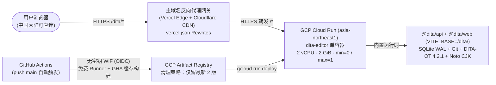

# GCP Cloud Run 低成本试用部署指南（子路径反代 + Push 自动部署）

> **适用场景**：希望以最低成本（月均约 **\$0 – \$1**）把 **DITAEditor 完整版单容器工作台**（含 DITA-OT 4.2.1 严格校验、Phase 12 HTML5 多套主题、Noto CJK 中文 PDF、本地 Git / Check-out 锁与 AI 助手）部署到 Google Cloud，**支持中国大陆稳定访问**，并在 `git push` 到 `main` 时全自动更新。
>
> 如只需纯前端离线体验，请参阅 [deploy-github-pages.md](./deploy-github-pages.md)；如需免绑卡社区托管，请参阅 [deploy-huggingface-spaces.md](./deploy-huggingface-spaces.md)。

---

## 一、总体架构与低成本设计原理



### 核心设计取舍

1. **为什么选 Cloud Run 而不是常驻 VM？**
   - 配置 `--min-instances=0`，无访问约 15 分钟自动缩容至 0，闲置期 **\$0 计算费**；每月含免费额度（180,000 vCPU-秒、360,000 GiB-秒、200 万次请求），试用期几乎零费用。
   - 配置 `--max-instances=1` 保障内置 **SQLite（WAL）+ 本地 Git Worktree + Check-out 独占锁** 处于单实例安全边界；`--cpu=2 --memory=2Gi` 保障 DITA-OT 4.2.1 + JRE 21 渲染中文 PDF 不会 OOM。
2. **为什么配合子路径反向代理（而非 Cloud Run 默认域名或 GCP 负载均衡器）？**
   - Cloud Run 默认分配的 `*.run.app` 域名在中国大陆普遍无法直连；而 GCP 外部 HTTP(S) 负载均衡器仅转发规则就需约 **\$18/月**。
   - 复用已有可国内访问的主域名网关（如 Vercel `vercel.json` Rewrites 或 Cloudflare 免费 Worker）将 `/dita` 透明反向代理到 Cloud Run 上游地址，可实现**零额外网关费用 + 自动 HTTPS + 中国大陆直连**。
3. **为什么 GitHub Actions 用免费 Runner 构建 + 无密钥 WIF？**
   - 公开仓库使用 GitHub Actions `ubuntu-latest` + `docker/build-push-action`（`type=gha` 层缓存）完全免费，JRE 21 / DITA-OT / Noto CJK 基础层命中缓存后增量构建仅需 **1–2 分钟**，不消耗 Cloud Build 额度。
   - 通过 **Workload Identity Federation（OIDC）** 严格限定仅 `main` 分支可换取临时凭据，仓库与 CI 中**不保存任何 JSON 私钥**；同时为 Artifact Registry 配置清理策略，仅保留最新 2 个镜像版本，将存储费压至接近 \$0。

---

## 二、仓库内置的子路径反向代理适配

为确保应用无论部署在根路径 `/` 还是反向代理子路径（如 `https://<your-domain>/dita`）均开箱可用，代码库已内置以下双向适配（默认 `/` 行为 100% 不变）：

1. **前端构建与 API 基址**：
   - [Dockerfile](../Dockerfile) 支持构建参数 `ARG VITE_BASE=/` 与运行时环境变量 `DITA_BASE_PATH=`。
   - [apps/web/src/services/api-base.ts](../apps/web/src/services/api-base.ts) 提供 `apiUrl()`，自动将所有 `/api/*` 请求、SSE 日志/AI 流、图片资产（`/api/assets/resolve`）、HTML5 主题实时预览和发布产物下载链接挂载到 `import.meta.env.BASE_URL` 下（如 `/dita/api/...`）。
   - [apps/web/src/router/app-router.ts](../apps/web/src/router/app-router.ts) 原生兼容 `BASE_URL`，`/dita` 与 `/dita/manuals/:id` 路由无缝往返。
2. **后端前缀透明剥离**：
   - [apps/api/src/index.ts](../apps/api/src/index.ts) 在设置 `DITA_BASE_PATH=/dita` 时通过 Fastify `rewriteUrl` 自动剥离请求前缀 `/dita`，确保**经主域名反代**与**直连 Cloud Run URL** 均能正常加载静态资源、SPA 路由与 `/health` 探针。
3. **干净的构建上下文**：
   - [.dockerignore](../.dockerignore) 与 [.gcloudignore](../.gcloudignore) 统一排除 `node_modules`、`dist`、`**/*.tsbuildinfo`、`graphify-out`、`apps/desktop/release` 等非运行时文件，防止本地增量编译缓存误导容器内 `tsc` 跳过产物输出。

---

## 三、首次部署步骤（GCP Cloud Run）

### 1. 创建隔离的试用项目并启用 API

建议新建独立 GCP 项目存放试用资源（方便核算账单，试用结束后一条命令彻底删除零残留）：

```bash
export GCP_PROJECT_ID="dita-editor-trial-84"   # 替换为全局唯一的项目 ID
export GCP_BILLING_ACCOUNT="<你的结算账号ID>"   # 可用 gcloud billing accounts list 查询

gcloud auth login
gcloud projects create "${GCP_PROJECT_ID}" --name="DITAEditor Trial"
gcloud billing projects link "${GCP_PROJECT_ID}" --billing-account="${GCP_BILLING_ACCOUNT}"
gcloud config set project "${GCP_PROJECT_ID}"
```

### 2. 一键构建并部署到 Cloud Run

仓库已内置 [deploy/gcp/cloudbuild.yaml](../deploy/gcp/cloudbuild.yaml) 与 [deploy/gcp/deploy-cloudrun.sh](../deploy/gcp/deploy-cloudrun.sh)：

```bash
GCP_PROJECT_ID="${GCP_PROJECT_ID}" \
GCP_REGION="asia-northeast1" \
DITA_BASE_PATH="/dita" \
./deploy/gcp/deploy-cloudrun.sh
```

脚本会自动完成：
1. 启用 `run.googleapis.com`、`cloudbuild.googleapis.com`、`artifactregistry.googleapis.com`；
2. 在 `asia-northeast1`（东京）创建 Docker Artifact Registry 仓库 `ditaeditor`；
3. 以 `VITE_BASE=/dita/` 与 `DITA_BASE_PATH=/dita` 构建单容器镜像；
4. 部署 Cloud Run 服务 `dita-editor`（`2 vCPU / 2 GiB`、`min-instances=0`、`max-instances=1`、`timeout=900`）并输出上游地址（形如 `https://dita-editor-xxxxxxxxxx-an.a.run.app`）。

> 如需在首次部署时顺带开启 AI 助手，可在命令前追加 `DEEPSEEK_API_KEY="sk-..."`（或在上线后切至管理员角色在页面「AI 设置」中配置）。

### 3. 配置 Artifact Registry 自动清理策略（必做省钱项）

Artifact Registry 免费额度为 0.5 GB，自动清理超过 24 小时的旧镜像并只保留最新 2 个版本，可防止多次 push 后存储费累积：

```bash
cat > /tmp/ar-cleanup.json <<'EOF'
[
  {
    "name": "delete-old-images",
    "action": {"type": "Delete"},
    "condition": { "tagState": "ANY", "olderThan": "86400s" }
  },
  {
    "name": "keep-latest-2",
    "action": {"type": "Keep"},
    "mostRecentVersions": { "keepCount": 2 }
  }
]
EOF

gcloud artifacts repositories set-cleanup-policies ditaeditor \
  --project="${GCP_PROJECT_ID}" \
  --location="asia-northeast1" \
  --policy=/tmp/ar-cleanup.json \
  --no-dry-run
```

---

## 四、配置中国大陆可访问的域名反向代理

### 方式 A：复用主域名 Vercel 子路径反向代理（推荐）

在承载主域名的 Vercel 网关项目的 `vercel.json` 中追加 `/dita` 规则（将 `<CLOUD_RUN_URL>` 替换为第三步输出的上游地址）：

```json
{
  "redirects": [
    {
      "source": "/dita/",
      "destination": "/dita",
      "permanent": true
    }
  ],
  "rewrites": [
    {
      "source": "/dita",
      "destination": "https://<CLOUD_RUN_URL>/"
    },
    {
      "source": "/dita/:path*",
      "destination": "https://<CLOUD_RUN_URL>/:path*"
    }
  ]
}
```

然后在该网关项目目录下执行 `vercel --prod --yes` 发布即可通过 `https://<your-domain>/dita` 访问。

### 方式 B：独立自定义域名 + Cloudflare 免费 Worker

若没有现成 Vercel 主网关，可在 Cloudflare 免费版创建一个 Worker 并绑定自己的自定义域名（勿用默认 `*.workers.dev`），以 `DITA_BASE_PATH=""`、`VITE_BASE="/"` 部署 Cloud Run 后转发根路径：

```js
export default {
  async fetch(request) {
    const url = new URL(request.url);
    const upstream = new URL(url.pathname + url.search, 'https://<CLOUD_RUN_URL>');
    const headers = new Headers(request.headers);
    headers.set('host', upstream.host);
    return fetch(new Request(upstream, {
      method: request.method,
      headers,
      body: request.method === 'GET' || request.method === 'HEAD' ? undefined : request.body,
      redirect: 'manual',
    }));
  },
};
```

---

## 五、配置 `git push` 自动部署（GitHub Actions + 无密钥 WIF）

仓库已内置工作流 [.github/workflows/deploy-cloudrun.yml](../.github/workflows/deploy-cloudrun.yml)。按以下两步一次性完成授权后，此后每次 `push` 到 `main`（改动运行代码或 `Dockerfile`）都会自动构建并滚动发布到 Cloud Run。

### 1. 在 GCP 创建最小权限部署账号与 Workload Identity Federation

```bash
export GCP_PROJECT_ID="dita-editor-trial-84"
export PROJECT_NUM="$(gcloud projects describe "${GCP_PROJECT_ID}" --format='value(projectNumber)')"
export GITHUB_REPO="<你的GitHub用户名>/DITAEditor"
export SA_EMAIL="github-deployer@${GCP_PROJECT_ID}.iam.gserviceaccount.com"

gcloud services enable iamcredentials.googleapis.com sts.googleapis.com --project="${GCP_PROJECT_ID}"

gcloud iam service-accounts create github-deployer \
  --project="${GCP_PROJECT_ID}" \
  --display-name="GitHub Actions Cloud Run Deployer"

# 仅授予推送镜像、部署 Cloud Run 与挂载运行时账号的最小权限
gcloud projects add-iam-policy-binding "${GCP_PROJECT_ID}" \
  --member="serviceAccount:${SA_EMAIL}" --role="roles/artifactregistry.writer" --condition=None
gcloud projects add-iam-policy-binding "${GCP_PROJECT_ID}" \
  --member="serviceAccount:${SA_EMAIL}" --role="roles/run.developer" --condition=None
gcloud iam service-accounts add-iam-policy-binding "${PROJECT_NUM}-compute@developer.gserviceaccount.com" \
  --project="${GCP_PROJECT_ID}" --member="serviceAccount:${SA_EMAIL}" --role="roles/iam.serviceAccountUser"

# 创建 OIDC 池与提供方，严格锁定仅允许本仓库 main 分支换取凭据
gcloud iam workload-identity-pools create github-pool \
  --project="${GCP_PROJECT_ID}" --location="global" --display-name="GitHub Actions Pool"

gcloud iam workload-identity-pools providers create-oidc github-provider \
  --project="${GCP_PROJECT_ID}" --location="global" --workload-identity-pool="github-pool" \
  --issuer-uri="https://token.actions.githubusercontent.com" \
  --attribute-mapping="google.subject=assertion.sub,attribute.actor=assertion.actor,attribute.repository=assertion.repository,attribute.ref=assertion.ref" \
  --attribute-condition="assertion.repository == '${GITHUB_REPO}' && assertion.ref == 'refs/heads/main'"

gcloud iam service-accounts add-iam-policy-binding "${SA_EMAIL}" \
  --project="${GCP_PROJECT_ID}" --role="roles/iam.workloadIdentityUser" \
  --member="principalSet://iam.googleapis.com/projects/${PROJECT_NUM}/locations/global/workloadIdentityPools/github-pool/attribute.repository/${GITHUB_REPO}"
```

### 2. 在 GitHub 仓库配置 Actions Variables

使用 `gh` CLI（或在仓库 **Settings → Secrets and variables → Actions → Variables** 手动填写）：

```bash
gh variable set GCP_PROJECT_ID --body "${GCP_PROJECT_ID}"
gh variable set GCP_SA_EMAIL --body "${SA_EMAIL}"
gh variable set GCP_WIF_PROVIDER --body "projects/${PROJECT_NUM}/locations/global/workloadIdentityPools/github-pool/providers/github-provider"
```

可选变量与密钥（均非必填）：

| 类型 | 名称 | 默认值 | 说明 |
| :--- | :--- | :--- | :--- |
| Variable | `GCP_REGION` | `asia-northeast1` | Cloud Run 与 Artifact Registry 区域 |
| Variable | `GCP_AR_REPO` | `ditaeditor` | Artifact Registry 仓库名 |
| Variable | `GCP_SERVICE` | `dita-editor` | Cloud Run 服务名 |
| Variable | `GCP_BASE_PATH` | `/dita` | 后端 `DITA_BASE_PATH`（根路径部署留空） |
| Variable | `GCP_VITE_BASE` | `/dita/` | 前端构建 `VITE_BASE`（根路径部署填 `/`） |
| Secret | `DEEPSEEK_API_KEY` | *留空* | 如配置则自动注入 Cloud Run（注意公开试用站点的密钥防滥用） |

> 工作流在部署时使用 `--update-env-vars`，不会覆盖你在 Cloud Run 控制台里额外手动设置的环境变量；缺少上述 Variables 的 Fork 仓库在 `push` 时会自动跳过部署而不报错。

---

## 六、上线验收、运行特性与试用清理

### 端到端验收命令

```bash
BASE="https://<your-domain>/dita"
curl -fsS "${BASE}/health"                                    # 服务健康检查
curl -fsS "${BASE}/api/manuals"                               # 内置示例手册
curl -fsS "${BASE}/api/publish/runtime"                       # 确认 DITA-OT 4.2.1 与 Noto CJK 就绪
curl -fsS "${BASE}/api/publish/themes"                        # 确认 Phase 12 主题目录就绪
curl -fsS -o /dev/null -w "%{http_code}\n" \
  "${BASE}/api/publish/themes/tech-docs/preview?locale=zh-CN" # 实时样本预览返回 200
```

### 运行特性与注意事项

- **冷启动与无状态重置**：Cloud Run 闲置 ~15 分钟后自动缩容至 0，下次首次打开约需 **3–5 秒**冷启动；容器重建后 `/data` 会自动还原为内置 `samples/demo-dita-project`，适合公共体验与演示。
- **如需长期持久化编辑数据**：请勿将 SQLite WAL 与 Git Worktree 挂载到对象存储（GCS FUSE），应改用 **单台 GCE VM（如 `e2-small` + 2 GB Swap + 挂载本地 `/data` 磁盘卷，平时按需 Stop 关机）** 或私有 Docker 宿主机。
- **预算与彻底清零**：建议在 GCP Billing 设置 \$5 预算提醒；试用结束后，一条命令即可彻底销毁该项目下所有云端资源并停止一切计费：

```bash
gcloud projects delete "${GCP_PROJECT_ID}"
```
