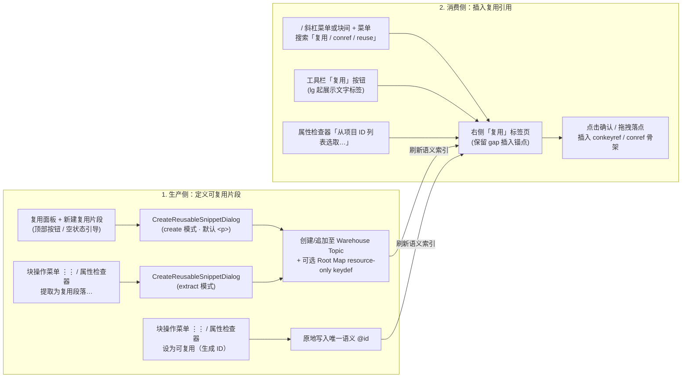

# 内容复用工作流：复用仓库、片段创建与全入口交互设计

> 本文档记录 DITAEditor 中 DITA 1.3 内容复用（`conkeyref` / `conref`）的生产侧与消费侧完整闭环、用户操作入口以及核心工程约束。DITA Warehouse Topic 编写规范另见 [dita_topic.md](../dita/dita_topic.md) 第 7 节。

---

## 1. 背景与设计目标

此前工作台右侧检查器已有 **「复用」标签页（`ConrefReusePanel`）**，支持按 Key（`conkeyref`）或相对路径（`conref`）选取项目中**已带有 `@id` 的元素**、执行 DFS 环路检测预览并插入或拖拽到编辑器；但在实际编写中仍存在两处操作断层：

1. **生产侧缺少「增加一个可复用段落」的入口**：无法在编辑流程内新建 DITA 规范的复用仓库（Warehouse Topic）并自动挂载 `processing-role="resource-only"` `<keydef>`，也缺少「在复用面板直接新建可复用段落」、「原地给段落赋语义 ID」与「将已有段落提取到复用仓库」的入口。
2. **消费侧发现与直达链路不足**：`/` 斜杠菜单与块间 `+` 插入菜单（`InsertElementMenu`）中没有「插入复用段落」入口，工具栏按钮文字在 `< 1536px` 屏幕被隐藏，且复用面板空状态缺少创建引导。

---

## 2. 完整用户工作流与入口矩阵

### 2.1 四种常用操作路径

1. **新建复用段落（并可选自动建仓库 + 立即插入）**
   - 打开右侧 **「复用」** 标签页，点击顶部或空状态中的 **`+ 新建复用片段`**，打开 `CreateReusableSnippetDialog`（`create` 模式）。
   - 选择已有仓库/Topic，或点击内联 **「+ 新建复用仓库」**（默认路径 `reuse/common-snippets.dita`，存在可用 Root Map 时默认勾选挂载 `<keydef processing-role="resource-only"/>`）。
   - 选择元素类型（默认 `
`，支持 `
` / `<note>` / `<section>` / `<codeblock>` / `<ph>`）、填写内容与自动生成的语义 `id`，默认勾选「创建后立即在当前光标处插入引用」。
2. **把正文已有段落设为可复用（原地赋 ID）**
   - 在任意可复用块左侧 **`⋮⋮` 块操作菜单**（`BlockHandle`）或右侧 **属性检查器 → 内容复用 (Conref)** 中点击 **「设为可复用（生成 ID）」**。
   - 编辑器基于当前元素标签、正文内容及文档已有 `@id` 集合自动生成唯一语义 `id` 并写入属性，同时切换至属性面板方便微调。
3. **将正文已有段落提取到复用仓库**
   - 在 **`⋮⋮` 块操作菜单** 或 **属性检查器 → 内容复用 (Conref)** 中点击 **「提取为复用段落…」**，进入 `CreateReusableSnippetDialog`（`extract` 模式）。
   - 导出选中的 ProseMirror 块级节点 XML 到目标仓库后，可选择：
     - **替换为复用引用（推荐）**：以单个可撤销 ProseMirror 事务将原块替换为带 `conkeyref` / `conref` 的空宿主骨架（保留 `audience`、`platform`、`product`、`otherprops`、`props`、`rev` 条件过滤属性，`Cmd/Ctrl+Z` 一步还原）。
     - **仅保存到复用库**：保留当前段落内容不变，仅向仓库追加副本。
4. **在正文中快捷插入复用段落**
   - 输入 **`/`** 或点击块间 / 块左侧 **`+`** 打开 `InsertElementMenu`，搜索 `复用`、`段落`、`片段`、`reuse`、`conref`、`conkeyref`、`snippet`，选中 **「插入复用内容 (Conref / Conkeyref)」** 后自动清理前导 `/` 并打开右侧「复用」面板；若从间隙 `+` 触发，会记录 `pendingReuseInsertPosRef` 并在确认复用时精准插入该位置。
   - 也可直接点击工具栏 **「复用」** 按钮（`lg` 断点即 `≥ 1024px` 起显式展示文字标签），或从候选列表直接拖拽到可视化/源码编辑区。

---

## 3. 分层架构与关键不变量

### 3.1 `@dita/core` 同构内核
- **`packages/dita-core/src/templates/topic-templates.ts`**：新增 `createWarehouseTopicTemplate()`，生成带标准 `<!DOCTYPE topic>`、中文/英文模板标题、仓库规范 XML 注释与空 `<body>` 的 `<topic>` 文档。
- **`packages/dita-core/src/semantics/warehouse.ts`**：
  - `generateSemanticElementId(tagName, textPreview, existingIds)`：生成符合 XML Name 规则（`/^[A-Za-z_][A-Za-z0-9_.-]*$/`）的语义化 `@id`，并在冲突时自动递增后缀去重。
  - `collectTopicElementIds(topicXml)`：安全收集文档中已有 `@id`。
  - `appendReusableFragmentToTopicXml(topicXml, options)`：
    - 基于 `parseXml()` + `serializeXml()` 保持无损往返（`<?xml?>`、`<!DOCTYPE>`、注释、PI 与属性顺序不变），跨文档克隆严格依据 `node.nodeType` 常量（避免 `instanceof slimdom.*` 跨版本失效）。
    - 自动处理 DITA 1.3 内容模型容器合法性：Strict `<taskbody>` 中将流式块落位至 `<context>`、将 `<section>` 落位至 `<example>`；将 `<ph>` / `<keyword>` 等行内片段自动包入 `
`；将 `<li>` 自动包入 `<ul>`。
    - 强制覆盖目标 `@id` 并剥离嵌套 `conref` / `conkeyref` / `conrefend`。
- **`packages/dita-core/src/prosemirror/converter.ts`**：新增 `serializePmBlockToXml(node)`，复用 `appendPmNodeToDom` 无损序列化单个 ProseMirror 块节点。

### 3.2 `@dita/web` 状态管理与编辑器命令
- **仓库与跨文件写入（`apps/web/src/store/editor-store/slices/files.ts`）**：
  - `createWarehouseTopic()`：挂载 Root Map `<keydef>` 前强制校验 `ensureMapEditable()`；API 模式下立即保存 Map 至个人草稿层，使服务端语义索引器立即识别新 Key。
  - `addReusableFragmentToTopic()`：API 模式下对未打开的目标文件先执行 `ensureFileCheckedOut()` 再读取并携带 `expectedHash` 保存至 Draft Overlay，严格遵循 Phase 13 Check-out 锁与多作者草稿隔离边界；写入后刷新工作区树、语义索引与诊断。
- **单事务替换与结构守卫（`apps/web/src/editor/visual/commands/reuse-commands.ts`）**：
  - `REUSE_EXCLUDED_BLOCK_TAGS` 统一屏蔽 `title`、`shortdesc`、`body`、`conbody`、`taskbody`、`refbody`、`prolog`、`related-links` 等结构锚点，避免误将文档骨架设为或替换为 `conref`。
  - `replaceBlockWithReuseAtPos()` 与 `insertReuseReferenceAtPos()` 分别挂载到 `VisualEditorHandle`（`replaceBlockWithReuse` / `insertReuseAtPos`），通过单个 ProseMirror 事务完成替换/插入，完整支持单步 Undo/Redo。

---

## 4. 测试覆盖

- `packages/dita-core/test/warehouse.test.ts`：覆盖仓库模板往返、语义 ID 生成与去重、各类块/行内片段追加、`taskbody` 槽位落位、Prolog/PI 保真、`serializePmBlockToXml()` 等。
- `apps/web/test/reuse-entry-points.test.ts`：覆盖 `replaceBlockWithReuseAtPos` 单事务替换与撤销、条件过滤属性保留、`insertReuseReferenceAtPos`、对话框校验与目标值解析（`conkeyref` 优先 / 相对路径 `conref` 回退）以及默认标签与语义 ID 生成。
