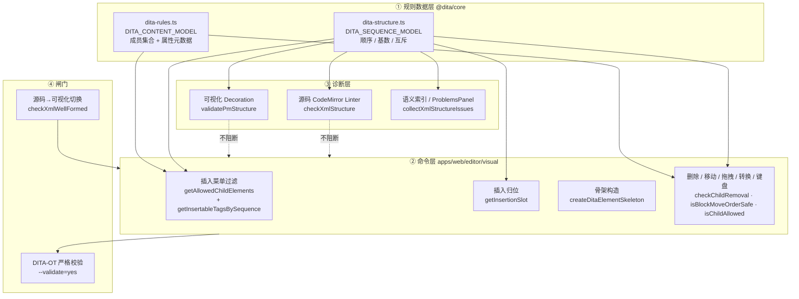

# 前端 DITA 1.3 结构化写作合规实施说明

> 本文说明「可视化编辑器如何保证作者写出的内容符合 OASIS DITA 1.3」的完整实现路径：规则数据从哪来、编辑操作如何被引导到合法槽位、违规如何被实时发现、以及最终由谁做权威判定。
>
> 相关约束见 `AGENTS.md` §4.1（无损往返）、§4.2（ProseMirror Schema 规则）、§4.8（DITA 1.3 有序内容模型）。

---

## 1. 设计目标与三条硬约束

| 目标 | 后果 |
| :--- | :--- |
| **标准 DITA XML 是唯一真相源，必须无损往返** | ProseMirror Schema **不能**写成严格 DTD；未知/特化元素必须能透传 |
| **引导而非拦截**（AGENTS.md §4.8「Guide, never block」） | 禁止用 `filterTransaction` 或抛异常阻断编辑；违规以诊断形式提示 |
| **单一规则来源** | 顺序/基数/互斥规则只写在 `@dita/core`，Visual、源码编辑器、问题面板共用同一判断与同一句文案 |

因此本项目**不是"DTD 编译器"**，而是：

```
宽松无损 Schema（保存能力）
  + 数据化内容模型（判断能力）
  + 只放出合法操作的命令层（预防）
  + 实时诊断装饰（反馈）
  + DITA-OT --validate=yes（权威裁决）
```

---

## 2. 总体链路



| 层 | 回答的问题 | 是否阻断编辑 |
| :--- | :--- | :--- |
| ① 规则数据 | 合法结构长什么样 | — |
| ② 命令层 | 这次操作会不会写出非法结构 | **是**（命令返回 `false`，UI 置灰或拒绝） |
| ③ 诊断层 | 当前文档哪里已经不合规 | **否**（仅标注/列表） |
| ④ 闸门 | 这份 XML 能不能进可视化、能不能发布 | **是**（切换/发布前） |

---

## 3. ① 规则数据层

### 3.1 成员表：父子能不能放

`packages/dita-core/src/model/dita-rules.ts:131` 的 `DITA_CONTENT_MODEL`，逐父元素列出合法直接子元素，注释明确对应 DITA 1.3 `*.mod`：

```ts
topic: ['title', 'titlealts', 'shortdesc', 'abstract', 'prolog', 'body', 'related-links', 'topic'],
taskbody: ['prereq','context','steps','steps-unordered','result',
           'tasktroubleshooting','example','postreq'],
step: ['note','hazardstatement','cmd','info','substeps','choices',
       'choicetable','itemgroup','stepxmp','tutorialinfo','stepresult','steptroubleshooting'],
```

配套 API：

| API | 位置 | 说明 |
| :--- | :--- | :--- |
| `getAllowedChildElementTags(parent, taskModel)` | `dita-rules.ts:775` | 取原始标签数组（strict/general 覆盖优先） |
| `isChildAllowed(parent, child, taskModel)` | `dita-rules.ts:783` | 布尔判断；**规则表未收录的父元素返回 `true`**（特化透传） |
| `getAllowedChildElements(parent, 'block'\|'inline'\|'all', taskModel)` | `dita-rules.ts:795` | 返回 `DitaElementSpec[]`，供菜单/工具栏使用 |
| `getElementSpec` / `getAttributesForElement` | `dita-rules.ts:752` / `:1021` | 元素分类、标签文案、属性元数据（含 `required` 标记） |

### 3.2 顺序表：必须排第几、能出现几次

`packages/dita-core/src/model/dita-structure.ts:196` 的 `DITA_SEQUENCE_MODEL`。**数组下标 = rank = 在内容模型中的位置**，没有第二份顺序表。

```ts
// dita-structure.ts:198
topic: [
  required('title'),                 // 0
  optional('titlealts'),             // 1
  optional('shortdesc', 'abstract'), // 2  单值槽多标签 = 互斥
  optional('prolog'),                // 3
  optional('body'),                  // 4
  optional('related-links'),         // 5
  many('topic'),                     // 6  主题嵌套（shell DTD 限制类型）
],
```

```ts
// dita-structure.ts:129 —— OASIS task.dtd + strictTaskbodyConstraint.mod
const STRICT_TASKBODY_SLOTS = [
  optional('prereq'),                    // 0
  optional('context'),                   // 1
  optional('steps', 'steps-unordered'),  // 2  互斥二选一
  optional('result'),                    // 3
  optional('tasktroubleshooting'),       // 4
  optional('example'),                   // 5
  optional('postreq'),                   // 6
];
// dita-structure.ts:238
taskbody: STRICT_TASKBODY_SLOTS,
```

其余关键模型（同文件）：

| 父元素 | 槽位 |
| :--- | :--- |
| `conbody` (`:244`) | 纯正文块 `many(p, note, ul, ol, dl, codeblock, fig, …)`，随后 `many(section, example, conbodydiv)` |
| `table` (`:270`) | `optional(title), optional(desc), some(tgroup)` |
| `tgroup` (`:277`) | `many(colspec), optional(thead), required(tbody)` |
| `step` (`:282`) | `many(note), required(cmd), many(info…), optional(stepresult), optional(steptroubleshooting)` |
| `dl` / `dlentry` (`:316`/`:317`) | `dl: optional(dlhead), some(dlentry)`；`dlentry: some(dt), some(dd)` |
| `prolog` (`:301`) | `author* → source? → publisher? → copyright* → critdates? → permissions? → metadata* → resourceid*` |

**故意不建模的容器**：`body`、`li`、`entry`、`note`、`section` 正文等。它们在 OASIS DTD 里是无序 `|` 选择，成员表 `DITA_CONTENT_MODEL` 已是完整约束，再加顺序槽会伪造 `child-out-of-order`（见 `DITA_SEQUENCE_MODEL` 上方注释）。

### 3.3 槽位语义

```ts
// dita-structure.ts:34
export type SequenceOccurrence = 'required' | 'optional' | 'zeroOrMore' | 'oneOrMore';
export interface DitaSequenceSlot {
  readonly tags: readonly string[];
  readonly occurrence: SequenceOccurrence;
}
```

| 形态 | 含义 |
| :--- | :--- |
| `required('title')` | 必须有，且只能 1 个 |
| `optional('body')` | 0 或 1 个 |
| `some('step')` | ≥1 个（删除最后一个会被拒） |
| `many('topic')` | 任意个 |
| 多标签 + 单值 | **互斥选择**：`(steps | steps-unordered)?` 不能同时出现 |
| 多标签 + 重复 | **无序混合重复**：`(prereq | context | section)*` 可交错 |

五个诊断码（`dita-structure.ts:42`）：

```ts
'child-out-of-order' | 'missing-required-child' | 'child-cardinality'
| 'slot-exclusive' | 'child-not-allowed'
```

### 3.4 Strict Task 与 General Task

`task.dtd` 与 `generalTask.dtd` / `ditabase.dtd` 的 `taskbody` 模型不同，实现为**覆盖表**而非分支代码：

| 表 | 位置 | 内容 |
| :--- | :--- | :--- |
| `GENERAL_TASKBODY_SLOTS` | `dita-structure.ts:146` | `many(prereq, context, section)`, `optional(steps, steps-unordered, steps-informal)`, `optional(result)`, … , `many(example)`, `many(postreq)` |
| `GENERAL_TASK_SEQUENCE_OVERRIDES` | `dita-structure.ts:167` | `{ taskbody: GENERAL_TASKBODY_SLOTS }` |
| `STRICT_FORBIDDEN_CHILDREN` | `dita-structure.ts:163` | `{ taskbody: ['section', 'steps-informal'] }` → strict 下报 `child-not-allowed` |
| `getSequenceSlots(parent, taskModel)` | `dita-structure.ts:182` | 按模型选表，非 task 容器两模型一致 |

模型来源三态（`apps/web/src/editor/structure-options.ts`）：

- `auto`（默认）：读文档自身 `<!DOCTYPE>`，`task.dtd` → strict，`generalTask.dtd`/`ditabase.dtd` → general
- `strict` / `general`：强制覆盖，供统一外壳的团队使用

React 状态通过模块级镜像（`getTaskContentModelSetting()` / `resolveTaskModelForDocument(doc)`）暴露给非 React 的命令与 CodeMirror 补全。

### 3.5 刻意的"宽容"（保无损）

| 机制 | 位置 | 行为 |
| :--- | :--- | :--- |
| open-tail 容器 | `OPEN_TAIL_CONTAINERS` `dita-structure.ts:116`（`section`/`example`/`refsyn`/`fig`） | 只约束 `title`/`desc` 打头；未声明正文元素归 `TAIL_RANK`，所以迟到的 `<title>` 仍报乱序 |
| 未知/特化元素 | `UNKNOWN_RANK = -1` `:323`、`resolveRank()` `:335` | 在严格序列容器中透明跳过，不污染后续兄弟的 rank 比较 |
| `conref` / `conkeyref` 空元素 | `validateChildSequence(..., { contentIsReused })` `:376`；调用点 `prosemirror/structure.ts:101` | 内容发布时复用，不报 `missing-required-child` |

### 3.6 编辑策略例外（不是 DTD 规则）

`dita-structure.ts:695` 的 `REQUIRED_STRUCTURAL_CHILDREN = { task: ['taskbody'] }`：

- DITA 1.3 里 `<task>` 无 `<taskbody>` 依然合法（`taskbody` 槽是 `optional`）
- 但可视化编辑需要 `taskbody` 作为块元素的合法父容器，删掉会锁死编辑
- 因此删除守卫返回 `required-policy`，而序列模型保持 `optional`，**不制造 `missing-required-child` 噪音**

---

## 4. ② 命令层：只放出合法操作

Schema 本身是全宽松的（`packages/dita-core/src/prosemirror/schema.ts`：容器 `any_block*` / `inline*`，行内元素一律建模为 inline node），约束全部集中在命令层。

### 4.1 插入菜单：候选先过成员表，再过基数/互斥表

`apps/web/src/editor/visual/selection-info.ts:155` 起 `getSelectionSnapshot()`：

1. 光标所在最深文本块 → `getAllowedChildElements(tag, 'inline', taskModel)` 得行内候选（`:188`）
2. 向上遍历 2–3 层祖先容器 → `getAllowedChildElements(tag, 'block', taskModel)`
3. `getInsertableTagsBySequence(容器, getPmChildTags(容器), 候选)` 过滤（`:237`）
   - 单值槽已填 → 不出现（如已有 `<title>` 不再给 title）
   - 互斥失败方 → 不出现（已有 `<steps>` 不给 `<steps-unordered>`）
4. 表格内部结构元素（`sthead/strow/tgroup/colspec/thead/tbody/row/entry`）不进通用菜单，由表格工具栏负责（`:207-232`）

同样逻辑复用于：

- 块手柄与间隙 `+` 菜单：`apps/web/src/editor/visual/VisualEditor.tsx:120 buildBlockInsertGroups()`
- 工具栏可用态：`VisualEditor.tsx:1107-1115`（`canInsertBlock` / `canInsertInline` → `isInlineTagAllowedAtSelection` `selection-info.ts:372`）
- 源码模式标签补全：`apps/web/src/editor/source/dita-completion.ts:165`（同一个 `getInsertableTagsBySequence`）

### 4.2 插入位置：自动归位到 DTD 槽位

`apps/web/src/editor/visual/commands.ts:789 insertBlockDitaElement()` → `commands.ts:743 resolveSequenceAnchor()`：

1. 取容器元素子节点（注释/PI/`xml_text_block` 不参与内容模型）
2. 由光标位置换算 `preferredIndex`
3. `getInsertionSlot(containerTag, childTags, tagName, preferredIndex, taskModel)`
4. `ok === false` → 整个命令返回 `false`（插入被拒）
5. `slot.index !== preferredIndex` → 锚定到 `elementChildren[slot.index - 1]` 之后

`getInsertionSlot()`（`dita-structure.ts:574`）的区间计算核心（`:613-628`）：

```ts
if (rank < targetRank) lastLowerIdx = i;
else if (rank > targetRank && firstHigherIdx === childTags.length) firstHigherIdx = i;
const minIndex = lastLowerIdx + 1;
const maxIndex = Math.max(minIndex, firstHigherIdx);
```

**实例：向已有 `<related-links>` 的 `<topic>` 插入 `<body>`**

| 步骤 | 值 |
| :--- | :--- |
| `targetRank(body)` | 4 |
| 已有子元素 | `[title(0), related-links(5)]` |
| `lastLowerIdx` | 0（title） |
| `firstHigherIdx` | 1（related-links） |
| 合法区间 | `[1, 1]` |
| 游标停在 related-links 之后（preferredIndex=2） | 被夹回 1 → **插在 `<related-links>` 之前** |

`<title>` "永远第一"的同源机制：非 title 插入时 `minIndex = lastLowerIdx + 1 ≥ 1`；title 槽为 `required` 单值，已有 title 时 `count > 0` → `ok: false`。

### 4.3 新元素天生合法：骨架构造

`commands.ts:62 createDitaElementSkeleton()` 按 DTD 预置必需子节点，例如：

- `step` → 自带 `<cmd>`
- `dlentry` → `<dt>` + `<dd>`
- `section` / `example` → 带 title 槽位
- `menucascade` → 两个 `<uicontrol>` 示例
- `conref` / `conkeyref` 骨架 → **空容器**（内容发布时复用，避免伪造本地内容）
- 其余容器按 `blockTypeMap` 映射到对应 PM 类型并检查 `contentMatch.validEnd`

### 4.4 结构变更守卫一览

| 操作 | 实现 | 守卫 |
| :--- | :--- | :--- |
| 插入块 | `commands.ts:789` / `:838 insertBlockDitaElementAtPos` | `getInsertionSlot().ok` |
| 插入行内 / 包裹选区 | `commands.ts:609 toggleInlineDitaElement` | 选区必须在单一 textblock 内；同类型嵌套拍平（`<b><b>` → `<b>`）；`codeblock` 内拒绝；工具栏侧再经 `isInlineTagAllowedAtSelection()` |
| Turn into 换标签 | `commands.ts:1396 convertDitaBlockAtPos` | `isChildAllowed(parentTag, 新标签, taskModel)` |
| 删除元素 / 块手柄删除 / 属性面板删除 | `commands.ts:1310 deleteDitaNodeAtPos`；`block-transforms.ts:203`；`AttributesPanel.tsx:175`；`VisualEditor.tsx:1205` | `checkChildRemoval()` |
| 上下移动 | `commands.ts:1341 moveDitaNodeSibling` | `isBlockMoveOrderSafe()` |
| 拖拽移动 | `commands.ts:1440 moveDitaBlockToGap` | `isBlockMoveOrderSafe()` |
| 复制块 | `block-transforms.ts` `canDuplicateBlock` | 复制后序列仍然合法 |

`checkChildRemoval()`（`dita-structure.ts:722`）返回四类障碍：

```ts
'root-element'      // 文档根元素
'required-child'    // required 槽（如 <step> 的 <cmd>）
'required-policy'   // 编辑策略（<task> 的 <taskbody>，见 §3.6）
'last-of-one-or-more' // oneOrMore 槽的最后一个（如 <steps> 里唯一的 <step>）
```

`isBlockMoveOrderSafe()`（`block-transforms.ts:313`）先模拟重排，再用 `validateChildSequence` 只拒绝 `child-out-of-order`——删除/移动不会改变基数，所以只关心顺序。

### 4.5 键盘行为按内容模型设计

`apps/web/src/editor/visual/keymap.ts:43-46` 绑定：

| 键 | 实现 | 行为 |
| :--- | :--- | :--- |
| `Enter` | `commands.ts:927 handleDitaEnter` | `codeblock`/`pre`/`unknown_pre_block` → 字面 `\n`；`<title>` → 绝不产生第二个 title（跳兄弟或补建 body）；`<cmd>` → 新的同级 `<step><cmd/></step>`；`<dt>` → 聚焦/补 `<dd>`；`<li>`/`<choice>` → 复制同级，空项则退出列表；`<p>` → 干净分割并**剥掉第二段的 `id`**（避免 XML ID 重复） |
| `Backspace` | `commands.ts:1217 handleDitaBackspace` | topic 级 `title`/`shortdesc` 退格被安全吞掉；空行内元素干净解包；末尾空 `<p>` 删除并回退光标 |

### 4.6 行内元素与表格的额外保真规则

- 行内元素用 **inline node** 而非 Mark（AGENTS.md §4.2）：空元素 `<keyword keyref="…"/>`、精确嵌套顺序 `<b><i>`、每个元素独立的 `rawAttrs` 都不会被合并/丢弃。
- 混合内容用 `xml_text_block`（序列化时**不输出任何包装标签**），避免在 `<li>`、`<dd>`、`<note>` 里凭空造 `<p>`。
- CALS 表格：`cals/` 适配器从 `namest/nameend/morerows` 推导 `colspan/rowspan`，但**原属性保留在 `rawAttrs`**；多 `tgroup` 表用 `hasMultipleTgroups()` 禁止破坏性可视化编辑。

---

## 5. ③ 诊断层：看得见，但不挡路

### 5.1 可视化模式：Decoration 标注

`apps/web/src/editor/visual/structure-decorations.ts:36` 的 `buildStructureDecorations()`：

```ts
const issues = validatePmStructure(doc, { taskModel });
// ...
Decoration.node(issue.pos, issue.pos + issue.size, {
  class: `dita-structure-invalid dita-structure-${issue.code}`,
  title: describeStructureIssue(issue, locale),
  'data-structure-code': issue.code,
  'data-structure-parent': issue.parentTag,
});
```

- 全量校验入口：`packages/dita-core/src/prosemirror/structure.ts:80 validatePmStructure()`，遍历所有非叶子、非 unknown 节点，对每个父元素跑 `validateChildSequence`
- 插件 `DITA_STRUCTURE_KEY` 只在 `doc / locale / taskModel` 变化时重算，其余事务复用旧 `DecorationSet`
- `missing-required-child` 没有可标注节点（`size === 0`）→ 不画装饰，交给 Problems 面板（新建骨架常处于"写到一半"）

### 5.2 源码模式：CodeMirror Linter

`apps/web/src/editor/source/xml-linter.ts:34` 调用 `checkXmlStructure(xml, { taskModel })`（`packages/dita-core/src/xml/structure-check.ts:87`）：

1. `checkXmlWellFormed()` 失败 → 短路返回解析错误（含 `line/column/offset`），不继续做结构检查
2. 成功 → `collectXmlStructureIssues()` 产出带 offset 的 `StructureIssue[]`
3. 映射为 `Diagnostic`：`severity` 跟随 issue，`source` 走 i18n（`source.structureSource`）
4. `delay: 180` 防抖

### 5.3 跨文件：语义索引与 Problems 面板

`packages/dita-core/src/semantics/semantic-engine.ts:589`：

```ts
for (const issue of collectXmlStructureIssues(parsed.document)) {
  diagnostics.push({
    id: `structure:${filePath}:${issue.offset}:${issue.code}:${issue.childTag}`,
    source: 'structure',
    severity: issue.severity,
    message: formatStructureIssue(issue, this.uiLocale),
    ...
  });
}
```

与 `keyref` / `conref` / 图片路径 / DITAVAL 语法等诊断一起进入 `apps/web/src/components/ProblemsPanel.tsx`（`STRUCTURE_SOURCE_KEYS` 含 `structure`）。

### 5.4 文案单一来源

`packages/dita-core/src/model/dita-structure.ts:91 formatStructureIssue()` + `STRUCTURE_MESSAGE_KEYS`（`:71`）：

| code | i18n key |
| :--- | :--- |
| `child-out-of-order` | `structure.outOfOrder` |
| `missing-required-child` | `structure.missingRequiredChild` |
| `child-cardinality` | `structure.childCardinality` |
| `slot-exclusive` | `structure.slotExclusive` |
| `child-not-allowed` | `structure.childNotAllowed` |

`apps/web/src/editor/structure-messages.ts` 只是转发，Visual / CodeMirror / Problems 三处文案必然一致（含中英文）。

### 5.5 为什么不用 `filterTransaction`

- 未知/特化元素必须无损透传，严格拦截会破坏 round-trip（AGENTS.md §4.1）
- 作者常"先写内容再补结构"，硬拦截会制造死角（如新建 topic 只填 title 时缺 `body`）
- Oxygen 等成熟 DITA 编辑器的行为也是"标注 + 提示"，而非禁止输入

---

## 6. ④ 闸门

| 闸门 | 位置 | 行为 |
| :--- | :--- | :--- |
| 源码 → 可视化 | `apps/web/src/editor/bridge/xml-bridge.ts:80`；`apps/web/src/store/editor-store.ts:1153` | `checkXmlWellFormed()` 失败 → 强制 `mode: 'source'`，记录 `xmlError: { line, column, offset, message }`，禁止切换 |
| 全局行为 | `editor-store.ts` 多处（`:437`、`:748`、`:1069`、`:1329`） | Map/Topic 加载、AI 应用、基线对比前均先做良构检查 |
| 发布 / 严格校验 | `apps/api/src/modules/validate/strict-validator.ts:227` | 调 DITA-OT `--validate=yes`，用 OASIS DTD/RNG 做权威判定，结果解析回统一诊断 |

> 前端只覆盖"可快速反馈的有序内容模型"；完整 DTD/RNG 语义（属性类型、ID 唯一性、`%info-types` 主题嵌套、特化约束）由 DITA-OT 兜底，避免在浏览器里重写整套 DTD 引擎。

---

## 7. 已知边界与取舍

| 边界 | 说明 |
| :--- | :--- |
| **不是完整 DTD 引擎** | 只为"确实有序"的容器建模；无序容器仅靠成员表 |
| **属性 `required` 是弱提示** | `dita-rules.ts` 中 `required: true`（`topic/@id`、`tgroup/@cols`、`keydef/@keys` 等）只影响属性面板展示，不阻断保存 |
| **未知/特化元素一律放行** | 牺牲"绝对阻断"，换 100% 无损 round-trip |
| **编辑策略与 DTD 规则分离** | `<task>` 必须保留 `<taskbody>` 属于编辑器策略（`required-policy`），不污染 DTD 诊断 |
| **CALS 保真优先** | 跨行/跨列由适配器推导，原属性保留；多 `tgroup` 表禁用破坏性可视化编辑 |
| **行内元素不是 Mark** | 因此不存在"Mark 合并/顺序丢失"问题，但也不享受 Mark 的自动扩张语义 |

---

## 8. 扩展指南

### 8.1 新增/修正一条顺序规则

只改 `packages/dita-core/src/model/dita-structure.ts` 的 `DITA_SEQUENCE_MODEL`（或对应覆盖表）。**不要**把顺序判断写进 `isChildAllowed()` 或 `apps/web/src/editor/visual/commands.ts`（AGENTS.md §4.8）。

```ts
// 例：为某容器声明 (title, desc?, body*)
someContainer: [optional('title'), optional('desc'), many('body')],
```

判定"是否真的有序"的标准：OASIS `*.mod` 中出现 `,` 才是有序；`|` 单独出现是无序，不应建模。

### 8.2 新增一个元素

1. `dita-rules.ts` — 加入 `DITA_CONTENT_MODEL` 的父元素数组与 `DITA_ELEMENT_SPECS`（category/kind/属性）
2. `packages/dita-core/src/prosemirror/schema.ts` — 若需要独立 PM 类型，按 block/inline 规则注册（含 `rawAttrs` / `namespaceURI`）
3. `commands.ts:62 createDitaElementSkeleton` — 补骨架（含必需子节点）
4. 如需顺序约束，补 `DITA_SEQUENCE_MODEL`
5. 中英文文案同步：`packages/dita-core/src/i18n` 与 `apps/web/src/i18n/messages`（`pnpm test` 有 parity 检查）
6. 若属于严格/通用任务壳差异，进 `GENERAL_TASK_SEQUENCE_OVERRIDES` 或 `STRICT_FORBIDDEN_CHILDREN`

### 8.3 新增一种结构诊断码

1. `StructureIssueCode` 与 `STRUCTURE_MESSAGE_KEYS`（`dita-structure.ts:42`、`:71`）
2. `formatStructureIssue()` 模板（`:91`）
3. 产生该问题的校验逻辑（`validateChildSequence` / `checkChildRemoval` / `getInsertionSlot`）
4. 三处消费端无需改动（Visual Decoration / Linter / Problems 自动生效）
5. 补 `packages/dita-core/test/dita-structure.test.ts` 与 `apps/web/test/structure-diagnostics.test.ts`

### 8.4 自检清单

- [ ] 新规则是否只在 `@dita/core` 出现一次？
- [ ] `getInsertableTagsBySequence` 是否正确隐藏已填单值槽与互斥失败方？
- [ ] 删除最后一项 `oneOrMore` 是否被 `checkChildRemoval` 拒绝？
- [ ] 拖拽/上下移动是否走 `isBlockMoveOrderSafe`？
- [ ] 未知/特化元素是否仍然透传（`passthrough-unknown.test.ts`）？
- [ ] 诊断文案中英文是否齐全（`i18n-parity.test.ts`）？
- [ ] `pnpm -r build && pnpm -r typecheck && pnpm -r test` 是否全绿？

---

## 9. 关键文件索引

| 文件 | 职责 |
| :--- | :--- |
| `packages/dita-core/src/model/dita-rules.ts` | 成员表、元素/属性元数据、`isChildAllowed` / `getAllowedChildElements` |
| `packages/dita-core/src/model/dita-structure.ts` | 顺序/基数/互斥模型、校验、插入槽位、删除守卫、错误文案 |
| `packages/dita-core/src/model/task-model.ts` | Strict / General 任务壳检测与解析 |
| `packages/dita-core/src/prosemirror/structure.ts` | `validatePmStructure`（PM 文档 → 结构问题） |
| `packages/dita-core/src/xml/structure-check.ts` | `checkXmlStructure`（解析 + 良构 + 结构） |
| `packages/dita-core/src/semantics/semantic-engine.ts` | 跨文件语义/结构诊断聚合 |
| `apps/web/src/editor/structure-options.ts` | 任务壳设置（auto/strict/general）与 React-free 镜像 |
| `apps/web/src/editor/structure-messages.ts` | 诊断文案转发（唯一出口 `formatStructureIssue`） |
| `apps/web/src/editor/visual/commands.ts` | 插入/删除/移动/转换/键盘命令的结构守卫 |
| `apps/web/src/editor/visual/block-transforms.ts` | 块手柄、拖拽重排、Turn into 候选与顺序安全判断 |
| `apps/web/src/editor/visual/selection-info.ts` | 上下文插入候选与工具栏可用态 |
| `apps/web/src/editor/visual/structure-decorations.ts` | 可视化实时诊断插件 |
| `apps/web/src/editor/source/xml-linter.ts` | CodeMirror 结构 linter |
| `apps/web/src/editor/bridge/xml-bridge.ts` | 源码↔可视化转换与良构闸门 |
| `apps/api/src/modules/validate/strict-validator.ts` | DITA-OT `--validate=yes` 权威校验 |

## 10. 相关测试

| 测试 | 覆盖点 |
| :--- | :--- |
| `packages/dita-core/test/dita-structure.test.ts` | 顺序/基数/互斥/插入槽位/删除守卫 |
| `packages/dita-core/test/task-elements.test.ts` | Strict 任务壳元素与模型 |
| `packages/dita-core/test/concept-elements.test.ts` / `reference-elements.test.ts` | 概念/参考主题结构 |
| `packages/dita-core/test/passthrough-unknown.test.ts` | 未知/特化元素无损透传 |
| `packages/dita-core/test/roundtrip.golden.test.ts` | 无损往返黄金样例 |
| `apps/web/test/structure-diagnostics.test.ts` | 可视化装饰与问题面板 |
| `apps/web/test/task-model-switch.test.ts` | `auto` / `strict` / `general` 切换 |
| `apps/web/test/dita-commands.test.ts` | 命令层结构守卫（插入/删除/移动/键盘） |
| `apps/web/test/dita-completion.test.ts` | 源码补全的基数过滤 |
