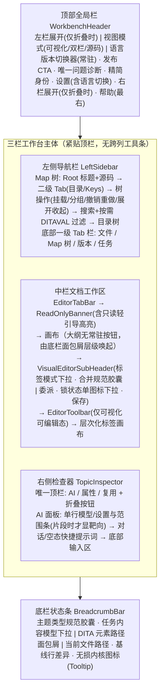

# 工作台信息结构与交互设计规范

> 状态：已实现（v1.7.x）
> 范围：`@dita/web` 主编辑工作台壳层、Map 导航栏、可视化画布工具栏、标签装饰渲染、AI 检查器与底栏状态条
> 相关代码：`apps/web/src/App.tsx`、`apps/web/src/components/`、`apps/web/src/map-tree/`、`apps/web/src/editor/visual/`、`apps/web/src/ai/`、`apps/web/src/store/editor-store/`、`apps/web/src/styles/`

---

## 一、背景与设计原则

随着 Phase 0–15 功能持续演进，主编辑工作台在顶部、左栏、画布与右栏累积了多层局部控制条与重复状态入口。本规范以**信息结构（Information Architecture）**与**交互一致性（Interaction Design）**为锚点，确立五条长期设计原则：

1. **严格包含层级（Containment Hierarchy）**：全局壳层控件（视图模式、手册发布、全局问题诊断、语言与身份）归属顶部 `WorkbenchHeader`；文档级控件（格式化工具栏、规范抽屉、标签模式、保存/锁操作）归属当前活动文档窗格内部，绝不横跨 `EditorTabBar` 或右侧 Inspector 之上，避免切换编辑/只读态或视图模式时引发跨列跳动。
2. **单一信源（Single Source of Truth）**：同一状态与高频入口不在多个区域重复摆放（左/右面板折叠展开对称、问题诊断只在顶栏唯一呈现、身份角色不重复渲染、AI 范围切换不附带同义说明胶囊）。
3. **内容优先与按需显露（Content First & Progressive Disclosure）**：默认界面优先让位于文档正文与 Map 目录树；低频或前提未满足的控件（如未启用 DITAVAL 时的 `全显/淡化/隐藏`、只读态下置灰的 `保存` 按钮）默认隐藏，触发条件成立时再展开。
4. **阅读态与编辑态自适应（Mode-Adaptive Defaults）**：只读浏览聚焦可读性，编辑写作聚焦 DITA 结构感知——标签显示模式按编辑权限分别记忆并自动切换。
5. **不破坏工程不变量**：所有优化均限于 `@dita/web` 表现层与 UI 状态，不改变 `@dita/core` 无损 XML 往返语义、Phase 13 草稿叠加层与独占锁机制，且保持完整的中英双语 i18n 一致性。

---

## 二、已确认的核心设计决策

| # | 决策项 | 规范方案 | 理由 |
| :-- | :--- | :--- | :--- |
| 1 | **标签模式按编辑态自适应** | **只读模式默认 `none`（无标签）**，**编辑模式默认 `tags`（仅标签）**；两套偏好分别持久化到 `localStorage`（`ditaeditor.tagDisplayMode.readOnly` / `ditaeditor.tagDisplayMode.edit`） | 未检出查阅时正文纯净无干扰；点击“检出”进入写作后自动浮现结构标签，兼顾新手可读性与 DITA 写作者的结构掌控感；手动切换仍可按模式持久记忆 |
| 2 | **`发布` 入口提升至顶栏** | 将手册级主动作 `发布` 提升至 `WorkbenchHeader` 右侧；从 `MapTreePanel` 紧凑树操作条中移除，保持树操作单行清爽 | 发布是全手册交付级动作，放在顶栏更符合全局心智模型，同时缓解左栏窄屏拥挤 |
| 3 | **`问题诊断` 保留顶栏单一入口** | 保留 `WorkbenchHeader` 的问题诊断胶囊作为唯一入口，移除 `BreadcrumbBar` 中重复的 `诊断: 0` | 顶栏错误/警告色标在全局视线焦点区更易发现，消除底栏重复点击入口 |
| 4 | **工具栏归位文档内部** | 移除跨列 `showActionRow`；可视化格式化 `EditorToolbar` 迁入 `VisualEditor` 内部（位于 `VisualEditorSubHeader` 正下方），源码/Map 概览控制条收入中栏内部且无内容时不渲染 | 彻底修复只读可视化态下的 9px 空白占位条，以及编辑态格式化条压在 Tab 与右栏上方导致的层级倒置与布局跳动 |
| 5 | **全量实施 P0 + P1 + P2** | 一次性完成壳层重构与 Bug 修复（P0）、跨区降噪与结构重排（P1）、画布视觉层级与 AI/只读交互引导（P2） | 保证信息架构整体自洽，避免半成品过渡态 |

---

## 三、信息结构蓝图

---

## 四、分项设计规范

### 4.1 P0：壳层包含层级重构与渲染/交互缺陷修复

1. **左右边栏折叠/展开按钮严格对称**
   - `LeftSidebar` 展开时仅由其顶部自带的 `PanelLeftClose` 负责收起；`WorkbenchHeader` 左侧的 `<PanelLeft />` 展开按钮仅在 `!leftSidebarOpen` 时显示，与右侧 `showInspectorExpand` 完全对称。
2. **消除空白 `showActionRow` 与归位 `EditorToolbar`**
   - 删除 `App.tsx` 中位于 `WorkbenchHeader` 下方、横跨中栏与右侧 Inspector 的 `showActionRow`。
   - `VisualEditor` 新增 `formattingBarSlot?: ReactNode`；当 `showTopicVisual && canEdit` 时将 `<EditorToolbar />` 渲染于 `VisualEditorSubHeader` 与画布滚动区之间。
   - 非可视化模式（纯源码 / Map 概览）下，仅当 `saveControlsNode`、`TopicGuideChip` 或 `topicContextNode` 存在实际可渲染内容时，在中栏 `center-workbench-pane` 内部渲染单行文档控制条。
3. **修复 Oxygen 风格标签属性粘连缺陷（`conceptid="..."`）**
   - 根因：`.dita-ox-body` 为 `display: inline-flex`，Flex 子项自动折叠 `attrsSpan.textContent` 的前导空格。
   - 修复：在 `apps/web/src/styles/tag-chrome.css` 中为 `.dita-ox-body` 增加 `gap: 4px`，并在 `apps/web/src/editor/visual/decorations/tag-dom.ts` 中直接输出 `attrsText`（不再依赖前导空格）。
4. **移除 AI 面板重复顶栏与失效 `X` 按钮**
   - `TopicInspector` 已统一承载右侧面板 Tab 与折叠按钮；移除 `AiAssistantPanel` 内部的二次标题栏与调用 `useAiStore.closePanel()` 的死按钮 `X`。
   - 将模型名称胶囊（点击可直达 AI 设置）与设置图标整合进顶部范围上下文栏；当 `scope === 'document'` 时隐藏与选中按钮同义的 `整篇模式 · 完整 Topic` 胶囊，仅在 `scope === 'fragment'` 时展示具体命中元素与选中片段预览。

### 4.2 P1：左栏、文档工具栏、身份与底栏降噪

1. **`MapTreePanel` 垂直层级压缩（5 层 → 3 层）**
   - 顺序调整为：**Root Map 标题行** → **`目录结构 | Keys (N)` 二级 Tab** → **树操作与搜索区（仅 `tree` 视图渲染）**，切换 `Keys` 视图时二级 Tab 位置固定不跳动。
   - `发布` 按钮移至 `WorkbenchHeader`，树操作条仅保留 `挂载 v`、`分组 v` 与右侧 `撤销/重做/展开/收起`。
   - 搜索框与 DITAVAL 过滤触发器合并为同一行：未选择 DITAVAL 时右侧仅展示紧凑的过滤选择触发器（不渲染 3 个禁用的 `全显/淡化/隐藏` 按钮）；选择 DITAVAL 或展开过滤面板后，再显示青色激活条（含 `全显/淡化/隐藏` 与排除/标记统计）。
   - `RootMapSwitcher`（`apps/web/src/map-tree/RootMapSwitcher.tsx`）把 Root Map 标题行升级为下拉菜单：①列出工作区全部 `.ditamap` 并激活为目标根 Map（`selectRootMap` 重载缓冲/语义/诊断）；②保留原“查看根元素属性”动作；③`设为手册默认 Root Map` 写入手册元数据 `defaultRootMap`（非 viewer 且 API 模式可用）。`MapTreePanel` 启动即按手册默认 Map 定根（`initWorkspace({ rootMapPath })` 优先于“顶层首个 Map”启发式），设置的默认 Map 以琥珀色图钉标记。
   - 移除底部常驻静态提示行，释放目录树可视高度；将操作提示保留在空态与树标题 Tooltip 中。
2. **`IdentitySwitcher` 去重**
   - 保留 `<select>` 内的 `{displayName} · {roleLabel}` 清晰展示，移除右侧重复的灰色角色小标签。
3. **`TopicGuideChip` 合并与 `SaveControls` 只读隐藏**
   - 将 `概念主题` 徽章与 `展开编写规范 v` 合并为一枚统一的交互胶囊按钮（图标 + 主题类型名 + 展开/收起箭头，点击整枚胶囊即可切换规范面板；有结构问题时紧邻展示结构问题角标）。
   - `SaveControls` 在 `readOnly && dirtyCount === 0` 时返回 `null`，不在只读工具栏中展示置灰的 `保存` 按钮。
4. **`BreadcrumbBar` 精简**
   - 移除重复的 `诊断: 0` 入口（由顶栏统一承接）。
   - 将静态文字 `@dita/core 无损内核` 收敛为带 `title` 与 `aria-label` 的紧凑绿色 `ShieldCheck` 状态图标，为左侧 DITA 元素路径面包屑腾出横向空间。
   - 底栏左侧构成一枚“当前在看什么”的控制簇：主题类型规范胶囊（`任务主题 <task>`）+ `TopicModelSlot`（任务正文内容模型下拉 `自动/严格/通用`，仅在 `<task>` 主题出现，由 `BreadcrumbBar` 的 `topicModelSlot` 渲染在规范胶囊右侧）。该类控件不再占用文档工具条行：可视化子头部与源码工具条均不再重复渲染，拆分视图下也不会出现两份。

### 4.3 P2：自适应标签默认态、视觉层次与交互引导

1. **按编辑权限自适应与持久化的 `tagDisplayMode`**
   - 在 `editor-store` 中维护 `readOnlyTagDisplayMode`（默认 `'none'`，持久化键 `ditaeditor.tagDisplayMode.readOnly`）与 `editTagDisplayMode`（默认 `'tags'`，持久化键 `ditaeditor.tagDisplayMode.edit`），同时保留 `tagDisplayMode` 字段与 `setTagDisplayMode(mode, scope?)` 向后兼容。
   - `App.tsx` 根据 `canEdit` 自动映射当前生效模式：`canEdit ? editTagDisplayMode : readOnlyTagDisplayMode`。用户签出文件时自动从“无标签阅读”切入“仅标签编辑”；签入/释放锁回退只读时自动恢复纯净阅读；用户在任一模式下手动切换标签档位均被持久记住。
   - 控件形态：文档工具条最左侧的单枚下拉胶囊（标签图标与原生 `<select>` 同在一个边框内，`apps/web/src/styles/primitives.css` 的 `.dita-tag-mode` 负责边框/悬停/蓝色激活态，内部 `select` 无边框），三档一次可见、一击可达；大纲开关已移出该行（见 P3 大纲书签把手）。
2. **标签视觉权重分级与 `titlealts` 轻量化**
   - `.dita-ox-strip:not([data-ox-selected="true"])` 降低非焦点容器开/闭标签的视觉噪音（更柔和边框与 `opacity: 0.72`，悬停恢复 `1`），聚焦与祖先选中态保持蓝色高亮。
   - 弱化 `titlealts` / `navtitle` 区域字号与灰度，避免与文档主标题 `<h1>` 争夺第一视觉焦点。
3. **AI 空态快捷指令引导**
   - 当对话为空且无待处理提案时，在说明卡片下方提供 3 个一键填入的常用提示词按钮（检查 DITA 1.3 结构规范 / 润色 `<shortdesc>` 摘要 / 提炼本主题要点），点击自动选择对应任务类型、填入输入框并聚焦文本框（不自动消耗 Token）。
4. **只读画布键入轻引导**
   - 当 `VisualEditor` 处于 `readOnly` 状态且用户在画布内敲击可打印字符或退格/删除键（忽略方向键、Esc 及复制/全选/查找快捷键）时，触发 `onReadOnlyEditAttempt`，短时高亮 `ReadOnlyBanner` 的 `检出` 按钮并播报无障碍状态提示，消除“敲键盘无响应”的困惑。

### 4.4 P3：文档大纲由底栏面包屑层级唤起（无常驻按钮）

1. **删掉常驻开关**
   - 文档大纲是**导航面板**，不是渲染偏好，因此工具条里不该有它的位置；迭代后连“画布左缘书签把手”（`OutlineEdgeTab`）也一并删除 —— 那仍是第二套导航入口，只是换了个壳。现在可视化 / 双栏 / 纯源码三种布局都没有大纲按钮。
2. **面包屑层级即入口**
   - 底栏 `BreadcrumbBar` 的每一层（`topic › title › p`）本来就回答“我现在在哪”，点击它同时做两件事：选中该元素（`visualRef.selectNode(crumb.pos, true)`），并把大纲打开定位到这一层（`handleSelectBreadcrumb` 里调用 `setOutlineOpen(true)`）。
   - 定位链路复用现有机制：`activeOutlineId` 由 `resolveActiveOutlineId(snapshot.breadcrumbs, outlineNodeMap)` 从最深的面包屑回溯到最近的可见大纲节点；`DocumentOutlinePanel` 已有的 `scrollIntoView({ block: 'nearest' })` 负责滚到该行。
3. **折叠分支必须自动展开**
   - 新增 `collectOutlineAncestorIds(nodes, targetId)`（`outline-model.ts`）：返回目标节点的全部祖先 id。面板在 `activeNodeId` 变化时把这些 id 从 `collapsed` 集合里剔除 —— 否则用户折叠过的分支里 `scrollIntoView` 找不到行（行根本不在 DOM 中），“跳到这一层”会静默失效。只展开目标路径，其他折叠分支保持不变。
4. **可达性与退路**
   - 面包屑按钮 `title` 改为 `breadcrumb.selectTitle`（zh：`点击选中 <{tag}>，并在大纲中定位到它`；en：`Click to select <{tag}> and reveal it in the outline`），让“点层级会开大纲”可见。
   - 面板头部 `PanelLeftClose` 仍负责关闭；纯源码模式（底栏不渲染面包屑）仍可用快捷键 `Ctrl/Cmd+Shift+O` 随时开关。

### 4.5 P4：多语言工作台卡片与翻译中心导航闭环（Phase 16）

1. **手册中心语言家族折叠与“先选后开”**：
   - `WorkbenchHubPage` 通过 `groupHubManualsByLanguageFamily()`（`apps/web/src/workbench/manual-language-families.ts`）隐藏已绑定为翻译目标语言的顶层手册卡片，将其归并至源手册卡片的语言标签栏；基础语言（`isBase: true`，`Globe` 图标）固定排首位，目标语言（`Languages` 图标）按语言代码排序紧随其后。
   - 单击语言胶囊仅切换该卡片的选中语言版本（`aria-pressed` 态同步更新卡片的 Topic/Map 统计、分支与最近打开时间），绝不立即跳转编辑器；点击底部唯一主动作「进入编辑」后，才打开所选语言对应的手册工作区。卡片底部移除「翻译」按钮，避免在浏览态铺设过多二级入口。
2. **编辑器顶栏常驻「语言版本」切换器（Phase 16 修订）**：
   - `WorkbenchHeader` 在常规（非 `VITE_STATIC_DEMO` 离线）模式下始终渲染 `header-translation-capsule`（位于「发布」左侧），它现在是**语言版本下拉选择器**而非单纯跳转按钮：胶囊显示当前编辑版本的语言（`en-US`）与目标语言数量徽标（`+{count}`，不渲染 `+0`），点击展开 `header-language-menu`。
   - 菜单条目由纯函数 `buildSessionLanguageEditions()`（`apps/web/src/workbench/manual-language-families.ts`）构建：基础语言（source of truth）固定排首位并用 `Globe` 深色图标 + `基础`/`Base` 实心徽标（`header-language-base-badge`）双重标识；当前版本额外高亮并显示 `Check` 且不可点击；目标语言条目显示 `Languages` 图标、翻译进度百分比与手册名。底部「打开翻译中心 / 添加目标语言」保留进入 `/manuals/:manualId/translation` 的路径。
   - 切换版本会打开另一个语言手册的会话，因此必须复用「未保存改动」守卫：`App` 把目标路径存入 `pendingLeaveTargetRef`，`requestLeaveTo(target)` 在存在脏缓冲区时弹出同一个 `UnsavedChangesDialog`，保存/放弃后再执行跳转，绝不静默丢稿。
   - 基础语言的判定不依赖当前手册的 `sourceLang`（被翻译手册的 `sourceLang` 就是自己的目标语言），而是从 `listLinks()` 返回的整族配对的 `sourceManual`/`sourceLang` 推导，因此从目标语言手册进入时同样能看到并列的基础语言版本。
3. **翻译中心双向编辑闭环**：
   - `TranslationCenterPage` 左上角返回按钮为「返回编辑器」（`editorPath(manualId, { branch })`），移除右上角重复的源手册打开按钮；顶部每个目标语言配对（`zh-CN → en-US 100%`）采用无嵌套的双按钮分段胶囊，左侧点击切换当前语言配对，右侧提供「打开编辑器」按钮直接打开对应目标语言手册（目标目录缺失时自动禁用）。

---

## 五、验收与回归要求

- 全仓构建、类型检查与测试全部通过：`pnpm -r build && pnpm -r typecheck && pnpm -r test`。
- 国际化契约守护：`i18n-parity.test.ts` 与 `no-hardcoded-cjk.test.ts` 零报错。
- 核心 UI 回归测试覆盖：
  - `WorkbenchHeader` 左栏按钮对称性与顶栏 `发布` 按钮；
  - `MapTreePanel` 二级 Tab 顺序、DITAVAL 未激活时不渲染禁用模式按钮、Root Map 下拉的切换/设为默认动作；
  - `createOxygenTagDom` 属性无前导空格与 CSS `gap` 协作；
  - `editor-store` 只读/编辑两套 `tagDisplayMode` 默认值与 `localStorage` 持久化；
  - `SaveControls` 只读干净态隐藏、`AiAssistantPanel` 无冗余关闭按钮与空态快捷提示词、`BreadcrumbBar` 去重。
