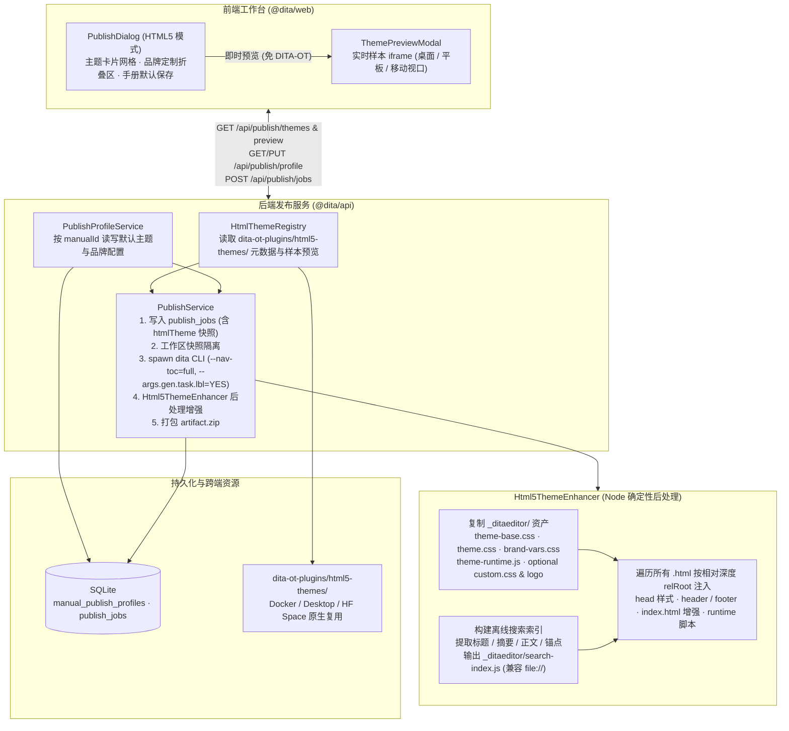

# Phase 12 规划与实施蓝图：HTML5 发布样式主题与多套专业文档模板

> **状态**：📋 规划已确认（待进入编码实现）  
> **上游架构基线**：[architecture-and-plan.md](./architecture-and-plan.md)（Phase 0–11 已完成）  
> **目标形态**：发布弹窗支持可视化挑选 **4 套专业 HTML5 文档主题 + 原生默认兜底** · 零依赖离线文档站体验（左侧目录树 / 右侧页内大纲 / `Cmd+K` 离线全文检索 / 代码复制 / 明暗切换 / 响应式抽屉） · 轻量品牌定制（主色 / 标题 / Logo / 页脚 / 工作区自定义 CSS）与按手册持久化默认配置 · 零 DITA-OT 插件安装门槛（Docker / 本机 / 桌面端一致可用）

---

## 1. 目标、痛点与设计树共识

Phase 5 打通了 DITA-OT 4.x HTML5 与中文 PDF 发布闭环，但 DITA-OT 默认 `html5` 产物仅附带最基础的 `commonltr.css`，既无左侧导航目录、右侧页内目录、站内搜索和代码块复制，也缺少面向现代技术文档或企业手册的视觉排版，交付给客户或发布到静态站点前往往需要额外二次加工。

Phase 12 在不破坏 **标准 DITA XML 唯一真相源**、**零 Java 业务代码** 与 **零外部中间件** 原则的前提下，构建一套轻量化、离线可用、跨平台一致的 HTML5 发布样式主题系统。

### 1.1 已确认设计决策（Design Tree 共识清单）

| 维度 | Phase 12 确认决策 | 明确不做（Non-Goals） |
| :--- | :--- | :--- |
| **主题增强架构** | **混合方案（DITA-OT 原生 HTML5 + 确定性静态后处理增强）**：DITA-OT 侧开启 `--nav-toc=full` 与 `--args.gen.task.lbl=YES` 生成标准语义 HTML；Node 后端在打包 ZIP 前注入共享基础样式、主题样式表、品牌 CSS 变量、页眉/页脚、零依赖交互脚本与离线搜索索引 | 不开发重型自定义 DITA-OT XSLT / Java 插件（避免桌面端接入本机 DITA-OT 时必须执行 `dita install` 的高门槛）；不破坏原始 DITA-OT 语义类名 |
| **离线与托管兼容** | 全部样式、字体栈与脚本均自包含于产物 `_ditaeditor/` 目录内，**零外部 CDN 请求**；离线搜索索引以 `_ditaeditor/search-index.js`（`window.__DITA_SEARCH_INDEX__`）输出，确保 ZIP 解压后 **双击本地 `index.html`（`file://` 协议）** 与静态托管（Nginx / OSS / GitHub Pages / 工作台在线预览）表现 100% 一致 | 不依赖后端搜索服务，不外链 Google Fonts 或第三方 CDN JS |
| **首批内置模板** | **4 套定位鲜明的专业主题 + 1 套原生兜底**：① `tech-docs`（现代技术文档，默认）、② `editorial-paper`（出版极简纸白）、③ `enterprise-manual`（企业硬件手册）、④ `dev-dark`（开发者暗夜风）、⑤ `vanilla`（DITA-OT 原生纯净输出） | 暂不在此阶段引入 PDF 样式模板编辑器（PDF 仍沿用 Phase 5 Noto CJK 方案） |
| **品牌微调与扩展** | 支持 **主色（Accent Color）**、**页眉标题（Site Title）**、**工作区图片 Logo**、**页脚版权文案**、**4 项交互开关（搜索 / 页内 TOC / 代码复制 / 明暗切换）** 及 **工作区自定义 CSS 文件覆盖** | 本期不做可视化主题拖拽编辑器、不做 Admin 上传任意 ZIP 主题包（后续如需再扩展） |
| **默认配置持久化** | 新增 SQLite `manual_publish_profiles` 表按 **手册（`manual_id`）** 记住默认 HTML5 主题与品牌配置；同时在 `publish_jobs.options_json` 留存每次发布的主题快照以便历史追溯；**绝不向 `.dita` / `.ditamap` 写入任何样式配置** | 零 XML 污染、零 Git Diff 污染 |
| **预览与双语体验** | `PublishDialog` 提供带迷你布局缩略图的主题卡片选择器 + **免 DITA-OT 编译的实时样本预览弹窗**（支持桌面/平板/移动端视口切换与品牌色即时联动）；全链路纳入 Phase 8 中英双语（`zh-CN` / `en`）词典与防退化门禁 | 不在未点击发布时自动后台跑 DITA-OT |

---

## 2. 首批内置 HTML5 样式模板设计矩阵

所有 4 套精选主题共享同一套语义化布局骨架与响应式规范（`shared/theme-base.css`），通过独立的 CSS Design Tokens 与组件覆写层（`<themeId>/theme.css`）实现截然不同的出版气质，并完整覆盖 DITA 1.3 核心元素渲染（`topic`/`concept`/`task`/`reference`、`title`、`shortdesc`、`steps`/`step`/`cmd`/`info`/`stepresult`、`note[@type]`、`codeblock`/`pre`、`fig`/`image`、`table`/`simpletable`、`dl`/`ul`/`ol`、`uicontrol`/`menucascade`/`codeph`/`filepath`/`varname`/`xref`/`related-links`）。

| 主题 ID | 中文名称 / 英文名称 | 视觉气质与默认色板 | 布局与组件特色 | 典型适用场景 |
| :--- | :--- | :--- | :--- | :--- |
| **`tech-docs`** *(默认)* | **现代技术文档** / Tech Docs Slate | 清爽冷白底 `#FFFFFF` + 浅灰侧栏 `#F8FAFC` + Slate 墨黑正文 + 靛蓝主色 `#2563EB`（支持一键切换深色） | 56px 毛玻璃顶栏 + 272px 可折叠左侧树 + `76ch` 正文 + 220px 右侧页内大纲（Scroll-Spy）；精致左侧色条 Callout、暗色代码块 + 复制按钮、键帽风 `<uicontrol>` | SaaS 产品手册、API / 平台文档、团队知识库 |
| **`editorial-paper`** | **出版极简纸白** / Editorial Paper | 暖纸白 `#FAF8F5` + 暖炭墨 `#1C1917` + 焦糖琥珀主色 `#B45309`（呼应官网技术出版调性） | 轻盈无压迫感顶栏与左侧目次 + `68ch` 黄金阅读列宽；衬线标题混排无衬线正文、学术/图书三线表、`shortdesc` 引言导语排版、强化 `@media print` 打印效果 | 白皮书、概念说明、长文阅读型产品指南 |
| **`enterprise-manual`** | **企业标准手册** / Enterprise Manual | 深海军蓝品牌顶栏 `#0F2942` + 纯白正文 + 钢蓝主色 `#1D4ED8` + 高对比边框 | 稳重企业级顶栏（适合横版 Logo）+ 实线左侧目录树（支持全部展开/收起）+ 宽正文容器（友好承载多列 CALS 合并单元格规格表）；ANSI/ISO 风格强警示块（`danger` 红头 / `warning` 橙头 / `caution` 黄头）与清晰圆标步骤号 | 工业设备、硬件操作手册、政企交付文档 |
| **`dev-dark`** | **开发者暗夜风** / Dev Dark Carbon | 默认深色碳黑基底 `#0B0F17` + `#111827` 表面层 + 极光青蓝主色 `#38BDF8`（允许读者切回浅色） | 紧凑高信噪比工程风；高对比代码块与行内 `<codeph>` / `<cmdname>` / `<filepath>` / `<varname>` 视觉分层、暗色半透明参数表、高可见度键盘快捷键提示（`Cmd/Ctrl+K`） | CLI 工具、SDK、开发框架、运维与 DevOps 手册 |
| **`vanilla`** | **原生纯净默认** / DITA-OT Vanilla | DITA-OT 4.x 默认 `commonltr.css` | 完全跳过后处理增强与 `--nav-toc=full`，100% 保留官方标准 HTML5 输出 | 客户自有管线二次加工、排查 DITA-OT 原生行为 |

---

## 3. 总体架构与发布增强流水线



### 3.1 为什么将主题资产存放在 `dita-ot-plugins/html5-themes/`？

- 现有 `Dockerfile`（`COPY --from=build /app /app`）、`scripts/sync-hf-space.sh`（`SOURCE_DIRS` 已包含 `dita-ot-plugins`）以及 `apps/desktop/electron-builder.yml`（`extraResources` 已映射 `../../dita-ot-plugins` → `dita-ot-plugins`）**均已覆盖该目录**。
- 在开发模式、单容器部署、Hugging Face Space 与 Electron 双端桌面安装包下均可零额外打包配置自动定位（同时支持 `DITAEDITOR_HTML_THEMES_DIR` 环境变量覆盖）。
- 全部主题资产为纯静态 `.css` / `.js` / `.json`，总大小预计控制在 **100 KB 以内**，镜像与桌面安装包体积几乎零增长。

### 3.2 `Html5ThemeEnhancer` 关键实现细节

1. **DITA-OT CLI 参数增强（仅非 `vanilla` 主题）**：
   - 在现有 `--input` / `--format=html5` / `--output` / `--validate=yes` / `--processing-mode=strict` 基础上，自动追加：
     - `--nav-toc=full`：由 DITA-OT 原生在每个页面嵌入遵守 `DITAVAL` 过滤且带 `class="active"` 标记的完整 `<nav class="toc">`。
     - `--args.gen.task.lbl=YES`：为 `<task>` 的前置条件、步骤、结果等区域生成清晰标题结构。
2. **相对路径深度自适应（彻底解决子目录断链痛点）**：
   - 遍历 `outputDir` 中全部 `.html` 文件，计算相对 `outputDir` 的层级深度 `depth`，生成 `relRoot = depth === 0 ? './' : '../'.repeat(depth)`。
   - 所有注入的 `<link>`、`<script>`、页眉 Logo `` 与回首页链接均基于 `relRoot` 拼接，确保无论 Topic 嵌套在 `concepts/arch/` 还是根目录下，样式、脚本与 Logo 均 100% 正常加载。
3. **品牌变量推导与安全消毒**：
   - `accentColor` 经严格正则 `/^#[0-9a-fA-F]{6}$/` 校验；后端按 HSL/RGB 混合算法自动生成 `--de-accent`、`--de-accent-hover`、`--de-accent-soft`、`--de-accent-border`、`--de-accent-contrast` 写入 `_ditaeditor/brand-vars.css`。
   - `siteTitle`、`footerText` 经严格 HTML 实体转义后写入 `<header class="de-header">` / `<footer class="de-footer">`，绝不拼接原始 HTML。
   - `logoPath`（白名单 `.png/.jpg/.jpeg/.svg/.webp`，上限 2 MB）与 `customCssPath`（白名单 `.css`，上限 512 KB）必须通过 `resolveSafeWorkspacePath(snapshotDir, ...)` 验证位于快照工作区内，防止路径穿越。
   - 若指定的 `logoPath` 或 `customCssPath` 在目标分支快照中不存在，则记录清晰警告到 `build.log` 并安全降级忽略，不因装饰资产缺失阻断整本手册发布（但提交任务时在 API 层提前校验给出明确提示）。
4. **离线全文搜索索引（兼容 `file://` 与中英文检索）**：
   - 扫描生成的 Topic `.html`（排除纯目录 `index.html`），剔除 `<nav>` / `<script>` / `<style>` 后提取 `<title>`、`<h1>`、`.shortdesc`、`h2/h3` 章节标题与前 4000 字符正文纯文本，规范化空白。
   - 输出 `_ditaeditor/search-index.js`：`window.__DITA_SEARCH_INDEX__ = [...]`。
   - 前端 `theme-runtime.js` 内置轻量分词打分检索器（支持中文连续字/词子串匹配与英文不区分大小写词首加权，标题权重 > 小节标题 > 摘要 > 正文），在结果列表中高亮命中片段，支持键盘 `↑`/`↓`/`Enter`/`Esc` 导航与 `Cmd/Ctrl+K` 快捷唤起。
5. **交互运行态能力（`shared/theme-runtime.js`，零外部依赖，gzip < 6 KB）**：
   - **左侧目录树增强**：自动为含子级 `<ul>` 的 `<nav class="toc">` 节点添加折叠/展开按钮，默认展开当前活动页的祖先路径并将 `.active` 项平滑滚动至可见区；支持记忆展开状态（`sessionStorage`）。
   - **右侧页内大纲（On-Page TOC）**：自动扫描 `<main>` / `<article>` 内的 `h2`/`h3`（必要时生成稳定 `id`），渲染右侧 sticky 大纲并以 `IntersectionObserver` 实时高亮当前阅读章节。
   - **上下页导航（Prev / Next）**：从左侧 `<nav class="toc">` 线性抽取叶子链接，在正文底部自动生成「上一篇 / 下一篇」跳转卡片。
   - **代码块体验**：为 `pre.codeblock` / `pre` 自动挂载顶部语言标识与「复制 / 已复制」按钮（`navigator.clipboard` + `execCommand` 兜底，兼容 `file://`）。
   - **明暗模式切换**：支持 `localStorage` 持久化与 `prefers-color-scheme` 兜底；在 `<html>` 写入 `data-de-mode="light" | "dark"`。
   - **移动端抽屉导航**：视口 `< 960px` 时左侧目录折叠为滑出抽屉，带遮罩与 `Esc` 关闭。
   - **封面首页（`index.html`）增强**：识别 DITA-OT 生成的目录首页，自动渲染带手册标题、副标题/统计数与首层章节网格卡片的门户视图，点击直达对应章节。

---

## 4. 数据模型与 API 契约

### 4.1 SQLite 数据表：`manual_publish_profiles`

继续沿用 `apps/api/src/db/schema.ts`（Drizzle ORM）与 `apps/api/src/db/client.ts` 幂等 DDL，零破坏升级：

```sql
CREATE TABLE IF NOT EXISTS manual_publish_profiles (
  manual_id TEXT PRIMARY KEY NOT NULL,     -- 对应 manuals.id (= project_id)
  html_theme_id TEXT NOT NULL DEFAULT 'tech-docs',
  html_theme_options_json TEXT NOT NULL DEFAULT '{}',
  updated_by TEXT NOT NULL,
  updated_at INTEGER NOT NULL
);
```

- `publish_jobs` 表 **无需新增列**：继续将本次任务使用的 `htmlTheme: { themeId, options }` 序列化存入现有 `options_json` 字段中，`PublishService.toView()` 将其解析为强类型字段 `themeId` 与 `themeOptions` 返回前端（老数据默认回退为 `null` / `vanilla`，完全向后兼容）。

### 4.2 TypeScript 类型契约

```ts
export type HtmlThemeId =
  | 'tech-docs'
  | 'editorial-paper'
  | 'enterprise-manual'
  | 'dev-dark'
  | 'vanilla';

export interface HtmlThemeFeatures {
  search: boolean;
  toc: boolean;
  codeCopy: boolean;
  colorModeToggle: boolean;
}

export interface HtmlThemeOptions {
  accentColor?: string | null;     // '#RRGGBB'
  siteTitle?: string | null;       // <= 120 chars
  logoPath?: string | null;        // workspace relative image path
  footerText?: string | null;      // <= 240 chars
  customCssPath?: string | null;   // workspace relative .css path
  features?: Partial<HtmlThemeFeatures>;
}

export interface HtmlThemeDescriptor {
  id: HtmlThemeId;
  name: string;                    // localized by x-dita-locale
  description: string;             // localized by x-dita-locale
  tags: string[];                  // localized tags
  defaultAccent: string;           // e.g. '#2563eb'
  defaultMode: 'light' | 'dark';
  supportsCustomization: boolean;  // false for 'vanilla'
  previewPalette: {
    bg: string;
    surface: string;
    header: string;
    text: string;
    accent: string;
    border: string;
  };
  defaultFeatures: HtmlThemeFeatures;
}

export interface ManualPublishProfile {
  manualId: string;
  htmlThemeId: HtmlThemeId;
  htmlThemeOptions: HtmlThemeOptions;
  updatedBy: string | null;
  updatedAt: string | null;
}
```

### 4.3 REST API 端点

| 方法与路径 | 权限 | 用途 |
| :--- | :--- | :--- |
| `GET /api/publish/themes` | 全部角色 | 返回内置主题列表 `HtmlThemeDescriptor[]`（按 `x-dita-locale` 返回中/英文名称、说明与标签） |
| `GET /api/publish/themes/:id/preview` | 全部角色 | 返回使用真实主题 CSS/JS 渲染的内置 DITA 样本预览 HTML（支持 `?accent=&title=&footer=&search=&toc=&codeCopy=&colorModeToggle=&locale=` 查询参数即时联动） |
| `GET /api/publish/profile` | 全部角色 | 获取当前手册（按 `x-dita-manual-id`）保存的默认 HTML5 主题与品牌定制配置；无记录时返回系统默认（`tech-docs`） |
| `PUT /api/publish/profile` | `admin` / `writer` | 保存当前手册的默认 HTML5 主题与品牌配置（Zod 强校验 `themeId`、颜色格式、工作区文件路径） |
| `POST /api/publish/jobs` *(扩展)* | `admin` / `writer` | 新增可选参数 `themeId?: HtmlThemeId`、`themeOptions?: HtmlThemeOptions`、`saveAsDefault?: boolean`；仅 `format === 'html5'` 时生效 |

---

## 5. 前端工作台交互设计（`PublishDialog` 升级）

1. **格式联动展示**：
   - 保持 `PublishDialog` 现有顶部「Root Map / 输出格式 / DITAVAL / 标题 / 开始发布」高效单行栏；当格式选中 **`HTML5`** 时，下方展开紧凑的 **HTML5 样式风格区**（切换为 `PDF` 时自动折叠隐藏，保持界面清爽）。
2. **主题卡片网格（5 张横向紧凑卡片）**：
   - 每张卡片顶部内置一个 **纯 CSS/SVG 迷你文档站缩略图**（直观体现顶栏颜色、侧栏/正文配色、纸白/暗夜基底与主色强调条），底部显示主题名、标签与选中勾选角标，以及右上角小型 **「预览」** 图标按钮。
3. **品牌与功能定制（默认收起的可折叠面板）**：
   - 点击「品牌与高级定制」展开（当选中 `vanilla` 时禁用并给出提示）：
     - **主题主色**：6 枚精选预设色点 + 原生 `<input type="color">` 与 Hex 输入框 + 一键「恢复主题默认」。
     - **页眉标题**（留空跟随发布标题）与 **页脚版权文案**。
     - **页眉 Logo**：下拉列出工作区已有图片资产（`.svg`/`.png`/`.jpg`/`.webp`，复用已有工作区文件树数据）+ 无 Logo 选项。
     - **自定义 CSS 覆盖**：下拉列出工作区内 `.css` 文件（若工作区存在 `.css`）或允许输入相对路径。
     - **功能开关（4 枚紧凑复选）**：`离线全文搜索` / `右侧页内目录` / `代码块一键复制` / `读者明暗切换`。
     - **底部操作条**：「实时预览当前配置」按钮 + 勾选「保存为本手册默认配置」（或独立「保存默认」按钮）。
4. **实时样本预览弹窗（`ThemePreviewModal`）**：
   - 全屏/大尺寸弹窗内嵌 `<iframe src="/api/publish/themes/:id/preview?...">`，顶栏支持：
     - 快速切换 5 套主题即时对比；
     - 切换 **桌面（100%）/ 平板（768px）/ 手机（390px）** 视口尺寸测试响应式效果；
     - 确认按钮直接应用当前预览主题到发布表单。
   - 样本 HTML 涵盖 `concept` / `task`（含 `steps`）/ `note`（`tip`/`warning`/`danger`）/ `codeblock` / 合并单元格表格 / 行内语义标签，用户无需等待 10 秒 DITA-OT 编译即可直观看到真实效果。
5. **发布历史可追溯**：
   - `PublishDialog` 左侧历史列表与右侧任务详情元信息栏展示本次 HTML5 任务所使用的主题徽章（如 `现代技术文档` / `Tech Docs`），便于对比不同风格的发布产物。

---

## 6. 涉及文件与目录清单

```text
DITAEditor/
├── dita-ot-plugins/
│   └── html5-themes/                      # 新增：纯静态 HTML5 主题资产（Docker/Desktop/HF 共用）
│       ├── shared/
│       │   ├── theme-base.css             # 共享布局网格、DITA 1.3 元素排版、响应式与打印样式
│       │   └── theme-runtime.js           # 零依赖离线运行时（侧栏折叠、页内 TOC、搜索、复制、明暗、抽屉）
│       ├── tech-docs/theme.css            # 主题 1：现代技术文档 (Tech Docs Slate)
│       ├── editorial-paper/theme.css      # 主题 2：出版极简纸白 (Editorial Paper)
│       ├── enterprise-manual/theme.css    # 主题 3：企业标准手册 (Enterprise Manual)
│       └── dev-dark/theme.css             # 主题 4：开发者暗夜风 (Dev Dark Carbon)
├── apps/
│   ├── api/
│   │   ├── src/
│   │   │   ├── db/
│   │   │   │   ├── schema.ts              # 新增 manualPublishProfiles 表定义
│   │   │   │   └── client.ts              # 新增 manual_publish_profiles 幂等 DDL
│   │   │   ├── modules/publish/
│   │   │   │   ├── html-themes.ts         # 新增：主题目录、元数据双语定义、色阶计算与校验
│   │   │   │   ├── html-theme-enhancer.ts # 新增：DITA-OT HTML5 后处理增强 + 离线搜索索引生成
│   │   │   │   ├── html-theme-preview.ts  # 新增：免 DITA-OT 实时样本预览 HTML 生成器
│   │   │   │   ├── publish-profile-service.ts # 新增：手册默认发布配置 CRUD
│   │   │   │   ├── publish-service.ts     # 扩展：传递 --nav-toc=full 与执行后处理增强
│   │   │   │   └── routes.ts              # 扩展：themes / preview / profile 端点与 jobs 参数
│   │   │   └── i18n/messages.ts           # 新增主题相关双语错误与提示文案
│   │   └── test/
│   │       └── phase12-html-themes.test.ts # 新增：后处理、搜索索引、路径安全、Profile & 预览 API 单测
│   ├── web/
│   │   └── src/
│   │       ├── services/publish-api.ts    # 扩展：themes / profile / createJob 参数类型与请求函数
│   │       ├── store/publish-store.ts     # 扩展：themes / profile 状态与保存逻辑
│   │       ├── components/publish/
│   │       │   ├── PublishDialog.tsx      # 升级：接入主题选择区、品牌定制与历史徽章
│   │       │   ├── HtmlThemeSelector.tsx  # 新增：带迷你缩略图的主题卡片网格与品牌定制面板
│   │       │   └── ThemePreviewModal.tsx  # 新增：多视口实时样式预览弹窗
│   │       └── i18n/messages/{zh-CN,en}.ts # 新增双语词条（通过对称与硬编码中文门禁）
│   └── desktop/
│       └── src/
│           ├── paths.ts                   # 扩展：解析 htmlThemesDir（开发与打包态）
│           └── main.ts                    # 扩展：向 createServer 透传 htmlThemesDir
└── docs/
    ├── architecture-and-plan.md           # 更新 Phase 12 概览、目录与风险矩阵
    └── phase12-html-themes-plan.md        # 本文档
```

---

## 7. 分步垂直切片实施计划（Slices 1–5）

预计总工作量约 **1–1.5 周**（AI 辅助高强度推进约 **2–4 个连续开发会话**），按以下 5 个可独立验证的垂直切片推进：

### Slice 1：共享排版内核与 4 套 HTML5 主题资产（`dita-ot-plugins/html5-themes/`）
- 编写 `shared/theme-base.css`：定义统一 CSS 变量契约（`--de-bg`、`--de-surface`、`--de-text`、`--de-accent` 等）、三栏响应式布局、DITA 1.3 全量语义块（`note` 各 type、`steps`、`codeblock`、`table`/`simpletable`、`fig`、`dl`、`related-links`、`index.html` 门户页）与 `@media print` 样式。
- 编写 `shared/theme-runtime.js`：实现左侧目录折叠与定位、右侧页内 TOC 与 Scroll-Spy、上一篇/下一篇导航、`Cmd/Ctrl+K` 离线全文搜索弹层、代码块复制、明暗切换与移动端抽屉。
- 精雕 4 套主题样式表：`tech-docs/theme.css`、`editorial-paper/theme.css`、`enterprise-manual/theme.css`、`dev-dark/theme.css`。
- **切片验收**：在浏览器直接打开本地测试 HTML 校验 4 套主题桌面/移动端视觉质感、对比度、暗色模式与全部 JS 交互无控制台报错。

### Slice 2：后端主题注册表、确定性后处理增强器与样本预览（`apps/api`）
- 实现 `html-themes.ts`（主题注册表、中英双语描述、主色色阶推导、路径与参数 Zod 校验）。
- 实现 `html-theme-enhancer.ts`（递归遍历 HTML、按深度 `relRoot` 注入样式与页眉页脚、生成 `_ditaeditor/search-index.js`、拷贝 Logo 与自定义 CSS、处理 `index.html` 封面标记与安全转义）。
- 实现 `html-theme-preview.ts`（免 DITA-OT 真实 DITA 结构样本渲染，支持 query 参数动态覆盖主色/标题/页脚/开关）。
- **切片验收**：`phase12-html-themes.test.ts` 覆盖 4 套主题增强、子目录多级相对路径正确性、`vanilla` 零侵入透传、`search-index.js` 中英文提取、XSS 转义与路径穿越拦截。

### Slice 3：SQLite 手册默认配置与 `PublishService` 集成（`apps/api` + `apps/desktop`）
- 在 `db/schema.ts` 与 `db/client.ts` 新增 `manual_publish_profiles` 表及幂等 DDL。
- 实现 `publish-profile-service.ts` 与 `routes.ts` 新端点（`GET /api/publish/themes`、`GET /api/publish/themes/:id/preview`、`GET/PUT /api/publish/profile`）。
- 扩展 `PublishService`：HTML5 非 `vanilla` 任务追加 `--nav-toc=full` 与 `--args.gen.task.lbl=YES`，DITA-OT 退出码为 0 后执行 `enhanceHtml5Output()` 再打包 `artifact.zip`，日志清晰记录主题与增强文件数。
- 接通 `apps/desktop/src/{paths,main}.ts` 的 `htmlThemesDir` 解析与单测。
- **切片验收**：API 集成测试覆盖多手册隔离的 Profile 读写、`viewer` 权限拦截、模拟 DITA-OT 产出多级目录 HTML 后完整增强与 ZIP 校验。

### Slice 4：前端主题选择器、品牌定制面板与实时预览弹窗（`apps/web`）
- 扩展 `publish-api.ts` 与 `publish-store.ts`，加载主题目录与手册默认配置。
- 新增 `HtmlThemeSelector.tsx`（5 张含迷你布局缩略图的卡片 + 可折叠品牌与功能定制面板 + 工作区 Logo/CSS 下拉选择器）与 `ThemePreviewModal.tsx`（桌面/平板/手机三视口实时 iframe 预览）。
- 更新 `PublishDialog.tsx`：HTML5 模式下挂载主题选择器，历史任务展示主题徽章，支持随发布或独立保存为手册默认配置。
- 完整补齐 `apps/web/src/i18n/messages/{zh-CN,en}.ts` 与 `apps/api/src/i18n/messages.ts`。
- **切片验收**：`pnpm -r build && pnpm -r typecheck && pnpm -r test` 全绿（含 Phase 8 双语键对称与硬编码中文扫描门禁）。

### Slice 5：端到端验收与文档/知识图谱同步
- 使用 `samples/demo-dita-project`（含嵌套 `concepts/`、`tasks/`、`references/`、`images/` 与 `DITAVAL`）对 4 套主题 + `vanilla` 分别验证：
  - 工作台在线预览（`/api/publish/jobs/:id/preview/`）样式、图片、侧边栏、右侧大纲、搜索与代码复制均正常；
  - 下载 `*-html5.zip` 解压后直接双击 `index.html`（`file://`）离线浏览与搜索零报错；
  - 切换 `VITE_STATIC_DEMO=true` 静态演示模式与 `./scripts/sync-hf-space.sh --dry-run` 均正常。
- 更新 `docs/architecture-and-plan.md` 状态标记、双语官网文档（如适用）并运行 `graphify update .`。

---

## 8. 主要工程风险与应对策略

| 风险点 | 触发场景 | 应对策略 |
| :--- | :--- | :--- |
| **嵌套子目录相对路径断裂** | Topic 分布在 `concepts/`、`tasks/sub/` 等多级目录，写死 `assets/theme.css` 导致子页失样式 | `Html5ThemeEnhancer` 逐文件计算相对输出根目录的 `relRoot`（`./` / `../` / `../../`），绝不使用根绝对路径 `/`（同时兼容预览路由子路径与 `file://` 离线打开） |
| **本地双击 `file://` 搜索失败** | 使用 `fetch('search-index.json')` 在 Chrome/Safari 本地打开时触发 CORS 拦截 | 索引改以 `_ditaeditor/search-index.js` 挂载 `window.__DITA_SEARCH_INDEX__`，经 `<script defer>` 加载，彻底免受 `file://` CORS 限制 |
| **品牌定制注入 XSS 或路径穿越** | 恶意 `siteTitle`/`footerText` 注入 `<script>`，或 `logoPath`/`customCssPath` 指向 `../../etc/passwd` | 文本字段统一做严格 HTML 转义、`accentColor` 强校验 `#RRGGBB`；文件路径强制过 `resolveSafeWorkspacePath()` + 扩展名与体积白名单 |
| **DITA-OT 原生样式冲突** | DITA-OT 生成的 `commonltr.css` 规则与新主题样式优先级打架 | 主题 CSS 置于 `commonltr.css` 之后并以 `html[data-de-theme]` 作用域提高选择器权重，精准重置而不破坏自定义特化类 |
| **桌面端 / Docker / HF Space 找不到主题目录** | Electron `esbuild` 单文件打包丢失相对路径资产 | 统一置于三端已覆盖的 `dita-ot-plugins/html5-themes/`，提供 `DITAEDITOR_HTML_THEMES_DIR` 覆盖并编写 `apps/desktop/test/paths.test.ts` 回归校验 |
