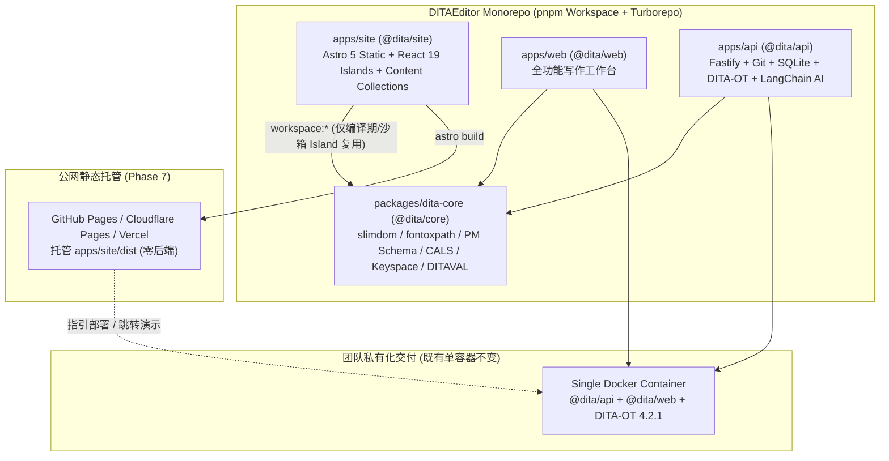

# Phase 7 规划与实施蓝图：项目官网、交互式 DITA 沙箱与快速上手文档

> **状态**：📋 规划已确认（待实施）  
> **上游架构基线**：[architecture-and-plan.md](./architecture-and-plan.md)（Phase 0–6 已完成并验收，v1.0.0）  
> **目标形态**：独立静态站点 `apps/site`（`@dita/site`）· 中英双语（`zh-CN` / `en`）· 现代技术出版编辑风 · 浏览器内纯前端 `@dita/core` 交互试玩

---

## 1. 目标、定位与决策边界

Phase 7 为 DITAEditor 构建面向开源社区与技术文档团队的官方项目网站，承担三大核心职责：

1. **精准传达产品价值**：清晰呈现 DITAEditor 区别于重型桌面 CCMS 与通用 Markdown 编辑器的工程护城河——**标准 DITA 1.3 XML 唯一真相源、100% 无损往返、最小 Git Diff、单一信息源语义引擎、本地 Git + Check-out 独占锁、DITA-OT 4.x 中文 PDF 发布与 AI 片段级安全辅助**。
2. **零门槛可信验证（在线试玩）**：充分发挥 `@dita/core` 前后端同构优势，在浏览器中直接运行免后端的 **DITA 1.3 交互式沙箱**，让访客无需部署 Docker 即可亲手编辑、切换可视化/XML 源码、体验 DITAVAL 三态过滤并实时查验最小行级 Diff。
3. **30 分钟内自助落地（快速上手与部署文档）**：提供中英双语、结构清晰且可直接复制执行的 Docker 单容器部署、本机 DITA-OT 字体配置、功能导览与 DeepSeek / 私有化代理 AI 接入指南。

### 1.1 已确认设计决策（Non-Negotiables & Non-Goals）

| 维度 | Phase 7 确认范围 | 明确不做（Non-Goals） |
| :--- | :--- | :--- |
| **产品范围** | 产品展示官网 + 浏览器内交互式 DITA 试玩沙箱（基于 `@dita/core`）+ 快速上手/部署核心文档（6 篇精炼指南） | 不做重型商业化计费/注册登录系统；不把官网做成全功能在线云工作台（无后端 Git / DITA-OT 构建 / 公共 AI Key 代理） |
| **工程组织** | 新增独立静态站包 `apps/site`（`@dita/site`），静态输出 `apps/site/dist/`，与 `apps/web` 和单容器 `Dockerfile` 解耦 | 不把营销页塞进 `apps/web` 工作台路由；不把官网静态产物打入单容器工作台运行时镜像；禁止 `apps/site` 跨包相对导入 `apps/web/src/` |
| **托管部署** | 纯静态构建产物，开箱支持 **GitHub Pages**（附 CI 工作流）、**Cloudflare Pages**、**Vercel** 及任意静态 CDN | 不依赖 Node SSR 运行时或外部数据库/搜索引擎服务 |
| **语言支持** | 中英双语对称路由（简体中文默认 `/`，英文 `/en/`），支持顶栏同页切换与语言记忆，与 `README.md` / `README.en.md` 保持一致 | 首期不引入第三语种或外接翻译 SaaS 平台 |
| **视觉调性** | **现代技术出版编辑风**（暖纸白浅色精密排版 + 深色炭墨 XML/Diff 代码对比块），契合结构化技术写作与专业出版美学 | 不做泛滥的暗黑霓虹渐变/玻璃拟态模板风；首期聚焦单一打磨到极致的浅色出版主视觉（暂不做双主题维护分散精力） |

---

## 2. 技术选型与架构设计

### 2.1 技术栈选型

| 层级 / 模块 | 选型 | 核心理由 |
| :--- | :--- | :--- |
| **站点框架** | **Astro 5**（`output: 'static'`） | 营销页与文档页默认 0 JS 静态输出，首屏性能与 SEO 极佳；原生支持 Islands 局部水合，可按需加载 React 19 交互沙箱而不污染营销页首屏体积 |
| **交互组件层** | **React 19**（`@astrojs/react`） | 与 Monorepo 主前端 `apps/web` 保持一致的 React 19 + TypeScript 5.8 体验，用于交互沙箱、首页微试玩、快速启动 Tab 与导航切换 |
| **样式系统** | **Tailwind CSS 4**（`@tailwindcss/vite`） | 与 `@dita/web` 统一 Tailwind v4 方案，便于沉淀清晰的设计令牌（纸白底色、印刷网格线、语义色、排版比例） |
| **沙箱内核** | **`@dita/core`（workspace 依赖）+ ProseMirror + CodeMirror 6** | 100% 复用真实 DITA XML 解析、无损序列化、ProseMirror 双向转换、CALS 表格、`keyref` 与 `.ditaval` 求值能力，非假动画模拟 |
| **文档与代码高亮** | **Astro Content Collections（Markdown/MDX）+ Shiki** | 类型安全的双语文档集合，构建期零运行时完成 XML / Bash / Dockerfile / YAML 高亮 |
| **站内搜索** | **Pagefind**（构建后静态索引） | 纯静态生成分片索引，支持中文与英文文档全文检索，零 Algolia/服务端依赖 |
| **质量校验** | **Vitest 3** + Astro TypeCheck（`astro check`） | 纳入现有 `pnpm -r build && pnpm -r typecheck && pnpm -r test` 流水线，验证双语字典键一致性与沙箱样本无损往返 |

### 2.2 系统依赖与边界图



### 2.3 关键工程约束与避坑设计

1. **`slimdom-sax-parser` 浏览器 Stub 复用**：
   - 与 `apps/web/vite.config.ts` 一致，`apps/site/astro.config.mjs` 的 `vite.plugins` 必须配置 `browserStreamStubPlugin()`，将 `stream` / `node:stream` 映射为浏览器空桩，确保 `@dita/core` 在沙箱 Island 中无报错运行。
2. **首屏零沙箱包体积污染**：
   - 首页除紧凑交互模块外均为纯静态 HTML/CSS；首页微沙箱使用 `client:visible` 懒加载，完整 `/playground` 路由使用 `client:only="react"` 独立分块打包（ProseMirror、CodeMirror 6、`slimdom`/`fontoxpath` 拆分为独立 vendor chunk），避免阻塞首屏 LCP。
3. **不影响单容器 `Dockerfile` 与运行时镜像**：
   - `pnpm-workspace.yaml` 包含 `apps/*`，新增 `apps/site` 后需同步更新 `Dockerfile` 构建阶段：复制 `apps/site/package.json` 以保证 `pnpm install --frozen-lockfile` 通过，并将容器内构建命令精确限定为 `pnpm --filter @dita/core --filter @dita/web --filter @dita/api build`，确保单容器构建不安装 Astro 运行依赖或打包官网，镜像体积零增长。
4. **支持任意部署子路径（Base Path）**：
   - 通过环境变量 `SITE_URL`（如 `https://ditaeditor.dev` 或 `https://<user>.github.io`）与 `SITE_BASE`（默认 `/`；GitHub Pages 项目页可设为 `/DITAEditor`）驱动 Astro `site` / `base` 配置，所有站内链接、图片与语言切换路径统一经 `withBase()` 工具函数生成。

---

## 3. 视觉设计系统（现代技术出版编辑风）

整体美学取向借鉴专业技术出版物、印刷网格与现代开发工具文档（Stripe Docs / Typst / Linear Editorial），强调**克制、高信息信噪比与真实代码/XML 质感**。

### 3.1 色彩与对比规范

| 语义角色 | 色值 | 使用场景 |
| :--- | :--- | :--- |
| **主画布（Paper Canvas）** | `#FAF9F6` | 页面主背景，柔和暖纸白减少纯白刺眼感 |
| **卡片与正文面（Surface）** | `#FFFFFF` | 文档阅读区、特性卡片、工作台截图相框底色 |
| **印刷分隔线（Hairline）** | `#E5E2DA` | 1px 细网格线、表格分隔、章节编号底线 |
| **主墨色（Ink Primary）** | `#141619` | 大标题、核心声明、高对比正文 |
| **次正文色（Ink Secondary）** | `#454A54` | 段落说明、能力阐述、导航链接 |
| **辅助注释色（Ink Muted）** | `#6E7480` | 章节序号（`01 / 02`）、元信息、图注 |
| **编辑强调蓝（Editorial Blue）** | `#1D4ED8`（Hover `#1E40AF`） | 主按钮、文档链接、当前选中态、`<keyref>` 徽章 |
| **语义琥珀（Profiling Amber）** | `#B45309`（淡底 `#FEF3C7`） | DITAVAL 条件标签、校验警告、AI 提示标签 |
| **无损通过绿（Verified Green）** | `#15803D`（淡底 `#DCFCE7`） | 黄金样本通过徽章、Diff 新增行、校验通过状态 |
| **深色源码画布（Code Ink）** | `#111318`（边框 `#232732`） | XML 源码视图、CodeMirror MergeView、Docker/CLI 命令块，与浅色纸面形成强烈视觉锚点 |

### 3.2 排版与版式规范

- **字族体系**：
  - **Display 标题**：英文优先 `Newsreader` / `Georgia` 搭配现代人文无衬线 `Plus Jakarta Sans`；中文优先系统高品质黑体/宋体层级（`"PingFang SC", "Noto Sans SC", "Hiragino Sans GB", "Microsoft YaHei", sans-serif`），避免加载数 MB 的全量中文字体阻塞首屏。
  - **代码与 XML 标签**：`"JetBrains Mono", "IBM Plex Mono", ui-monospace, SFMono-Regular, Menlo, monospace`；文中提及 `<task>`、`keyref`、`conref`、`<!DOCTYPE>` 统一采用紧凑等宽标签胶囊样式。
- **网格与节奏**：
  - 最大内容容器宽度 `1200px`（文档正文阅读宽度限制在 `68ch`–`74ch` 以保证舒适行长；完整沙箱页放宽至 `1440px`）。
  - 首页各区块使用印刷编目式眉标（`01 — LOSSLESS KERNEL`、`02 — SINGLE SOURCING` 等），配 1px 通栏水平分隔线与非对称双栏排版（左叙述 + 右实景/交互面板）。
  - 禁用廉价彩虹渐变背景、大面积毛玻璃卡片堆叠与无意义装饰插画；所有视觉焦点均为**真实工作台截图、真实 XML/Diff 代码块或可交互 `@dita/core` 沙箱**。

---

## 4. 站点信息架构与页面规划

中英双语采用严格 1:1 对称路径映射：

| 中文路径（默认） | 英文路径 | 页面职责 | 渲染策略 |
| :--- | :--- | :--- | :--- |
| `/` | `/en/` | 项目官网首页（Landing Page） | 静态 HTML + 1 个懒加载微沙箱 Island |
| `/playground` | `/en/playground` | 浏览器内交互式 DITA 1.3 沙箱 | 静态外框 + React 19 沙箱 Island（`client:only`） |
| `/docs` | `/en/docs` | 文档首页（重定向或概览至快速开始） | 纯静态 |
| `/docs/introduction` | `/en/docs/introduction` | 项目简介、核心不变量与工具对比 | 纯静态 + Shiki |
| `/docs/getting-started` | `/en/docs/getting-started` | 5 分钟 Docker 单容器部署与数据卷说明 | 纯静态 + Shiki |
| `/docs/local-development` | `/en/docs/local-development` | 本地 pnpm 开发与本机 DITA-OT / Noto CJK 配置 | 纯静态 + Shiki |
| `/docs/features` | `/en/docs/features` | 六大核心功能导览（编辑/Map/语义/Git/发布/AI） | 纯静态 + 图文 |
| `/docs/ai-setup` | `/en/docs/ai-setup` | DeepSeek 与私有化兼容代理配置、安全与锁边界 | 纯静态 + Shiki |
| `/docs/architecture` | `/en/docs/architecture` | 架构分层、环境变量参考表与版本更新日志 | 纯静态 + Shiki |

### 4.1 官网首页（`/` & `/en/`）分屏叙事结构

1. **顶部导航栏（Sticky Editorial Header）**
   - 左侧：`DITAEditor` 品牌标识（几何文档/标签结构 SVG 图标 + 版本号胶囊 `v0.8`）。
   - 中间：核心能力（锚点）、在线试玩（`/playground`）、文档（`/docs/getting-started`）、架构与更新（`/docs/architecture`）。
   - 右侧：中/英语言切换器（自动映射到当前页对应语言路径）、GitHub 仓库图标链接、主按钮「在线试玩」。
2. **Hero 首屏（价值宣言 + 实景工作台交互展台）**
   - 眉标：`OPEN-SOURCE WEB DITA 1.3 WORKBENCH`
   - 主标题（中文示例）：**标准 DITA XML 唯一真相源，团队级轻量 Web 结构化写作工作台。**
   - 副标题：在浏览器中同时拥有 ProseMirror 可视化结构化编辑、CodeMirror 6 源码控制、Keys/Conref/DITAVAL 单一信息源、本地 Git Check-out 锁、DITA-OT 中文 PDF 发布与 AI 片段级校验辅助——零 Java 业务代码，单容器开箱即用。
   - 双 CTA：**立即在线试玩（免部署）** + **Docker 快速部署**。
   - 事实指标条（全部有真实代码与测试支撑）：`100% 无损 XML 往返` · `10 份复杂 DITA 1.3 黄金样本` · `单容器零外部中间件` · `HTML5 + Noto CJK PDF` · `186+ 自动化测试`。
   - 首屏视觉主框：带顶栏标签切换的工作台实景展示器（可在「三栏工作台」「双模同步对比」「单一信息源过滤」「DITA-OT 发布」「AI 辅助与 Diff」真实高分截图间切换，配简短图注与放大查看）。
3. **01 · 为什么选择 DITAEditor（结构化写作的工程底线）**
   - 三列精炼对比表：**重型桌面工具 / 传统 CCMS** vs **通用 Markdown / 富文本工具** vs **DITAEditor**，围绕「XML 无损与 Git Diff」「DITA 1.3 单一信息源」「部署成本与客户端依赖」「中文 PDF 交付」「AI 改动安全性」五个真实痛点做客观对比。
4. **02 · 首页微沙箱：亲眼验证“改一字只变一行 XML”**
   - 紧凑型双栏交互组件（`client:visible` 懒加载，基于真实 `@dita/core`）：
     - 预置一段含 `<?xml?>`、`<!DOCTYPE task ...>`、XML 注释、`<?oxy_comment_start?>` PI 与自定义属性顺序的真实 DITA Task；
     - 访客在左侧修改任意步骤文字或切换语义标签，右侧实时切换展示 **「序列化 XML」** 或 **「精准 Git Diff」**，顶部绿标实时显示 `DOCTYPE 保留 · 注释保留 · PI 保留 · 属性顺序 100% 一致 · 仅变动 N 行`；
     - 右下角引导按钮：**「打开完整 DITA 1.3 交互沙箱 →」**。
5. **03 · 六大核心能力深度展台（Editorial Feature Grid）**
   - 按 6 个能力主题分层展示（结合真实截图与精炼技术要点）：
     1. **双模无损编辑**：ProseMirror 精细建模 + `unknown_block/inline` 兜底 + CodeMirror 6 源码补全与良构拦截。
     2. **单一信息源（Keys / Conref / DITAVAL）**：Root Map BFS 键空间、`conref/conkeyref` 只读展开 + DFS 环路拦截、`.ditaval` 三态视图投影。
     3. **Map / Bookmap 编排**：拖拽层级、模板建 Topic、保留 `<reltable>` 与 `<topicmeta>`。
     4. **本地 Git 与 Check-out 独占锁**：零外部 Git 平台、分支隔离 `git worktree`、单文件悲观锁、MergeView 版本对比。
     5. **DITA-OT 4.x 严格校验与中文 PDF**：`--processing-mode=strict` 报错直达行列、异步日志流、内置 Noto CJK 纯 XML 插件零乱码。
     6. **AI 辅助写作、标签优化与错误修复**：DeepSeek / 私有化代理（LangChain.js）、片段级 `@dita/core` 校验重试、强制 MergeView Diff 审阅。
6. **04 · 纯 TypeScript + 单容器架构全景**
   - 定制化浅色出版风 SVG 架构图（`@dita/web` + `@dita/core` + `@dita/api` + SQLite/本地 Git + DITA-OT 4.2.1 CLI + OpenAI 兼容 LLM），突出「零 Java 业务代码」「零 Redis / PostgreSQL 外部依赖」「前后端共享同构 XML 内核」。
7. **05 · 5 分钟一键启动（Quick Start Strip）**
   - 深色炭墨终端卡片，支持 3 个 Tab 切换并一键复制：
     - **Docker 单容器**（`docker build` / `docker run -p 3001:3001 -v dita_data:/data ...`）
     - **本地开发（pnpm）**（`pnpm install && pnpm dev`）
     - **接入 DeepSeek / 私有代理**（`DEEPSEEK_API_KEY` / `DEEPSEEK_BASE_URL` / `DEEPSEEK_MODEL` 示例）
   - 底部 CTA：进入完整部署文档 / 查看 GitHub 仓库。
8. **页脚（Footer）**
   - 品牌简介、文档快速入口、在线试玩、仓库链接与许可证信息。

### 4.2 浏览器内交互式 DITA 沙箱（`/playground` & `/en/playground`）

沙箱页是官网最具差异化的技术名片，完全在浏览器内由 `@dita/core` 驱动，零后端网络请求：

- **4 个精选内置场景预设**（从 `samples/demo-dita-project/` 与 `packages/dita-core/test/fixtures/` 精选裁剪，随站点源码以静态 TS 模块打包）：
  1. **`lossless-roundtrip`（无损往返验证）**：包含 `<?xml?>`、`<!DOCTYPE concept>`、文档/节点级注释、处理指令 `<?xml-model?>`、自定义属性顺序与未知特化元素 `<hazardstatement>`，直观验证透传保真与最小 Diff。
  2. **`task-authoring`（Task 结构化写作）**：标准安装任务步骤（`<steps>/<step>/<cmd>/<info>/<stepresult>`）、`<note type="tip">`、`<codeblock>` 与行内语义标签（`<uicontrol>`、`<filepath>`、`<codeph>`），支持工具栏与基础 `/` 插入合法块元素。
  3. **`cals-table`（OASIS CALS 复杂表格）**：含 `<colspec>`、`namest`/`nameend` 跨列与 `morerows` 跨行的技术参数表，直观验证 CALS 渲染与原始属性无损写回。
  4. **`single-sourcing`（单一信息源：Keyref + DITAVAL）**：内嵌演示 Keyspace（`product-name`、`cli-version`、`edition-label`）与两套 `.ditaval` 规则（`Cloud Edition` vs `On-Prem Admin`），在顶栏实时切换 **「全部显示 / 淡化排除 / 隐藏排除」** 三态投影与 Flag 高亮，同时查验底层 XML 纹丝不动。
- **核心交互工具栏**：
  - 场景预设下拉切换 + 「重置当前样本」
  - 视图模式切换：`可视化` / `双栏对比` / `XML 源码`
  - 当处于 `single-sourcing` 场景时显示：DITAVAL 配置选择 + 三态投影切换
  - 实时状态徽章：`XML 良构 ✓`（源码故意写坏时精准拦截切回可视化并标出行/列错误，演示 Source → Visual 保护机制！）
  - **「查看 Diff」切换面板**：内嵌 CodeMirror 6 `MergeView`，实时对比当前内容与初始预设的精确行级差异
  - 「复制 XML」按钮 + 顶部提示条说明完整版工作台独有能力（多文件 Map 树、Git/Check-out 锁、DITA-OT 发布、AI 助手）并链接至 Docker 部署文档。

### 4.3 快速上手与部署文档（`/docs/*` & `/en/docs/*`）

- 左侧固定文档目录导航 + 右侧自动提取的页内大纲（TOC）+ 顶部 Pagefind 静态搜索框（`Cmd/Ctrl + K` 快捷键）。
- 6 篇精炼高密文档全部提供中英双语版本，内容与仓库实际脚本、环境变量（`PORT`、`DITA_OT_HOME`、`DEEPSEEK_API_KEY`、`DEEPSEEK_BASE_URL`、`DEEPSEEK_MODEL`、`DITA_PUBLISH_CONCURRENCY` 等）和 `Dockerfile` 保持严格一致。

---

## 5. 目录结构设计（`apps/site/`）

```text
apps/site/
├── package.json                    # @dita/site (astro, @astrojs/react, @astrojs/sitemap, tailwindcss, pagefind, vitest)
├── astro.config.mjs                # 静态输出、i18n(zh/en)、Shiki 主题、React 集成、browserStreamStubPlugin
├── tsconfig.json                   # 继承 ../../tsconfig.base.json（适配 Astro + React JSX）
├── public/
│   ├── favicon.svg                 # DITAEditor 几何矢量图标
│   ├── og-cover-zh.png             # 中文 Open Graph 分享图（1200x630）
│   ├── og-cover-en.png             # 英文 Open Graph 分享图（1200x630）
│   └── screenshots/                # 从 docs/pic/ 优化产出的高分 WebP/PNG 工作台截图（含 Phase 6 AI 截图）
├── src/
│   ├── styles/
│   │   └── global.css              # Tailwind v4 + 出版编辑风 CSS 变量与排版样式
│   ├── i18n/
│   │   ├── locales.ts              # 'zh' | 'en' 配置、路径前缀与 withBase/switchLocalePath 工具
│   │   ├── zh.ts                   # 中文官网 UI 字典
│   │   └── en.ts                   # 英文官网 UI 字典
│   ├── data/
│   │   ├── features.ts             # 六大能力与痛点对比结构化数据（双语）
│   │   └── playground-presets.ts   # 4 个基于真实 DITA 1.3 的沙箱预设 + 演示 Keyspace / DITAVAL
│   ├── content/
│   │   ├── config.ts               # Astro Content Collections Schema (title, description, order, lang)
│   │   └── docs/
│   │       ├── zh/                 # 6 篇中文核心文档 (.md / .mdx)
│   │       └── en/                 # 6 篇英文核心文档 (.md / .mdx)
│   ├── layouts/
│   │   ├── BaseLayout.astro        # SEO Meta、hreflang、OG、Header、Footer
│   │   └── DocsLayout.astro        # 文档三栏布局（侧栏导航 + 正文 + 页内 TOC + Pagefind 搜索）
│   ├── components/
│   │   ├── Header.astro            # 顶栏导航、语言切换、GitHub 与主 CTA
│   │   ├── Footer.astro            # 页脚
│   │   ├── HeroShowcase.tsx        # 首屏多 Tab 工作台实景切换器（轻量 React Island）
│   │   ├── ArchitectureDiagram.astro # 浅色出版风定制 SVG 系统架构图
│   │   ├── QuickStartTabs.tsx      # Docker / pnpm / AI 配置命令切换与复制
│   │   ├── SearchModal.tsx         # Pagefind 客户端静态搜索弹框 (Cmd+K)
│   │   └── playground/
│   │       ├── MiniRoundTripDemo.tsx   # 首页紧凑型无损往返 + 实时 Diff 微沙箱
│   │       ├── DitaPlayground.tsx      # /playground 完整交互沙箱（4 场景 + 双模 + DITAVAL + Diff）
│   │       ├── SandboxVisualEditor.tsx # 基于 @dita/core + ProseMirror 的轻量只依赖核心的编辑器视图
│   │       ├── SandboxSourceEditor.tsx # 基于 CodeMirror 6 + @dita/core checkXmlWellFormed 的源码视图
│   │       └── SandboxDiffDrawer.tsx   # 基于 CodeMirror 6 MergeView 的实时行级 Diff 对比
│   └── pages/
│       ├── index.astro             # 中文首页 (/)
│       ├── playground.astro        # 中文交互沙箱 (/playground)
│       ├── docs/
│       │   ├── index.astro         # 重定向至 /docs/getting-started
│       │   └── [...slug].astro     # 中文文档路由
│       └── en/
│           ├── index.astro         # 英文首页 (/en/)
│           ├── playground.astro    # 英文交互沙箱 (/en/playground)
│           └── docs/
│               ├── index.astro     # 重定向至 /en/docs/getting-started
│               └── [...slug].astro # 英文文档路由
└── test/
    ├── i18n.test.ts                # 校验 zh/en 字典键 100% 对称无遗漏、双语文档 slug 一一对应
    ├── presets-roundtrip.test.ts   # 用 @dita/core 校验 4 个沙箱预设全部良构、PM 往返无损、DITAVAL 求值有效
    └── routes.test.ts              # 校验 withBase / switchLocalePath 路径生成（根路径与子路径模式）
```

---

## 6. 分阶段实施切片（垂直交付，预计 1.5–2 周）

### Slice 7.1：工程底座、设计系统与 Docker 兼容性适配（第 1–2 天）
- 初始化 `apps/site`（Astro 5 + React 19 + Tailwind CSS 4 + `@dita/core`），复用 `browserStreamStubPlugin()` 配置 Vite。
- 落地 `src/styles/global.css` 现代技术出版编辑风设计令牌与 `BaseLayout.astro`、`Header.astro`、`Footer.astro`。
- 建立 `src/i18n/` 中英双语路由工具与字典骨架，新增 `test/i18n.test.ts` 与 `test/routes.test.ts`。
- 调整 `Dockerfile` 构建指令，确保单容器工作台构建兼容 `apps/site` 存在但零额外体积增长；确认根命令 `pnpm -r build && pnpm -r typecheck && pnpm -r test` 全绿。

### Slice 7.2：官网首页（Landing Page）与真实素材升级（第 3–5 天）
- 整理 `docs/pic/` 现有 7 张工作台高分截图，并补充截取 Phase 6 AI 辅助面板 + MergeView Diff 截图，统一转存/压缩至 `apps/site/public/screenshots/`。
- 完成首页全部 5 大内容区块（Hero + 实景展台、对比矩阵、六大核心能力展台、定制 SVG 架构图、QuickStartTabs 命令复制条）的中英双语内容编写与桌面/平板/移动端响应式精修。

### Slice 7.3：浏览器内交互式 `@dita/core` 沙箱（第 6–8 天）
- 编写 `src/data/playground-presets.ts`（4 个真实 DITA 1.3 场景 + Keyspace/DITAVAL 配置）并用 `test/presets-roundtrip.test.ts` 锁死 100% 无损往返。
- 实现 `SandboxVisualEditor`（ProseMirror + `@dita/core` schema/converter + keyref/DITAVAL 视觉装饰）、`SandboxSourceEditor`（CodeMirror 6 + 实时 XML 良构报错拦截）、`SandboxDiffDrawer`（MergeView）。
- 交付完整 `/playground`（`/en/playground`）页面与首页 `MiniRoundTripDemo` 微沙箱（验证 `client:visible` 懒加载与独立分块打包）。

### Slice 7.4：双语快速上手与部署文档站 + 静态搜索（第 9–11 天）
- 基于 Astro Content Collections 与 `DocsLayout.astro` 完成 6 篇中英双语核心文档（`introduction`、`getting-started`、`local-development`、`features`、`ai-setup`、`architecture`）。
- 集成 Shiki 代码高亮（XML / Bash / Dockerfile / YAML）、一键复制按钮、自动 TOC 目录高亮与 Pagefind 构建期静态中英文搜索（`Cmd/Ctrl+K`）。

### Slice 7.5：SEO、自动部署流水线与综合验收（第 12–14 天）
- 补齐 `sitemap.xml`、`robots.txt`、`hreflang`、中英文 Open Graph 分享封面图与 404 页面。
- 新增 `.github/workflows/deploy-site.yml`（支持 GitHub Pages 自动部署及 `SITE_BASE` 配置），并在文档中补充 Cloudflare Pages / Vercel 零配置部署说明。
- 执行端到端验证：桌面/移动视口视觉走查、沙箱 4 场景手工验证（含故意写坏 XML 触发切换拦截与 Diff 验证）、Lighthouse 性能/无障碍/SEO 达标检查，以及全仓库 `pnpm -r build && pnpm -r typecheck && pnpm -r test` 全绿。

---

## 7. 验收标准（Definition of Done）

- **工程与回归**：`pnpm -r build && pnpm -r typecheck && pnpm -r test` 全绿；`apps/site` 新增单测全绿（双语键对称、双语文档 slug 对称、4 个沙箱预设 `@dita/core` 往返无损、路径基址生成无误）；单容器 `Dockerfile` 构建路径不受官网包影响。
- **双语完整性**：`/` 与 `/en/`、`/playground` 与 `/en/playground`、全部 6 篇 `/docs/*` 与 `/en/docs/*` 页面完整可访问且无断链、无未翻译占位文本，顶栏切换语言可留在同语义页面。
- **交互沙箱真实性**：纯静态预览模式（无后端运行）下，首页微沙箱与 `/playground` 4 个场景均可正常可视化编辑、源码编辑、切换双栏、触发良构错误拦截、切换 DITAVAL 三态过滤并实时查看精准 MergeView Diff。
- **性能与规范**：官网首页与文档页纯静态渲染且首屏不加载 ProseMirror / CodeMirror chunk；桌面端与移动端无横向溢出；支持根路径 `/` 与子路径 `/DITAEditor/` 两种静态部署模式正常加载资源与搜索索引。
