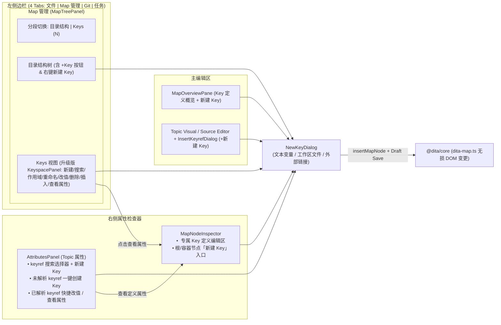

# Key 管理整合至「Map 管理」与「属性」及新建 Key 入口实施计划

> **状态**：✅ 已完成并归档（v1.5.0，commit `ea1bf47`）

## 1. 背景与目标

当前工作台的 Key 管理存在两处体验断层：

1. **信息架构割裂**：左侧边栏有 5 个顶层页签（`文件` / `Map 管理` / `Keys` / `Git` / `任务`），其中 `Keys` 从属于当前激活的 Root Map Keyspace，却被抽离为独立页签；而在「Map 管理」与右侧「属性」检查器中无法自然衔接 Key 的查看、挑选与编辑。
2. **缺少新建与完整编辑 Key 的入口**：
   - 项目没有「新建 Key」的表单或入口，唯一接近的能力是在 Map 树容器节点右键执行「插入变量定义 `<keydef>`」，只能盲插随机命名 `<keydef keys="key_xxxx" processing-role="resource-only"/>`（不含值、不支持在根节点插入、不支持选择文本变量/文件绑定/外部链接）。
   - `MapNodeInspector` 选中 `<keydef>` 时只能改属性，无法查看或编辑 `<topicmeta><keywords><keyword>` / `<linktext>` 内联文本值。
   - Topic `AttributesPanel` 中的 `keyref` / `conkeyref` 仅为纯文本输入框，不支持从 Keyspace 下拉挑选、不支持在 `keyref` 未定义时一键新建 Key、也不支持快捷编辑已解析 Key 的值。
   - 原 `KeyspacePanel` 传入的 `canEditKeys={canEdit}` 误用了当前打开 Topic 标签页的锁状态，导致在只读或未检出 Topic 时无法编辑 Map Key。

### 核心目标

- **移除左侧独立 `Keys` 页签**，将左侧边栏精简为 4 个页签（`文件` / `Map 管理` / `Git` / `任务`）。
- **整合到「Map 管理」**：在 `MapTreePanel` 顶部增加「目录结构 | Keys (N)」分段切换，各自独占面板高度；在目录树操作栏、右键菜单与 `MapOverviewPane` 补齐「新建 Key」与概览能力。
- **整合到两侧「属性」检查器**：
  - `MapNodeInspector`：选中 `<keydef>` 或含 `@keys` 节点时提供专属「Key 定义」编辑区（Key 名称、内联文本值 `<keyword>`/`<linktext>`、目标文件/URL、作用域与删除）；选中 Map 根节点或容器节点时提供「在此节点下新建 Key」快捷入口。
  - `AttributesPanel`（Topic 属性）：为 `keyref` 提供带搜索与值预览的下拉挑选器 + `+ 新建 Key…`；未解析 `keyref` 提供一键「创建 Key `{keyName}`」；已解析 `keyref` 支持行内改值、跳转属性检查器与跳转源码；为 `conkeyref` 提供新建文件绑定 Key 入口。
- **补齐「新建 Key」全链路入口**：新增结构化 `NewKeyDialog`（支持文本变量、工作区文件/Topic/图片绑定、外部链接三种 DITA 1.3 标准 `<keydef>` 形态），贯穿 `Map 管理`、两侧`属性`面板、`MapOverviewPane` 与 `InsertKeyrefDialog`。

---

## 2. 架构与交互流

---

## 3. 技术约束与不变量

- **100% 无损 XML 往返**：保留 `<?xml?>`、`<!DOCTYPE>`、XML 注释、PI、命名空间和原始属性顺序；`serializeXml()` 保持幂等。
- **Phase 13 Draft Overlay 兼容**：在 API 模式下，`createMapKey`、`deleteMapKey`、`renameMapKey`、`updateMapKeyValue`、`upsertMapNodeKeyText` 均需先调用 `ensureMapEditable(mapPath)` 校验/自动检出目标 Map 锁，写入无损 XML 后调用 `saveFile(mapPath)` 持久化到当前用户的 Draft Overlay 并刷新服务端 `keyspace`（绝不污染共享 `workDir` 或 Git `HEAD`）。
- **多 Key 与章节节点保护**：删除 Key 时，仅当元素为 `<keydef>` 且 `@keys` 仅包含该单一 token 时才删除整个元素；若 `@keys` 含多个空格分隔 token 或定义在 `<topicref>` 等导航节点上，则仅移除对应 token（若清空则移除 `@keys` 属性）。
- **双语国际化门禁**：所有用户可见字符串必须同时写入 `zh-CN` 和 `en` 词典且占位符完全一致，禁止在源码中硬编码中文（`i18n-parity.test.ts` 与 `no-hardcoded-cjk.test.ts`）。

---

## 4. 分模块实施设计

### 4.1 `@dita/core` 无损 Key XML 读写原语

- **`packages/dita-core/src/map/dita-map.ts`**：
  - 导出统一合法 Key 名称校验正则 `DITA_KEY_NAME_PATTERN = /^[A-Za-z0-9_][A-Za-z0-9._-]*$/`。
  - 扩展 `DitaMapTreeNode`：增加 `inlineText?: string` 与 `inlineTextSource?: 'keyword' | 'linktext' | 'navtitle' | 'none'`，在 `parseDitaMap()` 中提取（优先级 `keyword` > `linktext` > `topicmeta/navtitle` > `@navtitle`）。
  - 扩展 `InsertMapNodeOptions` 与 `insertMapNode()`：支持 `keydefLinktext?: string`，在 `<topicmeta>` 内按 DITA 1.3 顺序写入 `<navtitle>` → `<linktext>` → `<keywords><keyword>`。
  - 新增 `upsertMapKeyInlineText(xml, targetPath, source: 'keyword' | 'linktext', value: string | null): { xml: string; changed: boolean }`：
    - 非空值：若目标 `<keyword>` / `<linktext>` 已存在，仅当其为纯文本（不含子元素）时原地更新，否则拒绝覆盖返回 `changed: false`；若不存在，则最小侵入创建 `<topicmeta>` / `<keywords>` / `<keyword>` 或 `<linktext>`，保留既有 `<topicmeta>` 同级子元素。
    - 空值/`null`：若目标存在且为纯文本，移除该元素并在 `<keywords>` / `<topicmeta>` 无其余元素/注释/PI 子节点时清理空容器。
  - 新增 `removeMapNodeKey(xml, targetPath, keyName): { xml: string; changed: boolean; removedElement: boolean }`：
    - 单 token 的 `<keydef>`：移除整节点（`removedElement: true`）；
    - 多 token 的 `<keydef>` 或非 `<keydef>` 元素（如 `<topicref>`）：仅移除该 token（无剩余 token 时移除 `keys` 属性，`removedElement: false`）。
- **`packages/dita-core/src/model/dita-rules.ts`**：
  - `ELEMENT_SPECIFIC_ATTRS.keydef` 补充 `keyscope` 属性说明。
- **`packages/dita-core/test/dita-map.test.ts`**：
  - 为上述能力补齐完整单元测试与无损往返断言。

### 4.2 `@dita/web` Store 与 `NewKeyDialog`

- **`apps/web/src/store/editor-store/types.ts`**：
  - `LeftSidebarTab` 移除 `'keys'`，调整为 `'map' | 'files' | 'git' | 'assignments'`。
  - 新增 `MapPanelView = 'tree' | 'keys'`、`mapPanelView` 状态与 `setMapPanelView`。
  - 新增 `CreateMapKeyOptions`、`createMapKey`、`deleteMapKey`、`upsertMapNodeKeyText`。
- **`apps/web/src/store/editor-store/initial-state.ts` & `slices/ui.ts`**：
  - 初始化 `mapPanelView: 'tree'` 并实现 `setMapPanelView`。
- **`apps/web/src/store/editor-store/slices/map-tree.ts`**：
  - 实现 `createMapKey`、`deleteMapKey`、`upsertMapNodeKeyText`，严格走 `ensureMapEditable` → `@dita/core` 纯函数 → `mutateMapXml` → API 模式 `saveFile`（Draft Overlay）+ 语义刷新。
- **`apps/web/src/components/NewKeyDialog.tsx`**（新增）：
  - 原生 `<dialog>`，支持 3 种绑定类型（文本变量 `<keyword>` / 工作区文件 `@href` / 外部链接 URL + `<linktext>`）、目标 Map 选择、重复 key 预警与实时 XML 预览。

### 4.3 左侧边栏与「Map 管理」整合

- **`apps/web/src/components/LeftSidebar.tsx`**：
  - 移除独立 `Keys` 页签与 `keyspaceSlot`，精简为 4 列均衡页签栏（`文件` / `Map 管理` / `Git` / `任务`）。
- **`apps/web/src/components/KeyspacePanel.tsx`**：
  - 新增 `+ 新建 Key` 主按钮与空状态新建引导；
  - 新增删除 Key（带轻量行内二次确认）与点击查看节点属性（联动 `MapNodeInspector` 并高亮当前选中 Key）；
  - 移除硬编码英文字符串，全部接入 i18n。
- **`apps/web/src/map-tree/MapTreePanel.tsx`**：
  - Root Map 标题栏下方新增 `目录结构 | Keys (N)` 分段切换；
  - 目录树操作栏增加 `+ Key` 快捷按钮；
  - 右键菜单「插入变量定义 `<keydef>`」改为打开预填父节点的 `NewKeyDialog`。
- **`apps/web/src/map-tree/MapTreeNodeRenderer.tsx`**：
  - 为 `<keydef>` 节点补充绑定值预览提示。
- **`apps/web/src/map-tree/MapOverviewPane.tsx`**：
  - 顶栏新增 `+ 新建 Key` 按钮，并展示本 Map 的 Key 定义概览列表（支持点击查看属性或跳转源码）。

### 4.4 右侧「属性」检查器整合与工具栏闭环

- **`apps/web/src/map-tree/MapNodeInspector.tsx`**：
  - 选中 `<keydef>` 或含 `@keys` 节点时，在顶部渲染专属「Key 定义」编辑区（编辑 Key 名称、选择并编辑 `<keyword>`/`<linktext>` 内联文本值、目标文件/URL、作用域展示与删除）；
  - 选中 Map 根节点或容器节点时，头部操作栏提供 `+ 新建 Key`；根节点提供「查看全部 Keys」跳转。
- **`apps/web/src/editor/visual/AttributesPanel.tsx`**：
  - 升级 `keyref` 属性为可搜索的 Keyspace 选择器 + `+ 新建 Key…`（新建后自动回填当前元素 `keyref`）；
  - 未解析 `keyref` 警示卡新增一键「创建 Key `{keyName}`」按钮；
  - 已解析 `keyref` 信息卡新增行内快捷改值、查看属性（跳转 `MapNodeInspector`）与查看源码按钮；
  - `Reuse` 分组在缺少绑定文件的 Key 时提供 `+ 新建文件绑定 Key…` 快捷入口。
- **`apps/web/src/components/InsertKeyrefDialog.tsx`**：
  - 支持在插入 Keyref 弹窗中直接点击 `+ 新建 Key…`，创建成功后自动选中该 Key。
- **`apps/web/src/App.tsx`**：
  - 修正 `canManageKeys` 权限判断（不再错误绑定当前 Topic 标签页锁状态）；
  - 统一装配 `MapTreePanel` / `KeyspacePanel` / `NewKeyDialog` / `MapOverviewPane` / `MapNodeInspector` / `AttributesPanel` / `InsertKeyrefDialog`。
- **双语词典**：同步更新 `apps/web/src/i18n/messages/zh-CN/{common,structure}.ts` 与 `apps/web/src/i18n/messages/en/{common,structure}.ts`。

---

## 5. 验证计划

1. `@dita/core` 单元测试：`packages/dita-core/test/dita-map.test.ts` 覆盖全部新增 XML 原语与无损往返。
2. `@dita/web` 集成测试：`apps/web/test/key-management-integration.test.tsx` 覆盖 4 页签侧边栏、Map 管理分段切换、`NewKeyDialog`、`MapNodeInspector`、`AttributesPanel` 与 store 锁/持久化逻辑。
3. 全工作区门禁：`pnpm -r build && pnpm -r typecheck && pnpm -r test`（含 `i18n-parity.test.ts` 与 `no-hardcoded-cjk.test.ts`）。
4. 知识图谱更新：`graphify update .`。
