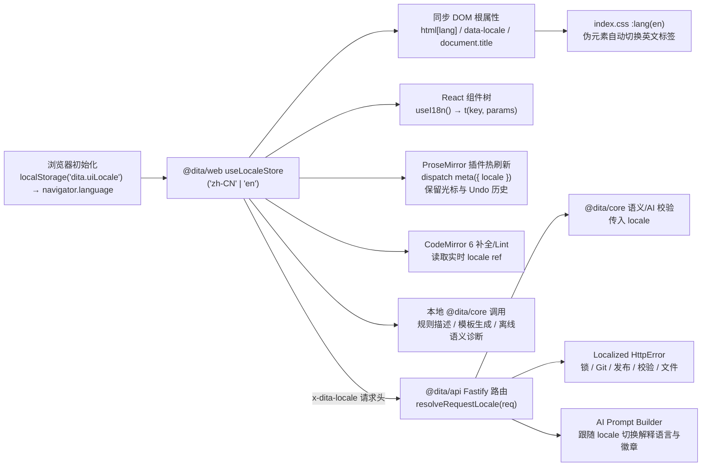

# Phase 8 规划与实施蓝图：全栈英文版界面与双语国际化（i18n）

> **状态**：✅ 已完成并归档（v1.2.0，见现行代码与 CHANGELOG）  
> **上游架构基线**：[architecture-and-plan.md](../architecture-and-plan.md)（Phase 0–6 已完成 v0.8.0，Phase 7 官网规划已完成）  
> **目标形态**：零外部运行依赖的强类型全栈 i18n（`zh-CN` / `en`）· 浏览器语言自动探测 + 顶栏实时无刷新切换 · 工作台 UI / DITA 模板 / 语义诊断 / API 报错 / AI 助手全链路英文支持

---

## 1. 目标、范围与决策边界

Phase 8 让 DITAEditor 工作台从“仅简体中文界面”演进为**面向国际技术文档团队的原生中英双语（`zh-CN` / `en`）全栈工作台**，在不破坏 XML 无损往返、不引入额外第三方 i18n 运行时包、不中断当前编辑状态的前提下，实现全链路语言一致。

### 1.1 已确认设计决策（Non-Negotiables & Non-Goals）

| 维度 | Phase 8 确认范围 | 明确不做（Non-Goals） |
| :--- | :--- | :--- |
| **覆盖深度** | **全栈语言一致**：前端工作台全部 UI + CSS 伪元素 + ProseMirror/CodeMirror 装饰 + `@dita/core` 元素/属性说明、新建 Topic/Map 模板与语义诊断 + `@dita/api` 角色/锁/Git/发布/校验报错 + Phase 6 AI 助手回复与上下文徽章 | 首期不新增独立的英文版 `samples/demo-dita-project/` 副本；不修改用户已编写的 `.dita` / `.ditamap` 业务正文内容 |
| **语言探测与切换** | 首次访问按 `localStorage` → `navigator.language`（`zh*` → `zh-CN`，其余 → `en`）自动决策；顶栏提供一键 `中文 / EN` 实时无刷新切换并持久化到 `localStorage`，切换时**保留未保存缓冲区、Tab 状态、光标选区与 ProseMirror 撤销栈** | 不通过整页重载（`window.location.reload()`）切换语言；不把界面语言强绑到服务端全局数据库（支持同一团队不同成员各自使用中文或英文工作台） |
| **i18n 技术方案** | **轻量自研强类型 TypeScript i18n 模块**（零第三方运行依赖），通过 TS 键名与插值参数类型检查 + Vitest 双语对称与硬编码中文扫描测试守卫质量 | 不引入 `i18next` / `react-i18next` / `react-intl` 等重型运行时依赖；不做复杂 ICU 性别/多级复数语法引擎 |
| **术语与文档语言** | 严格对齐 **OASIS DITA 1.3 官方英文术语**（Topic / Map / Keyref / Conref / DITAVAL / Check-out / Check-in / Strict Validation）；新建 Topic / Map 弹窗默认 `xml:lang` 跟随当前界面语言（`zh-CN` 或 `en`）并允许用户手动改选 | 切换工作台界面语言时，**绝不自动改写**已打开文档的 `xml:lang` 属性或正文文本，严格守住零意外 Git Diff 底线 |

---

## 2. 现有代码库中文文案全量盘点（基线扫描）

在动手改造前，已对当前仓库 `src/` 做全量 CJK 字符扫描，覆盖范围清晰可控（共 **85 个源码文件、1,475 行含中文代码** + `index.css` 5 处伪元素）：

| 包 / 模块 | 含中文文件数 | 含中文行数 | 主要分布与改造重点 |
| :--- | :---: | :---: | :--- |
| **`packages/dita-core/src`** | 9 | 228 | `model/dita-rules.ts`（100 行，元素/属性描述与分类）、`templates/topic-templates.ts` & `map-templates.ts`（51 行，新建文档骨架）、`semantics/`（30 行，keyspace/conref/语义诊断消息）、`ai/`（47 行，片段定位/拼装报错与约束摘要） |
| **`apps/web/src`** | 59 | 1,064 | 高密度模块：`AiAssistantPanel`（61）、`EditorToolbar`（60）、`editor-store`（55）、`WorkspaceDialog`（51）、`AttributesPanel`（48）、`PublishDialog`（46）、`MapTreePanel`（44）、`MapNodeInspector`（37）、`AiSettingsDialog`（35）、`GitPanel`（33）、`workspace-api`（30）、`ConrefReusePanel`（29）、`XrefImageDialog`（28）、`App`（27）、`VisualEditor`（25）、`decorations.ts`（17）等；外加 `index.html` 标题与 `index.css` 5 处 `::before` 伪元素（`prereq`/`context`/`result`/`postreq`/`related-links`） |
| **`apps/api/src`** | 17 | 183 | `modules/ai/`（83 行，Prompt 语言指令、上下文徽章、SSE 状态与错误）、`modules/locks/`（22 行，独占锁冲突与强制解锁提示）、`modules/publish/`（26 行，发布队列状态与参数错误）、`modules/git/`（19 行，分支/提交/回滚错误）、`modules/validate/`（14 行）、`modules/files/`（9 行）、`modules/identity/`（9 行，角色标签与描述）、`modules/dita-ot/`（1 行） |

---

## 3. 全栈 i18n 架构设计

### 3.1 端到端语言流转链路



### 3.2 四项关键技术机制

1. **共享同构内核底座（`packages/dita-core/src/i18n/`）**
   - 导出统一类型与纯函数，零外部依赖，前后端共同复用：
     - `export type UiLocale = 'zh-CN' | 'en';`
     - `export function normalizeLocale(input?: string | null): UiLocale`（识别 `zh`、`zh-CN`、`zh-Hans` 等归为 `'zh-CN'`，识别 `en`、`en-US`、`en-GB` 等归为 `'en'`，未知默认回退 `'zh-CN'`）。
     - `export function formatMessage(template: string, params?: Record<string, string | number>): string`（支持 `{name}` 命名插值，保留未命中占位符以便测试捕获）。
   - **向后兼容原则**：`@dita/core` 所有既有函数签名（如 `createTopicTemplate`、`createMapTemplate`、`DitaSemanticIndex.getDiagnostics`、`spliceAndVerifyAiXml`、`buildDitaConstraintSummary`）的 `locale` 均作为**可选参数且默认 `'zh-CN'`**，确保 Phase 0–6 全部既有单测零破坏通过。
   - **元素与属性元数据双语化（`model/dita-rules.ts`）**：
     - `DitaElementSpec` 已有 `label`（英文）与 `labelZh`（中文），增补 `descriptionEn`；`DitaAttributeSpec` 增补 `labelEn`、`descriptionEn`、`placeholderEn`；提供统一读取辅助函数 `getElementLabel(spec, locale)`、`getElementDescription(spec, locale)`、`getAttributeLabel(spec, locale)`、`getAttributeDescription(spec, locale)`，以及 `DITA_CATEGORY_LABELS[locale]`。
   - **模板双语化（`templates/topic-templates.ts` & `map-templates.ts`）**：
     - 依据 `options.lang`（当以 `en` 开头时）生成地道英文 OASIS DITA 1.3 模板（`xml:lang="en"`，英文示例标题、`shortdesc`、步骤与章节）；`zh-CN` 模板输出保持与现有完全一致。

2. **前端零依赖强类型词典与热切换（`apps/web/src/i18n/`）**
   - 按功能域拆分为模块化词典文件（`common`、`header`、`sidebar`、`editor`、`mapTree`、`semantics`、`git`、`publish`、`ai`、`dialogs`），合并为单一 `zhMessages` 对象；通过 TypeScript 类型约束 `enMessages: Record<MessageKey, string>`，并在类型层校验 `{param}` 占位符集合一致：
     ```ts
     type ExtractParams<S extends string> =
       S extends `${string}{${infer P}}${infer Rest}` ? P | ExtractParams<Rest> : never;
     ```
     调用 `t('locks.checkedOutBy', { user: 'Alice' })` 时，若漏传参数、错拼键名或传入多余键名，**`pnpm -r typecheck` 直接在编译期报错**。
   - **ProseMirror & CodeMirror 6 无损热切换（关键防坑）**：
     - 在 `DITA_DECORATIONS_KEY` 的 `DitaDecorationPluginState` / `DitaDecorationMeta` 增加 `locale: UiLocale`。当 `useLocaleStore` 切换语言时，`VisualEditor` 仅派发一个不修改文档内容的 metadata transaction（`tr.setMeta(DITA_DECORATIONS_KEY, { locale })`），即时重绘块间 `+` 快捷标签、Conref 卡片提示、Keyref 悬停文案与未建模标签徽章，**绝对不重建 `EditorView`、不丢失选区光标与 `prosemirror-history` 撤销栈**。
     - `SourceEditor`（CodeMirror 6）的 DITA 补全与 XML Linter 通过 `localeRef.current` 动态读取当前语言，无需销毁编辑器实例。
     - `apps/web/src/index.css` 中 5 处中文伪元素（`prereq`、`context`、`result`、`postreq`、`related-links`）补充 `:root[lang="en"]` 规则切换为英文（如 `"Prerequisites · prereq"`、`"Context · context"`、`"Result · result"`、`"Post-requirements · postreq"`、`"Related Links · related-links"`）。
   - **本地化格式化辅助**：统一封装 `formatDateTime(input, locale)`、`formatRelativeTime(input, locale)`、`formatDuration(ms, locale)`，替换散落在 `GitPanel`、`PublishDialog`、`AiSettingsDialog` 中的硬编码中文时间拼接。

3. **请求头透传与后端响应双语化（`x-dita-locale`）**
   - 与现有 `x-dita-user-id` 请求头保持完全一致的轻量约定：前端在 `workspace-api`、`git-api`、`publish-api`、`ai-api` 的统一请求头构造器中附带 `x-dita-locale: zh-CN | en`。
   - 后端新增 `apps/api/src/i18n/locale.ts`（`resolveRequestLocale(req)`：优先 `x-dita-locale`，次选 `Accept-Language`，默认 `'zh-CN'`）及 `apps/api/src/i18n/messages.ts`。
   - **覆盖后端 4 类面向用户输出**：
     1. **身份角色元数据**：`GET /api/identity` 返回的 `roles[].label` / `description` 按请求语言返回（`Administrator` / `Writer` / `Viewer`）。
     2. **语义诊断与工作区诊断**：`WorkspaceSemanticIndexer` 查询 `/api/semantics/diagnostics`、`/api/semantics/overlay`、`/api/files/diagnostics` 时按 `locale` 生成英文/中文诊断文本，前端在切换语言后自动刷新当前工作区的诊断与身份元数据。
     3. **业务错误提示（`HttpError`）**：`LockService`（锁冲突/只读拦截/强制解锁）、`GitManager`（分支名非法/无改动可提交）、`PublishService`（参数校验/任务取消）、`StrictValidator`（DITA-OT 未安装或超时）、`WorkspaceFs`（路径越界/文件已存在）均走后端 `apiT(locale, key, params)`。
     4. **Phase 6 AI 助手双语化（`apps/api/src/modules/ai/`）**：
        - `POST /api/ai/stream` 与 `POST /api/ai/config/test` 读取 `locale`（请求体可选字段优先，否则取 `x-dita-locale`）。
        - 当 `locale === 'en'` 时：系统 Prompt 切换为英文专家指令，要求 `<explanation>` 与 `ask` 回答使用**自然、简洁的英文**；`contextBadges`（如 `Element target`、`Keyspace (12 keys)`、`3 diagnostics`）、SSE 进度/重试提示与配置测试返回文案均为英文。
        - **重要边界**：当用户在英文界面下编辑中文 DITA 文档（或反之）执行 `authoring` / `optimize_tags` 时，Prompt 明确区分 **“回复解释使用界面语言”** 与 **“修改 XML 正文时严格保持原文档语言（除非用户显式要求翻译）”**，防止 AI 误把中文文档正文翻译成英文！

---

## 4. OASIS DITA 1.3 官方英文术语规范表

为确保全工作台 59 个前端文件与后端提示措辞高度专业且前后统一，制定强制术语基准：

| 中文原词 | 英文标准术语（强制统一） | 适用位置 |
| :--- | :--- | :--- |
| 可视化 / 双栏对比 / XML 源码 | `Visual` / `Split` / `XML Source` | 顶栏模式切换 |
| 无标签 / 标签 / 含属性 | `No Tags` / `Tags` / `Tags + Attrs` | 可视化标签显示模式 |
| 项目文件 / Map 结构树 / Keys 键空间 / 版本 | `Files` / `Map Tree` / `Keys` / `Git` | 左侧导航四 Tab |
| 属性 / 复用 / AI 助手 | `AI` / `Attributes` / `Reuse` | 右侧检视区三 Tab |
| 问题面板 / 诊断 | `Problems` / `Diagnostics` | 底部问题面板 |
| 检出 / 签入 / 撤销检出 / 强制解锁 | `Check Out` / `Check In` / `Cancel Check-out` / `Force Unlock` | LockStatusBar / GitPanel / CheckinDialog |
| 管理员 / 写作（编辑者） / 只读 | `Admin` / `Writer` / `Viewer` | IdentitySwitcher / 权限拦截提示 |
| 根 Map / 条件过滤（DITAVAL） | `Root Map` / `DITAVAL Filter` | 工具栏上下文切换 |
| 全部显示 / 置灰排除 / 隐藏排除 | `Show All` / `Dim Excluded` / `Hide Excluded` | DITAVAL 三态投影 |
| 严格校验 / 异步发布 / 构建日志 | `Strict Validation` / `Publish` / `Build Log` | StrictValidationDialog / PublishDialog |
| 片段 / 整篇 Topic / 查看 Diff 并应用 | `Selection` / `Full Topic` / `Review Diff & Apply` | AI 助手面板与 Diff 弹窗 |
| 检出并应用 / 仅预览 | `Check Out & Apply` / `Preview Only` | AiDiffDialog 锁联动按钮 |

---

## 5. 目录结构规划

```text
packages/dita-core/src/
├── i18n/
│   ├── locale.ts              # UiLocale ('zh-CN' | 'en'), normalizeLocale, formatMessage
│   ├── messages.ts            # 语义诊断与 AI 校验消息双语表
│   └── index.ts
├── model/dita-rules.ts        # 补齐英文 descriptionEn / labelEn 与 locale 读取辅助函数
└── templates/                 # topic-templates.ts & map-templates.ts 支持 en 模板

apps/web/src/
├── i18n/
│   ├── index.ts               # useLocaleStore, useI18n, t(), getCurrentLocale(), formatters
│   ├── types.ts               # 编译期键名与 {param} 占位符强类型定义
│   ├── locales/
│   │   ├── zh-CN/             # 按域拆分：common, header, sidebar, editor, mapTree, semantics, git, publish, ai, dialogs
│   │   └── en/                # 与 zh-CN 1:1 严格对称的英文词典
│   └── sync-dom.ts            # 同步 html[lang], data-locale, document.title 与 localStorage
└── components/
    └── LocaleSwitcher.tsx     # 顶栏紧凑型 中 / EN 语言切换控件（置于 WorkbenchHeader）

apps/api/src/
├── i18n/
│   ├── locale.ts              # resolveRequestLocale(req) 解析 x-dita-locale / Accept-Language
│   └── messages.ts            # 后端 HttpError / 角色描述 / AI 徽章与状态双语词典
└── modules/ai/ai-prompt.ts    # 双语 Prompt 模板（解释语言跟随 locale，正文语言尊重文档原语言）
```

---

## 6. 分阶段实施切片（垂直交付，预计 1.5–2 周）

### Slice 8.1：同构 i18n 底座与 `@dita/core` 双语化（第 1–2 天）
- 在 `packages/dita-core/src/i18n/` 落地 `UiLocale`、`normalizeLocale`、`formatMessage` 与核心诊断双语消息表。
- 升级 `model/dita-rules.ts`（全部元素与属性英文描述、分组标签）、`templates/{topic,map}-templates.ts`（`lang="en"` 英文模板）、`semantics/` 与 `ai/` 错误信息支持可选 `locale` 参数（默认 `'zh-CN'` 保持向后兼容）。
- 新增 `packages/dita-core/test/i18n.test.ts` 验证双语模板往返无损、规则描述无缺失英文、语义诊断双语输出准确。

### Slice 8.2：前端 i18n 引擎、顶栏切换与布局骨架（第 3–4 天）
- 建立 `apps/web/src/i18n/`（强类型 `t()`、Zustand `useLocaleStore`、`navigator.language` 自动探测、`localStorage` 持久化、DOM `lang`/`title` 同步、时间数字格式化）。
- 新增 `LocaleSwitcher.tsx` 接入 `WorkbenchHeader.tsx`（顺带清理顶栏陈旧的 `Phase 5` 副标题文案）；所有前端 API 客户端统一注入 `x-dita-locale` 请求头。
- 完成核心外框组件双语化：`App.tsx`、`WorkbenchHeader`、`LeftSidebar`、`EditorTabBar`、`LockStatusBar`、`IdentitySwitcher`、`ProblemsPanel`、`TopicInspector`、`FileExplorerPanel`。

### Slice 8.3：双模编辑器核心、Map 树与语义面板全量双语化（第 5–7 天）
- 完成可视化编辑器与源码编辑器双语化：`VisualEditor`、`EditorToolbar`、`InlineBubbleToolbar`、`InsertElementMenu`、`BlockHandle`、`BreadcrumbBar`、`AttributesPanel`、`SourceEditor`、`dita-completion`、`xml-linter`、`decorations.ts`、`conref-renderer.ts`、`node-views.ts`。
- 落地 `DITA_DECORATIONS_KEY` 的 `locale` 元数据热刷新机制 + `apps/web/src/index.css` 的 `:root[lang="en"]` 伪元素规则，验证切语言时选区与 Undo 历史零丢失。
- 完成 Map 与语义相关组件双语化：`MapTreePanel`、`MapTreeNodeRenderer`、`MapNodeInspector`、`MapNodeContextMenu`、`MapOverviewPane`、`MountExistingDialog`、`KeyspacePanel`、`ConrefReusePanel`、`ProfilingAttrEditor`、`InsertKeyrefDialog`、`XrefImageDialog`、`NewTopicDialog`、`NewMapDialog`（默认 `xml:lang` 跟随当前界面语言且可手动覆盖）。

### Slice 8.4：Git 协作、DITA-OT 发布、AI 前端与后端全栈双语化（第 8–10 天）
- 完成协作/发布/AI 前端双语化：`GitPanel`、`CheckinDialog`、`DiffDialog`、`DiffViewer`、`WorkspaceDialog`、`PublishDialog`、`JobLogViewer`、`StrictValidationDialog`、`AiAssistantPanel`、`AiDiffDialog`、`AiSettingsDialog` 及 `store/{editor,git,publish}-store.ts`、`ai/ai-store.ts`。
- 落地 `apps/api/src/i18n/` 与全模块 `resolveRequestLocale(req)` 接入：`identity`、`locks`、`git`、`files`、`indexer`、`validate`、`publish` 与 `ai`（双语 `ai-prompt.ts`、英文 `contextBadges`、SSE 状态文案，并确保“解释用界面语言、XML 正文尊重原文档语言”）。
- 前端切换语言时触发轻量刷新（重新拉取 `identity` 角色文案与当前工作区语义诊断），即时消除中英混杂。

### Slice 8.5：自动化门禁、视觉溢出走查与综合验收（第 11–12 天）
- 编写 **三大自动化防退化测试**：
  1. `apps/web/test/i18n-parity.test.ts`：校验 `zh-CN` 与 `en` 键集合 100% 一致、所有 `{param}` 占位符集合逐键完全匹配、无空字符串值。
  2. `apps/web/test/no-hardcoded-cjk.test.ts`：扫描 `apps/web/src/`（排除 `src/i18n/locales/zh-CN/` 与明确白名单注释/示例数据）确保零新增硬编码中文 UI 文本，防止后续开发回退！
  3. `apps/api/test/phase8-i18n.test.ts`：验证携带 `x-dita-locale: en` 时，角色接口、Check-out 锁冲突报错、语义诊断与 AI Prompt/SSE 流均正确返回英文。
- 英文文案长度适配走查（英文通常比中文长 25%–40%）：重点检查 `WorkbenchHeader`、`EditorToolbar`、三栏窄宽度下的 Tab 标签、按钮换行与截断 `title` 提示，确保 `1280px` 笔记本屏幕下不挤压错位。
- 运行全仓 `pnpm -r build && pnpm -r typecheck && pnpm -r test`，并同步更新 `README.md` / `README.en.md`（可顺带为 `README.en.md` 补充英文界面截图）与 `CHANGELOG.md`。

---

## 7. 验收标准（Definition of Done）

- **全量构建与测试**：`pnpm -r build && pnpm -r typecheck && pnpm -r test` 全绿，既有 201 项测试零破坏，新增 `@dita/core` / `@dita/web` / `@dita/api` i18n 回归测试与硬编码中文扫描门禁全部通过。
- **零中英混杂**：在英文模式下走通完整主链路（打开工作区 → 浏览 Map 树 / Keys / Git → 检出文件 → 可视化/双栏/源码编辑与 `/` 插块 → 切换 DITAVAL → 新建英文 Topic/Map → 触发校验/发布 → 使用 AI 写作/修错并查看 Diff 确认 → 签入提交），除用户文档本身的正文外，界面、提示条、右键菜单、空态、弹窗、诊断、接口报错与 AI 解释 **100% 为规范英文**。
- **无损热切换**：在未保存文档且处于可视化编辑选区状态时，于顶栏反复切换 `中文 ↔ EN`，页面不刷新、未保存改动不丢失、光标位置与 `Cmd/Ctrl+Z` 撤销历史保持完好、CSS 块标签与 ProseMirror 装饰即时更新。
- **布局稳健性**：在 `1280×800` 与 `1440×900` 分辨率下，英文较长标签在顶栏、工具栏、三栏侧边与所有弹窗内无重叠、无按钮被挤出视口。
