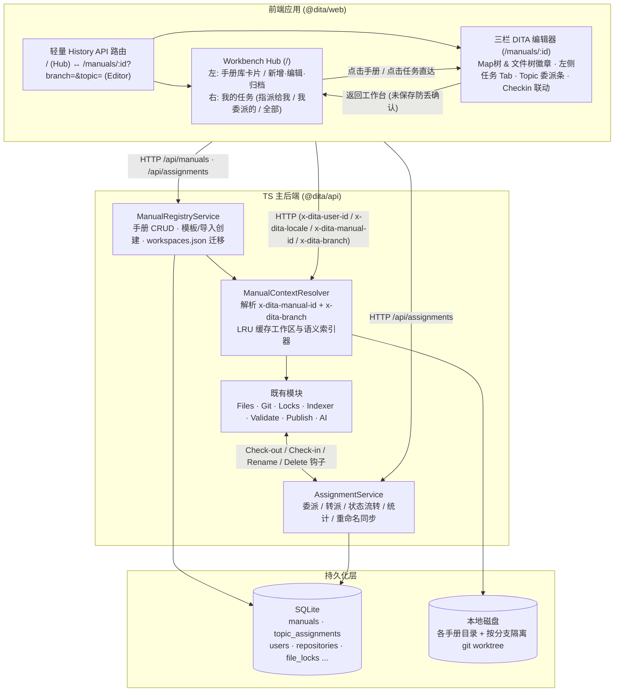

# Phase 10 规划与实施蓝图：手册编辑工作台与 Topic 编辑任务委派

> **状态**：✅ 已实现（后端 `apps/api/src/modules/{manuals,assignments}/`、`apps/api/src/db/{schema,client}.ts`；前端 `apps/web/src/{router,workbench,store}/`、`apps/web/src/components/{TopicAssignmentBanner,DelegateTopicButton,ManualAssignmentsPanel,LeftSidebar,CheckinDialog}.tsx`；测试 `apps/api/test/phase10-{manuals,assignments}-api.test.ts`、`apps/web/test/phase10-router.test.ts`）  
> **上游架构基线**：[architecture-and-plan.md](../architecture-and-plan.md)（Phase 0–9 已完成）  
> **领域词典与架构决策**：[GLOSSARY.md](../../GLOSSARY.md) · [ADR-0001](../adr/0001-manual-as-independent-workspace.md) · [ADR-0002](../adr/0002-per-request-manual-isolation.md) · [ADR-0003](../adr/0003-soft-assignments-in-sqlite.md)  
> **目标形态**：独立「手册编辑工作台（Workbench Hub）」首页（`/`）+ 三栏编辑器路由（`/manuals/:id`）· SQLite 持久化手册元数据与多手册/多分支并发隔离 · 轻量 Topic 编辑任务（`Assignment`）委派、转派与 Check-out/Check-in 联动

---

## 1. 目标、范围与设计树共识

Phase 10 将 DITAEditor 从“打开即进入单一工作区的三栏编辑器”演进为**以「手册（Manual）」和「我的任务（My Assignments）」为入口的团队文档工作台**，在不破坏既有无损 XML 往返、最小 Git Diff 与 Check-out 独占锁底线的前提下，补齐多手册组织管理与轻量 Topic 分工委派闭环。

### 1.1 已确认设计决策（Design Tree 共识清单）

| 维度 | Phase 10 确认决策 | 明确不做（Non-Goals） |
| :--- | :--- | :--- |
| **手册（Manual）边界** | **1 本手册 = 1 个独立工作区目录与独立 Git 仓库**（[ADR-0001](../adr/0001-manual-as-independent-workspace.md)），在 SQLite `manuals` 表持久化元数据，整合现有新建/导入/关联目录能力，内置 `demo-dita-project` 作为默认手册 | 不做跨仓库共享 Topic 池；不引入「项目 → 手册」两层冗余层级；工作台移除手册绝不删除磁盘目录与 Git 仓库 |
| **入口与导航路由** | 根路径 `/` 为独立 **Workbench Hub**（左 2/3 手册卡片库 + 右 1/3「我的任务」面板）；编辑器视图使用零依赖 History API 路由 `/manuals/:id?branch=...&topic=...`（兼容 `VITE_BASE` 与单容器 SPA 回退）；未保存改动离开前二次确认；`VITE_STATIC_DEMO=true` 维持直达离线编辑器 | 不引入 `react-router-dom` 等额外路由依赖；离线演示模式不发起任何 `/api/*` 请求 |
| **多手册 / 多分支隔离** | 后端通过 **`x-dita-manual-id`** 与可选 **`x-dita-branch`** 请求头定位目标手册与对应 `git worktree` 及语义索引缓存池（[ADR-0002](../adr/0002-per-request-manual-isolation.md)），无头调用向后兼容默认手册与主分支 | 不强制把全部旧路由改写为 `/api/manuals/:id/...` 以免破坏既有 API 客户端与测试契约 |
| **任务（Assignment）模型** | 严格区分 **`Assignment`（编辑任务）** 与 DITA **`Task`（`<task>` 主题）**；仅落库 SQLite（零 XML/Git 污染，[ADR-0003](../adr/0003-soft-assignments-in-sqlite.md)）；限定目标为 `.dita` Topic；绑定 `(manualId, branch, topicPath)`；同 Topic 同分支最多 **1 条活跃任务**，重复委派走转派（Reassign）；字段精简为必填归属 + 可选 `note` / `dueDate` | 绝不把委派信息写入 `.dita` `<prolog>` 或 PI；不支持对 `.ditamap`/`.ditaval`/图片委派；不做工时、优先级矩阵、子任务或评论盖楼 |
| **状态机与协作联动** | 轻量四态：`pending` → `in_progress` → `done` / `cancelled`（支持重新打开与自委派）；**软引导、不自动加锁、不硬拦截**；`admin`/`writer` 均可委派与被委派（过滤 `viewer`）；他人查看/检出已委派给别人的 Topic 时给出提示与确认；受托人 Check-out 自动推进 `pending → in_progress`，Check-in 弹窗提供默认勾选的「同时标记任务完成」 | 不做多级审批/待验收/打回流；不因委派阻断管理员或紧急救火编辑 |
| **多入口与刷新策略** | 入口覆盖工作台「我的任务」面板（含「新建委派」）、编辑器 **Map 树**、**文件树**（展示受托人徽章）、**Topic 顶部状态条**与**左侧「任务」Tab**；采用动作即时刷新 + 窗口重新聚焦（`focus`/`visibilitychange`）自动刷新 + 手动刷新 | 不新增任务专用 WebSocket/SSE 推送通道，不建独立站内信/未读通知表 |

---

## 2. 领域模型与系统交互流

核心术语以 [GLOSSARY.md](../../GLOSSARY.md) 为唯一标准：`Manual`（手册）、`Root Map`、`Topic`、`Task`（专指 DITA `<task>`）、`Workbench Hub`（手册编辑工作台）、`Assignment`（编辑任务）、`Assigner`（委派人）、`Assignee`（受托人）、`Check-out Lock`（检出独占锁）。



---

## 3. SQLite 数据模型与迁移设计

继续沿用 `apps/api/src/db/schema.ts`（Drizzle ORM）与 `apps/api/src/db/client.ts`（幂等 `DDL`）机制，新增两张表，不破坏任何既有表结构。

### 3.1 `manuals` 表

手册 ID 直接复用 `repositoryIdFor(realRootDir)`（与既有 `repositories.id`、`file_locks.project_id`、`publish_jobs.project_id`、`ai_usage_logs.project_id` 保持 100% 一致），从而无缝衔接历史锁记录、发布记录与 AI 审计记录，无需额外映射表。

```sql
CREATE TABLE IF NOT EXISTS manuals (
  id TEXT PRIMARY KEY NOT NULL,           -- = repositoryIdFor(realpath(root_dir))
  name TEXT NOT NULL,                     -- 手册显示名称
  description TEXT NOT NULL DEFAULT '',   -- 手册简介
  root_dir TEXT NOT NULL,                 -- 规范化绝对路径 (realpath)
  default_root_map TEXT,                  -- 可选默认 Root Map 相对路径，如 index.ditamap
  is_builtin INTEGER NOT NULL DEFAULT 0,  -- 1 表示默认内置示例手册
  archived INTEGER NOT NULL DEFAULT 0,    -- 0=活跃, 1=已归档
  created_by TEXT NOT NULL,               -- 创建者 userId
  created_at INTEGER NOT NULL,
  updated_at INTEGER NOT NULL,
  last_opened_at INTEGER NOT NULL DEFAULT 0
);
CREATE UNIQUE INDEX IF NOT EXISTS manuals_root_dir_unique ON manuals (root_dir);
CREATE INDEX IF NOT EXISTS manuals_archived_opened_idx ON manuals (archived, last_opened_at DESC);
```

### 3.2 `topic_assignments` 表

通过 SQLite **部分唯一索引（Partial Unique Index）**在数据库层强约束「同一 `(manual_id, branch, topic_path)` 同一时刻最多 1 条活跃任务」，同时完整保留历史 `done` / `cancelled` 记录。

```sql
CREATE TABLE IF NOT EXISTS topic_assignments (
  id TEXT PRIMARY KEY NOT NULL,
  manual_id TEXT NOT NULL,                -- 对应 manuals.id (= project_id)
  branch TEXT NOT NULL,                   -- Git 分支名 (如 main / release/2.0)
  topic_path TEXT NOT NULL,               -- POSIX 相对路径，仅限 .dita 文件
  assignee_id TEXT NOT NULL,              -- 受托人 userId (仅 admin / writer)
  assigner_id TEXT NOT NULL,              -- 委派人 userId (仅 admin / writer)
  status TEXT NOT NULL,                   -- 'pending' | 'in_progress' | 'done' | 'cancelled'
  note TEXT NOT NULL DEFAULT '',          -- 选填委派说明/写作要求
  due_date TEXT,                          -- 选填截止日期 'YYYY-MM-DD'
  created_at INTEGER NOT NULL,
  updated_at INTEGER NOT NULL,
  completed_at INTEGER                    -- 标记 done 时的时间戳，重新打开时置 NULL
);

-- 数据库层强制同手册同分支同 Topic 最多 1 条活跃任务
CREATE UNIQUE INDEX IF NOT EXISTS topic_assignments_active_unique
  ON topic_assignments (manual_id, branch, topic_path)
  WHERE status IN ('pending', 'in_progress');

CREATE INDEX IF NOT EXISTS topic_assignments_assignee_idx
  ON topic_assignments (assignee_id, status, updated_at DESC);
CREATE INDEX IF NOT EXISTS topic_assignments_assigner_idx
  ON topic_assignments (assigner_id, status, updated_at DESC);
CREATE INDEX IF NOT EXISTS topic_assignments_manual_branch_idx
  ON topic_assignments (manual_id, branch, status);
```

### 3.3 现有工作区平滑迁移策略（首次启动自动导入）

`ManualRegistryService.syncLegacyWorkspaces()` 在服务端启动时幂等执行（仅插入 `root_dir` 尚未登记的记录，不会覆盖用户编辑过的名称、简介或归档状态）：
1. 登记默认内置目录 `defaultRootDir`（如 `samples/demo-dita-project`，标记 `is_builtin = 1`）。
2. 读取既有 `workspaces.json`（忽略 `hidden: true` 的墓碑条目），将其 `name`、`path`、`lastOpenedAt` 迁移进 `manuals` 表。
3. 扫描 `importsRootDir`（`.dita-workspaces/`）下非隐藏子目录（跳过 `git-worktrees/` 与隐藏记录），自动补录为可见手册，确保从旧版本升级零数据丢失。
4. 若某已登记手册的磁盘目录在外部被删除，列表接口仍安全返回 `exists: false` 供用户在工作台提示并安全移除，避免接口崩溃。

---

## 4. 后端多手册与多分支并发隔离方案

参考 [ADR-0002](../adr/0002-per-request-manual-isolation.md)，消除当前 `WorkspaceManager` 单例持有全局 `activeRootDir` 的并发串台隐患：

### 4.1 `ManualContextResolver`（请求级上下文解析器）

新增 `apps/api/src/modules/manuals/manual-context-resolver.ts`，替代路由层对单一 `WorkspaceManager` 实例的直接读写：

1. **解析顺序**：
   - 从请求头 `x-dita-manual-id`（或静态资源/SSE 场景的 query 参数 `?manualId=`）读取 `manualId`；若缺失，则回退到「最近激活手册 / 默认内置手册」（向后兼容旧测试脚本与直接 curl）。
   - 从 `manuals` 表查出 `projectRootDir = realpath(manual.rootDir)`，校验目录存在。
   - 从请求头 `x-dita-branch`（或 query 参数 `?branch=`）读取目标分支名；若缺失，解析主仓库当前分支 `git.currentBranch(projectRootDir)`；若指定了非主分支，通过 `git.ensureWorktreeForBranch(projectRootDir, branch)` 定位（或按需挂载）该分支对应的独立 `git worktree` 目录 `workDir`。
2. **有界缓存池（LRU）**：
   - 以 `${manualId}::${workDir}` 为键缓存轻量 `WorkspaceSession`（包含绑定到该 `workDir` / `projectRootDir` 的 `WorkspaceManager` 视图与独立 `WorkspaceSemanticIndexer` 实例），默认上限如 `MAX_CACHED_SESSIONS = 16`，超限时淘汰最久未访问会话，防止内存无界增长。
   - 保持现有文件变更回调（`onFileWritten` / `onFileRenamed` / `onFileDeleted` / `onAssetAdded`）仅刷新当前会话对应的 `indexer`，绝不跨手册/跨分支互相清除缓存。
3. **全面接入的路由模块**：
   - `files/routes.ts`、`files/asset-routes.ts`（图片 URL 附带 `?manualId=...&branch=...`）、`indexer/routes.ts`、`locks/routes.ts`（重构 `resolvePhase4Scope` 直接委托给 `ManualContextResolver`）、`git/routes.ts`（`switch-branch` 返回目标分支元数据而不修改全局状态）、`validate/routes.ts`、`publish/routes.ts`、`ai/routes.ts`。

---

## 5. REST API 契约设计

所有接口遵循现有规范：请求头统一透传 `x-dita-user-id`、`x-dita-locale`（编辑器内额外透传 `x-dita-manual-id`、`x-dita-branch`），参数使用 `Zod` 校验，错误统一使用 `httpError()` 双语返回。

### 5.1 手册管理接口（`apps/api/src/modules/manuals/routes.ts`）

| 方法与路径 | 角色要求 | 说明 |
| :--- | :--- | :--- |
| `GET /api/manuals?includeArchived=false&q=` | 全部角色 | 返回手册列表（每项含元数据、`exists`、`currentBranch`、`stats: { totalTopics, totalMaps }`、`activeAssignmentCount`、`myActiveAssignmentCount`、`lastOpenedAt`）及 `importsRootDir` / `defaultRootDir` |
| `GET /api/manuals/:id` | 全部角色 | 返回单本手册详情、可用 Root Map 清单与当前分支摘要 |
| `POST /api/manuals` | `admin` / `writer` | 新建手册：支持 `mode: 'create'`（空白/起步模板）、`mode: 'import'`（浏览器上传本地文件夹批量写入）、`mode: 'attach'`（高级：关联服务器已有目录）；自动初始化 Git（可选默认开启）并登记到 `manuals` |
| `PATCH /api/manuals/:id` | `admin` / `writer` | 编辑手册元数据：`name`、`description`、`defaultRootMap`；归档/取消归档（`archived` 仅 `admin` 或创建者可改） |
| `POST /api/manuals/:id/touch` | 全部角色 | 记录 `lastOpenedAt`（打开手册进入编辑器时调用） |
| `DELETE /api/manuals/:id` | `admin` 或创建者 | **安全移除**：仅从 `manuals` 表移除登记（并写入隐藏记录防止自动重扫复活），**绝不删除磁盘目录与 Git 仓库**；内置默认手册禁止移除（支持归档）；关联未完成任务随移除一并取消或保留提示（删除前返回统计供前端二次确认） |

> 旧有 `/api/workspace/list`、`/api/workspace/open`、`/api/workspace/create`、`/api/workspace/import`、`/api/workspace/forget` 在 Phase 10 内部桥接到 `ManualRegistryService` 保持向后兼容，避免破坏既有自动化测试。

### 5.2 Topic 编辑任务接口（`apps/api/src/modules/assignments/routes.ts`）

| 方法与路径 | 角色要求 | 说明 |
| :--- | :--- | :--- |
| `GET /api/assignments` | 全部角色 | 查询任务列表，支持筛选：`scope=mine \| delegated \| all`、`status=active \| pending \| in_progress \| done \| cancelled \| all`、`manualId`、`branch`、`topicPath`。响应附带联表信息：`manualName`、`topicTitle`（实时或缓存读取）、`topicExists`、`assignee`、`assigner`、`lockOwnerId`、`overdue` |
| `GET /api/assignments/summary` | 全部角色 | 轻量角标计数接口，返回当前用户的 `{ myPending, myInProgress, myOverdue, delegatedActive }` |
| `POST /api/assignments` | `admin` / `writer` | 创建委派：校验目标为 `.dita` Topic 且存在于指定 `(manualId, branch)`、受托人存在且角色为 `admin \| writer`（禁止 `viewer`）。若同一 `(manualId, branch, topicPath)` 已存在活跃任务，返回 `409 Conflict` 并附带现有任务 `existingAssignment`（前端直接引导「转派」） |
| `PATCH /api/assignments/:id` | 见权限矩阵 | 更新任务：`status`（状态流转）、`assigneeId`（转派）、`note`、`dueDate`。权限规则：创建者与 `admin` 可修改全部字段及取消；当前受托人可推进状态（`pending ↔ in_progress → done` / 重新打开）及转派给其他合法作者；`viewer` 一律 `403` |
| `DELETE /api/assignments/:id` | `admin` 或创建者 | 仅允许删除历史已取消记录或直接调用取消（前端主流程优先用 `status: 'cancelled'` 保留协作轨迹） |

### 5.3 与既有模块的自动联动钩子

1. **Check-out 联动（`POST /api/locks/checkout`）**：
   - 成功获取锁后，若当前 `(manualId, branch, filePath)` 存在 `assignee_id === user.id && status === 'pending'` 的任务，自动将其更新为 `in_progress`，并在响应中附带 `updatedAssignment`。
2. **Check-in 联动（`POST /api/locks/checkin`）**：
   - 请求体新增可选字段 `completeAssignmentIds?: string[]`（或 `completeMyAssignments?: boolean`）。
   - Git Commit 成功并释放锁后，将指定的本人活跃任务批量标记为 `done`（写入 `completed_at`），并返回 `completedAssignments`。
3. **文件重命名 / 删除联动（`files/routes.ts`）**：
   - `POST /api/files/rename` 成功后：同步将 `topic_assignments` 中 `(manualId, branch, fromPath)` 的 `topic_path` 更新为 `toPath`。
   - `DELETE /api/files` 成功后：保留历史任务记录，前端展示时通过 `topicExists: false` 标出「目标文件已移除」，避免任务凭空消失。

---

## 6. 前端架构、路由与交互设计

### 6.1 零依赖路由与页面壳层（`apps/web/src/router/`）

新增轻量模块 `apps/web/src/router/app-router.ts`（约 120 行纯 TS + `useSyncExternalStore`）：
- **路由表**：
  - `/` → `WorkbenchHubPage`（手册编辑工作台首页）
  - `/manuals/:manualId` → `ManualEditorPage`（现有三栏 DITA 编辑器重构为独立页面组件），支持查询参数 `?branch=<branch>&topic=<posixPath>`
- **子路径适配**：统一基于 `import.meta.env.BASE_URL` 拼装与剥离前缀，兼容本地 Vite、Docker 单容器 SPA fallback 及子路径部署。
- **离线演示兼容**：当 `import.meta.env.VITE_STATIC_DEMO === 'true'` 时，跳过路由首页与 API 初始化，直接渲染离线版三栏编辑器（零 `/api/*` 404）。
- **未保存草稿守卫**：在 `ManualEditorPage` 中存在 `dirtyCount > 0` 时，点击顶栏「返回工作台」、浏览器回退或跨手册跳转前，弹出 `UnsavedChangesDialog`（提供「保存并离开」「放弃修改并离开」「取消」三个选项）。
  - 保存失败（未取得检出锁、目标文件已被删除、网络异常）时，弹窗内直接以红色提示列出失败文件路径，用户可重试或改为「放弃改动并返回」，不再出现点了没反应的情况。
  - 「保存并返回」使用 `saveAllDirtyFiles({ refresh: false })`，跳过语义索引与诊断刷新，避免离开动作被慢速刷新挂住；该动作返回失败路径数组，供弹窗展示具体文件。
  - 编辑器标签页在文件名**前**显示琥珀色小圆点表示未保存（`aria-label` 为「未保存」），文件名过长截断时仍可辨识。

### 6.2 手册编辑工作台首页（`WorkbenchHubPage`）

遵循现代高密度工具台美学（与现有 Slate + 蓝色主强调视觉语言完全一致，响应式适配 `1280×800` 及窄屏堆叠）：

- **顶部统一导航栏（`HubHeader`）**：
  - 左侧：DITAEditor 品牌标识 +「手册编辑工作台」副标题。
  - 右侧：`LocaleSwitcher`（中文 / EN）、`IdentitySwitcher`（切换身份后，右侧「我的任务」与手册卡片上「我的任务角标」即时刷新）、Admin 专属 `AI 设置` 快捷按钮。
- **左主区（约 2/3 宽）— 手册库（`ManualListSection`）**：
  - 顶部工具条：搜索框（按名称/简介实时过滤）、分段筛选（`活跃手册` / `已归档`）、主操作按钮 **`+ 新增手册`**（打开 `ManualFormDialog`，内含 Tab：`新建手册`（空白 / 起步模板）· `导入本地文件夹` · 折叠高级项 `关联服务器目录`）。
  - 卡片网格（2 列自适应）：每张 `ManualCard` 呈现手册名称、内置/归档标签、简介（2 行截断）、元统计条（Topic 数 · Map 数 · 当前分支 · 进行中任务数）、最近打开时间；底部提供主按钮 **`打开编辑`** 与 `...` 菜单（`编辑手册信息` / `归档或恢复` / `从工作台移除`）。
- **右侧常驻面板（约 1/3 宽）— 我的任务（`MyAssignmentsPanel`）**：
  - 顶部标题 + 待办数量徽章 + 刷新按钮 + **`+ 新建委派`** 按钮（打开 `DelegateTopicDialog`，依次选定手册 → 分支 → `.dita` Topic → 受托人 → 说明/截止日期）。
  - 视图 Tab：**`指派给我`**（默认） / **`我委派的`** / **`团队全部`**；次级筛选：`进行中`（含 `pending` + `in_progress`）/ `已完成` / `已取消`。
  - 任务卡片（`AssignmentCard`）：展示状态点、Topic 标题与相对路径、所属手册与分支胶囊、委派人→受托人头像、委派说明、截止日期（逾期红色高亮）、目标文件缺失告警；提供主操作 **`去编辑`**（一键导航 `/manuals/:id?branch=...&topic=...` 并自动选中/打开该 Topic）及快捷操作菜单（`开始处理` / `标记完成` / `重新打开` / `转派` / `取消`）。

### 6.3 编辑器内的委派融入（4 处触点）

1. **返回入口（`LeftSidebar` / `WorkbenchHeader` / `FileExplorerPanel`）**：
   - 返回工作台只有一个入口：左侧栏顶部的胶囊在手册会话内为 **`‹ 工作台`** 导航样式（当前手册名放在 `title`/`aria-label` 中），点击返回手册工作台并经过未保存草稿守卫；切换手册、新建/接入目录统一收敛到工作台，「切换工作区」对话框仅保留给无手册的空白态入口。
   - 顶栏不再放返回按钮：侧栏折叠时顶栏品牌位显示当前手册名与「手册编辑会话」副标题；侧栏展开时手册标识由文件树面板标题（`项目文件 · <手册名>`）承担。
   - 顶栏不再承载 `保存`：保存按钮（及当前文件的「还原」）放在文档工具条的右侧；存在未保存改动时工具条始终可见，顶栏仅在此时显示 `N 项未保存` 琥珀色胶囊作为全局提示。
   - 视觉子工具条（`VisualEditorSubHeader`）排布：**左侧**主题类型徽章 + 「展开编写规范」，其后为标签显示模式（无标签 / 标签 / 含属性）；**右侧**为委派胶囊、检出状态、任务内容模型开关、DITAVAL 徽章与保存/还原。窄面板下以容器查询（`@container`）先隐藏「展开编写规范」与检出状态文字、把取消检出/释放收成图标按钮，**检出 / 签入 与 转派 三个动作始终留在工具栏**。
2. **Map 树 & 文件树节点徽章（`MapTreePanel` / `FileExplorerPanel`）**：
   - 对当前分支存在活跃任务的 `.dita` 节点，在行尾显示受托人首字彩色圆形小头像 + 状态点（悬浮展示 `已委派给 陈可欣 · 进行中 · 截止 2026-12-01`）。
   - 右键菜单 / 悬浮菜单新增 **`委派给…`**（已有活跃任务时显示 **`转派 / 管理任务`**）。
3. **委派胶囊 + 检出状态并入文档工具条（`TopicAssignmentBanner` 内联变体 + `LockStatusBar` inline）**：
   - 不再占用独立横幅行：活跃任务的提示与「检出并开始 / 标记完成 / 转派 / 本次会话不再提示」与检出状态（未检出 / 已检出 / 他人检出 / 只读）同处一行，位于格式工具条上方、保存按钮左侧；完整说明（委派人、截止日期、备注、为何不能编辑）放在 `title` 悬浮提示里，不再常驻正文。
   - **指派给当前用户**：蓝色胶囊 `委派给你 · 待开始|进行中` + 「检出并开始」或「标记完成」+「转派」+ 关闭；检出状态在可检出时自动让位，避免两个按钮做同一件事。
   - **指派给他人**：琥珀色胶囊「此 Topic 已委派给 陈可欣」+「转派」（管理员或委派人可见）+ 关闭；检出仍由用户自行决定（软引导不阻断）。
   - `admin` 的「管理员」状态胶囊不再显示（管理员始终可编辑、且无动作可做）。
   - 源码模式或只读模式下没有视觉工具条，胶囊与检出状态回落到操作条同一位置；若无活跃任务且当前角色为 `admin`/`writer`，操作条提供轻量 **`委派`** 按钮。
4. **编辑器左侧「任务」Tab（`LeftSidebar` 第 5 Tab：`ManualAssignmentsPanel`）**：
   - 复用 `LeftSidebar` 现有的 `focusgroup` + `hidden="until-found"` + `beforematch` 无障碍 Tab 架构，展示当前手册当前分支的全部任务（支持仅看我的 / 全部、按状态过滤、新建委派、点击直接打开 Topic Tab）。
5. **Check-in 弹窗联动（`CheckinDialog`）**：
   - 当勾选提交的文件中包含指派给当前用户的活跃任务时，在提交说明框下方展示复选框：**`同时将关联的 N 个编辑任务标记为已完成`**（默认勾选，可手动取消）。

### 6.4 数据新鲜度同步

在 `useWorkbenchStore`（前端新增独立工作台 & 任务 Zustand Store，与高频编辑态 `useEditorStore` 解耦）中封装：
- 页面挂载、切换 `IdentitySwitcher` 身份、切换回 `/` 工作台、执行任何手册/任务写操作后即时刷新；
- 监听 `window.focus` 与 `document.visibilitychange`（加 3 秒节流防抖），用户切回浏览器标签页时静默刷新「我的任务」与当前手册任务列表；
- 面板顶部保留手动刷新图标按钮。

---

## 7. 双语国际化（`zh-CN` / `en`）与术语对照

严格遵守 Phase 8 全栈强类型 i18n 规范与硬编码中文扫描门禁：
- 前端在 `apps/web/src/i18n/messages/` 新增模块化词典 **`workbench.ts`** 与 **`assignments.ts`**，纳入 `zhMessages` / `enMessages` 强类型对称校验；
- 后端在 `apps/api/src/i18n/messages.ts` 补齐 `manuals.*` 与 `assignments.*` 全部双语报错文案；
- 强制术语对齐表（与 [GLOSSARY.md](../../GLOSSARY.md) 一致）：

| 中文界面文案 | 英文标准文案 | 说明 |
| :--- | :--- | :--- |
| 手册编辑工作台 | `Manual Workbench` | 首页标题与顶栏返回标识 |
| 手册 / 新增手册 / 编辑手册 | `Manual` / `New Manual` / `Edit Manual` | 统一取代原「工作区/项目」 |
| 归档 / 从工作台移除 | `Archive` / `Remove from Workbench` | 明确提示不删除磁盘文件 |
| 我的任务 / 编辑任务 | `My Assignments` / `Assignment` | 严格避开 DITA `Task` |
| 委派 / 转派 / 委派给… | `Assign` / `Reassign` / `Assign to…` | 动词统一 |
| 指派给我 / 我委派的 / 团队全部 | `Assigned to Me` / `Delegated by Me` / `All Team` | 任务面板三 Tab |
| 待处理 / 编辑中 / 已完成 / 已取消 | `Pending` / `In Progress` / `Done` / `Cancelled` | 四态标签 |
| 截止日期 / 已逾期 | `Due Date` / `Overdue` | 日期标识 |
| 同时将关联的编辑任务标记为已完成 | `Also mark linked assignments as Done` | Check-in 弹窗联动复选框 |

---

## 8. 目录结构规划

```text
apps/api/src/
├── db/
│   ├── schema.ts                        # 新增 manuals、topicAssignments Drizzle 表定义
│   └── client.ts                        # 新增 DDL（含 topic_assignments 部分唯一索引）
├── modules/
│   ├── manuals/                         # NEW: 手册领域模块
│   │   ├── manual-registry-service.ts   # 手册 CRUD、模板/导入创建、workspaces.json 平滑迁移
│   │   ├── manual-context-resolver.ts   # 按 (x-dita-manual-id, x-dita-branch) 解析隔离会话 + LRU
│   │   └── routes.ts                    # /api/manuals/* 路由
│   ├── assignments/                     # NEW: Topic 编辑任务领域模块
│   │   ├── assignment-service.ts        # 委派、转派、状态流转、角色校验、重命名/检出/检入钩子
│   │   └── routes.ts                    # /api/assignments/* 路由
│   ├── files/ | locks/ | git/ | indexer/ | validate/ | publish/ | ai/
│   │   └── *.ts                         # 路由上下文切换至 ManualContextResolver + 联动钩子
└── test/
    ├── phase10-manuals-api.test.ts      # NEW: 手册 CRUD、迁移、多手册/多分支隔离测试
    └── phase10-assignments-api.test.ts  # NEW: 委派唯一性、权限、状态流转、Check-out/in/Rename 联动测试

apps/web/src/
├── router/
│   └── app-router.ts                    # NEW: 零依赖 History API 路由 (/ ↔ /manuals/:id)
├── services/
│   ├── manuals-api.ts                   # NEW: 手册管理 API 客户端
│   ├── assignments-api.ts               # NEW: 编辑任务 API 客户端
│   └── workspace-api.ts / git-api.ts / publish-api.ts / ai-api.ts
│                                        # 统一附带 x-dita-manual-id & x-dita-branch 请求头
├── store/
│   └── workbench-store.ts               # NEW: 手册库 & 任务状态、聚焦刷新节流
├── workbench/                           # NEW: 手册编辑工作台首页组件
│   ├── WorkbenchHubPage.tsx             # 双栏首页主容器
│   ├── HubHeader.tsx                    # 工作台顶栏（品牌 / 语言 / 身份 / AI 设置）
│   ├── ManualListSection.tsx            # 搜索、筛选、手册卡片网格
│   ├── ManualCard.tsx                   # 单手册卡片（统计、角标、进入/编辑/归档/移除）
│   ├── ManualFormDialog.tsx             # 新增手册（模板/导入/关联目录）与编辑手册信息弹窗
│   ├── MyAssignmentsPanel.tsx           # 右侧「我的任务」面板（三 Tab + 筛选）
│   ├── AssignmentCard.tsx               # 单任务卡片（跳转、状态操作、逾期告警）
│   ├── DelegateTopicDialog.tsx          # 委派 / 转派弹窗（支持从首页选或编辑器预设 Topic）
│   └── UnsavedChangesDialog.tsx         # 离开编辑器未保存草稿二次确认弹窗
├── components/
│   ├── ManualAssignmentsPanel.tsx       # NEW: 编辑器左侧「任务」Tab 面板
│   ├── TopicAssignmentBanner.tsx        # NEW: 文档工具条内的委派胶囊（检出并开始 / 完成 / 转派）
│   ├── LeftSidebar.tsx                  # 扩展第 5 Tab（任务）与返回工作台入口
│   ├── CheckinDialog.tsx                # 增补「同时标记任务完成」复选框
│   └── MapTreePanel.tsx / FileExplorerPanel.tsx  # 节点受托人小头像徽章与右键委派菜单
└── i18n/messages/
    ├── workbench.ts                     # NEW: 工作台双语词典
    └── assignments.ts                   # NEW: 编辑任务双语词典
```

---

## 9. 分阶段垂直切片实施计划

为便于单人 / AI 辅助高质量推进，拆分为 **5 个可独立验证的垂直切片**（总工期约 **1.5–2 周**）：

### Slice 10.1：数据库底座、手册注册服务与多手册/多分支并发隔离（后端基座）
- 在 `db/schema.ts` 与 `db/client.ts` 新增 `manuals`、`topic_assignments` 表与索引。
- 实现 `ManualRegistryService`（含 `workspaces.json` 与 `.dita-workspaces/` 启动平滑迁移、安全移除不删磁盘）。
- 实现 `ManualContextResolver`（解析 `x-dita-manual-id` + `x-dita-branch` + LRU 缓存），改造 `files`/`assets`/`indexer`/`locks`/`git`/`validate`/`publish`/`ai` 路由接入请求级隔离，保持无头向后兼容。
- **验收**：双客户端并发请求不同手册及同一手册不同分支的读写/锁/语义索引接口互不干扰；全部既有 Phase 0–9 测试零回归全绿。

### Slice 10.2：Topic 编辑任务后端服务与生命周期钩子
- 实现 `AssignmentService` 与 `/api/assignments/*` 路由（角色权限矩阵、仅 `.dita` 校验、数据库层同 Topic 单活跃任务冲突返回、转派、状态流转与摘要统计）。
- 打通 4 处自动联动：`checkout` 自动 `pending → in_progress`、`checkin` 可选完成本人任务、`rename` 同步 `topic_path`、`delete` 保留记录并标记 `topicExists: false`。
- **验收**：`phase10-manuals-api.test.ts` 与 `phase10-assignments-api.test.ts` 全量通过。

### Slice 10.3：前端零依赖路由与「手册编辑工作台」首页（`/`）
- 实现 `app-router.ts`、`manuals-api.ts`、`assignments-api.ts`、`workbench-store.ts`，并让现有 API 客户端与图片资产 URL 统一透传当前手册与分支上下文。
- 拆分 `App.tsx` 为壳层 + `WorkbenchHubPage` + `ManualEditorPage`，接入未保存草稿防丢确认弹窗与 `VITE_STATIC_DEMO=true` 离线直达逻辑。
- 完成手册卡片网格、`ManualFormDialog`（新建/导入/关联/编辑信息/归档/安全移除）与右侧「我的任务」面板（三 Tab、筛选、新建委派、一键直达手册+分支+Topic）。
- **验收**：进入 `/` 显示工作台；新建/编辑/归档手册及从任务直达具体 Topic 与分支全链路可用；离线构建模式零 `/api/*` 请求。

### Slice 10.4：编辑器内委派融入与 Check-out / Check-in 软引导联动
- 扩展 `LeftSidebar` 新增「任务」Tab（`ManualAssignmentsPanel`），支持无障碍键盘导航与 `hidden="until-found"`。
- 在 `MapTreePanel` 与 `FileExplorerPanel` 增加受托人徽章与右键「委派 / 转派」入口。
- 把 `TopicAssignmentBanner`（本人的快捷完成/检出 + 他人的琥珀色提示）与 `LockStatusBar` inline 变体一起并入文档工具条，窄面板用容器查询逐级收起文字；在 `CheckinDialog` 接入「同时标记任务完成」复选框。
- 接入窗口聚焦自动刷新（3 秒节流）。
- **验收**：工具栏切换作者 A / 作者 B，完成「A 在 Map 树委派给 B → B 在工作台「我的任务」看到并一键进入 → Check-out 自动进入编辑中 → Check-in 勾选同步完成 → A 侧即时看到已完成」端到端闭环。

### Slice 10.5：双语 i18n 补齐、防退化门禁与构建验收
- 补齐 `apps/web/src/i18n/messages/{workbench,assignments}.ts` 与 `apps/api/src/i18n/messages.ts` 全部中英双语词典。
- 跑通全仓库 `pnpm -r build && pnpm -r typecheck && pnpm -r test`（含双语键对称测试、硬编码中文扫描门禁与离线构建检查），并走查 `1280×800` 笔记本视口中英文排版。
- 更新 `graphify update .`。

---

## 10. 风险与防呆清单

| 风险点 | 触发场景 | 应对策略 |
| :--- | :--- | :--- |
| **多手册/分支并发串台** | 成员 A 与 B 同时编辑不同手册或不同分支，或静态图片 `` 读到另一本手册的文件 | 服务端全部路由及图片资产端点强制走 `ManualContextResolver`（请求头 + 资产 URL query 参数），并用并发集成测试覆盖双手册/双分支同时写入 |
| **语义索引缓存内存膨胀** | 服务器挂载大量手册并在多分支间频繁切换 | `ManualContextResolver` 采用有界 LRU 缓存池（如上限 16 个 `(manualId, workDir)` 会话），淘汰时释放索引引用 |
| **旧版本工作区升级丢失** | 升级前用户已在 `workspaces.json` 或 `.dita-workspaces/` 创建多个项目 | 启动时幂等执行 `syncLegacyWorkspaces()` 自动导入 `manuals` 表，且旧 `/api/workspace/*` 接口保留兼容桥接 |
| **离开编辑器丢失未保存改动** | 作者编辑 Topic 尚未保存就直接点「返回工作台」或浏览后退 | 路由切换守卫检测 `dirtyCount > 0` 并弹出三选项防丢弹窗，同时注册 `beforeunload` 兜底 |
| **委派目标文件被删或改名** | 任务已委派后，他人在文件树重命名或删除该 `.dita` 文件 | `rename` 路由原子同步 `topic_assignments.topic_path`；`delete` 路由保留任务并通过 `topicExists: false` 给出醒目告警与取消入口 |
| **术语污染或 i18n 回退** | 英文界面误将编辑任务写成 `Task`（与 DITA `<task>` 混淆），或工作台新增硬编码中文 | 严格遵循 [GLOSSARY.md](../../GLOSSARY.md) 统一用 `Assignment`，由 Phase 8 既有双语对称单测与硬编码中文扫描门禁持续把关 |
