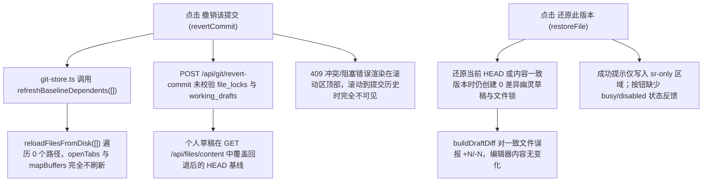

# Phase 13 补充修复方案：还原此版本（Restore）与撤销该提交（Revert）前端无响应根因与测试构建

- **状态**：✅ 已完成并归档（commit `dd2bf32`）
- **关联基线**：[`docs/plans/phase13-versioning-overlay.md`](./phase13-versioning-overlay.md)
- **问题现象**：在左侧版本面板（`GitPanel`）的提交历史中点击 **还原此版本**（`restoreFile`）或 **撤销该提交**（`revertCommit`）后，前端编辑器与界面没有可见变化。

---

## 1. 根因分析

结合代码链路追踪与运行中工作区（`samples/demo-dita-project`）的实时状态与审计日志分析，问题由 **4 个叠加缺陷**共同导致：



### 1.1 `revertCommit` 传入空路径列表，前端永远不重载已打开文件
- 在 `apps/web/src/store/git-store.ts` 中，`revertCommit()` 调用 `await refreshBaselineDependents([])`，导致 `editor.reloadFilesFromDisk([])` 遍历 0 次，当前打开的 Topic 标签页（`openTabs`）和 Map 缓冲区（`mapBuffers`）均未被重新拉取（`commitExternal()` 存在同样问题）。
- 后端 `POST /api/git/revert-commit`（`apps/api/src/modules/git/routes.ts`）未返回此次撤销提交实际变更的文件列表 `changedFiles`。
- `reloadFilesFromDisk()`（`apps/web/src/store/editor-store/slices/workspace.ts`）存在以下隐患：
  - 当文件因撤销/合并被删除（`GET /api/files/content` 返回 404）时直接 `catch { continue }`，导致已删除文件的标签页残留过期内容；
  - 在异步 `await fetchFileContent` 之前读取 `openTabs`/`mapBuffers` 快照，结束时整体覆盖，可能覆盖并发状态更新；
  - 未同步更新 `topicTitles`，也未清理被重载文件的陈旧 `contentConflict` 横幅。

### 1.2 `POST /api/git/revert-commit` 未检查文件锁与个人草稿，导致草稿遮蔽回退结果
- 在 Phase 13「干净基线 + 个人草稿叠加层」架构下，共享工作区始终干净处于 `HEAD`，未提交修改保存在 SQLite `working_drafts`。
- `POST /api/git/revert-commit` 执行前未校验目标提交涉及路径是否存在活动锁或未提交草稿：
  - 一旦当前用户对受影响文件持有个人草稿，即便 `git revert` 成功推进了 `HEAD` 且前端重新请求 `/api/files/content`，`readFileWithOverlay()` 仍优先返回个人草稿，从而**彻底遮蔽回退后的基线内容**；
  - 若其他协作者对受影响文件持有文件锁，直接改写基线也违背了与 `merge` / `restore-file (mode=commit)` 一致的锁保护不变量。

### 1.3 `restoreFile` 对与 `HEAD` 一致的版本创建 0 差异幽灵草稿，且 Diff 统计失真
- `GitPanel` 在当前 `HEAD` 提交行同样展示 **还原此版本**，后端 `POST /api/git/restore-file`（`mode: 'draft'`）在目标版本内容与当前 `HEAD` 字节完全一致时仍强行加锁并写入 `op: 'edit'` 草稿：
  - 编辑器内容无任何变化，却凭空多出 1 条无差异的「我的草稿」，后续签入时还会因 `git.noCommitChanges`（409）失败；
  - `buildDraftDiff()`（`apps/api/src/modules/git/routes.ts`）直接用 `countLines(newText)` / `countLines(oldText)` 代替真实行差异统计，导致完全一致的文件也被显示为 `+N / -N`；
  - 若还原一个在当前 `HEAD` 中已被删除的历史文件，`upsertTextDraft` 硬编码 `op: 'edit'` 而非 `'create'`。

### 1.4 `GitPanel` 反馈不可见且错误条位于滚出视口顶部
- `{error}` 提示条渲染在 `GitPanel` 滚动容器最顶部，而「提交历史」区块位于面板最底部；用户滚到底部点击按钮触发 `409 git.revertConflict` 或锁/草稿阻塞时，报错在视口上方 600px 外，视觉上等同于「点击毫无反应」。
- 操作成功时仅通过 `announce()` 写入 `<p role="status" className="sr-only">`，对普通视觉用户完全不可见。
- **还原此版本** 与 **撤销该提交** 按钮缺少 `disabled` / 加载态；操作完成后若「版本操作日志」已展开，审计列表也未自动刷新。

---

## 2. 已确认的核心策略决策

1. **撤销提交（`revert-commit`）遇到锁或草稿时的安全阻塞策略**：
   - 与 `merge` 保持一致，当目标提交涉及的任意路径存在活动文件锁或未提交个人草稿（无论归属当前用户还是其他成员）时，返回 `409` 并明确列出阻塞文件路径，提示用户先签入或放弃草稿，绝不静默丢弃草稿或放任草稿遮蔽基线。
2. **还原此版本（`restore-file`, `mode: 'draft'`）命中与 `HEAD` 一致内容时的策略**：
   - 若调用方当前对该文件已有个人草稿，则删除该冗余草稿（返回 `clearedDraft: true`），使编辑器与覆盖层干净回到基线 `HEAD`；
   - 若调用方当前没有草稿，则不加锁、不创建幽灵草稿，直接返回 `unchanged: true`，前端弹出明确可见提示（“该版本内容与当前一致，无需还原”）。

---

## 3. 详细改动设计

### 3.1 后端 Git 与覆盖层安全（`@dita/api`）

#### 修改 `apps/api/src/modules/git/git-manager.ts`
- 新增 `commitChangedFiles(workDir: string, revision: string): Promise<string[]>`：
  - 通过 `git diff-tree --no-commit-id --name-only -r --root <revision>` 提取指定提交变更/新增/删除的 POSIX 路径列表，供 `revert-commit` 事前校验锁/草稿以及事后向前端返回 `changedFiles`。

```ts
async commitChangedFiles(workDir: string, revision: string): Promise<string[]> {
  if (!this.isRepository(workDir)) return [];
  const safeRev = validateRevisionRef(revision);
  const raw = await this.client(workDir).raw([
    'diff-tree',
    '--no-commit-id',
    '--name-only',
    '-r',
    '--root',
    safeRev,
  ]);
  return raw
    .split('\n')
    .map((line) => line.trim())
    .filter(Boolean);
}
```

#### 修改 `apps/api/src/modules/git/routes.ts`
1. **`POST /api/git/revert-commit`**：
   - 预检：`targetPaths = await git.commitChangedFiles(scope.workDir, revision)`。
   - 检查 `locks.list(scope.projectId, scope.branch)` 与 `options.drafts?.listBranchDrafts(scope.projectId, scope.branch)`（包含 `rename` 草稿的 `originalPath`），若与 `targetPaths` 有交集则抛出 `409`（`git.revertBlockedByLocks` / `git.revertBlockedByDrafts`），携带 `{ paths, locks }` 详情。
   - 执行 `git.revertCommit(...)` 后计算新提交的 `changedFiles = await git.commitChangedFiles(scope.workDir, commit.hash)`（为空时回退 `targetPaths`），调用 `notifyBaselineChanged(scope)`，返回 `{ commit, changedFiles, status }`。
2. **`POST /api/git/restore-file`（`mode: 'draft'`）**：
   - 读取 `headContent = await git.fileAtRevision(scope.workDir, 'HEAD', filePath)`，判定 `existsInBaseline = headContent !== null`。
   - 若 `headContent !== null && content === headContent`：
     - 存在当前用户草稿：调用 `deleteUserDraft` 清理冗余草稿，记录审计并返回 `{ path: filePath, revision, mode, unchanged: false, clearedDraft: true, contentHash: computeContentHash(content) }`；
     - 不存在草稿：不加锁、不写草稿，返回 `{ path: filePath, revision, mode, unchanged: true, contentHash: computeContentHash(content) }`。
   - 否则按既有流程 `locks.checkout({ ..., allowMissing: true })` 并写入草稿，`op` 按 `existsInBaseline ? 'edit' : 'create'` 设定，返回 `{ path: filePath, revision, mode, unchanged: false, contentHash: draft.contentHash }`。
3. **`buildDraftDiff()`**：
   - 使用真实的逐行差异统计（例如复用 `@dita/core` 的 `computeXmlLineDiffStats(oldText ?? '', newText)`）计算 `additions` 与 `deletions`，消除相同文件内容误报 `+N / -N` 的问题。

#### 修改 `apps/api/src/i18n/messages.ts`
- 新增中英双语错误文案：
  - `git.revertBlockedByLocks`
  - `git.revertBlockedByDrafts`

---

### 3.2 前端 API 客户端与状态管理（`@dita/web`）

#### 修改 `apps/web/src/services/git-api.ts`
- 扩展 `restoreGitFile` 返回类型：`unchanged?: boolean`、`clearedDraft?: boolean`、`contentHash?: string`。
- 扩展 `revertGitCommit` 返回类型：`changedFiles?: string[]`。

#### 修改 `apps/web/src/store/editor-store/slices/workspace.ts`
- 加固 `reloadFilesFromDisk(filePaths: string[])`：
  - 先并行或顺序拉取所有唯一路径，区分 `404`（文件已在基线/覆盖层中被删除）与瞬时错误；
  - 使用函数式 `set((s) => ...)` 原子合入状态，避免覆盖异步请求期间的并发变更：
    - 存在的文件：更新对应 `openTabs` 的 `xml`、`baselineXml`、`xmlError`、`switchBlockedReason: null`、`visualReloadToken + 1`、`title`、`contentHash`，同步更新 `topicTitles[filePath]` 与 `mapBuffers[filePath]`，并清理匹配路径的 `contentConflict`；
    - 确认 404 的文件：从 `openTabs` 关闭对应标签页（若为当前激活标签则切换到相邻标签或 `null`），从 `mapBuffers` 移除并清理对应 `contentConflict`。

#### 修改 `apps/web/src/store/git-store.ts`
- 新增可见操作反馈状态：`notice: { id: number; tone: 'success' | 'info'; message: string } | null` 与 `clearNotice()`。
- 增强 `refreshBaselineDependents(paths: readonly string[], options?: { reloadAllOpen?: boolean })`：
  - 当 `options?.reloadAllOpen` 为 `true`（或基线级变更且 `paths` 为空）时，合并 `paths ∪ openTabs.map(t => t.path) ∪ Object.keys(mapBuffers)` 后调用 `editor.reloadFilesFromDisk(...)`；
  - 若 `auditLogs.length > 0`，同步刷新 `loadAudit({ limit: 50 })`。
- 更新 `restoreFile(input)`：
  - 根据返回值 `unchanged` / `clearedDraft` 展示对应的可见 `notice`（含短哈希 `shortCommitHash(input.revision)`）；
  - 当 `input.mode === 'commit'` 时同步刷新 `loadHistory(get().historyPath)`。
- 更新 `revertCommit(commitHash)`：
  - 读取 `changedFiles = response.changedFiles ?? []`；
  - 调用 `refreshBaselineDependents(changedFiles, { reloadAllOpen: changedFiles.length === 0 })`；
  - 刷新历史并展示成功 `notice`。
- 更新 `commitExternal(message)`：
  - 改为 `refreshBaselineDependents([], { reloadAllOpen: true })`，修复同类不刷新标签页问题。

---

### 3.3 前端交互与双语文案（`@dita/web`）

#### 修改 `apps/web/src/components/GitPanel.tsx`
- 将 `{error}` 移出滚动区域，与新增的可关闭 `{notice}` 横幅一起固定渲染在面板标题栏正下方（非滚动区），确保用户滚动至提交历史底部操作时，无论成功、无变更提示还是 409 冲突报错均立即可见。
- 为 **还原此版本** 和 **撤销该提交** 按钮绑定 `disabled={loading || (Boolean(activePath) && busyPath === activePath)}` 与 `disabled:opacity-50` 样式。
- 在提交历史中为匹配 `status?.lastCommit?.hash` 的提交显示 `当前 HEAD` / `HEAD` 徽标。

#### 修改 `apps/web/src/i18n/messages/zh-CN/collab.ts` 与 `apps/web/src/i18n/messages/en/collab.ts`
- 新增双语文案键：
  - `gitStatus.restoredUnchanged`：`'文件 {path} 当前内容已与 {revision} 版本一致，无需还原'` / `'File {path} already matches revision {revision}; nothing to restore'`
  - `gitStatus.restoredClearedDraft`：`'已将 {path} 还原至基线版本 {revision}，并清理了冗余草稿'` / `'Restored {path} to baseline {revision} and cleared the redundant draft'`
  - `git.headBadge`：`'当前 HEAD'` / `'HEAD'`
  - `git.dismissNotice`：`'关闭提示'` / `'Dismiss notice'`

---

## 4. 测试用例构建计划

### 4.1 后端集成测试（新建 `apps/api/test/git-restore-revert.test.ts`）

| 用例编号 | 测试场景 | 预期断言 |
| --- | --- | --- |
| API-1 | `POST /api/git/revert-commit` 正常回退修改与删除文件的提交 | 返回 `200`、新 `commit` 与准确的 `changedFiles`；工作区基线内容回退且 `git status` 干净 |
| API-2 | `POST /api/git/revert-commit` 目标提交涉及他人锁定的文件 | 返回 `409`（`git.revertBlockedByLocks`），基线未变动，不残留 `REVERT_HEAD` |
| API-3 | `POST /api/git/revert-commit` 目标提交涉及当前用户的未提交个人草稿 | 返回 `409`（`git.revertBlockedByDrafts`），阻断草稿遮蔽基线，个人草稿完整保留 |
| API-4 | `POST /api/git/restore-file`（`mode: 'draft'`）还原历史差异版本 | 自动检出并更新个人草稿，`GET /api/files/content` 返回历史版本内容，`unchanged: false` |
| API-5 | `POST /api/git/restore-file` 还原与当前 `HEAD` 字节一致的版本（无草稿） | 返回 `200` 且 `unchanged: true`，不加锁、不生成幽灵草稿（`userDrafts` 为空） |
| API-6 | `POST /api/git/restore-file` 还原与当前 `HEAD` 字节一致的版本（已有修改草稿） | 清理冗余草稿，返回 `clearedDraft: true`，`GET /api/files/content` 回到 `HEAD`，`userDrafts` 为空 |
| API-7 | `POST /api/git/restore-file` 还原在 `HEAD` 中已删除的历史文件 | 创建 `op: 'create'` 草稿，`GET /api/files/content` 可重新读取该文件 |
| API-8 | `GET /api/git/diff` 对个人草稿计算差异统计 | 内容一致时 `additions === 0 && deletions === 0`；单行修改时统计精确 |

### 4.2 前端 Store 与组件测试（新建 `apps/web/test/git-restore-revert.test.tsx`）

| 用例编号 | 测试场景 | 预期断言 |
| --- | --- | --- |
| WEB-1 | `revertCommit()` 收到 `changedFiles` | 已打开的 Topic Tab 与 `mapBuffers` 均被重载；`xml`/`baselineXml`/`title`/`topicTitles`/`contentHash` 更新；`visualReloadToken` 自增（驱动 ProseMirror 重建与 CodeMirror 同步）；历史刷新且生成可见 `notice` |
| WEB-2 | `revertCommit()` 未返回 `changedFiles`（空数组/兼容旧响应） | 自动回退为重载所有已打开的 `openTabs` 与 `mapBuffers` |
| WEB-3 | `revertCommit()` 撤销创建提交导致已打开文件返回 404 | 自动关闭被删除文件的 Tab（并切换 `activeTabPath`），清理 `mapBuffers` 与 `contentConflict` |
| WEB-4 | `revertCommit()` 遭遇 409 冲突或草稿阻塞 | `error` 写入可读错误消息，已打开 Tab 的 `xml` 不被破坏 |
| WEB-5 | `restoreFile()` 还原历史版本 | 目标 Tab 内容更新、`visualReloadToken` 自增、清理陈旧 `contentConflict`、`userDrafts` 更新、设置成功 `notice` |
| WEB-6 | `restoreFile()` 返回 `unchanged: true` 与 `clearedDraft: true` | 分别设置对应的提示 `notice`（`info` / `success`），状态干净无错误 |
| WEB-7 | `commitExternal()` 提交外部改动 | 重载当前所有已打开 Tab 与 `mapBuffers` 而非传空数组 |
| WEB-8 | `GitPanel` SSR 渲染不变量 | `error` 与 `notice` 位于滚动容器之外（标题栏下方）；`loading` 或 `busyPath === activePath` 时「还原此版本」「撤销该提交」按钮带 `disabled`；当前 `HEAD` 提交渲染 `HEAD` 徽标 |

---

## 5. 验证计划

### 5.1 自动化验证命令
```bash
pnpm --filter @dita/api test
pnpm --filter @dita/web test
pnpm -r build && pnpm -r typecheck && pnpm -r test
graphify update .
```

### 5.2 手工端到端验收
1. 打开手册工作台并打开 `concepts/single-sourcing.dita`（分别验证 Visual / Source / Split 模式）。
2. 在左侧 Git 面板滚动到底部「提交历史」：
   - 对较早提交点击 **还原此版本**：顶部固定提示条立即显示成功反馈，「我的草稿」同步更新，编辑区立即切换为该历史版本内容；
   - 持有草稿时对 `当前 HEAD` 点击 **还原此版本**：冗余草稿被清理，编辑区回到 `HEAD`；再次点击时提示「内容已一致，无需还原」，不生成幽灵草稿；
   - 草稿干净时对 `HEAD` 点击 **撤销该提交**：新反向提交出现在历史顶部，顶部固定提示条显示成功反馈，编辑区内容立即同步回退；
   - 存在未提交草稿时对涉及该文件的提交点击 **撤销该提交**：顶部固定错误条立即展示草稿/锁阻塞提示（无需滚动即可看到）。
