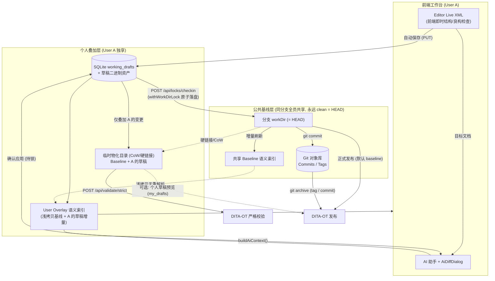

# Phase 13 规划与实施蓝图：Git 干净基线 + 个人草稿叠加层（版本管理重构与合并闭环）

> **状态**：✅ 已实施完成（Stage 1–3 后端、前端工作台与回归测试矩阵全量通过）  
> **上游架构基线**：[architecture-and-plan.md](../architecture-and-plan.md)（Phase 0–12 已完成）  
> **关联架构决策**：[ADR 0001](../adr/0001-manual-as-independent-workspace.md)、[ADR 0002](../adr/0002-per-request-manual-isolation.md)、[ADR 0003](../adr/0003-soft-assignments-in-sqlite.md)、[ADR 0004](../adr/0004-baseline-and-draft-overlay.md)

---

## 1. 背景、核心问题与目标架构

在 Phase 4 与 Phase 10 落地的「分支 = 目录、保存直接写 `workDir`」模型中，已暴露出三类根源性问题：

1. **同分支半成品互相污染**：同一分支所有作者共享 1 个物理 `workDir`，作者 A 自动保存的未检入/畸形 XML 会立即污染作者 B 的语义诊断、DITA-OT 严格校验与 HTML5/PDF 发布快照。
2. **状态机与并发漏洞**：删除/重命名已跟踪文件触发检入死锁；`release` 制造无主脏文件；`admin` 免锁写与 `checkin` 规则自相矛盾；锁续期 `isExpired()` 误用 `lockedAt`；只读 `GET` 请求会静默执行 `git worktree add -b` 创建垃圾分支；首屏并发缺单飞锁；`slugifyBranch` 存在目录名碰撞；`discard` 绕过语义索引刷新。
3. **版本闭环与溯源缺失**：发布未记录 `commit_hash` 与 `is_dirty`；无发布基线（Tag）、无安全回滚、无无污染分支合并、无分支/worktree 清理；仓库 ID 强绑定绝对路径 `sha1(rootDir)`。

### 1.1 目标架构：Git 干净基线 + 个人草稿叠加层

在坚守 DITAEditor **“标准 DITA XML & Git 为唯一真相源、单容器零外部中间件、1 分支 = 1 worktree”** 定位的前提下，彻底解耦 **“公共基线（`workDir = HEAD`）”** 与 **“个人未检入草稿（`working_drafts`）”**：

```text
Manual (持久化独立 ID，解耦物理路径；1 手册 = 1 Git 仓库)
  ├── Branch (协作 / 维护线：1 活跃分支 = 1 worktree，磁盘 workDir 永远保持 clean = HEAD)
  │     ├── Shared Baseline (公共基线：workDir + 共享只读基线 DitaSemanticIndex)
  │     └── User Overlay (个人叠加层：file_locks + working_drafts + 草稿二进制资产)
  │           └── 仅持锁用户本人可见；签入时原子落盘并 git commit 推进 Baseline
  └── Baseline Tag (不可变发布标签：绑定确定 Commit SHA，供纯净发布与复现)
```

### 1.2 三层视图定义

| 视图 | 数据来源 | 可见范围 | 何时变化 |
| :--- | :--- | :--- | :--- |
| **1. 公共基线（`Baseline`）** | 当前分支 `workDir`（始终等于 Git `HEAD`） | 同分支全员共享、只读 | 仅在 **签入（Check-in）**、**合并（Merge）**、**回滚（Revert）** 时原子推进 |
| **2. 个人叠加视图（`User Overlay`）** | `Baseline` + **仅当前用户自己**的 `working_drafts`（`edit` / `create` / `delete` / `rename`） | 仅当前登录用户可见，完全屏蔽同分支他人草稿 | 用户保存、新建、删除、重命名、上传草稿图片、取消检出时 |
| **3. 编辑器瞬时内容（`Editor Live XML`）** | 浏览器当前打开 Tab 内存中的最新 XML 字符串 | 仅当前标签页 | 每次按键 / ProseMirror 事务 / CodeMirror 变更 |

### 1.3 五条工程不变量

1. **共享 `workDir` 永远干净**：普通保存、新建、删除、重命名均写 `working_drafts`，绝不直接修改共享 `workDir`；同分支多人编辑同一 Map 下的不同 Topic 仍仅需 **1 个 worktree** 且完全零污染。
2. **只读请求零写副作用**：任何 `GET` 请求绝不隐式创建分支或 worktree，绝不覆写进程级默认分支。
3. **单文件独占锁保证零冲突签入**：签入路径必由当前用户持锁，推进 `Baseline` 时无文件级冲突；签入失败自动还原 `workDir`，草稿零丢失。
4. **发布可溯源、可复现**：正式发布默认基于干净基线（`HEAD` / `Tag` / `Commit`），落库 `commit_hash`、`source_mode` 与 `is_dirty`。
5. **零 XML / Git 污染**：草稿、锁、审计日志、保护分支策略全部落 SQLite；草稿二进制资产存放在仓库外目录；手册解耦 ID 写入 `.git/ditaeditor-id`（位于 `.git/` 内部，不出现在工作区与 Git Diff 中）。

---

## 2. 四大核心操作的对象边界

| 操作 | 读取对象（输入源） | 写入 / 产出对象 | 是否受同分支他人草稿影响 |
| :--- | :--- | :--- | :--- |
| **1. 签入（Check-in）** | 当前用户勾选的 `working_drafts`；Diff 对比源为当前分支 `HEAD` | **推进 `Baseline`**（原子写入 `workDir` → `git commit` → 删草稿与锁 → 同步任务重命名 → 刷共享基线索引） | ❌ 不受影响 |
| **2. 语法检查（Validation）** | • 编辑器实时结构检查：`Editor Live XML`<br>• 跨文件语义检查：`User Overlay` 索引<br>• DITA-OT 严格校验：`User Overlay` 临时物化目录（默认 `scope='my_drafts'`）或纯 `Baseline`（`scope='baseline'`） | 只读诊断列表（不改草稿、不改基线） | ❌ 不受影响 |
| **3. AI 辅助编写（AI Authoring）** | • 目标文档：`Editor Live XML`（缺省回落 `User Overlay`）<br>• 全书语义上下文（`keyspace` / `topicIndices` / `profiling`）：`User Overlay` 索引<br>• *(远期 RAG)*：已发布的 `Baseline` / `Tag` 产物 | • `ask`：只读回答（无需锁）<br>• `authoring` / `optimize_tags` / `fix_error`：经 `@dita/core` 校验 + `AiDiffDialog` 确认后**仅写入当前用户的 `working_drafts`** | ❌ 不受影响 |
| **4. 发布（Publish）** | • **正式发布（默认）**：纯 `Baseline`（当前分支 `HEAD` / 指定 `Commit` / `Tag`）<br>• **个人草稿预览（可选）**：`User Overlay`（`HEAD` + 仅发布者本人草稿） | 只读 HTML5/PDF 产物与溯源记录（`commit_hash`、`source_mode`、`is_dirty`） | ❌ 正式发布零草稿；个人预览也**只含自己草稿** |



### 2.1 与既有模块/ADR 的关键协同规则

1. **草稿图片 URL 携带身份（衔接 ADR 0002）**：浏览器 `` 无法发送 `x-dita-user-id` 请求头，因此工作区图片 URL 除 `manualId` / `branch` query 参数外，同步携带可选 `userId` query 参数（与现有轻量免密身份模型一致），使 `asset-routes.ts` 能为作者实时渲染其未签入的草稿图片，同时向其他用户隐藏未签入图片。
2. **Topic 委派路径同步时机（衔接 ADR 0003）**：作者在草稿期执行 `rename` 时，同分支其他人仍处于旧路径基线，因此 **`topic_assignments.topic_path` 仅在「签入（Check-in）」成功推进公共基线后才同步更新**，绝不在草稿期提前改写共享任务路径。
3. **HTML5 主题 Logo 与自定义 CSS 解析源（衔接 Phase 12 / `AGENTS.md §4.9`）**：`Html5ThemeEnhancer` 解析工作区 Logo 与自定义 CSS 时，一律基于本次构建的 **`snapshotDir`** 执行 `resolveSafeWorkspacePath(snapshotDir, ...)`，确保 `tag` / `commit` 发布使用对应历史基线中的品牌资产，`my_drafts` 预览自动使用本人草稿中的最新资产。
4. **`@dita/core` 严格同构（衔接 `AGENTS.md §4.5`）**：`DitaSemanticIndex.cloneWithOverlay()` 仅操作纯内存 JS `Map`，严禁引入任何 `node:*` 模块，确保前端离线工作台与后端共享同一实现。

---

## 3. 核心底层机制设计

### 3.1 SQLite 数据模型

#### ① `working_drafts`（新增）

```sql
CREATE TABLE IF NOT EXISTS working_drafts (
  id TEXT PRIMARY KEY NOT NULL,
  project_id TEXT NOT NULL,
  branch TEXT NOT NULL,
  file_path TEXT NOT NULL,              -- 变更后的目标 POSIX 路径
  user_id TEXT NOT NULL,
  op TEXT NOT NULL,                     -- 'edit' | 'create' | 'delete' | 'rename'
  original_path TEXT,                   -- 仅 op='rename' 时非空，记录基线原路径
  content TEXT,                         -- UTF-8 文本内容；delete 或二进制资源时为 NULL
  asset_blob_path TEXT,                 -- 二进制草稿暂存路径（相对 draftAssetsRootDir），文本文件为 NULL
  base_commit TEXT,                     -- 创建草稿时的基线 HEAD SHA
  content_hash TEXT,                    -- sha256(content) 前 16 位，供 PUT 乐观并发校验
  updated_at INTEGER NOT NULL
);
CREATE UNIQUE INDEX IF NOT EXISTS working_drafts_scope_unique
  ON working_drafts (project_id, branch, file_path);
CREATE INDEX IF NOT EXISTS working_drafts_user_idx
  ON working_drafts (project_id, branch, user_id);
```

- 重命名已跟踪文件 `a.dita → b.dita` 时，在单事务中锁定 `a.dita` 与 `b.dita` 双路径，并在 `working_drafts` 写入 `op = 'rename', original_path = 'a.dita', file_path = 'b.dita'`，彻底消除删除/重命名检入死锁。

#### ② `publish_jobs`（幂等 `ALTER TABLE` 增量迁移）

```sql
ALTER TABLE publish_jobs ADD COLUMN source_mode TEXT NOT NULL DEFAULT 'baseline';
ALTER TABLE publish_jobs ADD COLUMN source_ref TEXT;
ALTER TABLE publish_jobs ADD COLUMN commit_hash TEXT;
ALTER TABLE publish_jobs ADD COLUMN is_dirty INTEGER NOT NULL DEFAULT 0;
ALTER TABLE publish_jobs ADD COLUMN dirty_files_json TEXT;
```

#### ③ `version_audit_logs`（新增）

```sql
CREATE TABLE IF NOT EXISTS version_audit_logs (
  id TEXT PRIMARY KEY NOT NULL,
  project_id TEXT NOT NULL,
  branch TEXT NOT NULL,
  actor_id TEXT NOT NULL,
  action TEXT NOT NULL,                 -- checkout | release | handoff | cancel | force_unlock | checkin |
                                        -- branch_create | branch_delete | tag_create | merge | restore | revert | publish
  target_path TEXT,
  details_json TEXT NOT NULL DEFAULT '{}',
  created_at INTEGER NOT NULL
);
CREATE INDEX IF NOT EXISTS version_audit_project_time_idx
  ON version_audit_logs (project_id, created_at DESC);
```

#### ④ `manuals`（增量迁移，Stage 3 保护分支配置）

```sql
ALTER TABLE manuals ADD COLUMN protected_branches_json TEXT NOT NULL DEFAULT '["main"]';
```

### 3.2 `User Overlay` 读写与语义索引叠加

- **文件层（`OverlayWorkspaceView`）**：
  - 文件树扫描：基于干净 `workDir` 树，仅对当前用户隐藏其 `delete` / `rename.original_path`，并挂载其 `create` / `rename.file_path` 与最新草稿标题。
  - 文本读取：优先返回当前用户草稿 `content` 与 `contentHash`，否则读基线 `workDir` 并计算 `contentHash`。
  - 文本保存：校验锁与可选 `expectedHash`，仅更新 `working_drafts` 与 `file_locks.updated_at`。
  - 草稿二进制资产：上传至 `<dataRoot>/draft-assets/<projectId>/<draftId><ext>`（不在 Git 仓库内），签入时移入 `workDir` 一并提交，取消检出时删除。
- **语义索引层（`DitaSemanticIndex.cloneWithOverlay()`）**：
  - 浅拷贝共享基线索引中的 `fileContents`、`parsedDocs`、`xmlErrors`、`topicIndices`、`parsedDitavals`、`keyspaceCache`（**零未改动 XML 重解析**）；
  - 仅对当前用户草稿中的变更项（通常 1–5 个文件）执行增量 `removeFile()` / `updateFile()`；
  - `WorkspaceSemanticIndexer` 按 `(manualId, branch, userId, baselineRev, draftRev)` 缓存轻量 Overlay 索引，签入推进基线时递增 `baselineRev` 自动失效。

### 3.3 锁规则收口与签入原子闭环

1. **修复续期**：`isExpired(row.updatedAt)` 替代 `isExpired(row.lockedAt)`；支持可选 `DITA_LOCK_AUTO_RECLAIM_CLEAN` 自动回收超时且无草稿改动的空闲锁。
2. **收紧 `release` + 新增 `handoff`**：`POST /api/locks/release` 仅允许无草稿改动（clean）时释放，有草稿改动返回 `409 locks.releaseDirtyBlocked`；新增 `POST /api/locks/handoff`（`{ path, targetUserId }`）在单事务中转移锁与草稿所有权，彻底消灭无主脏文件。
3. **统一 `admin` 写/提交规则**：文件被他人锁定时 `admin` 保存同样返回 `409`，须先 `force-unlock`（将原持锁人草稿全文与相对 `HEAD` 的补丁写入 `lock_backups` 并清理原草稿）再接管；未锁文件写入时自动隐式加锁并写个人草稿，确保后续可直接 `checkin`。
4. **取消检出（`POST /api/locks/cancel`）**：单事务删除 `working_drafts` + 暂存图片 + `file_locks`，递增 `draftRev`，**无需调用 Git 命令**。
5. **签入（`POST /api/locks/checkin`）**：在 `withWorkDirLock(workDir)` 内原子落盘草稿 → `git add` → `git commit --author=<真实用户>` → SQLite 单事务清理草稿与锁 + 同步 `topic_assignments` 重命名 + 写审计日志 → 增量刷新共享基线索引；任何 Git 异常立即还原 `workDir` 回 `HEAD`，草稿与锁完好保留。

### 3.4 桌面端 / 外部编辑器改盘兼容

- 针对 `apps/desktop` 或本机直接用 VS Code / Oxygen 改动 `workDir` 磁盘的场景：
  - `GET /api/git/status` 与 `checkin` 前探针检测 `git status --porcelain`；
  - 若存在外部未提交改动，前端展示非侵入提示条提供「提交外部改动到基线」或「丢弃外部改动」；
  - 签入个人草稿时若与外部脏路径冲突返回 `409 git.externalDirtyConflict` 拒绝覆盖，不重叠路径则安全提交 `git commit -- <affectedPaths>`。

---

## 4. 分阶段实施切片

### Stage 1（P0）：草稿叠加层底座 + 并发与状态机止血（2–3 天）
- 落地 `working_drafts` 表、`DraftService`、`OverlayWorkspaceView`、草稿图片资产读写（`userId` query 参数）；
- 改造文件读写/删除/重命名与锁服务（原子签入、瞬间取消、`release` 收紧 + `handoff`、统一 `admin`、修复 `isExpired(updatedAt)`）；
- 改造 `GitManager` 与 `ManualContextResolver`（`ensureWorktree` 默认 `createIfMissing = false` 禁止 GET 隐式建分支、放开 `viewer` 切换已有分支、`createBranch` 支持 `baseBranch`、`inflightWorktrees` / `inflightSessions` 单飞锁、`withWorkDirLock` 互斥锁、防碰撞目录名 `${slug}-${sha1(branch).slice(0, 8)}`、消除全局 `defaultBranchByManual` 跨用户串台）；
- `@dita/core` 新增 `DitaSemanticIndex.cloneWithOverlay()`；语义索引、`/api/diagnostics`、`/api/validate/strict`（默认 `my_drafts` 临时物化目录）、`/api/ai/stream` 全量接入 `User Overlay`。

### Stage 2（P1）：基线发布、Tag、乐观锁、路径解耦与审计（2 天）
- `publish_jobs` 溯源列升级与 `PublishService` 四态构建（`baseline` 默认 / `tag` / `commit` / `my_drafts`），HTML5 主题 Logo/CSS 统一从 `snapshotDir` 解析；
- 新增 `GET/POST/DELETE /api/git/tags` 与前端发布基线交互；
- `GET/PUT /api/files/content` 接入 `contentHash` / `expectedHash` 乐观并发防覆写（`409 files.staleContent` + MergeView）；
- 新建手册采用独立 UUID 并持久化至 `.git/ditaeditor-id`，目录迁移后 `attach` 自动认回原 `manualId`（旧手册向后兼容并懒回填）；
- 落地 `version_audit_logs` 与 `GET /api/git/audit`。

### Stage 3（P2）：无污染分支合并、安全回滚与生命周期清理（3–4 天）
- 安全回滚：`POST /api/git/restore-file`（恢复历史版本进草稿或直提）与 `POST /api/git/revert-commit`（冲突自动 `--abort`）；
- 无污染合并：`GET /api/git/merge-preview`（`git merge-tree --write-tree` 纯内存预检 `ahead/behind`、冲突与锁阻塞）、`GET /api/git/merge-conflict`、`POST /api/git/merge`（前端 MergeView 求解 + `@dita/core` 良构校验 + 隔离合成 merge commit，共享 `workDir` 永不残留 `MERGING` 态）；
- 保护分支配置、`DELETE /api/git/branches/:branch`（安全删分支 + `git worktree remove`）、24h 孤儿 worktree 与过期草稿资产巡检、`DITA_MAX_CACHED_SESSIONS` 可配 + 30 分钟空闲索引回收。

---

## 5. 改动文件索引

| 阶段 | 模块 / 文件 |
| :--- | :--- |
| **P0** | `packages/dita-core/src/semantics/semantic-engine.ts` |
| **P0** | `apps/api/src/db/{schema,client}.ts`、`apps/api/src/modules/locks/{draft-service,lock-service,routes}.ts` |
| **P0** | `apps/api/src/modules/files/{routes,asset-routes,workspace-fs}.ts`、`apps/api/src/modules/indexer/semantic-indexer.ts` |
| **P0** | `apps/api/src/modules/validate/{routes,strict-validator}.ts`、`apps/api/src/modules/ai/{routes,ai-context}.ts` |
| **P0** | `apps/api/src/modules/git/{git-manager,routes}.ts`、`apps/api/src/modules/manuals/manual-context-resolver.ts` |
| **P1** | `apps/api/src/modules/publish/{publish-service,routes,theme-enhancer}.ts`、`apps/api/src/modules/manuals/manual-registry-service.ts`、`apps/api/src/modules/git/audit-service.ts` |
| **P2** | `apps/api/src/modules/git/merge-service.ts` |
| **P0–P2** | `apps/web/src/store/{git-store,editor-store}/`、`apps/web/src/components/{GitPanel,CheckinDialog,PublishDialog,MergeDialog}.tsx`、`apps/web/src/i18n/` |

---

## 6. 验收与回归测试矩阵

每阶段均需通过 `pnpm -r build && pnpm -r typecheck && pnpm -r test` 并补充专项集成测试：

1. **同分支草稿隔离**：A 在 `main` 写入畸形 XML 草稿、B 合法编辑另一 Topic → `workDir` 始终 clean；B 的文件读取、语义诊断、DITA-OT 严格校验、AI 编写完全不受 A 影响；A 的校验能准确发现自身错误。
2. **删除 / 重命名 / 移交 / 取消闭环**：删除已跟踪文件可正常签入提交或取消恢复；重命名已跟踪文件签入生成标准 Git Rename 且仅在签入后同步 `topic_assignments.topic_path`；`release` 脏草稿返 `409`；`handoff` 完整转移锁与草稿。
3. **只读安全与并发单飞**：`viewer` 带不存在分支头访问 GET 返 `404` 且零新分支/worktree；`viewer` 可切换已有分支；10 路并发访问新分支仅建 1 次 worktree 与索引；`release/2.0` 与 `release__2.0` 无目录碰撞；`admin` 不可静默覆盖他人锁。
4. **基线发布、乐观锁与路径解耦**：存在未检入破损草稿时，默认 `baseline` 发布构建成功（`is_dirty=0`、`commit_hash=HEAD`）；`my_drafts` 仅包含发起人草稿；双写同 `expectedHash` 后写返 `409`；移动目录后重新 `attach` 凭 `.git/ditaeditor-id` 自动认回原 `manualId`。
5. **合并、回滚与回收**：无冲突与 XML 冲突合并（拒绝畸形 XML 解），目标 `workDir` 全程不进入半截 `MERGING` 态；单文件恢复、Commit Revert 与删分支 worktree 回收全部通过。
