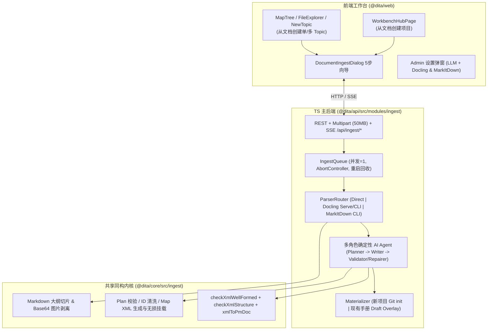

# Phase 14 规划与实施蓝图：文档智能导入与 AI Agent 撰写校验闭环（Docling + MarkItDown → Markdown → DITA）

> **状态**：✅ 已实施完成（Stage 1–4B 全部落地：`@dita/core` 同构导入内核、SQLite `ingest_parser_settings` / `ingest_jobs`、Docling + MarkItDown 双解析器、多角色 Agent、Materializer、REST + SSE 路由、前端 5 步向导、`Dockerfile` 可选 MarkItDown 与根级 `docker-compose.yml`）  
> **上游架构基线**：[architecture-and-plan.md](../architecture-and-plan.md)（Phase 0–13 已完成）  
> **关联架构基线**：[ai-contract.md](../design/ai-contract.md)、[phase13-versioning-overlay.md](./phase13-versioning-overlay.md)、[checkin-validation-ai-fix.md](./checkin-validation-ai-fix.md)

---

## 1. 目标与已确认架构决策

在 DITAEditor 现有 Phase 0–13 基线之上新增 **Phase 14**：支持将 **PDF、Word (`.docx`)、PowerPoint (`.pptx`)、Excel (`.xlsx` / `.xls`)、HTML、EPUB、CSV、Outlook (`.msg`)、Markdown/纯文本** 等外部文档导入系统，通过 **Docling + Microsoft MarkItDown 统一可插拔文档解析层**先解析为结构化 Markdown 与图片资产，再由复用现有 LangChain.js 底座的 **确定性多角色 AI Agent（Planner → Writer → Validator/Repairer）** 撰写符合 OASIS DITA 1.3 规范的 Topic / Map，并自动完成 **`@dita/core` 良构与结构校验 + 跨文件语义校验 + DITA-OT 严格校验（可用时）** 的自修复闭环，最终产出：

1. **新建项目（Manual，`new_manual`）**：生成完整 Root Map（`.ditamap`）、可选 `keys.ditamap`、分层 Topic（`concept` / `task` / `reference` / `topic`）及 `images/*`，自动初始化本地 Git 仓库并完成干净基线提交（`workDir = HEAD` clean）。
2. **在现有手册中创建 Topic（`single_topic` 或 `multi_topic`）**：严格遵守 Phase 13 **个人草稿叠加层（Draft Overlay）**不变量，将新建 Topic 与提取的图片写入当前用户的 `working_drafts` + 仓库外草稿二进制资产并加锁，按需无损挂载 `<topicref>` 到当前 Map 草稿中，绝不污染共享 `workDir`。

### 核心架构决策
1. **双解析器互补 + 直通**：
   - **Docling**（`docling-serve` HTTP 异步 API `/v1/convert/file/async` 优先，支持本机 `docling` CLI 回退）：主打**扫描件 OCR、复杂多栏 PDF 版面还原、高精度复杂表格与 PDF 插图提取**。
   - **Microsoft MarkItDown**（`markitdown` CLI，默认启用 `--keep-data-uris`）：纯轻量 Python、零 PyTorch / 零 GPU / 亚秒级转换，主打 **Word (`.docx`)、PPT (`.pptx`)、Excel (`.xlsx`/`.xls`)、EPUB、CSV、Outlook (`.msg`)、HTML**，并作为未部署 Docling 时文本型 PDF 的即开即用回退引擎。
   - **直通模式（Direct）**：`.md` / `.markdown` / `.txt` 零依赖直通。
   - **智能路由 + 上传可覆盖**：`auto` 模式下 PDF/图片/AsciiDoc 优先 Docling（未部署时 PDF 回退 MarkItDown）；Office/EPUB/CSV/HTML 默认优先 MarkItDown（可在 Admin 配置开关或上传向导第 1 步手动覆盖）。
2. **容器体积可控**：主 `Dockerfile` 默认保持精简（`ARG INSTALL_MARKITDOWN=false`，不装任何 Python 依赖）；仅 `--build-arg INSTALL_MARKITDOWN=true` 时在 `/opt/markitdown-venv` 安装轻量 `markitdown[all]`（`--no-cache-dir`）并将 `/opt/markitdown-venv/bin` 追加进 `PATH`，清理 apt 列表；根级 `docker-compose.yml` 一键编排 `ditaeditor`（`INSTALL_MARKITDOWN=true`、`DOCLING_MODE=serve`、`DOCLING_SERVE_URL=http://docling-serve:5001`、`MARKITDOWN_ENABLED=true`、`INGEST_DEFAULT_ENGINE=auto`、`DITA_INGEST_DIR=/data/ingest`、DeepSeek 变量透传）与 `docling-serve` sidecar（`DOCLING_SERVE_ENABLE_UI=true`、`DOCLING_SERVE_MAX_SYNC_WAIT=600`、`docling_cache:/root/.cache`），默认 CPU 镜像、CUDA 主机改 `docling-serve-cu128` + `deploy.resources` GPU 预留。
3. **两段式向导 + 一键全自动开关**：默认在解析与 Planner Agent 规划后暂停于 `awaiting_plan_approval`，供用户审阅 Markdown / 提取图片并调整 Map 与 Topic 拆分；同时提供「一键全自动」快捷开关直通撰写与校验。
4. **图片资产全链路提取 + 双层校验与工具化 DITA-OT 自修复闭环**：无论是 `docling-serve` 内联 Base64、`docling` CLI 外部引用图片，还是 `markitdown --keep-data-uris` 输出的 `data:image/*;base64,...`，均统一经 `@dita/core` `extractDataUriImages()` 剥离落盘为独立图片并改写为轻量占位符 `asset://img_NNN.<ext>`，在 Topic 中生成合规 `<fig><image href="..."><alt>...</alt></image></fig>`；校验同时覆盖 Layer 1（`@dita/core` 良构 + `checkXmlStructure` + Topic 根直系子节点守卫 + ProseMirror 往返 + 资产存在性）与 Layer 2（`DitaSemanticIndex` 跨文件语义 + **工具化 DITA-OT 修复 Agent** + **确定性 `strict` 终检门禁**；无 DITA-OT 时显式 `skipped` 降级，模型不支持 `bindTools` 时自动降级为按 Topic 独立计数的确定性修复循环）。
5. **复用现有 LangChain.js 底座**：基于已有 `@langchain/core` + `@langchain/openai`、`AiSettingsService`、`AiModelFactory`（扩展可选 `bindTools`）与 `AiUsageService` 实现确定性外层编排 + 有界工具调用修复 Agent，零新增重型 Agent 框架依赖。

---

## 2. 系统架构与路由策略



### Docling vs MarkItDown 智能路由矩阵

| 文件类型 | 支持引擎 | `auto` 模式默认优先级 |
| :--- | :--- | :--- |
| `.md`, `.markdown`, `.txt` | `direct` | `direct` |
| `.pdf` | `docling`, `markitdown` | `docling-serve` → `docling-cli` → `markitdown-cli` |
| `.png`, `.jpg`, `.jpeg`, `.tiff`, `.asciidoc`, `.adoc` | `docling` | `docling-serve` → `docling-cli` |
| `.docx`, `.pptx`, `.xlsx`, `.html`, `.htm` | `markitdown`, `docling` | `preferMarkitdownForOffice=true`: `markitdown-cli` → `docling`；否则反转 |
| `.xls`, `.epub`, `.csv`, `.msg` | `markitdown` | `markitdown-cli` |

---

## 3. 核心模块与接口契约

### 3.1 `@dita/core/src/ingest/`（严格同构，零 `node:*` 导入）
- `types.ts`: `IngestTargetMode`, `IngestEngineChoice`, `IngestResolvedEngine`, `IngestJobStatus`, `MarkdownSection`, `ExtractedIngestAsset`, `PlannedTopicNode`, `IngestOutlinePlan`, `IngestDiagnosticItem`, `IngestValidationReport`, `IngestTopicProgress`, `IngestJobProgress`, `IngestJobResult`。
- `markdown-outline.ts`: `extractDataUriImages()`, `parseMarkdownOutline()`（支持 ATX 与 Setext 标题、跳过围栏代码块）, `buildPlannerOutlineDigest()`, `sliceMarkdownForTopic()`。
- `dita-plan-builder.ts`: `sanitizeDitaTopicId()`, `normalizePlanPaths()`, `buildMapXmlFromPlan()`, `buildKeysMapXml()`, `mountTopicsIntoExistingMap()`（基于 `slimdom` 无损保留 `<!DOCTYPE>`/注释/PI/属性顺序）, `buildFallbackOutlinePlan()`, `flattenPlannedTopics()`。

### 3.2 SQLite 数据模型（`apps/api/src/db/{schema,client}.ts`）
- `ingest_parser_settings`（单例 `id = 'default'`）：`default_engine`（`'auto' | 'docling' | 'markitdown'`）, `prefer_markitdown_for_office`, `docling_mode`（`'auto' | 'serve' | 'cli' | 'off'`）, `docling_serve_url`, `docling_api_key`, `docling_cli_command`, `docling_do_ocr`, `docling_table_mode`, `markitdown_enabled`, `markitdown_cli_command`, `markitdown_keep_data_uris`, `timeout_ms`（默认 `180000`）, `max_file_mb`（默认 `80`）, `updated_by`, `updated_at`。空列表示回落到 `INGEST_*` / `DOCLING_*` / `MARKITDOWN_*` 环境变量或内置默认值。
- `ingest_jobs`：`id`, `target_mode`, `project_id`, `branch`, `user_id`, `source_filename`, `source_ext`, `source_size`, `requested_engine`, `engine_used`, `status`, `auto_approve`, `options_json`, `markdown_path`, `assets_json`, `plan_json`, `progress_json`, `validation_json`, `result_json`, `created_manual_id`, `error`, `cancel_requested`, `created_at`, `started_at`, `finished_at`。
- `ai_usage_logs.task_type` 扩展：新增 `'ingest_plan' | 'ingest_write' | 'ingest_repair'`。

### 3.3 后端解析、Agent、落盘与路由（`apps/api/src/modules/ingest/`）
- `parser-settings-service.ts`: 配置读取（环境变量兜底 + SQLite 覆盖）、API Key 掩码、Admin 写入、`detectRuntimes()` 并行探测 `docling-serve`、`docling --version`、`markitdown --version`。`ResolvedParserConfig.doclingMode: 'auto' | 'serve' | 'cli' | 'off'` 决定 Docling 可用通道（`serve` 仅 HTTP、`cli` 仅本机 CLI、`auto` 先 serve 后 cli、`off` 完全禁用），环境变量兜底为 `INGEST_DEFAULT_ENGINE`、`INGEST_PREFER_MARKITDOWN_FOR_OFFICE`、`DOCLING_MODE`、`DOCLING_SERVE_URL`、`DOCLING_API_KEY`、`DOCLING_CLI_COMMAND`、`DOCLING_DO_OCR`、`DOCLING_TABLE_MODE`、`MARKITDOWN_ENABLED`、`MARKITDOWN_CLI_COMMAND`、`MARKITDOWN_KEEP_DATA_URIS`、`DITA_INGEST_TIMEOUT_MS`、`DITA_INGEST_MAX_FILE_MB`。
- `parsers/{types,docling-parser,markitdown-parser,parser-router}.ts`: 统一双引擎解析器与智能路由。Docling Serve 调用链路为 `POST /v1/convert/file/async` → `GET /v1/status/poll/:taskId` → 结果下载 → `GET/DELETE /v1/convert/file/async/:taskId` 清理（配置了 `docling_api_key` 时携带 `X-Api-Key` 头）；MarkItDown 以 `markitdown <input> --keep-data-uris -o <output>` 方式执行；路由按扩展名逐级回退（`docling-serve → docling-cli → markitdown-cli`），运行时不可用时抛出带引擎语义的错误并在 UI 提示。
- `agent/{planner-agent,writer-agent,validator-repair-agent,dita-ot-repair-agent}.ts`:
  - Planner Agent：生成 Zod 校验通过的 `IngestOutlinePlan`（带重试与规则兜底）。
  - Writer Agent：按节点受控并发（默认 2）撰写 DITA 1.3 XML（明确约束 `<task>`/`<taskbody>`/`<step>` 与外链属性规范）+ 确定性后处理（标准 `<?xml?>`/`<!DOCTYPE>`、`asset://` 替换为精确相对 `href`、`id`/`xml:lang` 同步、`http(s)://`/`mailto:` 外链自动幂等补齐 `scope="external"` 与 `format="html"|"pdf"`、`serializeXml()`）。
  - Validator & Repairer Agent（Layer 1 + Layer 2 混合自修复架构）：
    - **Layer 1**：良构 + `checkXmlStructure` + 标准 Topic 根直系子节点守卫（`invalid-topic-root-child`，拦截如 `<steps>`/`<section>` 误放 `<task>` 根下，同时保持自定义特化元素无损透传）+ `xmlToPmDoc` + 资产存在性，单 Topic 最多 2 轮自动修复。
    - **Layer 2（工具化 DITA-OT 修复 Agent + 确定性终检门禁）**：先跑 `DitaSemanticIndex` 跨文件语义与 `validateStrict`；若多文件场景 `strict` 首检失败，先执行一次 `processingMode: 'lax'` 预扫一次性暴露所有出错文件，再交由 `dita-ot-repair-agent.ts` 在严格沙箱化的临时 `stagingDir` 中自主调用 4 个工具修复：
      - `dita_ot_validate({ mode: 'lax' | 'strict', target? })`：支持全量 `lax` 扫描、单文件定向校验与整图 `strict` 验收，结果实时通过 SSE `log` 流式推送；
      - `list_staged_files()`：列出生成的 Topic、Root Map、Keys Map 与图片资源；
      - `read_staged_file({ path, startLine?, endLine? })`：按 250 行窗口带行号读取暂存区文件；
      - `write_staged_file({ path, xml })`：仅允许改写本次生成的 Topic、Root Map 或 Keys Map（绝不越权改写基线文件）；写入 Topic 时自动后处理并立刻跑毫秒级 Layer 1 校验返回反馈，修改 Map 时记入 `repairedFiles` 供落盘复用。
    - **硬护栏与降级**：动态限制 DITA-OT 调用次数（`4..8` 次）与 LLM 步数（`8..24` 步）、错误指纹无进展熔断、`AbortSignal` 全链路取消、`ai_usage_logs` 按 `ingest_repair` / `layer2_agent` 记账；模型不支持 `bindTools` 时自动降级为**按 Topic 独立计数**的确定性修复循环（每个 Topic 享有 `maxLayer2Retries` 次机会，避免全局轮次上限漏修靠后的 Topic）；无论 Agent 如何结束，外层始终执行**确定性 `strict` 终检门禁**作为唯一通过依据（未安装 DITA-OT 时显式 `skipped` 降级）。
- `materializer.ts`: `materializeNewManual()`（建目录 + 写文件并应用 Agent 修复的 Map `fileOverrides` + `git init` 干净初始提交 + `.git/ditaeditor-id` + 注册）与 `materializeIntoExistingManual()`（严格写 Phase 13 `working_drafts` + `draftAssetsRootDir` + `file_locks` + 可选无损 Map 挂载，遇他人锁不越权）。
- `ingest-service.ts` & `routes.ts`:
  - `GET/PUT /api/ingest/config`, `POST /api/ingest/config/test`
  - `POST /api/ingest/jobs`（独立 Multipart 作用域上限 100MB、默认运行时阈值 `max_file_mb = 80`，不影响 `/api/assets/upload` 10MB）
  - `GET /api/ingest/jobs`, `GET /api/ingest/jobs/:id`, `GET/PUT /api/ingest/jobs/:id/markdown`, `GET /api/ingest/jobs/:id/assets/:assetId`
  - `POST /api/ingest/jobs/:id/{replan,approve,cancel}`, `GET /api/ingest/jobs/:id/stream`（SSE 快照重放 + 增量事件 + 15s 心跳；Layer 2 结束后同步推送各 Topic 最终状态，校验失败消息优先展示 `severity === 'error'` 诊断并附文件路径）

### 3.4 前端工作台（`apps/web/src/ingest/`）
- `services/ingest-api.ts`：强类型 API + Multipart + SSE 封装。
- `ingest/{DocumentIngestDialog,IngestUploadStep,IngestPlanReviewStep,IngestProgressStep,IngestResultStep,ParserSettingsTab}.tsx`：5 步导入向导（失败/取消时阶段条停留在真实中止阶段并展示告警图标）与 Admin 解析引擎设置 Tab（集成进 `AiSettingsDialog`）。
- 入口挂载：`WorkbenchHubPage` / `ManualListSection`（从文档创建项目）、`MapNodeContextMenu` / `MapTreePanel`（右键导入 Topic 自动带 `mountContext`）、`FileExplorerPanel` / `NewTopicDialog` / `App.tsx`（`Ctrl/Cmd+Shift+I`）。
- 全栈双语（`zh-CN` / `en`）接入并通过 `i18n-parity` 与 `no-hardcoded-cjk` 门禁。

---

## 4. 分阶段实施切片与验收矩阵

| Stage | 模块范围 | 验收标准 |
| :--- | :--- | :--- |
| **Stage 1** | `@dita/core/src/ingest/*` + DB Schema + `ParserSettingsService` + `parsers/*` | `packages/dita-core/test/ingest.test.ts`、`apps/api/test/ingest-parsers.test.ts` 全绿 |
| **Stage 2** | `apps/api/src/modules/ingest/agent/*`（Planner / Writer / Validator-Repairer） | `apps/api/test/ingest-agent.test.ts` 全绿（含 Layer 1 & DITA-OT 自修复闭环与降级测试） |
| **Stage 3** | `materializer.ts` + `ingest-service.ts` + `routes.ts` + `index.ts` | `apps/api/test/ingest-routes.test.ts` 全绿（含新项目干净基线、Draft Overlay 隔离、他人锁保护、取消与权限） |
| **Stage 4** | `apps/web/src/ingest/*` + UI 入口 + 双语词典 | `pnpm -r build && pnpm -r typecheck && pnpm -r test` 全绿（含 `i18n-parity` & `no-hardcoded-cjk`） |
| **Stage 4B** | `Dockerfile`（`ARG INSTALL_MARKITDOWN`）+ `docker-compose.yml`（`ditaeditor` + `docling-serve` + `dita_data` / `docling_cache` 卷）+ `docs/architecture-and-plan.md` + 本文档 | `docker compose config` 校验通过；`INSTALL_MARKITDOWN=false` 默认镜像与 Phase 13 基线等价，`true` 时 `markitdown` CLI 可用；`git diff --stat` 仅涉及上述交付文件 |

---

## 5. 部署形态与本地验证

### 5.1 一键启动（推荐：DITAEditor + Docling sidecar）

```bash
# 可选：在同目录 .env 写入 DEEPSEEK_API_KEY=sk-...
docker compose up -d --build
# 工作台 / API： http://localhost:3001
# Docling Web UI：http://localhost:5001/ui
```

- `ditaeditor` 以 `INSTALL_MARKITDOWN=true` 构建（`/opt/markitdown-venv`），持久化 `dita_data:/data`（工作区、发布产物、`/data/ingest` 导入暂存），并通过 `depends_on: docling-serve` + `DOCLING_MODE=serve` 直接调用 sidecar。
- `docling-serve` 使用 CPU 官方镜像；CUDA 主机将 `DOCLING_SERVE_IMAGE` 切为 `quay.io/docling-project/docling-serve-cu128:latest` 并补齐 NVIDIA `deploy.resources` 预留（需宿主机 `nvidia-container-toolkit`）。
- 模型缓存落在 `docling_cache:/root/.cache`，二次启动无需重复下载。

### 5.2 精简单容器（不启用 MarkItDown）

```bash
docker build -t ditaeditor:lean .            # INSTALL_MARKITDOWN 默认 false，镜像与 Phase 13 基线一致
docker run -p 3001:3001 -v dita_data:/data ditaeditor:lean
```

`.md` / `.txt` 直通与 Docling（外接 `docling-serve` 或镜像内无 CLI 时显式 `skipped` 降级）仍可用；Office/EPUB/CSV 类文件需改用 5.1 的完整镜像。

### 5.3 验收命令

```bash
python3 -c "import yaml; yaml.safe_load(open('docker-compose.yml'))"   # 或 docker compose config
pnpm -r build && pnpm -r typecheck && pnpm -r test
git diff --stat                                                        # 仅 Stage 4B 交付文件
```
