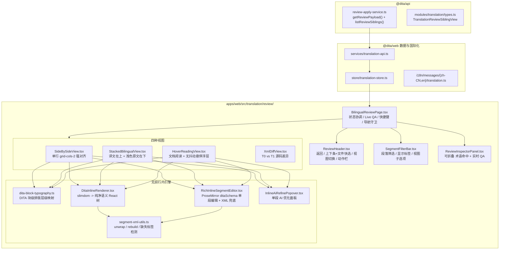

# Phase 16 补充方案：双语审校界面（Bilingual Review Workbench）UI 全面重构

## 1. 背景与痛点分析

双语审校界面（`apps/web/src/translation/BilingualReviewPage.tsx`）在初始阶段实现了基本的段落展示、术语命中、Live QA、AI 单段优化和草稿应用闭环，但在实际审校场景中暴露出四个显著的体验短板：

1. **中英文段落无法同行对齐**：源语言栏与目标语言栏作为两个独立滚动的卡片列表各自渲染，左侧受纯文本长度与原始 XML 重复块影响，右侧受固定行数 `<textarea>` 与顶部按钮栏影响，导致页面滚动几段后左右彻底错位。
2. **源语言与编辑态暴露原始 XML 标签且文本重复**：含行内 DITA 元素（如 `<keyword keyref="prod_name"/>`、`<uicontrol>项目文件</uicontrol>`、`<b>`、`<codeph>`、`<xref>`）的段落，在源语言栏会先渲染一遍纯文本，又在下方重复渲染一遍带尖括号的原始 XML；目标语言栏 `<textarea>` 也直接裸露原始标签字符。
3. **缺少上一条 / 下一条连续审校能力**：审校完一篇文档后必须退回翻译中心再打开下一篇，缺乏文件序列导航与未保存保护。
4. **视图单一与空间利用率低**：仅有双栏与 XML 差异两种模式；右侧 320px 术语与 QA 检查栏在无命中/无问题时形成大面积留白；每段常驻输入框边框与 `AI 优化` 按钮产生视觉噪音。

---

## 2. 核心设计目标（已对齐）

在 **100% 遵守 DITA 1.3 XML 无损往返、属性顺序保留、Live QA 校验与 Phase 13 草稿隔离边界** 的前提下，重构目标如下：

1. **四视图多模式对照**：
   - **行对齐左右对照（默认）**：单滚动容器逐段 `grid-cols-2` 强行对齐，彻底杜绝中英文错行。
   - **双语交错**：居中阅读宽度，上方清晰显示译文、下方浅色柔和显示原文，并支持一键互换「译文在上 / 原文在上」。
   - **沉浸阅读 + 悬停对照**：按真实 DITA 文档层级单栏呈现主语言（可切换「主显译文 / 主显原文」），鼠标悬停任意段落时以**无抖动浮层卡片**就近显示对照语言，点击段落固定展开并支持原位编辑译文。
   - **XML 差异**：保留 T0 基线 vs T1 提案双栏源码对比与编辑能力。
2. **纯净排版展示 + ProseMirror 无损行内富文本编辑**：
   - 源语言及非编辑态译文统一通过 `DitaInlineRenderer` 按真实 DITA 语义渲染（复用主编辑器视觉语言：`<uicontrol>` 蓝底胶囊、`<codeph>`/`<filepath>` 等宽代码胶囊、`<keyword keyref="..."/>` 紧凑键名徽章、`<xref>` 链接胶囊、`<b>`/`<i>` 真实字重），**绝不重复输出文本**。
   - 工具栏提供全局**「显示标签」**开关，按需显示紧凑的行内标签边界。
   - 点击译文原位编辑时，仅对当前聚焦段落挂载基于 `@dita/core` `ditaSchema` 的 **ProseMirror 单段富文本编辑器**（保留 `rawAttrs` 与顺序、防误删空标签胶囊、支持 IME 与 `Cmd/Ctrl+Z`，缺失源行内标签时自动提供一键补插芯片），并支持每段一键切换**单段 XML 源码编辑（`</>`）**兜底。
3. **语言配对级上一条 / 下一条与文件快选**：
   - 后端 `GET /api/translation/items/:id/review` 返回当前 `linkId` 下的全部可审校文件列表 `siblings`（按 `sourcePath` 确定性字母序排列，确保「应用到草稿」后文件位置不跳变）。
   - 顶部提供 `← 上一条` + **`3 / 12` 文件快选下拉**（显示状态、QA 计数，内置「仅看未完成」过滤开关）+ `下一条 →`，切页前提供未保存修改拦截（保存并切换 / 放弃修改 / 取消）。
4. **文档层级排版与降噪**：
   - 按 `elementTag` 与 `structuralPath` 呈现主标题、节标题、`<shortdesc>` 摘要、`<dt>/<dd>` 定义列表、步骤列表、`<note>` 与受保护 `<codeblock>`。
   - 非聚焦段落去除厚重输入框边框，hover/focus 时按需显现微操作条（`AI 优化`、`S0 对照`、`</>` XML 切换）。
5. **可折叠右侧检查栏 + 效率工具**：
   - 右侧「术语 & QA」面板默认智能折叠（有 QA 问题或当前段有术语命中时默认展开，全为 0 时默认收起释放宽屏，手动切换记忆在 `localStorage`），顶部按钮始终展示计数徽标。
   - 顶部增加段落快速筛选（`全部` / `有变更` / `QA 问题` / `已编辑`），「应用到目标草稿」后提供快捷「进入下一条」引导，支持快捷键（`Alt+↑/↓` 切段、`Alt+←/→` 切文件、`Cmd/Ctrl+S` 保存、`Esc` 退出编辑）。

---

## 3. 架构与模块拆分

---

## 4. 分层改动明细

### 4.1 后端 API (`@dita/api`)
- `apps/api/src/modules/translation/types.ts`：新增 `TranslationReviewSiblingView`，在 `TranslationReviewPayload` 中增加可选字段 `siblings?: TranslationReviewSiblingView[]`。
- `apps/api/src/modules/translation/review-apply-service.ts`：新增 `listReviewSiblings(linkId, currentItem)`，按 `sourcePath` 去重取最新项（状态包含 `ready_for_review` / `in_review` / `approved_draft` / `checked_in`，并强制包含 `currentItem`）并按 `sourcePath` 确定性排序，写入 `buildReviewPayload`。

### 4.2 前端接口、词典与样式 (`@dita/web`)
- `apps/web/src/services/translation-api.ts`：同步 `TranslationReviewSiblingView` 与 `siblings`。
- `apps/web/src/i18n/messages/zh-CN/translation.ts` 与 `apps/web/src/i18n/messages/en/translation.ts`：成对补充全部 UI 文案（通过 `i18n-parity.test.ts` 与 `no-hardcoded-cjk.test.ts`）。
- `apps/web/src/styles/translation-review.css` + `apps/web/src/index.css`：定义审校工作台行内语义元素、文档层级、悬停浮层与单段 ProseMirror 样式。

### 4.3 无损行内引擎与四视图组件 (`apps/web/src/translation/review/`)
- `segment-xml-utils.ts`：内部 XML 拆装、安全转义、基于 `node.nodeType` 的 `parseInnerFragment`（禁止 `instanceof slimdom.*`）、以及源/译行内标签缺失比对。
- `dita-block-typography.ts`：按 `elementTag` / `structuralPath` / `attributeName` 返回文档层级与排版类名。
- `DitaInlineRenderer.tsx`：基于 `parseInnerFragment` 渲染纯净行内语义元素 + 可选 `showTags` 紧凑标签芯片 + 源文术语高亮。
- `RichInlineSegmentEditor.tsx`：单段 ProseMirror 富文本编辑器（包装 `
` 使用 `ditaSchema` + `xmlToPmDoc` / `pmDocToXml` + 轻量 `keyword`/`xref` NodeView）+ 缺失源标签一键补插芯片 + 单段 `</>` XML 源码切换兜底。
- `InlineAiRefinePopover.tsx`：单段 AI 优化指令与语义化预览应用。
- `ReviewHeader.tsx`、`SegmentFilterBar.tsx`、`SideBySideView.tsx`、`StackedBilingualView.tsx`、`HoverReadingView.tsx`、`XmlDiffView.tsx`、`ReviewInspectorPanel.tsx`。
- `BilingualReviewPage.tsx`：整合四视图状态、Live QA、快捷键、未保存切换拦截、本地偏好记忆与上一条/下一条流转。

---

## 5. 验证计划

- **后端测试**：验证 `getReviewPayload` 返回按 `sourcePath` 排序的 `siblings` 及准确 QA 计数。
- **前端测试**：
  - 更新 `apps/web/test/phase16-translation-ui.test.tsx` 中与旧 DOM 强耦合的断言，保持全部无损 XML/QA/属性转义/AI 优化/锁冲突不变量覆盖。
  - 新增 `apps/web/test/bilingual-review-redesign.test.tsx`，覆盖行内纯净渲染、ProseMirror 富文本无损编辑、四视图切换、同容器行对齐、双语交错顺序切换、悬停阅读主语言切换与无抖动浮层、上下条与文件下拉切换、未保存修改拦截、右侧栏折叠与段落筛选。
  - 确认 `i18n-parity.test.ts` 与 `no-hardcoded-cjk.test.ts` 全绿。
- **全工作区构建、类型检查与测试**：`pnpm -r build && pnpm -r typecheck && pnpm -r test`，随后执行 `graphify update .`。
