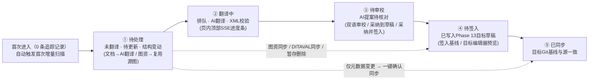

# Phase 16 补充方案：翻译中心场景化工作流重构与编辑器 UI 风格统一

> **状态**：✅ 已实现（全工作区 `pnpm -r build && pnpm -r typecheck && pnpm -r test` 全绿，含双语门禁与新增后端/前端回归测试）  
> **上游基线**：[phase16-translation.md](./phase16-translation.md)、[phase16-bilingual-review-ux.md](./phase16-bilingual-review-ux.md)、[workbench-ux-architecture.md](../design/workbench-ux-architecture.md)  
> **覆盖范围**：`@dita/web` 翻译中心壳层与四标签页（`TranslationCenterPage` / `TranslationFilesTab` / `TranslationQueueTab` / `TranslationSettingsTab`）、双语审校台壳层（`ReviewHeader` / `SegmentFilterBar` / `translation-review.css`）、`@dita/api` 资产与结构变动闭环接口、全栈中英双语 i18n 与自动化回归测试

---

## 1. 背景与痛点分析

Phase 16 初始落地的翻译中心（`/manuals/:id/translation`）完成了多语言配对、增量扫描、队列调度与双语审校的底层连通，但在真实译者与技术写作者的工作流中暴露出两大类问题：

### 1.1 工作流与状态心智断裂
1. **底层状态平铺，缺少主流程脉络**：页面把 SQLite 里的 9 种底层文件状态直接铺成 10 个筛选胶囊 + 8 个重复统计标签，看不出「待处理 → 翻译中 → 待审校 → 待签入 → 已同步」的流转先后与每步含义。
2. **文件类型混杂且行内按钮错配**：
   - `.svg` 与 `.png`/`.jpg` 在后端统一归为不可 AI 翻译的 `asset`，但表格中每一行无活跃任务的文件仍一律展示「翻译此文件」（点击后直接报 HTTP 400）；译者面对 `*.svg` 等图资完全不清楚应该翻译、复用还是替换。
   - `.ditaval` 条件配置文件不含可译正文，却仍被允许入队 AI 翻译；`source_deleted`（源文件已删除）行同样错误展示「翻译此文件」（点击报 404）。
   - 资产点击「同步图片到草稿」后仅写入 `working_drafts`，既未推进状态至 `draft_ready`，也无法在翻译中心通过「批量签入」提交到目标基线，导致图资同步闭环断裂。
3. **批量工具栏无差别堆砌**：勾选任意文件都会同时弹出 6 个动作按钮（增量翻译 / 全量翻译 / 标记已同步 / 同步图片到草稿 / 批量应用到目标草稿 / 批量签入），不区分所选文件的类型与阶段；「待审校 → 草稿就绪 → 签入基线」缺乏步骤说明与快捷闭环。
4. **流程跳转与扫描打断心流**：发起 AI 翻译后强制跳转至「队列」页，且首次进入未扫描记录时不会自动扫描，停留在空白提示页。

### 1.2 与主编辑器 UI 风格不统一
对照主编辑工作台（[WorkbenchHeader.tsx](../../apps/web/src/components/WorkbenchHeader.tsx)、[workbench-ux-architecture.md](../design/workbench-ux-architecture.md) 与 `apps/web/src/styles/`）：
1. **顶栏结构与密度割裂**：编辑器采用 `h-12` 紧凑工具栏、居中分段开关（`bg-slate-100/90 p-0.5`，激活态白底 `shadow-xs`）、右侧将身份/语言/帮助收敛进单枚 `Settings` 齿轮菜单；而翻译中心采用 `h-14` 居中宽容器、下划线标签页，且把 `IdentitySwitcher` 与 `LocaleSwitcher` 直接平铺在顶栏，缺少帮助中心入口。
2. **主色与按钮语法冲突**：编辑器以中性 `slate` 承载表面、以 `blue-600` 作为主 CTA（如「发布」）与选中高亮（如 `.dita-tb-btn[aria-pressed="true"]`、`.dita-tag-mode`）；翻译中心则混用大面积黑底 `bg-slate-900` 胶囊/主按钮与 `bg-blue-600` 按钮，视觉重心分散。
3. **字号、数字对齐与滚动条不统一**：翻译中心多处使用零散微字号（`11.5px`/`10.5px`），未统一复用主工作台的 `--font-sans` / `--font-mono`、`tabular-nums` 数字对齐、`.dita-scroller` 细滚动条与 `focus-visible` 蓝色焦点环。

---

## 2. 已确认的核心设计决策

| # | 设计维度 | 确认方案 | 设计理由 |
| :-- | :--- | :--- | :--- |
| 1 | **页面工作流架构** | **场景引导卡 + 5 步状态流水线视图**：顶部按优先级展示「当前推荐下一步」场景引导卡；下方以可点击的 5 阶段流水线（`待处理 → 翻译中 → 待审校 → 待签入 → 已同步`）替代 10 个平铺状态胶囊与 8 个重复统计标签 | 一眼看懂当前最该做什么，以及每个文件所处的生命周期位置 |
| 2 | **SVG 与图片资源处理** | 独立为**「图片与资源」**视角分栏，SVG 与位图均不走 AI 翻译，彻底移除资产行非法的「翻译此文件」按钮；清晰引导**「复用源图（同步到草稿并签入）」**与**「本地化替换（目标编辑器替换 / 保留本地覆盖）」**两条路径，并补齐后端资产同步→`draft_ready`→批量签入闭环 | 彻底消除 SVG 处理困惑，避免无画布校验的盲翻破坏矢量图排版，同时打通图资端到端交付闭环 |
| 3 | **文件分类与特殊变动** | 文件列表顶部设 **3 个视角分栏**：① **文档内容（Topic & Map）**、② **图片与资源（SVG / 图片）**、③ **配置与结构变动（DITAVAL / 已删除 / 已重命名 / 仅元数据）**；每类只呈现严格合法的行内与批量动作 | 消除 Topic、Map、SVG、DITAVAL 与异常态混杂造成的认知过载与非法点击报错 |
| 4 | **审校 → 草稿 → 签入衔接** | 保留 Phase 13 `working_drafts` 草稿层以支持目标编辑器预览/校验；在「待审校」提供「双语审校」「采纳到草稿」与次级快捷**「采纳并签入」**，在「待签入」提供「签入基线」与「在目标编辑器预览草稿」，并用一句话解释阶段含义 | 兼顾 Phase 13 预览/锁安全边界与高频批量交付效率 |
| 5 | **队列联动与自动扫描** | 发起 AI 翻译后**留在「文件」页**，顶部通过 SSE 实时展示轻量翻译进度条（可随时点「查看队列详情」跳转队列页，完成后自动刷新文件列表）；首次进入无追踪文件时自动执行一次扫描，后续保留轻量「检查源手册更新」按钮 | 保持译者在「文件」页的连续操作心流，消除首次空页门槛 |
| 6 | **编辑器 UI 风格统一** | 翻译中心全面对齐编辑器工作台设计语言：`h-12` 紧凑顶栏、居中分段式主导航、`Settings` 齿轮收敛会话控件、`slate + blue-600` 统一色彩与主按钮语法、一致的标签/徽标/字号/焦点环与 `.dita-scroller` 滚动条 | 让用户从三栏编辑器进入翻译中心与双语审校台时，视觉与交互心智无缝衔接 |

---

## 3. 编辑器 UI 风格统一规范

为了使翻译中心与三栏编辑器（[WorkbenchHeader.tsx](../../apps/web/src/components/WorkbenchHeader.tsx)）、双语审校台（[translation-review.css](../../apps/web/src/styles/translation-review.css)）保持同一套产品视觉体系，统一遵循以下规范：

### 3.1 壳层与顶栏对齐（`TranslationCenterPage`）
- **顶栏高度与布局**：由 `h-14` 调整为与 `WorkbenchHeader` 一致的 **`h-12`（48px）**，`sticky top-0 z-20 border-b border-slate-200 bg-white/95 backdrop-blur`，采用紧凑工作台横向布局（`px-4`），消除营销页风格的厚重留白。
- **左区（返回 + 上下文锚点）**：
  - `返回编辑器` 按钮沿用编辑器次级按钮规范：`rounded-md border border-slate-200 bg-white px-2 py-1 text-[11px] font-medium text-slate-600 hover:border-blue-200 hover:bg-blue-50 hover:text-blue-700`。
  - 紧邻分隔线后展示工作台上下文标识（`h-7 w-7 rounded-lg bg-slate-900` 紧凑图标徽章 + 手册名称 + 源语言标签，与编辑器折叠侧栏态品牌锚点同源）。
- **中区（主导航分段开关）**：
  - 将原本的下划线标签栏（`文件 | 队列 | 手册术语库 | 设置`）统一升级为编辑器招牌的 **Segmented Switch**（`rounded-lg border border-slate-200 bg-slate-100/90 p-0.5`，激活项 `bg-white text-slate-900 shadow-xs`，与编辑器顶栏「可视化 / 双栏 / 源码」完全同款）。
  - 当当前语言配对有运行中队列任务时，「队列」项右侧显示微小的蓝色脉冲状态点。
- **右区（操作 + 会话收纳）**：
  - 保留轻量 `刷新` 图标按钮、`DesktopSettingsButton`，并将 `IdentitySwitcher`、`LocaleSwitcher` 与 `帮助中心` 统一收纳进与 `WorkbenchHeader` 同款的 **`Settings` 齿轮下拉菜单**（`data-testid="translation-settings-menu-button"`），避免会话控件挤占工作区顶栏。

### 3.2 次级上下文条（目标语言配对条）
- 紧贴 `h-12` 顶栏下方设置紧凑的白底工具条（`border-b border-slate-200 bg-white px-4 py-2`），承载语言配对分段胶囊与 `+ 添加目标语言` 按钮，右侧展示当前 `目标手册：{name}`。
- **消除黑底视觉冲突**：选中态语言胶囊由实心黑底（`bg-slate-900`）统一为编辑器蓝色激活胶囊（`border-blue-300 bg-blue-50 text-blue-900`，进度徽标 `bg-blue-600/10 text-blue-700 tabular-nums`），右侧「打开编辑器」子按钮保持独立无嵌套点击目标，悬停呈 `bg-blue-100/80 text-blue-800`。

### 3.3 统一视觉 Token 与控件语法

| 视觉元素 | 编辑器工作台基线规范 | 翻译中心统一落地标准 |
| :--- | :--- | :--- |
| **画布与卡片** | 画布 `#f8fafc`（`bg-slate-50`），面板 `#ffffff` + `border-slate-200` + `rounded-lg` | 所有引导卡、流水线条、文件表格、队列双栏与设置卡片统一 `rounded-lg border border-slate-200 bg-white`，仅浮层/分段激活态使用 `shadow-xs` |
| **主操作按钮（Primary CTA）** | `border-blue-600 bg-blue-600 text-white shadow-xs hover:bg-blue-700`（如顶栏「发布」） | 场景引导卡主 CTA、批量翻译/签入主按钮、设置保存按钮统一使用 `blue-600` 主按钮，彻底移除零散的 `bg-slate-900` 主按钮 |
| **次级按钮（Secondary）** | `border-slate-200 bg-white text-slate-600 hover:border-blue-200 hover:bg-blue-50 hover:text-blue-700` | 「检查源手册更新」「采纳到草稿」「打开编辑器」「查看队列详情」等统一复用该样式 |
| **工作区二级分栏** | `MapTreePanel` 二级 Tab（`目录结构 \| Keys (N)`） | 「文档内容 / 图片与资源 / 配置与结构变动」采用同款紧凑底部指示条（`border-b-2 border-blue-600 text-blue-700` + `tabular-nums` 等宽计数徽标） |
| **语义状态色板** | 诊断/审校共享 7 色语义体系 | 严格统一：`slate`（未翻译/中性）、`amber`（待更新/警告）、`blue`（队列中/执行中）、`violet`（待审校/人工复核）、`teal`（待签入草稿/已本地化）、`emerald`（已同步/通过）、`rose`（失败/源文件已删除） |
| **字体、数字与焦点** | `--font-sans`、`--font-mono`、`tabular-nums`、`focus-visible:outline-2 outline-blue-600`、`.dita-scroller` | 路径/哈希用 `--font-mono`，所有计数/进度用 `tabular-nums`，所有可交互控件带蓝色 `focus-visible` 焦点环，列表容器挂 `.dita-scroller` |
| **跨标签页一致性** | 单一工作台体验 | 同步整理 `TranslationQueueTab` 与 `TranslationSettingsTab` 的按钮主色（`blue-600`）、卡片圆角、表头与数字对齐，避免切 Tab 后风格跳变 |

### 3.4 双语审校台对齐落地（`ReviewHeader` / `translation-review.css`）
- **顶栏由三行收敛为 `h-12` 主栏 + 紧凑状态条**：返回、上下文锚点（`h-7 w-7 rounded-lg bg-slate-900` + `双语审校` + 状态胶囊）、文件路径（`--font-mono`，目标路径 `text-blue-700`）、文件切换器与保存/应用/签入/术语面板动作共用一行，不再让每行各自留白。
- **会话控件进入齿轮菜单**：`IdentitySwitcher`、`LocaleSwitcher` 与帮助中心统一由共享组件 `SessionSettingsMenu` 承载（`review-settings-button` / `review-settings-menu`）；编辑器顶栏、翻译中心与审校台复用同一实现，避免三处菜单逻辑漂移。
- **视图切换与状态条**：`左右对照 / 双语交错 / 沉浸对照 / XML 差异` 改为编辑器同款 Segmented Switch（`bg-slate-100/90` + 激活白底 `shadow-xs`），与锁状态、QA 徽标、段落进度同处第二行。
- **控件语法统一**：主按钮 `应用到目标草稿` 由近黑 `#0f172a` 改为 `blue-600`；保存/签入/术语面板统一为白底灰边次级按钮与 `hover:bg-blue-50`；筛选胶囊激活态改 `border-blue-200 bg-blue-50 text-blue-700`；段内 `富文本 | XML` 切换同步为蓝色激活；所有计数、文件进度使用 `tabular-nums`，所有交互控件补齐蓝色 `focus-visible` 焦点环。
- **字体单一来源**：`apps/web/src/index.css` 通过 `@theme` 把 Tailwind `font-sans` / `font-mono` 绑定到 `--font-sans` / `--font-mono`，审校台内的等宽路径与哈希不再落回浏览器默认字体。

---

## 4. 场景化工作流架构设计

### 4.1 生命周期与 5 步状态流水线



**9 种底层状态 → 5 步流水线映射表**：

| 流水线阶段 | 底层 `TranslationFileStatus` | 界面一句话阶段解释 |
| :--- | :--- | :--- |
| **全部** (`all`) | 全部状态 | 当前视角下的全部追踪文件 |
| **① 待处理** (`todo`) | `untranslated`、`outdated`、`outdated_metadata_only`、`source_renamed`、`source_deleted` | 源手册新增、改动或发生结构变动，尚未进入译文处理 |
| **② 翻译中** (`translating`) | `in_queue` | 正在后台队列执行 AI 翻译与 DITA 结构校验 |
| **③ 待审校** (`review`) | `in_review` | AI 已生成译文提案，建议双语核对后采纳到目标草稿 |
| **④ 待签入** (`checkin`) | `draft_ready` | 已写入你的目标手册个人草稿（可在目标编辑器预览），签入后进入目标基线 |
| **⑤ 已同步** (`synced`) | `synced` | 目标手册 Git 基线已与源手册当前版本一致 |

### 4.2 顶部场景引导卡优先级（`deriveRecommendedScenario`）

页面顶部始终只展示 **1 张最贴合当前手册状态的引导卡**（当队列运行中时切换为**实时 SSE 进度条卡片**），消除同时面对十几个入口的选择瘫痪：

1. **翻译进行中**（`inQueue > 0` 或存在 `queued`/`running` 任务）：实时进度条（`已完成 X / Y 篇` + 实时脉冲徽章）+ `查看队列详情` + `取消任务`。
2. **有待签入草稿**（`draftReady > 0`）：说明「已有 N 个文件写入你的目标草稿，可先在目标编辑器预览，或直接签入到目标基线」+ 主 CTA `签入全部就绪草稿 (N)` + 次 CTA `在目标编辑器预览`。
3. **有 AI 译文待审校**（`inReview > 0`）：说明「AI 已完成 N 篇译文提案，建议进入双语审校核对后采纳」+ 主 CTA `开始双语审校`（直达首篇待审文件）+ 次 CTA `查看待审校文件`。
4. **首次整本翻译**（文档中 `untranslated > 0` 且 `synced === 0`）：说明「这是新的目标语言版本，建议先对目录 Map 与核心 Topic 发起 AI 翻译；图片资源可在图资分栏按需复用或本地化」+ 主 CTA `增量翻译全部待译文档 (N)`。
5. **源手册有增量更新**（文档中 `outdated > 0` 或 `untranslated > 0`）：说明「源手册有 N 篇文档新增或修改，系统会自动复用未改段落，仅增量翻译改动部分」+ 主 CTA `一键增量翻译 (N)`。
6. **有待同步图资或结构变动**（存在待同步图片/SVG，或存在待处理 DITAVAL / 仅元数据 / 已删改文件）：给出对应一句话引导，并一键切到对应视角或触发一键同步/确认。
7. **全部已同步**（待办为 0 且 `total > 0`）：温和的绿色完成态（「源手册与目标语言基线已完全同步」）+ `打开目标编辑器` + `检查源手册更新`。

### 4.3 三大视角分栏与合法动作矩阵

| 视角分栏 | 归属规则 | 单行唯一合法动作 | 批量选择栏（严格按所选子集动态呈现） |
| :--- | :--- | :--- | :--- |
| **文档内容** (`docs`) | `topic`、`map`、`keydef_map`（不含 `outdated_metadata_only` / `source_deleted` / `source_renamed`） | • `untranslated`/`outdated` → **AI 翻译**<br>• `in_queue` → **查看队列**<br>• `in_review` → **双语审校**（主）+ **采纳到草稿**（次）<br>• `draft_ready` → **签入基线**（主）+ **双语审校**（次）<br>• `synced` → **重新翻译**（次级弱化按钮）<br>*(另：`keydef_map` 显「需人工复核」提示，`map` 显「目录标题」微提示)* | • 选中待译/已同步文档 → **增量 AI 翻译** / **全量 AI 翻译**<br>• 选中待审校文档 → **采纳到草稿 (N)** / **采纳并签入 (N)**<br>• 选中待签入草稿 → **批量签入基线 (N)** |
| **图片与资源** (`assets`) | `asset`（`.svg` 单独标注 `SVG` 徽标，`.png`/`.jpg`/`.jpeg`/`.gif`/`.webp` 标注 `图片`；不含 `source_deleted`） | **绝不出现 AI 翻译按钮！** 顶部常驻一句提示：「SVG 与位图不走 AI 翻译：无需改字可直接复用源图；含文字或界面标注的图请在目标编辑器替换为本地化版本。」<br>• `untranslated`/`outdated`（未覆盖）→ **复用源图**<br>• `outdated` 且 `localizedAssetOverride` → **保留本地版本**（主，标记已同步）+ **用源图覆盖**（次，`force: true`）<br>• `draft_ready` → **签入基线** + **目标编辑器查看**<br>• `synced` → **去目标编辑器替换** | • 选中待同步图资 → **复用源图到草稿 (N)** / **同步并签入 (N)**<br>• 选中已本地化图资 → **保留本地版本 (N)**<br>• 选中待签入图资 → **批量签入基线 (N)** |
| **配置与结构变动** (`structure`) | `ditaval` + 任意类型的 `outdated_metadata_only`、`source_deleted`、`source_renamed` | • `ditaval`（待处理）→ **同步源配置**<br>• `ditaval`（`draft_ready`）→ **签入基线**<br>• `outdated_metadata_only` → **确认已同步（免重译）**<br>• `source_renamed` → 展示 `原路径 → 新路径`，提供 **增量翻译** + **标记已同步**<br>• `source_deleted` → **从目标草稿删除**（主）+ **保留目标文件**（次） | • 选中 `ditaval` → **同步配置到草稿 (N)**<br>• 选中 `outdated_metadata_only` → **确认已同步 (N)**<br>• 选中 `source_deleted` → **从目标草稿删除 (N)** / **保留并移出待办 (N)**<br>• 选中 `draft_ready` → **批量签入基线 (N)** |

---

## 5. 分层代码改动清单

### 5.1 后端闭环补齐（`@dita/api`）

1. **`apps/api/src/modules/translation/sync-service.ts`**
   - `syncAssetsToDrafts()`：调用 `drafts.upsertBinaryDraft()` 成功后，同步将对应 `translation_file_states.status` 更新为 `'draft_ready'`（`force: true` 时同步复位 `localizedAssetOverride = 0`）。
   - 新增 `syncPassthroughToDrafts(linkId, paths, user)`：将 `.ditaval` 等非正文源 XML 文件复制到调用方的目标 `working_drafts`（遵循 `LockService.checkout`，不抢占他人锁）并置状态为 `'draft_ready'`。
   - 新增 `resolveDeletedFiles(linkId, { paths, action: 'stage_delete' | 'keep_target' }, user)`：
     - `stage_delete`：若目标基线存在该文件，则加锁并调用 `drafts.markDeleted()`，同时将行状态置为 `'draft_ready'`；若目标基线已无此文件，则直接移除过期追踪行。
     - `keep_target`：直接移除 `translation_file_states` 追踪行，保留目标仓库内文件不动。
   - `scanLink()`：扫描时读取目标分支当前 `working_drafts`；若某文件无活跃 `translationItem` 但已存在有效草稿（新增/修改/删除），保持状态为 `'draft_ready'`，防止重扫覆盖待签入状态。
   - `markSynced()`：标记已同步时清空 `renamedFromPath = null`。
2. **`apps/api/src/modules/translation/review-apply-service.ts`**
   - `batchCheckin()`：候选文件除 `translationItems.status === 'approved_draft'` 外，一并纳入 `translationFileStates.status === 'draft_ready'` 且在调用方 `working_drafts` 中存在草稿的路径（涵盖已同步的 SVG/PNG 图资、`.ditaval` 与暂存删除项），复用既有 Phase 13 原子签入。
   - `onTargetCheckinCommitted()`：签入提交后，若文件在源 `HEAD` 与目标 `HEAD` 均已不存在（即 `stage_delete` 已签入），自动删除其 `translation_file_states` 行；否则更新为 `'synced'`，清空 `renamedFromPath`，且当图资哈希与源一致时复位 `localizedAssetOverride = 0`。同时修复了一项潜在缺陷：原先会对所有文件无差别调用 `computeTranslatableDocumentFingerprint()`，签入二进制图片时会抛出被吞掉的 XML 解析异常从而中断水位推进，现已限定仅对 `topic` / `map` / `keydef_map` 计算可译指纹。
3. **`apps/api/src/modules/translation/types.ts`、`routes.ts`、`apps/api/src/i18n/messages.ts`**
   - 新增 `SyncPassthroughResult`、`ResolveDeletedResult` 类型。
   - 新增路由：
     - `POST /api/translation/links/:linkId/sync-passthrough`
     - `POST /api/translation/links/:linkId/resolve-deleted`
   - 在 `apps/api/src/i18n/messages.ts` 成对补充错误提示键（`zh-CN` / `en`）。

### 5.2 前端接口、状态与国际化（`@dita/web`）

1. **`apps/web/src/services/translation-api.ts`**
   - 补齐 `syncTranslationAssets(linkId, { paths?, force? })`、`syncTranslationPassthrough(linkId, { paths? })`、`resolveDeletedTranslationFiles(linkId, { paths, action })`。
2. **`apps/web/src/store/translation-store.ts`**
   - `syncAssets()` 成功后自动刷新 `loadFiles(linkId)` 与 `loadLink(linkId)`。
   - 新增 `syncPassthrough()` 与 `resolveDeleted()` 动作。
   - 强化 `subscribeJob()`：当收到 `job.completed`（或 `item.updated` 进入终态）时同步刷新 `loadFiles(job.linkId)` 与 `loadLink(job.linkId)`，支撑留在「文件」页的实时无刷新体验。
3. **`apps/web/src/i18n/messages/{zh-CN,en}/translation.ts`**
   - 成对新增场景引导卡、5 步流水线说明、3 视角分栏、SVG/图资提示条、结构变动动作、采纳并签入、同步并签入、自动扫描提示等全部双语键，严格通过 `i18n-parity` 与 `no-hardcoded-cjk` 门禁。

### 5.3 翻译中心场景化工作流与 UI 统一（`@dita/web/src/translation/`）

1. **[NEW] `apps/web/src/translation/translation-workflow.ts`**
   - 纯函数工作流投影引擎：`classifyWorkspaceScope`、`stageOfFile`、`computeScopeCounts`、`computeStageCounts`、`deriveRecommendedScenario`、`getRowCapabilities`、`getBatchCapabilities`、`isSvgAssetPath`。
2. **[NEW] `apps/web/src/translation/TranslationScenarioBanner.tsx`**
   - 场景引导卡 + 运行中实时 SSE 进度条 + 轻量「检查源手册更新」入口。
3. **[NEW] `apps/web/src/translation/TranslationPipelineBar.tsx`**
   - 5 步状态流水线条（带方向箭头、`tabular-nums` 计数、蓝色激活态与当前阶段一句话说明）。
4. **[MODIFY] `apps/web/src/translation/TranslationFilesTab.tsx`**
   - 全量加载当前配对文件并在客户端按 `(scope, stage, search)` 即时过滤；首访 0 文件时自动触发一次扫描（非 viewer）。
   - 组合 `TranslationScenarioBanner` + 3 视角分栏 + 图资/结构说明条 + `TranslationPipelineBar` + 阶段感知批量操作栏（支持「采纳并签入」「同步并签入」内联签入说明框）+ 高密度文件表（隐藏冗余相同 `targetPath`、显式标注 `SVG` 徽标、行内仅渲染合法动作）。
5. **[MODIFY] `apps/web/src/translation/TranslationCenterPage.tsx`**
   - 顶栏全面对齐 `WorkbenchHeader`（`h-12`、居中分段式 4 标签导航、右侧 `Settings` 齿轮收纳身份/语言/帮助、次级语言配对条采用蓝色激活态）。
   - 取消发起翻译后强制跳转队列页（改为提供 `onOpenQueue` 与 `onOpenTargetEditor` 回调）。
6. **[MODIFY] `apps/web/src/translation/TranslationQueueTab.tsx` & `TranslationSettingsTab.tsx`**
   - 统一主按钮色（`blue-600`）、卡片圆角与边框、表头排版及 `tabular-nums` 样式，确保四标签页视觉一体。

---

## 6. 验证与回归计划

### 6.1 自动化测试
1. **后端集成测试**（`apps/api/test/translation-links-sync.test.ts`、`apps/api/test/translation-review-overlay.test.ts`）：
   - `sync-assets` 将资产状态推进到 `draft_ready`、经 `scanLink` 不回退、经 `batchCheckin` 原子提交后变为 `synced`；`force: true` 覆盖本地化图资并复位覆盖标记。
   - `sync-passthrough` 将 `.ditaval` 写入 `working_drafts`（`draft_ready`）并可由 `batchCheckin` 提交为 `synced`。
   - `resolve-deleted` 覆盖 `stage_delete`（暂存删除 → 签入后移除目标文件与追踪行）与 `keep_target`（保留目标文件并移除追踪行）。
2. **前端单元测试**（新增 `apps/web/test/translation-workflow.test.ts`）：
   - 验证全部 5 类文件 × 9 种状态的视角归属、5 步流水线映射、7 种场景优先级与非法动作零泄漏（SVG/PNG/DITAVAL/已删除绝不生成 AI 翻译能力）。
3. **前端组件与门禁测试**（更新 `apps/web/test/phase16-translation-ui.test.tsx` 与 `apps/web/test/bilingual-review-redesign.test.tsx`）：
   - 覆盖翻译中心与审校台顶栏编辑器风格统一（分段导航、`Settings` 收纳菜单、语言配对蓝态胶囊、审校台 `h-12` 主栏与 `review-*` 交互依然可达）、场景引导卡主 CTA、3 视角切换、5 步流水线过滤、SVG 行正确显示「复用源图」而非「翻译此文件」、发起翻译留在文件页并显示实时进度条、首访空列表自动扫描、`采纳并签入` 串联请求。
4. **全工作区构建、类型检查、测试与图谱刷新**：
   ```bash
   pnpm -r build && pnpm -r typecheck && pnpm -r test
   graphify update .
   ```

### 6.2 手工端到端场景验收
1. **视觉一致性对照**：在三栏编辑器与翻译中心之间来回切换，核对顶栏高度（48px）、分段开关、齿轮设置菜单、蓝色主按钮、中性灰边框与字号密度完全统一。
2. **首次翻译整本手册**：进入新配对语言 → 自动扫描 → 场景卡引导一键增量翻译 → 停留在文件页观察顶部实时进度条 → 自动刷新进入「待审校」。
3. **SVG 与图片资源处理**：切到「图片与资源」→ 看到清晰的 SVG/位图说明 → `.svg` 行标注 `SVG` 并提供「复用源图」/「去目标编辑器替换」（无 AI 翻译按钮）→ 同步并签入闭环生效。
4. **审校、采纳与签入闭环**：在「待审校」体验「双语审校」「采纳到草稿」与「采纳并签入」；在「待签入」体验「在目标编辑器预览草稿」与「批量签入基线」。
5. **配置与结构变动 + 双语切换**：验证 DITAVAL 同步、仅元数据变更一键确认、源文件删除（暂存删除/保留忽略）以及中英双语切换完整无缺漏。
