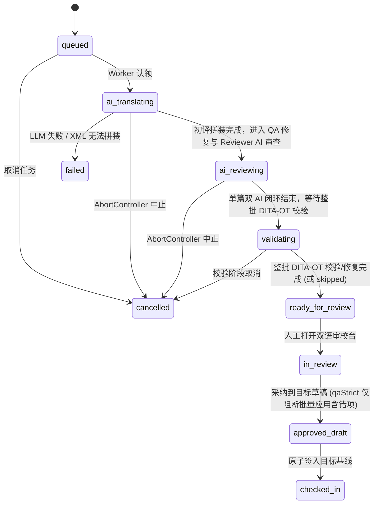

# Phase 16 补充方案：翻译双 AI 独立审查、QA 自动修复与整批 DITA-OT 严格校验

> **状态**：✅ 已实现（前后端闭环与自动化测试全部通过）  
> **上游架构基线**：[phase16-translation.md](./phase16-translation.md)、[phase14-docling-agent.md](./phase14-docling-agent.md)  
> **关联设计文档**：[ai-contract.md](../design/ai-contract.md)、[versioning-model.md](../design/versioning-model.md)、[ADR 0004](../adr/0004-baseline-and-draft-overlay.md)、[ADR 0005](../adr/0005-paired-manuals-translation-model.md)

---

## 1. 背景与目标

当前 Phase 16 的 AI 翻译流水线存在三个关键短板：

1. **QA 问题只报不修**：`apps/api/src/modules/translation/ai-translator.ts` 中的 `translateBatch()` 仅在缺少 `<tblock>` 或 XML 不良构时重试；`runTranslationQa()` 在整篇拼装之后才执行，术语漏用、禁用译法、DNT 被篡改、内联标签增删、受保护属性变更、占位符丢失等问题目前只写入 `qaReportJson` 等待人工处理，AI 不会在翻译过程中尝试自动修复。
2. **缺乏独立的审查 AI（Reviewer AI）**：缺少独立于翻译 AI 的质量审查角色，无法在提交人工审校前对语义准确度、漏译/错译、术语自然度、内联标签语境位置以及 QA 违规项做二次独立审查。
3. **缺少 DITA-OT 严格校验闭环**：`apps/api/src/modules/translation/queue-service.ts` 中条目虽会短暂经过 `validating` 状态，但实际上并未调用 `apps/api/src/modules/validate/strict-validator.ts` 执行 DITA-OT 严格校验，也未将校验结果与自动修复接入翻译流程；同时映射设置中的 `qaStrict` 开关尚未在后端生效。

本方案将在严格遵守 DITAEditor 核心工程不变量（**标准 DITA XML 无损往返**、**Phase 13 干净基线与个人草稿叠加层隔离**、**零外部中间件**、**服务端 LLM 与密钥隔离**、**增量翻译 0-Token 复用**）的前提下，构建完整的 **「翻译 AI + 独立审查 AI + QA 自动修复 + 整批 DITA-OT 严格校验与定向修复」** 闭环。

---

## 2. 已确认的核心架构决策

| 维度 | 确认方案 | 工程边界 |
| :--- | :--- | :--- |
| **双 AI 协作模式** | **翻译 AI 与审查 AI 职责分离（双角色闭环）**：翻译 AI 负责初译与定向修复；审查 AI 独立扮演严格审校员（只审不写，输出结构化 JSON 审查意见与修复建议）；当确定性 QA 有 `error` 或审查 AI 给出需修改项时，交回翻译 AI 按具体报错与审查意见定向修复受影响的块，再复检确认 | 审查 AI 绝不直接覆盖整篇 XML；修复循环严格有界并内置防回退守卫 |
| **审查 AI 模型配置** | **默认复用主模型 + 可选独立审查模型**：默认以独立审查 System Prompt 与低 `temperature`（默认 `0.1`）复用全局主模型；管理员可在「AI 设置」中可选配置独立的审查模型（单独的 `baseUrl` / `model` / `apiKey` / `temperature`）并单独测试连通性 | 明文 `apiKey` 仅留存服务端 SQLite/环境变量，下发前端一律脱敏 |
| **DITA-OT 严格校验粒度** | **整批（Job 级）统一严格校验与定向修复**：同一翻译 Job 内所有文件完成单篇双 AI 闭环后，统一构建一次临时隔离 `stagingDir` 执行整包 DITA-OT 严格校验（避免逐篇重复启动 JVM）；报错时仅对归属于本 Job 的出错文件调用翻译 AI 定向修复，并强制执行一次确定性 `strict` 终检确认 | 临时目录位于 `os.tmpdir()` 且 `finally` 必清理，绝不触碰共享 `sourceWorkDir` / `targetWorkDir`；未安装 DITA-OT 时优雅降级为 `skipped` |
| **残留问题与 `qaStrict` 策略** | **保留提案 + `qaStrict` 批量门禁**：即使自动修复达到上限后仍有残留问题，始终保留已生成的译文提案进入 `ready_for_review`，在队列与双语审校台高亮展示残留 QA / 审查 AI 意见 / DITA-OT 诊断；配对开启 `qaStrict` 时，在「批量应用到目标草稿」（`batchApplyDrafts`）中自动跳过存在未解决阻断错误的条目 | 双语审校台提供单篇「重新执行 DITA-OT 校验」入口，人工修正并复验通过后即可解除阻断 |

---

## 3. 系统总体架构与状态机

### 3.1 端到端数据流

```mermaid
flowchart TB
    Enqueue["POST /api/translation/jobs\n创建 Job + N 个 queued Items"] --> Pool["Worker Pool (并发受控)"]

    subgraph PerItem["阶段 1：单文件双 AI 翻译与 QA/审查闭环 (per-item)"]
        direction TB
        Plan["三方增量对齐 (S0 × S1 × T0)\nunchanged 0-Token 直复用 · protected 透传"] --> Draft["[ai_translating]\nTranslator AI 分批初译 (<tblock id> + 良构重试)"]
        Draft --> Assemble1["S1 骨架无损拼装 + ProseMirror 探针"]
        Assemble1 --> DetQA1["[ai_reviewing]\n确定性 QA 扫描 (runTranslationQa)"]
        DetQA1 --> ReviewerAI["Reviewer AI 独立审查\n(独立/复用模型 · 低 temperature · 只审不写 JSON)"]
        ReviewerAI --> NeedFix{"确定性 QA 有 error\n或 Reviewer AI 有 error?"}
        NeedFix -->|"是 (有修复预算)"| RepairTx["Translator AI 定向修复\n(仅发送出错 segment + QA 报错 + Reviewer 建议)"]
        RepairTx --> ReAssemble["重拼装 + 防回退守卫 + 确定性 QA 复检"]
        ReAssemble --> Recheck{"仍有 QA error\n且未达上限?"}
        Recheck -->|"是 (最多追加 1 轮 QA 修复)"| RepairTx
        Recheck -->|"否"| FinalReview["Reviewer AI 复审确认\n(仅针对修改过的块，最多 1 次)"]
        FinalReview --> WaitBarrier["持久化 proposedXml / segments / qaReport / aiReview\n状态置为 validating (等待整批校验)"]
        NeedFix -->|"否 (全部通过 / 0 新增译块)"| WaitBarrier
    end

    Pool --> PerItem
    WaitBarrier --> Barrier{"同 Job 所有条目是否均离开\nqueued / ai_translating / ai_reviewing?"}
    Barrier -->|"否"| Wait["继续处理同 Job 其余文件"]
    Barrier -->|"是"| JobStrict

    subgraph JobStrict["阶段 2：整批 DITA-OT 严格校验与定向修复 (job-level)"]
        direction TB
        Stage["构建临时隔离 stagingDir (os.tmpdir)\n层级覆盖：源手册 HEAD → 目标手册 HEAD →\n操作者目标草稿 Overlay → 本 Job 全部提案\n(绝不触碰共享 workDir)"] --> OT1["DITA-OT 严格校验 #1\n(strict 模式，单次 JVM)"]
        OT1 --> OTCheck{"校验结果?"}
        OTCheck -->|"未安装 DITA-OT"| SkipOT["标记 ditaOtReport = skipped"]
        OTCheck -->|"0 错误通过"| PassOT["标记 ditaOtReport = passed"]
        OTCheck -->|"有错误"| LaxScan["若批内多文件：补跑 1 次 lax 扫描\n一次性收集全部出错文件的诊断"]
        LaxScan --> Filter["仅筛选归属于本 Job 翻译路径的 error\n(忽略无关基线旧错)"]
        Filter --> HasOwnErr{"本批译文有错?"}
        HasOwnErr -->|"否"| PassOT
        HasOwnErr -->|"是"| OTRepair["逐出错文件调用 Translator AI 整篇修复\n(保留 XML 声明/DOCTYPE/xml:lang + 良构/PM 探针)"]
        OTRepair --> OTFinal["写回 stagingDir → 确定性 DITA-OT strict 终检确认"]
        OTFinal --> WriteBack["回写修复后 proposedXml、重对齐 segments、\n重算确定性 QA、保存 ditaOtReport & jobValidation"]
        SkipOT --> Release["批量释放所有 validating 条目 → ready_for_review\n广播 SSE item.updated + job.completed"]
        PassOT --> Release
        WriteBack --> Release
    end
```



### 3.2 条目状态机演进



---

## 4. 模块改造与接口设计

### 4.1 数据库 Schema 与 AI 模型配置层（`apps/api/src/db/` & `apps/api/src/modules/ai/`）

1. **`apps/api/src/db/schema.ts` & `client.ts`**
   - `ai_settings` 新增可空列：`reviewer_base_url`、`reviewer_model`、`reviewer_api_key`、`reviewer_temperature`。
   - `ai_usage_logs.task_type` 枚举扩展：`'translate_review'`、`'translate_repair'`。
   - `translation_jobs` 新增可空列：`validation_report_json`。
   - `translation_items`：`status` 枚举新增 `'ai_reviewing'`，新增可空列 `ai_review_json`、`dita_ot_report_json`。
   - 在 `openDatabase()` 中追加幂等迁移函数 `migrateAiSettings()`、`migrateTranslationJobs()`、`migrateTranslationItems()`，确保旧库平滑升级。

2. **`apps/api/src/modules/ai/{types,ai-settings-service,routes}.ts`**
   - 支持可选环境变量回退：`AI_REVIEWER_BASE_URL`、`AI_REVIEWER_MODEL`、`AI_REVIEWER_API_KEY`、`AI_REVIEWER_TEMPERATURE`。
   - `AiSettingsService.resolveReviewerConfig()`：字段级覆盖解析（DB `reviewer_*` → 环境变量 `AI_REVIEWER_*` → 继承全局主配置），默认 `temperature = Math.min(primary.temperature, 0.1)`，并标注 `isDedicated: boolean`。
   - `GET /api/ai/config` 返回 `reviewer: AiReviewerPublicConfig`（脱敏）；`PUT /api/ai/config` 支持更新或清空（传 `null` 恢复继承）；`POST /api/ai/config/test` 支持 `role?: 'primary' | 'reviewer'` 独立连通性验证。

### 4.2 双 AI 翻译审查与定向修复引擎（`apps/api/src/modules/translation/`）

1. **契约扩展（`apps/api/src/modules/translation/types.ts`）**
   - `TranslationItemStatus` 与 `RUNNING_ITEM_STATUSES` 增加 `'ai_reviewing'`。
   - 新增结构化报告类型：`TranslationAiReviewReport`（含 `verdict`、`model`、`isDedicatedModel`、`summary`、`reviewRounds`、`qaRepairRounds`、`repairedSegments`、`initialQaErrors`、`remainingQaErrors`、`issues`、`stale`）、`TranslationDitaOtItemReport`（含 `status`、`repaired`、`repairAttempts`、`errorCount`、`warningCount`、`diagnostics`、`reason`、`stale`）、`TranslationJobValidationReport`。
   - `TranslationItemView` 增加紧凑计数/状态字段：`aiReviewVerdict`、`aiReviewErrorCount`、`aiReviewWarningCount`、`qaRepairedCount`、`ditaOtStatus`、`ditaOtErrorCount`、`ditaOtWarningCount`。
   - `TranslationJobView` 增加 `validationReport`；`TranslationReviewPayload` 增加 `aiReview` 与 `ditaOtReport`。

2. **独立审查 AI（新建 `apps/api/src/modules/translation/ai-reviewer.ts`）**
   - 独立类 `AiTranslationReviewer`，通过 `aiSettings.resolveReviewerConfig()` 获取审查模型。
   - **只审不写**：System Prompt 明确其为独立 DITA 1.3 技术翻译审校员，仅返回经 Zod 校验的结构化 JSON：
     ```ts
     interface ReviewerBatchOutput {
       verdict: 'pass' | 'revise';
       summary: string;
       issues: Array<{
         segmentId: string;
         severity: 'error' | 'warning';
         category: 'accuracy' | 'omission' | 'terminology' | 'markup' | 'style' | 'qa_violation';
         message: string;
         suggestion: string;
       }>;
     }
     ```
   - **增量经济性**：仅审查本轮新译/改译的块（及含确定性 QA 错误的块），按 `MAX_REVIEW_BATCH_CHARS = 6_000` 分批送审；0 新增译块且 0 QA 错误时直接跳过（保持 0-Token 增量特性）。
   - **容错降级**：JSON 解析失败重试 1 次；仍异常或模型报错时降级为 `verdict: 'error'` 并记录 warning，绝不丢弃已生成的译文。
   - **用量审计**：记账为 `taskType: 'translate_review'`、`subAction: 'qa_review' | 'qa_recheck'`。

3. **翻译 AI 定向修复闭环（改造 `apps/api/src/modules/translation/ai-translator.ts`）**
   - `translateDocument()` 在首轮拼装与 `runTranslationQa()` 后：
     1. 触发 `onPhaseChange?.('ai_reviewing')`，调用 `reviewer.reviewSegments()`（附带首轮确定性 QA 报错与命中术语）。
     2. 合并需要修复的目标块集合（含确定性 QA `error` 的块 ∪ 含审查 AI `error` 意见的块）。
     3. 若集合非空，调用新增的 `repairSegments()`（`taskType: 'translate_repair'`, `subAction: 'qa_repair'`）仅把出错块连同 `[QA ERROR]` 与 `[REVIEWER FEEDBACK]` 交回 Translator AI 定向修复。
     4. **防回退守卫**：逐块对比修复前后的良构性与确定性 QA 错误数，若修复引入更多错误或破坏 `assembleTranslatedXml({ checkPm: true })` 则自动回退该块至更优版本。
     5. 若第 1 轮后仍残留确定性 QA `error` 且未达 `maxQaRepairRounds`（默认 `2`，上限 `3`），执行第 2 轮残留 QA 定向修复。
     6. 修复发生后，仅对被修改过的块调用最多 1 次 `reviewer.reviewSegments(..., { subAction: 'qa_recheck' })` 复审确认，更新最终 `aiReview` 报告。
   - 新增 `repairDocumentForDitaOt()`（`taskType: 'translate_repair'`, `subAction: 'dita_ot_repair'`）：接收 `sourceXml`、`proposedXml`、DITA-OT 诊断与术语约束，返回修复后的完整 XML；强制验证良构、`<!DOCTYPE>` 与根标签守恒、`xml:lang` 守恒及 Topic `xmlToPmDoc()` 兼容，任一不通过即回退原提案。

### 4.3 整批 DITA-OT 严格校验与队列屏障（`dita-ot-validator.ts` & `queue-service.ts`）

1. **整批校验与修复协调器（新建 `apps/api/src/modules/translation/dita-ot-validator.ts`）**
   - `TranslationDitaOtValidator` 支持注入 `strictValidator?: typeof validateStrict`（默认真实 `validateStrict`）。
   - **隔离 `stagingDir` 四层合并构建**（位于 `os.tmpdir()`，`try/finally` 必清理，绝不触碰共享 `workDir`）：
     1. 源手册 `sourceCommit ?? HEAD` 全部文件（补齐缺失 `keys.ditamap`、未译兄弟 Topic、图片资产）。
     2. 目标手册 `HEAD` 全部已签入文件（覆盖源文）。
     3. 任务发起人在目标手册的 `working_drafts` 个人草稿（含二进制草稿资产与删除/重命名，符合 Phase 13 视角隔离）。
     4. 本次 Job 的全部待校验译文提案 `proposedXml`（最高优先级）。
   - **两段式校验 + 确定性终检**：
     1. 环境未安装 DITA-OT 时直接返回 `status: 'skipped'`。
     2. 执行首轮 `validateStrict({ processingMode: 'strict' })`；若全过仅需 1 次 JVM 调用。
     3. 若失败且批内包含多个可校验文件，补跑 1 次 `processingMode: 'lax'` 一次性收集所有出错文件的诊断。
     4. **精准归因**：仅将 `filePath` 归属于本批翻译路径集合的 `severity === 'error'` 诊断计为本批错误（忽略无关基线旧错）。
     5. 对出错文件调用 `translator.repairDocumentForDitaOt()`（最多 1 轮），写回 `stagingDir`，**强制执行一次确定性 `validateStrict({ processingMode: 'strict' })` 终检确认**，绝不采信未复验修复。
   - 提供 `validateSingleItem()` 供双语审校台人工编辑后单篇重验。

2. **队列屏障与重启恢复（改造 `apps/api/src/modules/translation/queue-service.ts`）**
   - 单篇翻译完成后状态进入 `validating` 并触发 `maybeRunJobValidation(jobId)`：仅当同 Job 内不再有 `queued` / `ai_translating` / `ai_reviewing` 条目时，由 `validatingJobs` 互斥锁保证只触发 1 次整批 DITA-OT 校验。
   - 接入 Job 级 `AbortController`，支持 `cancelJob()` 与服务 `stop()` 优雅中止。
   - 校验/修复完成后回写更新的 `proposedXml`、重对齐的 `segmentsJson`、最新 `qaReportJson`、`ditaOtReportJson` 与 `validationReportJson`，原子释放所有 `validating` 条目至 `ready_for_review` 并广播 SSE。
   - 启动恢复 `start()` 优化：已有 `proposedXml` 且停留在 `validating` 的中断条目不再重复调用翻译 LLM，直接恢复触发整批校验。

3. **`qaStrict` 门禁与单篇重验接口（改造 `review-apply-service.ts` / `routes.ts` / `index.ts`）**
   - `ReviewApplyService.saveReviewEdits()` 保留 `aiReviewJson` 与 `ditaOtReportJson` 并标记 `stale: true`。
   - `ReviewApplyService.batchApplyDrafts()` 读取 `link.options.qaStrict === true` 时，跳过存在未解决确定性 QA error、未过期审查 AI error 或 DITA-OT strict error 的条目，计入 `skippedInvalid` 并给出本地化原因。
   - 新增 `POST /api/translation/items/:itemId/validate-strict`：单篇重跑 DITA-OT 严格校验并更新 `ditaOtReportJson`。
   - `linkOptionsSchema` 新增 `aiReviewEnabled`（默认 `true`）、`ditaOtStrictEnabled`（默认 `true`）、`maxQaRepairRounds`（默认 `2`，`0..3`）。
   - `CreateServerOptions` 新增 `translationStrictValidator?: typeof validateStrict`。

### 4.4 前端工作台、AI 设置与双语审校 UI（`apps/web/src/`）

1. **AI 设置弹窗（`apps/web/src/ai/{ai-types.ts,AiSettingsDialog.tsx}`）**
   - LLM 配置页新增 **「审查 AI 模型（翻译质量审查）」** 卡片：支持切换「复用主模型（低温度独立审查）」与「使用独立审查模型」（独立 Base URL / Model / API Key / Temperature + 独立「测试审查模型」按钮）。
   - 补全 AI 用量统计中 `translate_batch` / `translate_block` / `translate_refine` / `translate_review` / `translate_repair` 的双语标签。
2. **翻译设置（`apps/web/src/translation/TranslationSettingsTab.tsx`）**
   - 新增「启用独立审查 AI 与 QA 自动修复」（`aiReviewEnabled`）与「整批完成后执行 DITA-OT 严格校验」（`ditaOtStrictEnabled`）开关，并更新 `qaStrict` 提示文案。
3. **翻译队列（`apps/web/src/translation/TranslationQueueTab.tsx`）**
   - 支持 `ai_reviewing` 状态徽标；在 Job 详情头栏展示整批 DITA-OT 校验状态与耗时/修复统计；在条目行展示 QA 自动修复计数、审查 AI 结论与 DITA-OT 状态徽标。
4. **双语审校台（`BilingualReviewPage.tsx`、`ReviewHeader.tsx`、`ReviewInspectorPanel.tsx`、`review-shared.ts`）**
   - 顶栏子栏增加审查 AI 与 DITA-OT 状态胶囊。
   - 右侧检查器新增 **「AI 审查报告」** 卡片（结论、模型、QA 自动修复统计、审查摘要、可跳转逐块意见）与 **「DITA-OT 严格校验」** 区块（状态、诊断列表、单篇「重新执行 DITA-OT 校验」按钮）。
5. **全栈中英双语词典（`apps/api/src/i18n/messages.ts`、`apps/web/src/i18n/messages/{zh-CN,en-US}.ts`）**
   - 同步补齐全部新增文案键值，确保 `i18n-parity` 与 `no-hardcoded-cjk` 门禁 100% 通过。

---

## 5. 分步验证与验收计划

### 5.1 自动化测试

1. **新增后端综合测试 `apps/api/test/translation-review-and-strict.test.ts`**：
   - 审查 AI 独立模型配置继承、覆盖、脱敏、清空回退与 `role: 'reviewer'` 连通性测试。
   - 双 AI 闭环：初译触发术语/标签/属性 QA 错误 → 审查 AI 输出结构化意见 → 翻译 AI 仅对出错块定向修复 → QA 归零与复审通过；验证防回退守卫、审查 AI 异常优雅降级、0 改动增量翻译跳过审查、`ai_usage_logs` 分任务记账。
   - 整批 DITA-OT 严格校验：多文件仅在全部译完后触发 1 次整批校验；共享 `workDir` 零污染；报错后 `lax` 全量扫描 + 仅修出错文件 + 确定性 `strict` 终检；无关基线报错不误判；DITA-OT 不可用降级 `skipped`；重试耗尽保留提案；`qaStrict` 拦截批量应用草稿及单篇重验解除阻断。
2. **回归与前端测试**：
   - 适配更新 `apps/api/test/translation-queue-ai.test.ts`、`apps/api/test/translation-review-overlay.test.ts`。
   - 扩展 `apps/web/test/phase16-translation-ui.test.tsx`、`apps/web/test/bilingual-review-redesign.test.tsx`。
3. **全工作区门禁**：
   ```bash
   pnpm -r build && pnpm -r typecheck && pnpm -r test
   ```
   实施完成后同步执行 `graphify update .`。

### 5.2 手工验收清单

1. 在「AI 设置」切换「复用主模型」与「独立审查模型」并点击「测试审查模型」。
2. 在「翻译中心 → 设置」确认新开关生效，配置强制术语并批量翻译多个文件，在「翻译队列」验证 `排队中 → AI 翻译中 → AI 审查修复中 → DITA-OT 严格校验中 → 待审校` 实时流转且整批仅执行一次 DITA-OT 校验。
3. 在「双语审校台」右侧检查器核对审查 AI 报告、QA 自动修复统计、点击意见跳转定位、DITA-OT 诊断及手工修改后的「重新执行 DITA-OT 校验」。
4. 开启 `qaStrict` 后验证含未解决错误的文件在「批量应用到目标草稿」中被准确跳过，解决并复验通过后可正常批量应用与签入。
