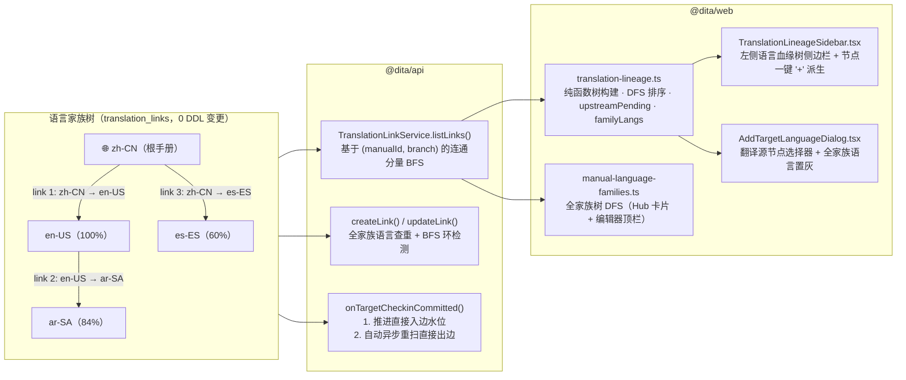

# Phase 16 补充方案：多级翻译血缘（树形 / 分支本地化链路）

> **状态**：✅ 已实现（零数据库 Schema 迁移，全工作区 `build / typecheck / test` 通过）  
> **上游基线**：[phase16-translation.md](./phase16-translation.md)、[phase16-translation-center-ux.md](./phase16-translation-center-ux.md)、[ADR 0001](../adr/0001-manual-as-independent-workspace.md)、[ADR 0004](../adr/0004-baseline-and-draft-overlay.md)、[ADR 0005](../adr/0005-paired-manuals-translation-model.md)  
> **覆盖范围**：`@dita/api` 家族图查询 / 全局语言唯一性校验 / 签入下游自动重扫；`@dita/web` 纯函数血缘树内核、翻译中心左侧语言血缘树侧边栏、任意节点派生弹窗、中间节点解绑预警、Workbench Hub 与编辑器顶栏全树遍历、手册级术语库源手册绑定、全栈中英双语 i18n 与自动化测试

---

## 1. 背景与现状诊断

在跨国技术文档本地化实践中，翻译并不总是单层星型（所有语言都直接从单一源语言翻译），而经常形成**多级翻译血缘树（Directed Acyclic Tree）**，例如：
- 主线链路：`zh-CN → en-US → ar-SA`（中文先译成英文作为中间枢纽语言，再由英文派生阿拉伯语、法语等小语种）；
- 平行分支：`zh-CN → es-ES`（西班牙语直接从中文派生）；
- 且团队需要能在血缘树中的**任意节点**继续派生新的目标语言。

### 1.1 底层模型天然一致（0 数据库迁移）
经代码审计，Phase 16 底层数据模型和执行引擎与多级血缘**完全兼容**，无需修改任何 SQLite 表结构：
- [`apps/api/src/db/schema.ts`](../../apps/api/src/db/schema.ts) 的 `translation_links` 具备两条唯一约束：
  - `UNIQUE(source_manual_id, source_branch, target_lang)`：允许任意节点 1:N 派生多个不同子语言；
  - `UNIQUE(target_manual_id, target_branch)`：保证每个目标版本最多只有 1 个直接父源（天然构成严格树/森林结构，杜绝菱形多父冲突）。
- [`apps/api/src/modules/translation/link-service.ts`](../../apps/api/src/modules/translation/link-service.ts) 已具备全图 BFS 环检测 `findCyclePath()`，且允许将任意已有目标手册再次作为 `sourceManualId` 建链。
- 增量扫描（`sync-service.ts`）、异步翻译队列（`queue-service.ts`）、双语审校与 Phase 13 草稿叠加层（`review-apply-service.ts`）均按单条 `link`（直接父边 → 子边）独立运行，互不干扰。

### 1.2 当前卡点（6 处单层 1-hop 假设）
1. **后端家族查询只查 1 跳**：`TranslationLinkService.listLinks({ manualId })` 仅过滤 `sourceManualId === manualId || targetManualId === manualId`，导致在 `zh-CN` 翻译中心看不到二级链路 `en-US → ar-SA`，而在 `en-US` 翻译中心会将入边与出边混排。
2. **翻译中心顶部栏与添加弹窗写死单层**：[`TranslationCenterPage.tsx`](../../apps/web/src/translation/TranslationCenterPage.tsx) 仅平铺渲染单行胶囊；[`AddTargetLanguageDialog.tsx`](../../apps/web/src/translation/AddTargetLanguageDialog.tsx) 将 `sourceManualId` 写死为当前 URL 的 `manualId`，无法选择从分支节点派生。
3. **Workbench Hub 二级以上语言消失（既有 Bug）**：[`manual-language-families.ts`](../../apps/web/src/workbench/manual-language-families.ts) 隐藏了所有 `targetManualId`，但只收集根手册的直接 1 跳 `outgoing`，导致 `zh-CN → en-US → ar-SA` 中的 `ar-SA` 在首页卡片中彻底不可见。
4. **编辑器顶栏语言切换器同样仅 1 跳**：打开中间节点 `en-US`（同时有入边与出边）时，`buildSessionLanguageEditions()` 会误将 `en-US` 判为根语言 `isBase: true`，丢失真正的根 `zh-CN` 与兄弟分支 `es-ES`。
5. **上游签入未联动下游重扫**：`onTargetCheckinCommitted()` 在 `en-US` Check-in 后仅推进入边 `zh-CN → en-US` 水位，不自动重扫直接下游 `en-US → ar-SA`，前端也没有上游未同步提醒。
6. **手册级术语库作用域偏差**：`TranslationCenterPage` 将 URL 的 `manualId` 传给 `GlossaryWorkspacePanel`，当用户从 `zh-CN` 进入并切换到 `en-US → ar-SA` 时，与后端 `resolveEffectiveGlossary({ manualId: link.sourceManualId })` 不一致。

---

## 2. 已确认核心设计决策（Design Tree 共识清单）

| # | 决策维度 | 确认方案 | 设计理由 |
| :--- | :--- | :--- | :--- |
| **Q1** | **翻译中心视角范围** | **全家族血缘树视角**：无论从根手册 `zh-CN`、中间节点 `en-US` 还是叶子节点 `ar-SA` 进入翻译中心，均展示整棵连通语言家族树的所有翻译链路，并默认选中与当前入口手册最相关的链路 | 消除“必须先切去中间语言编辑器才能管理下级翻译”的割裂感 |
| **Q2** | **翻译中心血缘导航 UI 形态** | **左侧语言血缘树侧边栏（Left Lineage Tree Sidebar）**：移除原有的顶部横向语言条，改为与编辑器工作台一致的「左树右区」主从布局；左侧固定宽度侧边栏以标准可折叠树形结构展示根手册与全部多级子语言，每个节点自带进度、上游待同步标记、快捷「打开编辑器」与一键 `+` 派生子语言按钮，弹窗内也支持自由切换父源节点 | 无论 1 级还是多级深分支（10+ 语言）都能清晰直观呈现完整血缘层级，不拥挤、不折行，且释放右侧主工作区垂直高度，与左侧 DITA Map 树心智完全一致 |
| **Q3** | **语言唯一性约束** | **家族树内每种语言全局唯一**：同一棵血缘家族树中，每个 BCP 47 语言代码（含根语言和所有后代）最多出现一次（禁止 `zh-CN → ar-SA` 与 `en-US → ar-SA` 并存，禁止回译出第二份祖先语言），弹窗自动置灰已占用语言 | 与 Hub 卡片、编辑器语言切换器及“一份手册一种语言一个版本”的心智完全一致 |
| **Q4** | **上游联动与提醒策略** | **签入后自动异步重扫直接下游 + 上游待同步非阻断提醒（绝不自动触发 AI）**：任意节点 Check-in 后后端自动重扫直接出边（立刻更新下游 `outdated` 与进度）；若某链路的祖先链路尚有未同步更新，前端显示非阻断提醒横幅及快捷跳转按钮 | 保持下游状态实时准确，同时避免中间译文未稳定时误消耗 AI Token |
| **Q5** | **中间节点解绑策略** | **允许解绑并显式预警（子树自然独立）**：解除中间边（如 `zh-CN → en-US`）时，确认区显式列出受影响的下游子语言（`ar-SA`），提示解绑后 `en-US` 及其子语言将独立成新家族、所有已译文件完整保留，确认后仅删当前边元数据 | 零数据丢失、不破坏下游 `S0` 增量基线，同时避免误操作引发困惑 |
| **Q6** | **Hub 卡片与编辑器顶栏** | **单卡片折叠整棵家族树 + 轻量血缘层级标识**：Hub 根卡片按 DFS 分支顺序展示全部后代胶囊（二级及以上带 `↳` 前缀与悬停完整路径）；编辑器顶栏下拉以树形缩进展示整棵家族树，根语言唯一标「源」，支持一键跨分支跳转 | 彻底修复二级语言消失与中间节点误判为源语言的 Bug |
| **Q7** | **手册级术语库作用域** | **跟随当前选中链路的直接源手册（`activeLink.sourceManualId`）**：看 `zh-CN → en-US` 维护 `zh-CN` 手册术语库，切到 `en-US → ar-SA` 维护 `en-US` 手册术语库 | 与后端 AI 翻译 / 审校 QA 的 `resolveEffectiveGlossary()` 100% 一致，且解绑子树时术语库自然随 `en-US` 保留 |

---

## 3. 总体架构与数据流



### 3.1 API 行为演进说明
- `GET /api/translation/links?manualId=X`（可选 `&branch=B`）：由「返回 1 跳直接邻接边」升级为「返回 `X` 所在的整棵连通语言家族树的所有边」。
  - 既有单层家族（1 跳）返回值保持完全一致，100% 向后兼容；
  - 多级家族一次请求即可返回所有祖先、兄弟与后代链路；
  - 指定 `branch` 时按 `(manualId, branch)` 连通图隔离，不混入无关分支。

---

## 4. 详细改动清单

### 4.1 后端：家族图遍历、唯一性守卫与签入级联（`apps/api`）

#### [MODIFY] [`apps/api/src/modules/translation/link-service.ts`](../../apps/api/src/modules/translation/link-service.ts)
- 新增纯图算法辅助函数 `collectFamilyLinkRows(allRows, seedManualId, seedBranch?)`：
  - 基于节点键 `(manualId, branch)` 进行无向 BFS 遍历（同时沿入边与出边扩展），返回整个连通分量的全部 `TranslationLinkRow`。
  - 当 `seedBranch` 缺省时，以 `allRows` 中所有涉及 `seedManualId` 的 `(seedManualId, branch)` 作为起点集合。
- 更新 `listLinks({ manualId, branch })`：
  - 传入 `manualId` 时调用 `collectFamilyLinkRows()` 返回全家族链路；
  - 未传 `manualId` 时维持原有全量列出（Hub 卡片使用）。
- 新增 `collectFamilyLanguages(allRows, seedManualId, seedBranch, excludeLinkId?)`：
  - 收集整棵连通家族树已占用的全部规范化语言代码（含根语言及每条边的 `sourceLang` / `targetLang`）。
- 更新 `createLink(input, user, locale)`：
  - 若 `targetLang` 已存在于 `sourceRow` 所属家族树中，抛出 `409 translation.familyLangExists`；
  - 若绑定已有目标手册 `targetManualId`，同时收集 `targetManualId` 已有家族子树的所有语言，校验合并后无重复语言（冲突则抛 `409 translation.familyLangExists`）；
  - 保留原有 `findCyclePath()` BFS 环检测（`409 translation.cycleDetected`）。
- 更新 `updateLink(linkId, patch, user)`：
  - 修改 `targetLang` 时，校验全家族树内无语言冲突；
  - 若该边的 `targetManualId` 存在直接出边（`sourceManualId === row.targetManualId && sourceBranch === nextTargetBranch`），在同一事务中同步更新这些出边的 `sourceLang` 与目标手册的 `sourceLang`，防止上下游语言标签漂移。
- `deleteLink(linkId, user)` 保持非破坏性：仅删当前边的 SQLite 元数据，保留所有下游边及目标手册文件，使下游子树自然独立成新家族。

#### [MODIFY] [`apps/api/src/modules/translation/review-apply-service.ts`](../../apps/api/src/modules/translation/review-apply-service.ts)
- 扩展 `onTargetCheckinCommitted(input)`（同时被 `apps/api/src/index.ts` 的 `phase4.onCheckin` 和 `batchCheckin` 调用）：
  1. **推进直接入边水位（既有逻辑）**：查找 `targetManualId === input.manualId && targetBranch === input.branch` 的入边并推进 `synced` 水位。
  2. **自动重扫直接出边（新增 · Q4）**：移除“无入边即提前返回”的短路，继续查询 `sourceManualId === input.manualId && sourceBranch === input.branch` 的所有直接出边，并逐条防御性执行 `await this.sync.scanLink(outLink.id).catch(() => undefined)`。
  - 效果：根手册 `zh-CN` 或中间节点 `en-US` 通过编辑器或翻译中心批量签入后，直接下游链路立刻刷新 `outdated` 状态与进度百分比；异常隔离绝不影响已完成的 Git 提交，且绝不自动入队 AI 翻译。

#### [MODIFY] [`apps/api/src/i18n/messages.ts`](../../apps/api/src/i18n/messages.ts)
- 在 `zh-CN` 与 `en-US` 词典中同步新增 `translation.familyLangExists`：
  - `zh-CN`：`'当前语言家族中已存在 {lang} 版本，不能重复添加'`
  - `en-US`：`'Language {lang} already exists in this translation family'`

---

### 4.2 前端纯逻辑内核：血缘树构建与 Hub/顶栏全树遍历（`apps/web`）

#### [NEW] `apps/web/src/translation/translation-lineage.ts`
零 React 依赖的纯函数模块，供翻译中心左侧血缘树、添加弹窗、设置页及单元测试复用：
- `buildTranslationLineage({ links, entryManualId, entryManualName?, entrySourceLang?, entryBranch? })` → `TranslationLineageModel`：
  - `roots: TranslationLineageNode[]`（入度为 0 的家族根节点，带环保护兜底）；
  - `nodeByManualId: Map<string, TranslationLineageNode>`；
  - `linkMetaById: Map<string, TranslationLinkLineageMeta>`：
    - `depth`（根的直接子边为 `1`，孙边为 `2`，以此类推）；
    - `pathLangs`（如 `['zh-CN', 'en-US', 'ar-SA']`）；
    - `ancestorLinks`（从根到当前边父级的有序链路列表）；
    - `descendantLinks` / `descendantLangs`（当前边目标节点下的全部后代链路与语言列表，供 Q5 解绑预警使用）；
    - `upstreamPending`（所有 `counts.total > counts.synced` 的祖先链路汇总，供 Q4 上游提醒使用）；
  - `orderedLinks`（按 DFS 顺序排列，同级按 `targetLang` 字母排序）；
  - `familyLangs: Set<string>`（小写规范化后的全家族已占用语言集合，供 Q3 弹窗置灰）；
  - `sourceCandidates: TranslationLineageSourceOption[]`（树中每个可选作父源的节点：`manualId` / `branch` / `lang` / `manualName` / `depth` / `pathLangs` / `progressPercent`）；
  - `maxDepth: number`（`0` 无链路、`1` 单层星型、`>= 2` 多级分支）。
- `pickDefaultActiveLink(links, lineage, entryManualId, requestedLinkId)`：
  - 优先级：① URL 显式 `?link=` → ② 当前入口手册作为 `sourceManualId` 的第一条出边 → ③ 当前入口手册作为 `targetManualId` 的入边 → ④ `lineage.orderedLinks[0]`。

#### [MODIFY] [`apps/web/src/workbench/manual-language-families.ts`](../../apps/web/src/workbench/manual-language-families.ts)
- 为 `ManualLanguageEdition` 增加可选血缘字段：
  ```ts
  depth?: number;          // 0 = 家族根, 1 = 一级译本, 2+ = 多级派生译本
  parentLang?: string | null;
  lineagePath?: string[];  // 例如 ['zh-CN', 'en-US', 'ar-SA']
  ```
- 重构 `groupHubManualsByLanguageFamily(manuals, links)`：
  - 识别入度为 0（或其父源不在列表内）的根手册，对每棵家族树执行**递归 DFS** 收集全部层级后代，填充 `depth`、`parentLang` 与 `lineagePath`，修复二级语言在 Hub 卡片中消失的 Bug。
- 重构 `buildSessionLanguageEditions(input)`：
  - 从当前打开的 `(manualId, branch)` **向上追溯**（带 visited 防环）找到唯一真正的**家族根节点**，再**向下递归 DFS** 展开整棵家族树；
  - 仅真正的家族根节点标 `isBase: true`，精准标出当前打开版本的 `isCurrent: true`，修复中间节点被误判为根语言的问题。

---

### 4.3 翻译中心左侧血缘树、任意节点派生、解绑预警与术语库绑定（`apps/web`）

#### [NEW] `apps/web/src/translation/TranslationLineageSidebar.tsx`
替换 [`TranslationCenterPage.tsx`](../../apps/web/src/translation/TranslationCenterPage.tsx) 中原有的顶部扁平 `links.map(...)` 语言栏，升级为**左侧树状导航侧边栏**，保持现有 `data-testid="translation-link-${id}"` / `data-testid="translation-link-open-editor-${id}"` 兼容，并新增 `data-testid="translation-link-derive-${id}"`：
- **布局与响应式**：
  - 桌面端为左侧固定宽度侧边栏（`w-64 lg:w-[272px] shrink-0 border-r border-slate-200 bg-white`，`sticky top-12 h-[calc(100vh-3rem)]` 独立滚动，不随右侧长表格滚走），窄屏自动回退为顶部紧凑折叠卡片；支持一键折叠/展开侧边栏以专注看大表。
  - 侧边栏头部展示「语言血缘」标题、语言总数角标与折叠按钮；底部提供通栏虚线 `+ 添加目标语言` 按钮（默认从根手册派生，并在弹窗内可切换任意父源）。
- **树状节点结构（`role="tree"` / `aria-label={t('translation.targetLanguages')}`）**：
  - **根节点行（`depth = 0`）**：展示 `🌐 zh-CN` + 「源」徽标与源手册名称，hover/focus 显示快捷「打开源手册编辑器」与 `+` 派生子语言按钮。
  - **多级目标语言节点行（`depth >= 1`）**：
    - 通过逐级缩进与轻量左边框树形引导线（`border-l border-slate-200`）直观表达 `zh-CN → en-US → ar-SA` 与 `zh-CN → es-ES` 的父子与分支关系；
    - 拥有子语言的中间节点左侧带折叠/展开小箭头（默认全展开，一眼看清整棵家族树）；
    - 主选择区（`data-testid="translation-link-${id}"`，`aria-pressed={active}`）：展示目标语言代码、进度百分比徽标（`100%` / `84%`）及微型进度条；若 `upstreamPending.length > 0`，在进度旁显示琥珀色提示点（悬停显示待同步上游详情）；
    - 行尾平级快捷操作按钮（不嵌套在主按钮内，激活行常显、其余行 hover/focus-within 显示）：
      - **打开编辑器**（`Pencil`，`data-testid="translation-link-open-editor-${id}"`，目标手册缺失时禁用）；
      - **派生子语言**（`Plus`，`data-testid="translation-link-derive-${id}"`，`title="基于 {lang} 派生新语言"`），点击直接打开 `AddTargetLanguageDialog` 并预选该节点为翻译来源。

#### [MODIFY] [`apps/web/src/translation/TranslationCenterPage.tsx`](../../apps/web/src/translation/TranslationCenterPage.tsx)
- 使用 `buildTranslationLineage()` 与 `pickDefaultActiveLink()` 驱动页面状态；
- 维护 `addSourceManualId` 状态：从左侧树具体节点点 `+` 时预选该节点，从底部 `+ 添加目标语言` 点开时默认选中家族根节点；
- 移除原有顶部横向目标语言条，在 `links.length > 0` 时改为**左树右区主从布局**：
  - 左侧渲染 `<TranslationLineageSidebar />`；
  - 右侧 `<main>` 顶部渲染单行紧凑的**当前链路血缘面包屑摘要条**（如 `zh-CN → en-US → ar-SA · 目标手册：...` + 快捷「打开编辑器」按钮），确保随时明确当前操作链路；
- 当 `activeLinkMeta.upstreamPending.length > 0` 时，在右侧主工作区上方渲染一条紧凑、非阻断的**上游待同步提示条**（含一键「跳转到上游链路」按钮）；
- 将 `GlossaryWorkspacePanel` 的 `manualId` 改为 `activeLink.sourceManualId`（加 `key={activeLink.sourceManualId}`，落实 Q7）；
- 将 `descendantLangs` 与 `onUnlinked`（重新 `loadLinks({ manualId })`）传入 `TranslationSettingsTab`（落实 Q5）。

#### [MODIFY] [`apps/web/src/translation/AddTargetLanguageDialog.tsx`](../../apps/web/src/translation/AddTargetLanguageDialog.tsx)
- 新增向后兼容的可选 Props：`sourceCandidates`、`defaultSourceManualId`、`familyTakenLangs`；
- 当 `sourceCandidates.length > 1` 时渲染「翻译来源（父版本）」下拉框（`data-testid="translation-add-source"`），按缩进与完整血缘路径列出家族内所有节点；
- 当所选父源为未 100% 完成的中间语言版本时，展示一条温和说明（基于其当前 Git `HEAD` 创建骨架，后续随其签入增量同步）；
- `takenLangs` 基于 `familyTakenLangs` 计算，整棵家族树已占用的语言统一置灰（落实 Q3）；
- 提交时以所选源节点的 `manualId`、`branch`、`lang` 调用 `addLink`。

#### [MODIFY] [`apps/web/src/translation/TranslationSettingsTab.tsx`](../../apps/web/src/translation/TranslationSettingsTab.tsx)
- 接收可选 `descendantLangs` 与 `onUnlinked`；
- 同时展示当前链路的源手册与目标手册名称；
- 解绑确认区中，若 `descendantLangs.length > 0`，渲染醒目的琥珀色预警提示（`data-testid="translation-unlink-downstream-warning"`），明确列出下游子语言并说明子树将拆分为独立家族、文件完整保留；
- 解绑成功后调用 `onUnlinked?.()` 刷新家族链路列表。

#### [MODIFY] [`apps/web/src/store/translation-store.ts`](../../apps/web/src/store/translation-store.ts)
- `batchCheckin` 成功后同步刷新已加载的家族链路（确保后端自动重扫直接下游后的最新进度立刻反映到左侧血缘树）。

---

### 4.4 Hub 卡片、编辑器顶栏与双语词典（`apps/web`）

#### [MODIFY] [`apps/web/src/workbench/ManualCard.tsx`](../../apps/web/src/workbench/ManualCard.tsx)
- 保持 `groupHubManualsByLanguageFamily` 返回的 DFS 血缘顺序（根语言首位 + 分支顺序后代）；
- 对 `depth >= 2` 的后代胶囊显示紧凑 `↳` 前缀，并在 `title` / `aria-label` 中包含完整血缘路径（如 `zh-CN → en-US → ar-SA`）。

#### [MODIFY] [`apps/web/src/components/WorkbenchHeader.tsx`](../../apps/web/src/components/WorkbenchHeader.tsx)
- 下拉语言版本菜单中对 `depth >= 2` 的版本施加轻量层级缩进 + `↳` 标识与 `← {parentLang}` 副标，悬停展示完整路径；
- 版本数量徽标准确统计整棵家族树的所有非根语言版本。

#### [MODIFY] [`apps/web/src/i18n/messages/zh-CN/translation.ts`](../../apps/web/src/i18n/messages/zh-CN/translation.ts) & [`apps/web/src/i18n/messages/en/translation.ts`](../../apps/web/src/i18n/messages/en/translation.ts)
- 成对新增全部血缘 UI、源节点选择、上游提醒、解绑预警及 Hub/顶栏提示文案，严格通过 `i18n-parity.test.ts` 与 `no-hardcoded-cjk.test.ts` 门禁。

---

## 5. 验证与验收方案

### 5.1 自动化测试
1. **后端回归测试**（[`apps/api/test/translation-links-sync.test.ts`](../../apps/api/test/translation-links-sync.test.ts)、[`apps/api/test/translation-review-overlay.test.ts`](../../apps/api/test/translation-review-overlay.test.ts)）：
   - 构建 `zh-CN → en-US → ar-SA` + `zh-CN → es-ES` 多级家族，验证分别用 `zh-CN` / `en-US` / `ar-SA` 查询 `GET /api/translation/links?manualId=...` 均返回完整家族（且带 `branch` 时分支隔离正确）；
   - 验证全家族语言唯一性（`409 translation.familyLangExists`）：拦截跨分支重复语言、回译到根语言、绑定含语言冲突的已有子树；
   - 验证签入联动：在 `en-US` 上经 `POST /api/locks/checkin` 及 `batchCheckin` 签入修改后，入边 `zh-CN → en-US` 推进为 `synced` 且直接出边 `en-US → ar-SA` 自动重扫为 `outdated`（且不创建任何 AI 队列任务）；
   - 验证中间解绑：删除 `zh-CN → en-US` 后，`en-US → ar-SA` 保持完整且成为独立家族。
2. **前端单测与组件测试**（新增 `apps/web/test/translation-lineage.test.ts` + 扩展 [`apps/web/test/phase16-translation-ui.test.tsx`](../../apps/web/test/phase16-translation-ui.test.tsx)）：
   - 纯函数单测：`buildTranslationLineage`、`pickDefaultActiveLink`、`groupHubManualsByLanguageFamily`（验证 `ar-SA` 不再消失）、`buildSessionLanguageEditions`（验证打开中间节点 `en-US` 时根仍唯一为 `zh-CN`）；
   - UI 集成测试：左侧 `TranslationLineageSidebar` 树形渲染（根锚点、多级缩进与折叠展开、进度与上游提示点）、节点 `+` 按钮预选父源、家族语言置灰、上游待同步横幅与跳转、中间节点解绑下游预警、术语库标签页绑定 `activeLink.sourceManualId`。
3. **全工作区门禁**：
   ```bash
   pnpm -r build && pnpm -r typecheck && pnpm -r test
   ```

### 5.2 手工端到端验收
1. 打开翻译中心：确认左侧语言血缘树完整展示根手册 `zh-CN` 与已有目标语言；点击 `en-US` 树节点的 `+` 派生 `ar-SA` 后自动缩进挂载于 `en-US` 下方；再从根 `zh-CN` 派生 `es-ES` 验证多分支树形排布与折叠/展开体验。
2. 在 `en-US` 签入一次修订：确认左侧树中 `ar-SA` 无需手动点扫描即刷新为过时状态与最新进度；在 `zh-CN` 签入修订后切至 `en-US → ar-SA`，确认左侧树出现琥珀色上游提醒点且右侧工作区顶部出现非阻断上游待同步提醒及一键跳转。
3. 切至 `en-US → ar-SA` 的「术语库」页，确认归属 `en-US` 手册术语库；切至 `zh-CN → en-US` 的「设置」页点击解绑，确认出现列出 `ar-SA` 的下游拆离预警。
4. 返回 Workbench Hub 与编辑器顶栏：确认 `zh-CN` 卡片完整列出 `en-US`、`↳ ar-SA`、`es-ES`，且在任意语言编辑器顶栏均可一键跨分支切换并准确标示唯一根语言 `zh-CN`。
