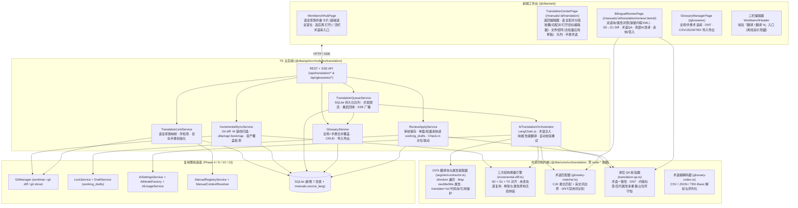
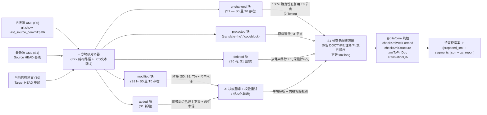
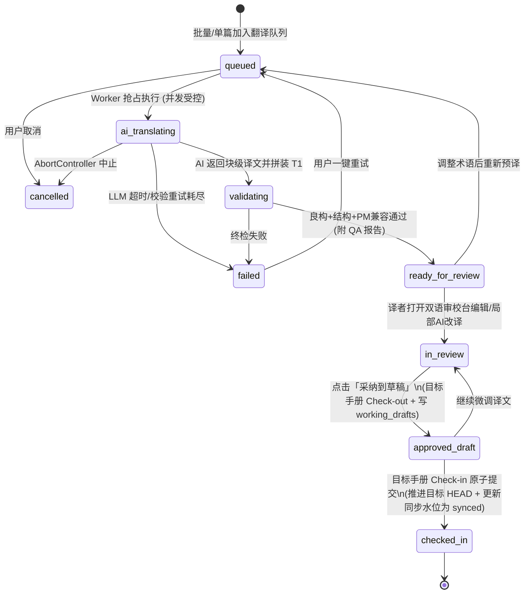

# Phase 16 规划与实施蓝图：多语言翻译、增量同步、术语库与 AI 协同工作台

> **状态**：✅ 已实现（`@dita/core/src/translation/`、`apps/api/src/modules/translation/`、`apps/web/src/translation/`；全工作区 build / typecheck / test 与双语门禁通过）  
> **上游架构基线**：[architecture-and-plan.md](../architecture-and-plan.md)（Phase 0–15 已完成）  
> **关联架构基线与 ADR**：[ADR 0001](../adr/0001-manual-as-independent-workspace.md)、[ADR 0004](../adr/0004-baseline-and-draft-overlay.md)、[ADR 0005](../adr/0005-paired-manuals-translation-model.md)、[versioning-model.md](../design/versioning-model.md)、[ai-contract.md](../design/ai-contract.md)、[workbench-ux-architecture.md](../design/workbench-ux-architecture.md)

---

## 1. 目标、定位与核心架构共识

在 DITAEditor Phase 0–15 基线之上新增 **Phase 16**：构建面向 DITA 1.3 技术文档团队的轻量级多语言翻译与本地化工作台，完整覆盖 **多语言映射**、**增量 Topic 与块级翻译**、**异步翻译队列**、**分层术语库与译后 QA**、**AI 协同预译与双语人工审校闭环**。

Phase 16 严格守住 DITAEditor 四大工程不变量：**标准 DITA XML 无损往返唯一真相源**、**零 XML/Git 元数据污染**、**Phase 13 干净基线与个人草稿叠加层隔离**、**零外部中间件（纯 SQLite + Node 进程内调度）**。

### 1.1 已确认架构决策（Design Tree 共识清单）

| 维度 | Phase 16 确认决策 | 明确不做（Non-Goals） |
| :--- | :--- | :--- |
| **多语言存储与映射拓扑** | **跨手册配对（语言家族）**：每种语言是独立手册与独立 Git 仓库（契合 [ADR 0001](../adr/0001-manual-as-independent-workspace.md)），SQLite `translation_links` 维护「源手册 ↔ 目标语言手册」映射，`translation_file_states` 维护 1:1 同相对路径基线水位；详见 [ADR 0005](../adr/0005-paired-manuals-translation-model.md) | 不把多语言塞入同一仓库的混杂分支或重写全部 `href`/`keyref` 相对路径 |
| **增量翻译粒度** | **Topic 级 Git 追踪 + 元素/块级三方结构增量翻译**：基于 `git diff -M` 识别新增/修改/删除/重命名，并通过 `S0`（上次已译源快照）× `S1`（当前源）× `T0`（当前译文）三方块级对齐，未改动块 100% 确定性直复用已有人工译文，仅增量翻译新增/修改块 | 不粗暴整篇重写冲掉人工润色，也不引入重型外部 TM 检索引擎 |
| **AI 协同与基线隔离** | **AI 队列后台预译入审校暂存态 → 双语对照审校 → 采纳进目标手册 `working_drafts` → Check-in 推进 `HEAD`**：复用既有 LangChain.js 底座（`AiSettingsService` / `AiModelFactory` / `AiUsageService`），严格受目标手册 Check-out 独占锁保护 | 后台 AI 队列永不直接修改共享 `workDir`，也不静默抢占他人独占锁 |
| **异步翻译队列** | **SQLite 两级持久化队列（`translation_jobs` + `translation_items`）+ Node 进程内并发 Worker + SSE 实时流**：支持并发限流、单条/整批取消、仅重试失败项、服务重启自恢复与审校人软指派 | 不引入 Redis / RabbitMQ / BullMQ 等外部消息中间件 |
| **术语库与译后 QA** | **全局术语库 + 手册级术语库覆盖**（含 DNT 禁译词、禁用译法、上下文释义、CSV/JSON/TBX-Basic 导入导出）；翻译前按命中词条动态注入 Prompt，翻译后毫秒级运行术语一致性、DNT、内联标签与引用属性守恒 QA | 第一批切片不强耦合外部 LSP/CAT 的 XLIFF 导出与 `keys.ditamap`/`<glossentry>` 自动抓取（架构层预留 `GlossarySourceExtractor` / `TranslationExchangeAdapter` 扩展口，留作 Phase 16B） |

### 1.2 已落地的 3 项默认策略

1. **目标手册初始化策略**：新建目标语言映射时初始化目标仓库骨架与图片资产，Topic 延后至审校签入时创建（避免源语言正文混入目标基线；可选预览回退开关）。
2. **图片资产同步策略**：仅当目标图缺失或哈希仍等于上次同步的源哈希时自动更新；若译者已手动替换为本地化截图则保留覆盖并仅标提醒。
3. **Map 与 `keys.ditamap` 翻译/复核策略**：翻译 `.ditamap` / `.bookmap` 中的文本子元素（`<title>`、`<navtitle>`、`<searchtitle>`、`<shortdesc>`、`<linktext>`、`<mainbooktitle>`、`<booktitlealt>`、`<booklibrary>` 及 `<keywords>/<keyword>`）以及各导航节点上的 `navtitle="..."` 属性（`<topichead>`、`<topicref>`、`<mapref>`、`<topicset>`、`<chapter>`、`<part>`、`<appendix>` 等）与 `<map>`/`<bookmap>` 根 `title="..."` 属性（锁定 `keys`/`href`/`keyscope`/`format`/`type`/`rev` 与属性顺序），并将含 `<keydef>` 的 `keys.ditamap` 类文件默认标为需人工复核。

---

## 2. 系统总体架构

### 2.1 分层全景图

### 2.2 三方增量翻译算法流（`S0 × S1 × T0 → T1`）

增量翻译的核心目标是：**源 Topic 改动 10% 时，90% 经人工校对的旧译文零改动保留，AI 仅翻译变化的 10%，且最终输出 100% 保持 DITA 1.3 无损往返。**

#### 关键工程护栏
1. **严格基于 `node.nodeType` 常量操作 `slimdom`**（绝不使用 `instanceof slimdom.*`）。
2. **DITA `translate` 继承与默认保护**：遍历维护 `effectiveTranslate`（`translate="no"` 继承关闭，子元素显式 `translate="yes"` 重新开启）；代码块（`codeblock` / `screen` / `msgblock`）与技术标识符（`filepath` / `varname` / `cmdname` / `apiname` / `parmname`）默认保护；`id`/`href`/`keyref`/`conref`/`conkeyref`/条件过滤属性/CALS 跨行列属性严禁 AI 篡改。
3. **结构分叉退化兜底**：若目标译文 `T0` 经人工大改导致 `S0 ↔ T0` 块匹配率 `< 0.5`，自动退化为 `full_with_reference` 模式（整篇携带 `T0` 作为参考译文，并在审校台弹出 `structural_divergence` 提示），绝不静默错位。
4. **空白与元数据变更过滤**：计算可译内容归一化指纹；若 `git diff` 检测到源改动但可译指纹未变，标为 `outdated_metadata_only`，支持一键同步水位免重译。

### 2.3 翻译队列与 Phase 13 签入闭环状态机

---

## 3. 核心模块与接口契约

### 3.1 共享同构翻译内核（`packages/dita-core/src/translation/`，零 `node:*` 导入）

- `types.ts`：`TranslationFileStatus`、`SegmentChangeKind`、`TranslatableSegment`（含可选 `attributeName`）、`AlignedTranslationSegment`、`DeletedTranslationSegment`、`GlossaryEntryForMatch`、`TranslationQaIssue`、`IncrementalTranslationPlan`、`AssembleResult`。
- `segment-extractor.ts`：`extractTranslatableSegments()`、`parseAttributeStructuralPath()`、`findElementByStructuralPath()`、`computeTranslatableDocumentFingerprint()`、`setRootXmlLang()`（基于 `slimdom` + `serializeXml()` 无损保留 prolog 与属性顺序；除 Topic 文本块外，完整支持 `.ditamap` / `.bookmap` 文本元素及各导航节点 `navtitle` 与根 `title` 属性片段，结构路径形式为 `/map[0]/topichead[0]/@navtitle`）。
- `incremental-diff.ts`：`planIncrementalTranslation({ prevSourceXml, currSourceXml, prevTargetXml })`（ID + 属性名 → 结构路径 → LCS 指纹多信号对齐）与 `assembleTranslatedXml()`（以 `S1` 为骨架无损拼装：元素片段替换子节点、属性片段原地 `setAttribute()` 保留属性顺序，并经 `checkXmlWellFormed` / `checkXmlStructure` / Topic `xmlToPmDoc` 终检）。
- `glossary-matcher.ts`：`matchGlossaryTerms()`（CJK 最长匹配 + 拉丁语词边界、`manual > global` 去重覆盖）。
- `translation-qa.ts`：`runTranslationQa()`（术语漏用/禁用词、DNT 守恒、内联标签计数、后代受保护属性按 `(tagName, attrName)` 顺序无关多重集守恒、占位符守恒；排除外层块自身属性避免合法内联片段误报）。
- `glossary-codec.ts`：CSV（RFC 4180）、JSON、TBX-Basic (`.tbx` XML) 双向编解码与导入预检。
- `index.ts`：汇总导出并在 `packages/dita-core/src/index.ts` 重导出。

### 3.2 SQLite 数据模型（`apps/api/src/db/{schema,client}.ts`）

- **扩展现有表**：
  - `manuals` 新增列：`source_lang TEXT`（BCP 47，允许 `NULL` 懒推断）。
  - `ai_usage_logs.task_type` 扩展：新增 `'translate_batch' | 'translate_block' | 'translate_refine'`（同样不落盘文档正文）。
- **新增 7 张表**（沿用纯文本 ID、无强外键约束与幂等 DDL 风格）：
  1. `translation_links`：`id`, `source_manual_id`, `source_branch`, `target_manual_id`, `target_branch`, `source_lang`, `target_lang`, `options_json`, `created_by`, `created_at`, `updated_at`；唯一索引 `(source_manual_id, source_branch, target_lang)` 与 `(target_manual_id, target_branch)`。
  2. `translation_file_states`：`id`, `link_id`, `source_path`, `target_path`, `file_kind`, `status`, `last_source_commit`, `last_source_blob_hash`, `last_source_translatable_hash`, `last_target_commit`, `last_target_blob_hash`, `renamed_from_path`, `localized_asset_override`, `updated_at`；唯一索引 `(link_id, source_path)`。
  3. `translation_jobs`：`id`, `link_id`, `user_id`, `mode`, `status`, `source_commit`, `total_items`, `completed_items`, `failed_items`, `options_json`, `cancel_requested`, `created_at`, `started_at`, `finished_at`。
  4. `translation_items`：`id`, `job_id`, `link_id`, `source_path`, `target_path`, `status`, `mode_used`, `source_commit`, `prev_source_commit`, `reviewer_id`, `proposed_xml`, `segments_json`, `qa_report_json`, `reused_segments`, `translated_segments`, `retry_count`, `error`, `updated_at`；索引 `(job_id, status)`、`(link_id, source_path)`、`(reviewer_id, status)`。
  5. `glossaries`：`id`, `scope` (`'global' | 'manual'`), `manual_id`, `name`, `description`, `source_lang`, `enabled`, `created_by`, `created_at`, `updated_at`。
  6. `glossary_terms`：源词条、同义词、大小写敏感、`do_not_translate`、词性/类别、上下文释义、状态。
  7. `glossary_translations`：按 `(term_id, target_lang)` 唯一存储目标译文、禁用译法列表与备注。

### 3.3 后端服务与路由契约（`apps/api/src/modules/translation/`）

- `link-service.ts`：语言家族创建/绑定、防成环校验、目标仓库初始化、家族进度聚合。
- `sync-service.ts`：基于 `GitManager` 的干净基线 `git diff --name-status -M` 扫描（识别 `.dita` / `.ditamap` / `.bookmap` / `.ditaval` / 图片资产）、可译指纹对比、本地化图片覆盖探测与同步到草稿。
- `glossary-service.ts`：全局+手册分层术语库 CRUD、`resolveEffectiveGlossary()` 与 CSV/JSON/TBX 导入导出。
- `ai-translator.ts`：批内块分组（~6,000 chars/批）、命中术语约束注入、`(S0, S1, T0)` 增量改译 Prompt（对 Map 属性片段显式标注 `attr="navtitle"`/`attr="title"` 并规范化裸 `&` 与误包标签）、`<tblock id>` 结构化解析与 `@dita/core` 自动校验重试、单块交互式 AI 改译（`refineSegment`）。
- `queue-service.ts`：SQLite 队列并发调度（默认并发 `2`，可配 `DITA_TRANSLATION_CONCURRENCY`）、`AbortController` 取消、失败重试、启动重启回收、SSE 广播。
- `review-apply-service.ts`：双语审校数据加载（透出 `attributeName`）与人工保存（整文件保存仅对 `topic` 运行 ProseMirror 探测）、单篇与批量采纳至目标手册 `working_drafts`（`applyToDraft` / `batchApplyDrafts`，逐项严格守 Check-out 锁，他人持锁单篇返 `409`、批量计入 `skippedLocked` 绝不抢锁）、挂载 `apps/api/src/index.ts` 的 `phase4.onCheckin` 回调在目标签入提交后自动推进 `translation_file_states` 水位至 `synced`。
- `routes.ts`：
  - 映射与增量：`GET/POST /api/translation/links`、`PATCH/DELETE /api/translation/links/:linkId`、`POST /api/translation/links/:linkId/{scan,sync-assets,mark-synced,batch-apply-draft,batch-checkin}`、`GET /api/translation/links/:linkId/files`
  - 队列与审校：`POST/GET /api/translation/jobs`、`GET /api/translation/jobs/:id`、`GET /api/translation/jobs/:id/stream`（SSE）、`POST /api/translation/jobs/:id/{cancel,retry-failed}`、`PATCH /api/translation/items/:itemId/assign`、`GET/PUT /api/translation/items/:itemId/review`、`POST /api/translation/items/:itemId/{ai-refine,apply-draft}`
  - 术语库：`GET/POST /api/glossaries`、`PATCH/DELETE /api/glossaries/:id`、`GET/POST /api/glossaries/:id/terms`、`PATCH/DELETE /api/glossaries/terms/:termId`、`POST /api/glossaries/:id/import`、`GET /api/glossaries/:id/export`

### 3.4 前端工作台与双语审校 UI（`apps/web/src/translation/`）

- 路由扩展（`apps/web/src/router/app-router.ts` & `AppShell.tsx`）：新增 `/manuals/:manualId/translation`（翻译中心）、`/manuals/:manualId/translation/review/:itemId`（双语对照审校台）、`/glossaries`（全局术语库管理）。
- `TranslationCenterPage.tsx`：左上角「返回编辑器」直返当前手册编辑器；顶部目标语言配对分段胶囊（左侧点击切换当前配对，右侧「打开编辑器」按钮直达对应目标语言手册编辑器）；四标签视图（增量文件矩阵含「批量应用到目标草稿」与「批量签入」 / 实时 SSE 翻译队列 / 手册术语库 / 映射设置）。
- `BilingualReviewPage.tsx`：三栏双语审校布局——左栏只读源文块（含内联 XML 标签高亮、属性片段 `<topichead @navtitle>` 徽标、`S0→S1` 差异高亮与复用/新增/修改/禁译徽标）、中栏行对齐可编辑译文块（保留内联 XML 片段编辑与未改动块原样透传、属性片段纯文本编辑并保存自动 XML 转义、单块 AI 改译气泡与 `T0 vs T1` 完整 XML 对比切换）、右栏命中术语一键插入与基于实时编辑缓冲的 QA 告警定位面板 + 「保存修订 → 应用到目标草稿 → 签入基线」闭环。
- `GlossaryManagerPage.tsx`：全局术语库管理、DNT/禁用词维护、CSV/JSON/TBX 导入预检与导出。
- 既有入口集成：
  - `WorkbenchHubPage` / `ManualCard`（配合 `workbench/manual-language-families.ts`）：已配对的目标语言手册不再作为独立顶层卡片重复展示，统一折叠进源手册的语言家族卡片；基础语言胶囊（`Globe` 图标）固定首位，其后按语言排序展示目标语言胶囊；单击语言胶囊仅切换选中版本（同步刷新 Topic/Map 统计、分支与最近打开时间），点击底部「进入编辑」才打开所选语言版本；卡片底部不设「翻译」按钮，全局「术语库」入口位于 `HubHeader`。
  - `WorkbenchHeader`（三栏编辑器顶栏）：常规模式下常驻「翻译」/「翻译 N」入口按钮（有配对时显示数量，无配对时仅显示「翻译」，静态离线演示模式隐藏），直达当前手册的翻译中心，遵守 [workbench-ux-architecture.md](../design/workbench-ux-architecture.md) 导航单一流向，且全链路接入中英双语 i18n 与零硬编码中文门禁。

---

## 4. 分阶段垂直切片与验收矩阵

| Stage | 模块范围 | 交付内容与验收标准 |
| :--- | :--- | :--- |
| **Stage 1：同构翻译与术语内核** | `packages/dita-core/src/translation/*` | Topic 块与 Map/Bookmap `navtitle`/`title` 属性提取、DNT 保护、`S0×S1×T0` 三方对齐与无损拼装、`xml:lang` 治理、术语匹配、后代属性多重集 QA 校验、CSV/JSON/TBX 编解码；`packages/dita-core/test/translation-*.test.ts` 全绿 |
| **Stage 2：数据层、多语言映射与增量扫描** | `apps/api/src/db/*` + `link-service` + `sync-service` + `glossary-service` + 路由 | 7 张表建表与迁移、语言家族建链与防环、Git `diff -M` 增量扫描（含 `.bookmap`）与元数据过滤、本地化图片覆盖保护、术语分层合并与导入导出；`translation-links-sync.test.ts` 与 `glossary-routes.test.ts` 全绿 |
| **Stage 3：AI 块级翻译引擎与持久化队列** | `ai-translator` + `queue-service` + `review-apply-service` + `index.ts` 签入联动 | 分批块/属性级翻译 + 校验重试、SQLite 队列并发控制/取消/重启回收/SSE、单篇与批量采纳进 `working_drafts` 锁保护、Check-in 水位联动；`translation-queue-ai.test.ts` 与 `translation-review-overlay.test.ts` 全绿 |
| **Stage 4：前端翻译中心、术语库与双语审校台** | `apps/web/src/translation/*` + 路由 + Hub 语言家族卡片/编辑器常驻入口 + 双语词典 | 翻译中心（返回编辑器、目标语言打开编辑器分段胶囊、批量应用草稿）、队列实时看板、三栏双语审校台（内联 XML 保留与 `@navtitle` 属性标识）、全局/手册术语库、全栈双语门禁；`pnpm -r build && pnpm -r typecheck && pnpm -r test` 全绿（含 `i18n-parity` & `no-hardcoded-cjk`） |
| **Stage 5：端到端验收与文档同步** | `docs/` + `graphify-out/` | 完整双语端到端手工与回归验收（含增量修改单 `<step>` 仅译 1 块、双语独立主题 HTML5/PDF 发布），更新本文档状态与 `graphify update .` |
